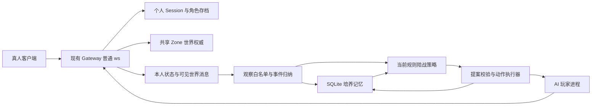

# 比奇阿洛陪战与培养实现方案

日期：2026-11-03。最初设计依据：仓库版本 `4e6a9962fb574c91f4283b0413b7a829f7eac7bd`。
当前主线：Windows EXE 的阿洛 P0 主人入口、可移植身份／成长和体验台账。源码与分项
测试已落地；实际 P0 普通网络通过 12/12，原生窗口部分通过，剩余 GUI 与完整 Gateway
回归仍在验收。历史 B2 的
12/12 陪战、4/4 基础与 Gateway 686 通过／1 项忽略仅证明当时构建，不替代当前范围。

### 当前 P0：原生主人操作、成长可移植、真人试点准备

三个入口已经进入 Windows 原生客户端实现：“伙伴 Companion”面板提供培养／召回、
记忆查看与撤销／删除／清空、完整成长导出与行动／费用记录。当前是规则与模板解释，
没有大模型，也不交付 Web 替代界面。实际 EXE 已通过教学 `v1→v2`、普通邀请组队、
撤销至 `v3`、删除教学正文、再次教学至 `v4` 与完整导出；原生 A→B、成本页和最终
中文调整仍待完成，不能扩大为 GUI 全通过，也不能宣布真人试点已经发生。

最近已通过 Node 163/163、Gateway companion 15/15、PartyHub 15/15、ui-core 52/52
（十项新增）、完整 client-bevy native-ui 391/391（五项新增 ECS）、完整 Windows 平台
325/325（隔离组合资源环境）、Release 构建和 locked check。普通真实网络 P0 12/12
也已通过，包含私有授权、删除／导出、真实 Node A 停止→CLI B 新路径导入及下一场冒险；
报告明确为工程夹具，未发生真人参与、收费或模型调用。完整 Gateway lib 回归、原生
剩余流程及最终构建 hash 待确认。此前窗口验收中间 EXE 为 67,677,696 字节，SHA-256
`16589f6e57ea35e7aada3353bb69d151240241d4a9e825ce6b68efac92683e7c`；
该 hash 不代表后续调整的最终构建。统一证据目录为 `generated/player-qa/alo-experience-2026-11-03/`。

| 对象 | 当前职责 |
| --- | --- |
| `characterArchive` | 一次保存的 archiveId、主人／realm／worldEpoch／游戏角色绑定及基础外观／设定，不随运行目录或 provider 改变 |
| `playerGrowth` | 有来源的经历、教学和习惯、撤销／删除墓碑及已有证据的关系；关系没有来源时为空 |
| `runtimeService` | runtimeId、规则／模型／provider、promptVersion、路径、credentialRef 和运行授权；不进入 portable export |

schema 2 增量迁移保留 schema 1 的 ID、顺序、经历、教学及原策略版本。采用旧库的新
主人／worldEpoch 必须显式执行，不能替换已有主人和世界。归档是完整一致快照，使用
外部可信 HMAC key；最多 2 MiB，超限失败而不截断。只导入全新目标，固定权限由本机
合同重建，游戏资产、预算、待执行动作和在线队伍不从包里恢复。

本机 archive 锁在登录前取得，换 path、runtimeId 或 guardPort 不能绕过；Gateway 再按
实际 owner／actor 账号和角色索引处理 admission 与 generation。私有 owner 请求与回执
不进入普通观察、AOI 或通用调试历史。撤销重算习惯，删除擦除正文副本，源经历删除
不能留下生效教学；已撤销 ID 不复活，清空保留身份与服务器角色。提交后回执失败为
unknown，清空旧导出缓存，不能误报“没有发生”后盲重试。

真人试点手册与空白逐人表见 [ALO-REAL-PLAYER-TRIAL.zh-CN.md](ALO-REAL-PLAYER-TRIAL.zh-CN.md)，
接口见[控制合同](COMPANION-CONTROL-CONTRACT.md)，配置见
[alo-experience.example.json](../apps/ai-player/profiles/alo-experience.example.json)。计划 6–10 位
真实参与者（含非开发者），每人三次约20–30分钟，两周从首位真人实际开始计算。
当前没有由工程夹具证明的回访、付款、续用或盈利，用户未定价，offer:null，购买入口关闭。
台账按参与者跨伙伴累计，当前伙伴选择数另列；意向、运营确认、grant 与实际观察使用
分开，未知费用为 null，估价和支持秒数单列。完整独立生活、LLM、商业与 Sui 合作判断
仍需后续真实证据。

本轮按用户修订的顺序落地：阿洛先用独立普通角色与你组队、跟随、协助打怪、
使用已有血药和危险撤退；再演示“组队先支援、战斗后拾取”的反馈确实改变下次选择，
并在阿洛进程重启后保留。即时 RPG 的真人操作继续沿用现有游戏。

当前实现为独立 Node.js 客户端、确定性陪战执行器与 SQLite 培养记忆，未启用大模型。
能自主谋生、采购、完成任务、形成长期关系的大模型居民仍是后续目标；本文件保留其
设计和边界，但它们不再是当前 B2 的前置条件，也不计为已实现能力。

本功能是产品新增能力，不提高 Crystal 1:1 完整度。全局验收口径继续遵守
[真实性审计](PARITY-TRUTH-AUDIT.md)及[语义台账](CRYSTAL-SEMANTIC-PARITY-LEDGER.md)。

### 2026 年 11 月 3 日 B1 历史验收记录

新增应用 [apps/ai-player](../apps/ai-player/README.md)，无新增 npm 依赖。
普通账号／战士入场、本人及 AOI 观察、走路／转向、附近文字、单实例与退出保存
基础已经实现。诊断走动限于出生点附近，不表示已经有自主狩猎、任务或生存规划。

验证：Node 聚焦测试 35/35，Gateway 当前源码构建成功；真实隔离网络验收通过
双账号入场、双向移动与聊天、控制前缀出网前拒绝，以及注销后新会话位置重载。
实际报告位于 `apps/ai-player/.data/acceptance-6a8811aa-5a05-43a2-91a5-835ab457d0bc/summary.json`，
网关二进制 SHA-256 为
`7d1ef6ba2a40b0dc694768892b8cd786eec7179d43ee9fd2123385dc735bc174`。

当前网关注销后路由租约仍可能等待默认三十秒 TTL，本次验收等待三十一秒再重登，
不声明即时重连已完成。聊天出站不伪造本人确认；两客户端证据使用观察者自己的
ObjectPlayer 对象绑定与真实 `角色名: 内容` 消息。该次 B1 未启用模型或长期记忆，也未进行
生产部署、原生视觉验收或连续运行验收。

### 历史 B2 实现与验证记录

新增 `CompanionController`、纯策略 `companion-policy`、公开客户端地图寻路和
`CompanionStore`。组队使用真实邀请、确认及成员投影；同图身份、HP、交战、物品与
掉落来自普通客户端观察。培养反馈与策略版本在 SQLite 事务中持久化。

该次已通过 Node 测试 108/108、PartyHub 14/14、Web 组队投影 3/3、Gateway
`shared_gateway_` 8/8（含五项药品桥接测试）、当前地图安全区 4/4、Zone 安全区
5/5、`shared_zone` 196/196、Simulation 组队投影 2/2 和安全生命周期 18/18。
最终构建的双客户端陪战网络验收已通过 12/12；同一个二进制的 B1 基础复验通过 4/4。
完整 Gateway lib 回归通过 686 项、失败 0 项、忽略 1 项，共发现 687 项，耗时 590.93 秒。
命令为 `cargo +1.89.0 test --locked -p mir2-gateway --lib --target-dir target-ai-player`。
被忽略的 `channel_identity::tests::postgres_store_is_shared_across_gateway_instances`
需要未配置的 `MIR2_CHANNEL_IDENTITY_TEST_DATABASE_URL`；不把它计为通过。

陪战网络运行时间为 `2026-11-02T20:16:48.159Z` 至 `2026-11-02T20:20:00.803Z`，
最终网关二进制 SHA-256 为
`d8c2bd33ed1ab1acf976bebf42719e9492040cc671b8c67bede5c72c139fe17b`。
脱敏证据已归档：

- [陪战 summary：12/12](generated/player-qa/alo-companion-2026-11-03/summary.json)。
- [同构建 B1 summary：4/4](generated/player-qa/alo-companion-2026-11-03/b1-summary.json)。
- [观察证据摘要](generated/player-qa/alo-companion-2026-11-03/trace-summary.json)：策略版本
  `1→2→2`，最后一个 2 来自不同 Node 进程；原生药品精确 UID 成功消费，真实 HP
  从 `18→11→17→10`，之后阿洛无药自动沿普通路径撤回安全区且存活。
- [源码清单](generated/player-qa/alo-companion-2026-11-03/source-manifest.json)：绑定本次
  44 个源码文件。原始私有报告保留在 `.data/companion-520f03eb-4e9d-47ad-937b-c1bce87ec386/`
  与 `.data/acceptance-c2fe6a23-e159-4648-9852-47daf716f726/`，不提交账号和凭据。
- [验证汇总](generated/player-qa/alo-companion-2026-11-03/verification.json)：记录实际完成的
  Node、Gateway、Simulation、安全与真实网络检查，以及外部数据库测试未运行的限制。

本轮网络脚本使用普通新账号、初始物品与真实时间；培养冲突通过正常丢下、拾取
原生 Candle 制造，不用 QA 赠送、传送、加速 tick、伤害倍率或直接修改 HP。
承伤阶段通过普通 `RemoveItem` 卸下初始布衣，让原版稻草人的伤害能实际扣血，
不改变护甲数值。重登明确等 31 秒路由租约与 16 秒入场 bootstrap grace，
分别记为 `reloginSettleMs` 与 `bootstrapSettleMs`，不宣称即时恢复。
运行、教学和召回命令见 [客户端说明](../apps/ai-player/README.md)。

## 1 首版角色与玩家体验

角色名“阿洛”，职业为战士。账号和角色都通过普通流程创建，使用原版初始
属性、物品、金币、经验、掉落和成长规则。界面应能识别其 AI 居民身份。

| 项目 | 首版约定 |
| --- | --- |
| 活动范围 | 本轮在比奇地图 `0`；`0141` 已列入地图白名单，但室内转场／恢复路线另验 |
| 当前目标 | 与配置的真人队长同图冒险，保命、协助战斗、遵守队伍培养偏好 |
| 初始偏好 | 收集型；本人安全且队长生命已知、足够健康时，可能优先拾取附近允许的掉落 |
| 当前行动 | 接受配置队长的真实邀请、跟随、支援已观察的交战、使用已有血药、撤退、战后拾取 |
| 培养内容 | 组队先支援、战斗后拾取；为捡物离开队伍活动范围时先请求决定 |
| 当前记忆 | 本机主人反馈、策略版本、行动选择和已观察的消费／拾取记录；不回写游戏状态 |
| 后续能力 | 任务、谋生、采割、自动采购、修理、完整恢复、模型规划和长期熟人关系 |
| 暂缓能力 | PvP、玩家交易、赠送资产、公会经营、深层洞穴、世界导演权限、自动创建新任务 |

当前培养改变的是组队行动优先级，不训练模型，也不提高角色战斗属性或消费权限。
教学经已授权 EXE 主人入口或明确的本机运营入口应用；附近玩家的一句话不能修改偏好。教学后的规则与
版本随同一个居民保存，重启不会恢复成初始收集偏好。

首版要出现下面的连续体验：

1. 你通过现有组队面板邀请阿洛；真实成员名单确认后，它跟随你出发。
2. 你先攻击当前可见的怪物，阿洛观察真实命中关系后靠近、协助攻击。
3. 它受到正常伤害后使用自己已有的血药；无药且危险时走普通路径撤退。
4. 安全的战斗／掉落冲突中，初始阿洛可能先捡物；主人在 EXE 伙伴页应用一次“先支援、战后捡”的反馈。
5. 后续同类场景中，它实际先协助战斗，再拾取允许的物品，而不是只在对话中答应。
6. 关闭并重启阿洛的 Node 进程，重新正常登录、受邀入队；下一次冒险仍遵守所教偏好。

历史 B2 的教学与召回入口在本机；当前 P0 的 EXE 伙伴面板已通过部分真实操作，剩余窗口验收尚待完成。
带 `--interactive` 运行时，同一终端的 `teach` 可在线教学，`recall` 召回、`resume`
恢复陪战、`quit` 正常退出；启动参数仍可用于教学或召回。
消费金币授权为 0；药品用完后先保命，不以自动买药或完整独立生活作为本轮验收。

世界或 AI 进程停机期间不补算狩猎、金币、掉落或社交。恢复时允许表达“刚回来”，
不能补写一段没有实际发生的离线生活。

## 2 现有项目可以复用什么

| 现有基础 | 位置 | 使用方式与边界 |
| --- | --- | --- |
| 普通浏览器 WS 协议 | `apps/gateway/src/web.rs`，`BrowserCommand`、`/ws` | 新居民作为普通网络客户端接入；不调用 Rust 内部会话 API |
| 共享世界权威 | `apps/simulation/src/runtime/zone/`、`apps/gateway/src/routing.rs` | 沿用位置、占用、AOI、战斗、掉落和离线存档的现有路由 |
| 玩家观察 | `WorldSnapshot`、`WorldSnapshotClientView`，`apps/simulation/src/config.rs` | 只消费普通客户端消息，再进行模型输入白名单过滤 |
| 真实客户端 Quest Agent | [QUEST-AGENT.md](QUEST-AGENT.md) | 参考其实际导航、补给、恢复和任务动作；保留其 CDP 输入合同 |
| 传输无关策略 | `apps/web/scripts/quest-agent/policy.mjs` | 复用碰撞寻路、目标隔离、补给风险、尸体生命周期、卖物与装备选择等纯函数 |
| 数据驱动路线 | `apps/web/scripts/quest-agent/route-manifest.mjs` | 从当前内容配置生成受限的比奇 NPC、任务、商品和旅行目录 |
| 普通客户端包旅程 | `apps/gateway/tests/vertical_slice_gateway_persistence.rs` | 作为包语义与存档断言参考；直接 tick、内部 snapshot 不进入生产居民 |
| 角色保存与重登 | `apps/gateway/src/routing.rs`、`apps/simulation/src/runtime/save.rs` | 使用既有网关生命周期，不从记忆库回写角色状态 |
| 世界导演提案模式 | [AI-WORLD-DIRECTOR-MVP.zh-CN.md](AI-WORLD-DIRECTOR-MVP.zh-CN.md) | 借鉴严格提案、硬约束、结果回执；不复用管理权限或全局遥测 |

Quest Agent 已有 Warrior Q1–Q9 的分阶段真实客户端证书，详情见
[QUEST-AGENT-ACCEPTANCE.md](QUEST-AGENT-ACCEPTANCE.md)。这证明行为基础存在，
不等于有了大模型居民。其 resume report 中的战斗风险记录也不等于完整社会记忆。

`run-q1-q5.mjs` 是超过九千行、带启动逻辑的验收入口，不直接作为生产库导入。
首轮只导入现有纯策略模块，通过居民自己的观察适配层满足输入合同；需要提取
执行逻辑时逐项提取，并保留原 Quest Agent 的回归测试和输入限制。

## 3 部署与职责

新增独立应用 `apps/ai-player`，沿用项目 `.nvmrc` 的 Node.js `22.18.0` 与 ESM
脚本风格。它不进入 Next.js 请求生命周期，也不在 Simulation crate 增加异步循环。
这是在现有非 eve 技术栈上扩展游戏客户端，不新建另一套 agent 平台。



| 组件 | 职责 |
| --- | --- |
| `ResidentActor` | 单角色事件循环、启动、正常退出与本机单实例；同一时刻一个主要行动 |
| `GatewayClient` | 普通认证、WS 消息、心跳、动作回执与退出；无管理端访问能力 |
| `ObservationReducer` | 从回执和快照还原本人及 AOI 状态，生成有来源的观察事件 |
| `CompanionController` 与 `companion-policy` | 生存、邀请、跟随、支援、拾取与培养优先级；每次执行一个普通动作 |
| `companion-control` | 仅接本机终端的教学、召回、恢复陪战和正常退出；不监听游戏聊天或模型输出 |
| `CompanionRuntimeService` | 承接已授权 Gateway 私有请求、提交后结果、分页与导出分块；运行配置不进入成长包 |
| `ExperienceLedger` | 区分参与者自述、运营确认、实际使用与未知费用，记录同一参与者跨伙伴累计数据 |
| `skills/navigation` | 读取分发给客户端的地图资源，结合可见占用寻路，避开未批准转场 |
| `CompanionStore` | SQLite 保存稳定身份、策略版本、授权反馈与经历，提供完整导出、撤销／删除及墓碑 |
| 后续 `LifeController`、`PlannerAdapter`、`ActionExecutor` | 增加生活目标、模型提案与更多普通技能，沿用本轮权限和回执边界 |
| 后续 `MemoryWorker` | 完整记忆量增加后用独立 worker 持有 SQLite 写连接，增加目标、关系与检索 |

同一档案只允许一个本机运行实例。P0 在登录前按稳定 archiveId 取得本机 archive
guard，换记忆路径、runtimeId 或配置端口不能绕过；历史 B2 的固定环回端口 guard
仍用于兼容运行。Gateway 再用真实账号／角色、admission 与注册 generation 阻止
并发及旧回执。当前不支持另一台主机自动抢占，不能仅凭本机锁声称分布式单写。

## 4 当前陪战如何推进

### 4.1 生存和真实队伍优先

每次策略从最新普通观察选择一个动作。先确认本人存活和健康，再处理已有药品、
召回或危险撤退，最后考虑组队、支援、拾取和站位。培养偏好不能阻止脱险。

| 条件 | 当前规则 |
| --- | --- |
| 本人死亡或 HP 未知 | 等待，停止攻击；自动复活恢复留待后续 |
| HP 不高于 65% 且有可确认的血药 | 按精确 UID、背包／腰带格子使用一份，核对回执和数量；遵守原版逐步回血规则 |
| HP 不高于 35%、不高于 65% 且无药，或同时存在至少两个近身／已确认威胁 | 放弃拾取与攻击，向明确安全目标或远离威胁的方向撤退 |
| 主人召回 | 用普通移动返回配置的安全目标；不能把野外重启位置自动当作安全区 |
| 配置队长邀请 | 只接受真实、未过期的邀请；成员名单同时含本人和队长后才算组队 |
| 支援目标 | 当前 AOI 中活着的怪物，且近期真实 `ObjectStruck` 表明它与本人或队友交战 |
| 队长离开视野、目标消失或地图未经授权 | 等待或取消旧目标；不全图追踪、不继续使用旧对象 ID |

药品结果不确定时隔离该 UID 并核对观察，不连续重放消耗。阈值只是行动选择，
不会修改游戏 HP、伤害、冷却、药品恢复量或掉率。出生初始物品按原版规则领取；
本轮没有“三瓶药才能启动”的门槛，也不新增自动买药、售物或零金币筹资。

### 4.2 教学前后必须有实际行为差异

初始收集型规则仅在本人健康、无即时威胁且队长的已知 HP 不低于 70% 时，考虑
附近允许拾取的掉落。队长健康优先取真实 `GroupMemberInfo`；普通 `ObjectPlayer`
没有 HP 时，不能默认其健康。包满、负重或其他人的掉落锁仍然限制拾取。

主人从 EXE 伙伴面板教学，或运营者在线输入 `teach`／使用明确启动参数后，将以下组队偏好保存为新版本：

- `assistBeforeLoot=true`：有当前确认的支援目标时先支援。
- `lootOnlyAfterCombat=true`：近期交战仍有效时不以拾取打断支援，战斗结束后再捡。
- `askBeforeLeaving=true`：为捡远物离开队伍活动范围时请求主人决定；正常战后两三格
  拾取仍可继续，紧急撤退和返回队长方向不受该软偏好阻止。

普通跟随站位目标为两格，队伍活动范围为六格。当前不会自动批准离队请求，也不主动
解散队伍。独行拾取偏好不变，金币授权仍为 0，教学不能扩大地图或资产权限。
输入相同、仅改变培养版本的测试需显示不同动作；真实网络演示还需证明普通命中、
实际拾取和真正进程重启后的下一场冒险，不能只展示策略 JSON。

### 4.3 后续独立生活与补给计划

陪战培养闭环通过后，再建设“确认自身状态→任务或已知猎场→普通狩猎／采割→
回收收益→返城→售物／买药／修理／换装→记录结果”的持续生活循环。
先验证 Q1–Q4，再解锁 Q5–Q9；任务完成不会重置，也不不断新建角色维持收益。

筹资能力计划单列 `bootstrap/emergencySupply`，不能原样调用受长线模式与 Q23
门槛限制的 `fundHealthPotionsWithSafeHuntIfNeeded`。从无战斗 Q1、已有合格战利品
开始，再研究孤立被动鹿的 Venison 采割与实际售物补药；任务 `DeerMeat` 始终保留。
新角色零金零药、受伤且无药的恢复路线必须另行验证，不无限进行致死筹资试探。

后续常规出猎可试验 80% HP、三份工作药量；无药受限筹资可试验 95% HP、一个
目标与九十秒暴露上限。它们均是后续待测规则，不是本轮已经运行的能力。商人服务、
价格和 NPC 数据库索引／加载对象 ID 必须由真实目录、AOI 与回执确认。

室内 `0141` 的生活转场也留待明确授权与普通门口路径验证；当前陪战导航避开
传送口，不能调用 `transfer_map("crystal:...")` 或 `MoveTo`。

进一步的风险记忆才研究“某猎场两次药耗尽→下次提前准备或换路线”。模型可提出
这种调整，但必须引用真实事件，不能编造经历、增加属性或把一次失败扩大为永久禁入。

## 5 观察范围与普通客户端合同

采用现有生产 `/ws` 的 `type` 标签与 camelCase 消息格式。新居民有自己的普通
客户端合同；旧 Quest Agent 的 CDP-only 证书继续只证明鼠标键盘路径。

| 输入 | 可用于什么 | 必须过滤或限制什么 |
| --- | --- | --- |
| `realmInfo` | 校验显式 realm；P0 policy-enabled 世界还须核对运营者持久配置的 worldEpoch 与 archive 绑定 | 兼容世界未启用 policy 不取得私有归档权限；不据此宣称完整后端重建隔离或跨世界长期身份 |
| `worldSnapshot` | 本人位置、HP/MP、背包、金币、任务、NPC 对话、可见对象、掉落 | 模型使用显式白名单，不展开整个 `stage5Systems` 或内部诊断 |
| `UserLocation` 与移动消息 | 确认权威位置、纠正路径 | 发送成功不代表已经移动 |
| `ObjectPlayer`、`ObjectRemove` 等 | 当前可见对象及生命周期 | 对象 ID 只在当前连接／出现代际内用于执行 |
| `selfZoneObjectId` | 普通快照中的可信本人 Zone ID 绑定，匹配本人命中及掉落归属 | 不从未知攻击者、名字或掉落所有人猜测本人的别名 |
| `GroupInvite`、成员名单与 `GroupMemberInfo` | 真实邀请、当前队伍、可用的队友健康状态 | 待接受邀请不等于组队；已离队、断线或重新上线后不沿用旧成员关系 |
| `ObjectStruck` | 双端当前可见且存活时，记录最多六秒的实际交战关系供支援使用 | `ObjectAttack` 只是动作姿态，不含目标 ID，不能据此猜测支援对象或因果 |
| `ObjectChat` | 将附近言语绑定到当前可见说话者 | 玩家言语属于外部内容，不提供系统指令或身份授权 |
| `NPCGoods` 等服务与实际对话链接 | 选择当前可用商品或交互选项 | 不生成未出现的脚本标签，不推测旧价格仍然有效 |
| 任务 ACK、物品／金币／生命变化 | 判断动作结果和形成经历 | 不把重复包、在场或单独 HP 变化解释为额外奖励或援助因果 |

当前共享投影的对象范围由 `CRYSTAL_OBJECT_DATA_RANGE = 16` 等现有逻辑决定，
不另写一套虚构的 `18×14` 权限范围。模型只见已观察实体和获准的本地常识；
全局遥测、其他账号资料、管理流、完整刷怪表与未观察掉落都不进入个人认知。

静态目录可以告诉执行器“药店在哪里”“哪些任务适合当前职业”，不把每个真实
刷新位置直接变成阿洛的亲历知识。未发现猎场通过普通旅行和观察逐步加入记忆。

### 5.1 公开身份与临时句柄

模型使用短句柄，例如 `actor:a3`、`npc:n2`、`place:p1`、`memory:m8`。
执行器将句柄绑定到当前观察版本及真实对象；过期对象、换图或目标重新出现后
必须重新绑定。模型不直接提供物品 UID、账号 ID、坐标命令或内部 Zone 命令。

`UserItem.unique_id` 是 u64。Node.js 适配层必须无损解析原始 JSON 整数字面量，
使用 `JSON.parse` reviver 的 `context.source` 保留不安全整数，并以 BigInt 或十进制
字符串内部表示；发包用 `JSON.rawJSON` 恢复合法整数字面量。禁止先经普通 Number
转换再恢复。模型只收到物品短句柄，SQLite 中身份值使用 TEXT。

启动兼容检查必须覆盖 `2^53+1` 与 `2^64-1` 的收发往返。当前固定 Node 22.18.0
具备上述 JSON 能力，但这不是现有 Web 客户端已经处理所有 u64 的声明。

### 5.2 动作与网关对应

| 执行技能 | 现有普通消息与确认 |
| --- | --- |
| 上线 | `login`、校验角色列表、`startGame`；无角色时仅在显式首次配置下 `newCharacter` |
| 走到已知地点 | 连续 `walk`／`run`／`turn`；等待权威位移，处理失败纠正和动态占用 |
| 近战 | 本地选择可见目标、靠近、朝向后 `attackDirection`；服务器决定实际攻击结果 |
| 对话 | `interact`，再从实际链接选择 `selectNpcDialog`／必要的 `submitNpcInput` |
| 任务 | 在真实 NPC 服务与当前任务条件成立后 `acceptQuest`／`finishQuest`，使用 requestId 与 ACK |
| 采割与拾取 | `harvest`、`pickUpTile`；验证任务或实际背包／金币结果 |
| 物品与商店 | 按确切 UID 使用／装备／出售／修理，按实际服务商品 `buyItem` |
| 附近交流 | 新增本地 `sayNearby` 技能校验后发送普通 `chat`；模型不能选择频道或提供原始发包内容 |
| 生死与离线 | `townRevive`、`logOut`、`disconnect`；等待结果并由网关保存权威角色状态 |

该表包含后续完整生活需要的动作目录。本轮执行范围为组队、移动、普通近战、
已有药品、拾取与正常退出；任务、采割、商店、自动复活和自动重连仍待接入验证。

未授权通道包括 raw `PasskeyLogin { account_id }`、`MoveTo`、Stage 5、QA/admin、
`crystal:<map>:<x>:<y>`、直接改角色存档以及直接构造 `ZoneCommand`。
这些限制与 `validate_production_player_command` 的现有边界一致。

### 5.3 当前共享队伍、安全区与药品桥接

本轮没有让每个私人 Session 各生成一个替身。Gateway 的单写队伍协调器处理在线
邀请、接受、成员与队长变化和断线清理；`SyncPartyView` 必须绑定实际账号与角色，
普通生产客户端不能提交。该同步只更新个人队伍镜像和 Zone 的 `group_members`
元数据，不推进世界、不应用过期 HP／位置，也不消费待投递世界事件或旧移动 ACK。

真实野外验收发现快路径走路曾保留上一次 `in_safe_zone`。当前由现有地图的配置与
Crystal 安全矩形提供只读范围，Zone 在权威移动、队列消费和内部重定位后重算安全
标志；旧个人投影不能把镇内安全状态带到野外。未配置安全区的旧 checkpoint 形状
保持兼容，不因新字段假定整张地图安全。

原版药品依个人计时逐步恢复，而战斗 HP 由共享 Zone 裁定。桥接按个人计时前后的
正常正向 HP／MP 恢复量，在提交时加到最新活体 Zone 数值并封顶；不把旧的完整
HP 快照覆盖上去。提交期间的实际伤害、死亡和待消费伤害／治疗消息继续有效，
药品不能复活已经死亡的角色，也不能清空或重算待处理消息造成重复恢复。观察者
看到的百分比以这次实际提交的权威值为准。被 Zone 拒绝的恢复量会单独撤销，
使待处理的致死伤害继续触发正常死亡惩罚，且仅一次。相关聚焦测试已通过，
历史 B2 最终二进制的 12/12 普通网络报告已验证吃药、实际回血与无药撤退；该构建
完整 Gateway lib 回归为 686 项通过、1 项外部数据库测试忽略。当前 P0 的完整 Gateway
回归仍待结果，不将历史数量当作本轮通过。

## 6 后续大模型规划边界

本节是后续计划。当前阿洛使用规则陪战和明确的主人反馈，没有调用模型；本轮培养
通过与否由真实行动及重启后的策略决定，不以接入模型作为交付前提。

模型参与选择下一项生活目标、改变计划、组织交谈、整理有证据的经历。普通
走路、冷却、攻击、吃药与追击使用确定性技能，模型超时期间仍可处理危险。

`LifeController` 先根据状态生成当前真正可执行的能力列表。模型只能从列表选择
最多三个有界步骤，例如 `restock`、`hunt`、`meet`、`rest`、`continueQuest`；
每个工具有单独 JSON schema，拒绝额外字段、代码、自由脚本和任意工具名。

一次提案的示例结构如下，字段和工具均为拟新增合同：

```json
{
  "schemaVersion": 1,
  "observationRef": "obs:1042",
  "goalRef": "goal:maintain-supplies",
  "steps": [
    { "skill": "restock", "placeRef": "place:p1", "targetHpPotions": 10 },
    { "skill": "hunt", "fieldRef": "field:f2", "maxKills": 3 }
  ],
  "memoryRefs": ["memory:m8"],
  "reasonCode": "prior_supply_shortfall"
}
```

执行前验证观察仍有效、地图获准、库存和能力满足、承诺没有冲突，且风险／金币
预算可承受。备十瓶是目标，实际购买可因金币不足降到可行数量，再重新评估是否
出猎；模型不能凭提案消耗尚不存在的金币。任务完成、购买或生命恢复由回执确认。

`meet` 只接受已知地点和有限时间窗；短程同行只能跟随当前 AOI 内的对象，
限定在批准地图、最多三分钟，离开视野后先停止或在约定地点等待。它不获得
全地图追踪真人位置的能力，也不接受会让自身持续暴露于危险的承诺。

模型回包最长等十秒，首次接纳提案最长三十秒；这个时限不用于截断已经接纳的
买药、旅行和狩猎。接纳后形成独立活动，默认最长十五分钟，每步按最新状态检查
能力与停止条件。观察引用用于审计，普通位置更新不使整个活动自动失效。

危险、非预期换图、死亡、重连、计划取消都会递增 `planEpoch`，旧模型回包丢弃。
按计划进入 `0141` 等普通换图会暂停当前技能、清除对象句柄并在新观察中重绑定；
验证活动仍可继续后恢复，不能因为正常买药路程超过三十秒而反复调用模型。

后续模型阶段计划提供三种模式：`rules` 验证身体和生存，`shadow` 记录模型提案但不采用，
`live` 让通过校验的提案改变真实目标。最终 AI 居民验收必须包含 `live` 和模型
实际改变行动的证据；纯规则生存通过不算大模型居民完成。

## 7 当前培养记忆与后续完整记忆

记忆库独立于角色财产库。数据库记录“发生了什么、我如何理解、下一步想做什么”，
游戏服务器继续保存真实等级、位置、背包、金币和任务状态。

### 7.1 当前 SQLite 培养存储

`memory/companion-store.mjs` 已使用 Node 内置 `DatabaseSync`、WAL、
`synchronous=FULL` 和显式事务，schema 2 在本机进程中执行有界写入，尚未增加独立
MemoryWorker 或 FTS5 检索。`characterArchive` 使用稳定 archiveId，可信配置核对
owner、realm、worldEpoch、居民与游戏角色绑定；配置或 schema 不匹配时停止，不自动
清空记忆。schema 1 无损迁移，注入可信主人／epoch 需显式采用旧库。

| 当前表 | 内容与边界 |
| --- | --- |
| `companion_state` | 固定绑定、schema、策略版本、独行与组队偏好、不可由教学扩大的权限 |
| `character_archive` | 稳定身份、基础外观／设定与成长修订，不保存运行器配置 |
| `feedback` | 已授权主人反馈、状态、ID、上下文与内容 hash；撤销／删除后同 ID 不复活 |
| `episodes` | 带策略版本的教学、行动选择与观察结果；删除清除正文，保留最小墓碑 |
| `operations` | 幂等操作 ID、类型及输入 hash，不复制被删除的私人文字 |
| `relations` | 仅保存已有来源的关系；没有可信经历时保持空，不从同名认人 |
| `import_receipts` | 精确快照重试凭据；不能用旧包回滚现存成长 |

反馈、策略变更和关联经历在同一事务提交。教学首次将 `policyVersion` 从 1 升到 2；
后续启动或不同目录 B 导入后读取已保存偏好，不需要重教。查看／删除／撤销不以付费
为条件。归档只包含 characterArchive 和 playerGrowth，HMAC key、runtimeService 与
credentialRef 留在运行环境；导出分块最多16KiB、完整包最多2MiB，超限不截断历史。
位置、HP、物品、金币与等级依然从游戏
读取，SQLite 不替代角色存档。当前范围不包括模型反思、自由对话学习、完整事件
归并、所有动作的预写恢复日志或跨世界／跨改名的长期熟人识别。

### 7.2 后续完整数据结构

使用 SQLite WAL、`synchronous=FULL` 与显式事务。Node 22.18.0 的 `node:sqlite`
提供 DatabaseSync；完整记忆阶段计划由独立 worker 串行使用，避免大量同步查询阻塞 WS 生存循环。
该版本 SQLite API 仍为实验状态，应用锁定该 Node 版本，并在升级前运行兼容、
崩溃恢复和备份恢复检查。后续全文检索优先考虑 FTS5，不增加向量库服务。

| 表 | 主要字段与职责 |
| --- | --- |
| `resident_profile` | `resident_id`、绑定世界／本人角色、人格版本、固定参数、schema 版本；凭据只存外部引用 |
| `observed_events` | `event_id`、连接代际、接收序号、发生／观察时间、类型、对象引用、来源、结构化结果 |
| `episodes` | 重要经历、关联事件、地点、相关角色、结果、重要性、可检索摘要 |
| `beliefs` | 有证据的风险／偏好推断、置信度、适用范围、失效时间与反证 |
| `relationships` | 稳定公开角色引用、历史显示名、熟悉程度、信任、最后见面及证据 |
| `commitments` | 约定对象、可执行行为、时间窗、接受／完成／取消／错过状态与来源 |
| `goals` | 长期／当前目标、完成谓词、计划版本、进展与阻塞条件 |
| `action_journal` | 动作意图、发送状态、前后观察、ACK、`confirmed/failed/uncertain` 结果 |
| `decisions` | 使用的观察与记忆版本、结构化提案、校验结果、实际采用与调用用量 |

重要事件入库、关联经历／信念更新、目标变更和消费水位在同一 SQLite 事务提交。
高频位置样本留在有界内存环，长期库保存出猎结果、补给、死亡、对话和承诺等
有意义的事件，避免把每一步走路变成一条长期记忆。

本地事件键使用连接代际和接收序号，数据库对相同键强制唯一。现有 snapshot tick
不是通用服务器事件 ID，也不把“相同内容再次收到”一律判为同一事件。跨重连通过
已确认状态变化、动作记录与对象出现代际对账，不声称网络消息全局 exactly-once；
重复死亡包不能变成新击杀经历，重生后的同对象 ID 也不能永久标为已死亡。

### 7.3 事实与理解分开

| 类型 | 示例 | 规则 |
| --- | --- | --- |
| 观察事实 | “我在药店买到三瓶药，金币减少了实际费用” | 引用回执及本人前后状态 |
| 言语记录 | “某玩家说东边有危险” | 保存为听闻，不能变成已确认世界事实 |
| 个人判断 | “当前装备下，这处猎场耗药较多” | 引用真实出猎结果，可修正、过期 |
| 承诺 | “我答应稍后在比奇等他几分钟” | 接受前检查能力和时间，保存截止条件 |
| 反思摘要 | “最近两次补给不足，我应先备药” | 引用事件或已有信念，不创建新奖励或新经历 |

模型只能提交候选摘要和信念；记忆写入器校验所有来源存在、对象一致、事件
类别与结论相容。聊天内容、模型回复、其他居民讲的故事都不能直接写成事实。
日记只是这些已确认经历的展示，不能反向成为游戏真相。

### 7.4 后续检索与长期保持

每次规划取：当前目标与承诺、最近的重要经历、相同角色／地点的历史，以及
相关风险信念。先按世界和主体过滤，再按相关性、时效、重要性排序，通常最多
十二条记忆。本人当前数值始终来自最新游戏观察。

完整记忆阶段保留重要事件及其摘要，不用纯模型压缩替换全部证据。可以衰减信念权重，
不能删除未完成承诺、当前关系或仍生效信念所依赖的来源。备份必须包含 WAL
的一致性快照，不能只复制一个可能正在写入的 `.sqlite` 文件。

## 8 后续记住真人需要的身份接口

历史 B1／B2 只要求显式 realm 绑定。当前 P0 的 policy-enabled `realmInfo` 已携带
运营者配置并持久保存的 worldEpoch，运行器核对精确绑定；它不能在每次启动时随机
生成。缺少 P0 policy 的兼容世界不因此获得归档控制权限。该方式防止本轮误接不同
epoch 的备份，不等于已为全部世界存档、备份恢复和克隆完成自动代际管理。

后续完整世界经历仍需把 epoch 与各权威存档后端的生命周期集成：普通重启保持、
重建更换，并分别验证备份与克隆语义。不能仅比较内容 hash 就判定是同一个世界。

现有远端玩家主要提供 `objectId + name`，不足以作为跨会话的关系主键。
B5 长期熟人功能再增加服务器生成并持久化的 `publicCharacterRef`：

1. 创建角色时生成不包含账号信息的 UUID；现有角色通过幂等迁移一次分配。
2. 同一角色重连、换图、改名后保持，删号新建获得新的引用；关系键为
   `(realmId, worldEpoch, publicCharacterRef)`。
3. 只随普通 AOI 玩家投影向观察者发送，同时提供服务器判定的 AI 居民标记。
4. 本人和当前可见玩家的临时对象通过该引用绑定；离开 AOI 后删除执行绑定，
   但可保留历史记忆。
5. 缺少可信引用时，只记录当前会话相遇，不凭名字或玩家自述合并旧关系。

建议为 Web `WorldEntitySnapshot` 增加可选字段并增加受限的 WS 身份事件；
原始 Crystal 二进制 `ObjectPlayer` 布局保持兼容。可选字段由服务器身份映射
填充，客户端和模型不得声明自己是谁或授予自己居民身份。

持久化 UUID 需要覆盖角色记录、文件存档、Postgres 序列化、备份恢复与 Zone
入场投影。worldEpoch 也须覆盖各权威存档后端。此项是明确的存档／身份变更，
必须由 frontier 模型牵头实现与复核，
不能只在网关内存中生成随机值后声称跨重启稳定。最终长期熟人验收依赖它完成。

### 8.1 后续可以记住哪些人际经历

可以可靠记录见面、实际对话、约定、自己的拒绝或回应，以及共同在场。
“某人救了我”“某人把这个怪杀死送给我”需要更强因果证据。

当前 HP 增加或 `ObjectDied` 不足以识别施助者，因此不生成这种归因记忆。
本轮 `ObjectStruck` 只证明当前两个对象的一次命中，用于有限视野内的支援选择，
不能单独推导“谁救过我”、整场击杀贡献或长期可信身份。
后续若增加援助记忆，需要一个仅向相关本人发送、带稳定 eventId、actor、recipient
与结果的服务器事件。该能力另列扩展，不为首版深入改动 combat／skills。

聊天可以回忆已确认相遇，并询问对方的计划。涉及往事、财物、援助和承诺的
具体陈述先转换为结构化 speech act，由有效记忆和当前状态填入事实槽位。
自然措辞不能扩大事实。一般闲聊可使用模型，但其内容不进入事实记忆。

`sayNearby` 接收言语意图和文本候选，可信执行器完成措辞拼接后进行最后校验：
拒绝控制字符、换行以及去除首尾空白／规范化后以 `@`、`/`、`!` 或 `:)` 开头的
文本，覆盖 `@ADDSTORAGE`、私聊、喊话、队伍、公会、关系与公告等控制路径；
禁用 `$pos` 替换与物品链接插值，不允许模型指定频道或 linked_items。
玩家请求复述命令、模型引用玩家原话和前置空白都必须经过同一最终出口。
这是实际动作边界，因为 `@ADDSTORAGE` 即便对普通账号也可能执行付费扩仓。

附近聊天默认每二十秒至多一条，对同一人主动搭话至少间隔两分钟；无人回应
便继续自己的活动。社交不打断即时脱险，也不让陌生人的一句话替换全部长期目标。

## 9 进程重启、断线与结果不确定

当前 B2 的重启流程是正常退出保存、关闭真实 Node 进程，再以同一配置开启新进程，
普通 Login／StartGame 后读取游戏状态与 SQLite 偏好。断线离队后需要新的真实邀请；
不能从本地旧 roster 恢复在线组队。自动 resume、完整动作日志及断线自恢复为后续计划。

客户端只在收到可信消息后推进状态。后续 `action_journal` 将在发包前保存意图；
发包到回执之间的任何中断都可能产生 `uncertain`，不能把“写进本地日志”当作
服务器已经完成。

完整恢复能力的计划顺序如下：

1. 校验记忆库、绑定世界和角色身份，取得本机单实例 guard。
2. 建立普通连接；短断线可使用内存里的 `nativeResumeV1` 轮换凭证。
3. Resume 被拒或网关重启后，正常 Login 和 StartGame，等待旧会话释放。
4. 获取当前本人、任务和背包，清除旧对象绑定及路径，校准长期目标完成谓词。
5. 核对未确认动作，确认已经满足的结果；无法判定的保留 uncertain，再做新的计划。
6. 读取相关记忆、未完成承诺和当前目标，继续可执行活动。

原生 resume registry 为进程内状态，不能把 resume 凭证当作跨网关重启的身份。
凭据不落普通日志、模型上下文或记忆库。账号密码由外部运行配置供给，不使用
Quest Agent 测试默认值，也不回退到 demo 账号。

现有任务有 requestId，但普通买卖、拾取等没有通用 exactly-once 协议。当前陪战与后续生活均须遵守：

- 自动恢复移动时按新权威位置重新寻路，不重放旧步数。
- 对购买、出售、使用药品、拾取与任务完成先核对状态，不盲重发。
- 不能从当前状态唯一确定的交易结果，标为 uncertain，放弃该旧动作的重试。
- 本地记忆提交和游戏资产提交不是同一事务，不宣称跨库原子性或 exactly-once。
- 不从历史记忆恢复金币、HP、装备、任务进度或世界掉落。

SQLite 损坏、持续写入失败或 singleton guard 丢失时，中止新的模型计划和经济
动作；保持有限的脱险能力后正常离线，报告具体原因。不能静默清空记忆后假装
是原来的连续居民。

## 10 当前调度与后续模型费用边界

当前陪战每次至多一个在途动作，行动之间约等 650 ms，实际位移和攻击仍由服务器
冷却、占用和回执决定；模型调用量为 0。下表是后续完整生活／模型阶段的配置目标，
需通过实际运行测量再调整：

| 项目 | 初始约束 |
| --- | --- |
| 生存循环 | 每 100–250 ms 检查已收到的状态；发包服从真实服务端节奏 |
| 生活需求更新 | 每 2–5 秒，通常沿用当前活动 |
| 模型规划触发 | 活动结束、任务阶段变化、重要相遇、明显危险变化或持续阻塞 |
| 计划巡视 | 至多每十五分钟检查一次；环境未变时可直接延续，无须调用模型 |
| 反思 | 重要事件累计或一个活动周期完成后，合并调用；无新经历不生成日记 |
| 模型并发 | 每角色最多一个在途请求，取消后以 planEpoch 丢弃旧结果 |
| 所有模型调用总量 | 每小时最多二十四次、每二十四小时最多二百次；包含对话和反思 |
| 单次上下文 | 默认最多六千输入 token、八百输出 token；另设总 token 与费用上限 |

这些调用上限不构成费用估计。`live` 启动前必须配置可用模型、用量计费方式和
每日费用上限，按最大输出预留预算并据实际 usage 对账。超时但用量未知时保留
预留。达到预算或模型不可用后，保留安全生存与已有活动，暂缓新社交和复杂规划。

模型供应商通过 `PlannerAdapter` 接入，首轮可使用录制响应和 mock。项目世界导演
已有模型适配模式可参考，但居民使用独立凭据和预算，不连接审批／Operator API。
本方案不固定未经验证的模型名称，也不在设计阶段发布服务或启用付费调用。

## 11 文件落点与变更边界

当前实现位于 `apps/ai-player`，包含 `main`、`resident-actor`、`gateway-client`、
`lossless-json`、`observation`、`companion-control`、`companion-controller`、`companion-policy`、
`companion-runtime-service`、`archive-guard`、`memory-cli`、`experience-cli`、
`memory/companion-store`、`memory/archive-codec`、`experience/experience-ledger`、
`skills/navigation`、`skills/conversation`、普通 B1 与陪战网络脚本、示例 profile 和对应测试。
完整生活、模型、熟人关系与全文检索仍待实施。

本轮文件落点如下；后续规划模块不得因出现在设计中就记为已有代码。

```text
apps/ai-player/
  package.json
  src/
    main.mjs
    resident-actor.mjs
    gateway-client.mjs
    lossless-json.mjs
    observation.mjs
    companion-control.mjs
    companion-controller.mjs
    companion-policy.mjs
    companion-runtime-service.mjs
    archive-guard.mjs
    memory-cli.mjs
    experience-cli.mjs
    skills/
      navigation.mjs
      conversation.mjs
    memory/
      companion-store.mjs
      archive-codec.mjs
    experience/
      experience-ledger.mjs
  profiles/alo-experience.example.json
  profiles/alo-companion.example.json
  profiles/bichon-warrior.example.json
  tests/
    companion-controller.test.mjs
    companion-policy.test.mjs
    companion-store.test.mjs
    gateway-companion.test.mjs
    navigation.test.mjs
    observation.test.mjs
    ...
  scripts/companion-fixture.mjs
  scripts/local-gateway.mjs
  scripts/run-local-acceptance.mjs
  scripts/run-local-companion-acceptance.mjs
```

后续再按需要增加 `life-controller`、完整 `action-executor`、狩猎／任务／补给技能、
`planner` 与 `memory/worker`、`retrieval`、`reflection` 等模块。

运行配置只保存公开的目标、地图白名单、模型适配选项、预算和凭据引用。
SQLite、备份、凭据、原始私有验收记录放在运行数据目录并排除 Git。
目录从应用／仓库根解析，不固定盘符或用户目录。

B1 主要新增 `apps/ai-player`，读取现有纯策略与内容导出；B2 为真实组队增加 Gateway
内单点协调和受限的会话投影，使用 `MIR2_SHARED_PARTY_ENABLED=1` 显式启用，默认关闭。
它没有用每个个人 Session 中的假人代替共享 Zone，也不放宽服务器移动或战斗碰撞。
跨 Gateway 组队和断线保队尚未实现。P0 已增加显式 worldEpoch 与私有 owner 控制；
完整后端代际和公开身份仍须按实际需要变更存档结构及入场类型，并补存档兼容测试。
高冲突文件每轮保持一名写入者。

## 12 实施顺序与完成条件

| 阶段 | 交付 | 通过条件 |
| --- | --- | --- |
| P0 当前 Windows EXE 主线（网络通过／GUI部分通过） | 原生主人面板、schema2 角色／成长可移植、实际体验及费用台账；规则和模板解释 | 普通真实网络 12/12、Node 163/163、ui-core 52/52、native-ui 391/391、平台 325/325 已过；窗口教学／组队／撤销／删除／再教／完整导出已验；原生 A→B、成本页、中文调整及完整 Gateway lib 仍待完成 |
| 真人小规模试点（待实际开始） | 6–10 人含非开发者，每人三次约20–30分钟，逐人自述、回访、使用与成本记录 | 两周从首位真实参与者开始；无假 visit／reminder／payment／grant；价格未定 offer:null，不认领留存或盈利 |
| B1 普通玩家身体（本地基础通过） | WS 连接、显式唯一 realmId、无损协议、本人／AOI 状态、普通动作、单实例 | 双账号真实网络入场、双向移动聊天、退出和延后重登已验证；即时重连、正式环境与视觉证据另验 |
| B2 阿洛陪战与培养（有界本地工程／网络通过） | 真实组队、跟随、支援普通战斗、已有药品、危险撤退、先支援战后拾取、SQLite 培养记忆与本机在线控制 | 最终二进制普通网络 12/12、同构建 B1 4/4、Node 108/108；Gateway lib 686 项通过、1 项外部数据库测试忽略。真实命中和消费、教后支援及战后拾取、不同进程下一场冒险保留偏好已验证 |
| B3 自己谋生与完整个人记忆（后续） | Q1–Q4 后再 Q5–Q9、独立筹资、补给、室内／死亡／断线恢复、完整后端代际覆盖、完整经历与目标日志 | 真实时间至少三次谋生循环和一次买药；零金零药有恢复路径；世界重建隔离与有证据的风险记忆通过 |
| B4 大模型生活决策 | shadow 对照、live 提案、预算与超时降级 | 至少覆盖“补给／换猎场／履约或拒绝”三类真实模型决策，能追踪到观察和记忆 |
| B5 长期熟人 | 稳定公开身份迁移、相遇记忆、有限承诺、事实约束对话 | 真人换会话和改名后能正确关联；同名新角色不继承关系；无来源往事不能记为事实 |
| B6 连续居民验收 | 独立证据包、可视同图观察、稳定性报告 | 先三十分钟，再六小时，最后七十二小时真实时间运行；结果按本方案逐项报告 |

B2 的交付目标就是可培养的规则陪战角色，不等待后续模型与完整经济任务。
P0 已实现将主人操作接入 Windows EXE，真实网络已通过；当前先完成剩余窗口与回归验收，再实际运行
上述小规模试点；之后逐项建设 B3–B6 的持续居民。
B5 完成前，不能宣称阿洛具备跨改名、删号或世界重建的长期真人识别。
完整独立生活目标以 B3–B6 分别通过为准；七十二小时必须实际经过，不用直接 tick
或虚构游戏日代替。

每阶段先做聚焦测试，命中公共行为变更时运行对应 Quest Agent／Gateway／
Simulation 回归。新增玩家可见字段或行为时，更新玩家 QA 文档并保存真实观察者
截图。设计文档提交不要求重跑整个 Rust／Web 套件。

### 12.1 历史 B2 陪战验收矩阵

该次 12/12 网络报告已覆盖主要陪战旅程，Node 108 项测试覆盖当时异常与权限边界。
当前 P0 原生主人操作、归档和体验台账的真实验收另见本文件顶部及玩家 QA 清单。
离队询问、未知结果等边界以聚焦测试为证据，不把它们写成网络脚本逐项人工验收。

| 场景 | 可检查的结果 |
| --- | --- |
| 真实组队 | 配置队长邀请，阿洛接受；两端同一真实 roster，邀请本身不触发陪战 |
| 跟随 | 普通 Walk 引起权威位移，真人收到阿洛 ObjectWalk；不穿过占用和碰撞 |
| 支援打怪 | 当前可见怪物的 ObjectStruck 绑定真实攻击者／目标；普通攻击和死亡由服务器裁定 |
| 吃药 | 正常承伤后使用已拥有血药；精确 UID 回执成功、实际数量减少，随后依原规则恢复 HP |
| 危险撤退 | 无药受伤、围攻或主人召回后，真实移动远离威胁／回安全目标，不修改 HP 或传送 |
| 培养改变行为 | 安全条件相同的战斗／掉落冲突中，版本 1 可以先收集；反馈后版本 2 先支援，战斗结束再实际拾取 |
| 离队偏好 | 为取远物离开队伍范围时请求决定；普通附近拾取与安全撤退不被错误阻塞 |
| 真正进程重启 | 关闭旧 Node 进程，开启不同进程，普通重登与重新受邀；下一次真实冒险仍用已保存的培养版本 |
| 不确定结果 | 药品、拾取或入队回执不明时不盲重放；AOI 消失、换图、死亡后不复用旧目标 |

### 12.2 后续完整居民验收矩阵

| 场景 | 可检查的结果 |
| --- | --- |
| 真人离线但服务运行 | AI 继续在同一共享世界进行有真实回执的活动，不依赖浏览器保持打开 |
| 真人重新上线 | 能看见同一个角色及真实成长，不额外生成私人世界里的替身 |
| 连续生活 | 首六小时至少三次完整谋生循环，至少一次实际买药；此后每个滚动六小时窗至少一轮真实收益→返城检查→再决策，收益花费与日志可对账 |
| 新角色与补给耗尽 | 分别覆盖零金零药的满血／低血、Q1 后仅一份药、普通肉与任务肉混存；不因三份药门槛永久锁死，也不无限送死 |
| 初期任务 | Q1–Q4 与后续 Q5–Q9 分别出具普通网络路径证据，不借用旧 CDP 证书 |
| 记忆影响行动 | 固定测试前后仅改变已确认经历，验证后续准备／选择的变化，附 live 决策记录 |
| 熟人再次出现 | 跨进程恢复后引用真实相遇；陌生人冒充旧名字不能继承关系 |
| 援助归因 | 只有 HP 增加或共同在场时，拒绝生成“某人救过我”的事实 |
| 掉落与售物 | 不把任务物品当普通肉出售，不拾取服务器拒绝归属的物品，不把重复包计为新收益 |
| 模型异常 | 超时、非法 JSON、过期提案、聊天指令注入、预算耗尽时仍可脱险且不执行任意命令；复述 `@ADDSTORAGE`、大小写、空白和换行不得触发命令或切换频道 |
| 连接与动作中断 | 覆盖买卖前后、发包无 ACK、药品使用、地图变化、旧回复抵达；未知结果不盲重放 |
| 重启与恢复 | 至少三次 AI 进程重启、一次网关重启；保留记忆并重新校准游戏状态 |
| 存储故障 | 模拟磁盘写入失败、损坏／旧版本库和一致备份恢复；不静默丢弃人格或记忆 |
| 完整运行 | 七十二小时记录真实在线时长、死亡、补给、任务、阻塞、模型调用与费用，所有中断显式标注 |

连续二十分钟没有计划进展时触发诊断和重规划；连续六十分钟仍无可执行生活
活动则标记本次连续运行 blocked 并报告原因，不能以心跳在线判为通过。休整需
有结束条件，至少每三十分钟复查；预先记录的维护窗口单独计时，不充当生活时长。
等待有安全意义，但最终验收仍需满足持续活动窗口，不能永久停在休整状态。

确定性故障注入在隔离测试中进行，与真实时间在线证据分开。人工观察重点是
行为连续、熟人关联、选择是否符合经历，以及不交谈时是否仍有自己的活动。
自动测试证明明确合同，不据此宣布生命感或全游戏完成度达标。

## 13 首个可演示结果

你在比奇邀请阿洛，带它走出几步并与一只真实怪物交战。初始阿洛在安全时为了
收集掉落先离开了支援位置。当前 P0 的目标体验是从 EXE 主人面板选择“组队先支援，战斗后拾取”，
它把反馈保存为版本 2，在后续同类场景先支援，打完再实际捡物。

接着观察它承受正常伤害、吃掉自己的原生血药、无药时选择撤退。关闭整个阿洛进程，
重新启动、普通登录与组队；下一次冒险仍遵守上次教会的偏好。真人同图消息和本人的
脱敏观察证明动作发生，不向其他普通玩家开放其私有背包。

历史 B2 已用本机教学和普通网络证明“我教过它，它下一次真的改变，并且重启后仍记得”；
P0 的普通真实网络及部分 EXE 操作已通过，原生 A→B 与成本页等剩余流程仍待窗口证据。完整谋生、模型
自主计划、长期熟人和持续生活随后分别验收，不能提前写进首轮通过结论。

## 14 资料与实现依据

- [Quest Agent 合同与模块](QUEST-AGENT.md)、[已记录的阶段验收](QUEST-AGENT-ACCEPTANCE.md)。
- [玩家命令生产边界](../apps/simulation/src/world_runtime.rs)、[WS 接入及消息](../apps/gateway/src/web.rs)。
- [共享网关路由与保存](../apps/gateway/src/routing.rs)、[客户端快照类型](../apps/simulation/src/config.rs)。
- [纯行为策略](../apps/web/scripts/quest-agent/policy.mjs)、[目录生成](../apps/web/scripts/quest-agent/route-manifest.mjs)。
- [Node.js 22.18.0 SQLite 官方文档](https://nodejs.org/download/release/v22.18.0/docs/api/sqlite.html)：
  用于固定版本的数据库 API 与实验状态；本机已只读验证内存库可建立 FTS5。
- [Generative Agents 论文](https://arxiv.org/abs/2304.03442)：记忆、规划和反思用于可信居民行为的研究参考；
  本项目的权限、身份、资产与恢复设计按现有游戏架构另行实现。
