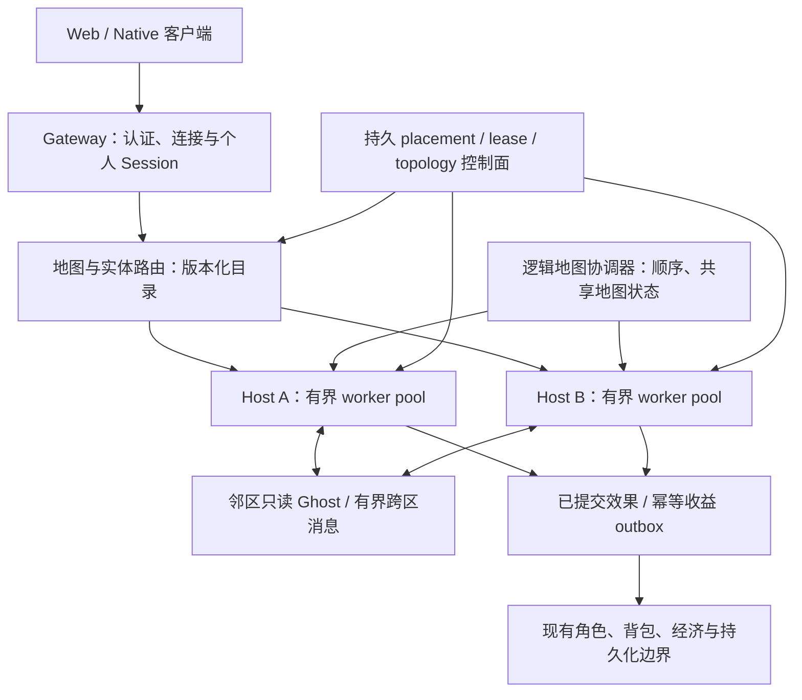

# Rust 服务端 Cell 分区与调度：上线前改造方案

日期：2026-10-24（Asia/Shanghai）。初稿为设计方案；最新实施为 **P1 工程合同通过、P0 容量基线进行中**，P2 尚未启动，见第 13 节。

本方案针对当前 mir2-web3 Rust 服务端，覆盖 Cell 分区、多核与多机调度、开源代码复用、实施顺序及上线验收。保留现有玩法、认证、客户端协议和经济持久化职责，渐进改造共享世界运行时。除第 13 节明确记录的实施范围外，接口、阈值和阶段交付仍是目标设计，不代表已有功能或实测承载。

## 1. 推荐决策与生产门槛

1. 保留 ZoneKey 的 shard / map / channel / instance 逻辑身份，在其内部引入空间 Cell 与运行分区。物理放置不进入账号、角色、掉落及奖励的业务身份。
2. 首版采用**固定整数格基础 Cell + 动态合组的权威分区**。运行时拆分、合并的是基础 Cell 的所有权集合；首版不做任意几何边界或无限四叉树细分。AOI 网格仍是独立查询索引。
3. 每个权威分区严格单写，由有界 worker pool 执行。先显式化原有提交顺序，再开放独立分区写入；不得直接并行调用当前可变 ZoneRuntime 的战斗函数。
4. 同进程与跨进程采用同一命令、事件、快照及迁移合同。首发即使以一地图一分区运行，也必须在上线前实际验证同地图双进程跨 Cell 战斗。
5. 复用已有整 Zone 租约、日志、RPC、复制、主备和 drain 基础；新增 Cell 范围与版本语义。默认不引入新的运行时依赖，SectorSync 先作为隔离适配候选。
6. 将正确性、可恢复性和实测容量设为生产门槛。生产配置中的人数、地图、技能及迁移能力不得超过已验收范围。

推荐按 P0—P8 完成。P6 的自动调度可在首发配置中关闭，但手动拆合、带战斗迁移、双机恢复及完整回归必须跑通。若 P5/P7 尚未完成，只能称单机阶段候选，不能称分布式 Cell 架构已准备就绪。最终 Accepted 仍需要人类客户端玩法验收。

## 2. 本轮核查的现有基础

以下是本轮源码审查结论；引用中的历史测试结果不是当前 checkout 的新验证。

| 当前能力 | 依据 | 可复用范围与新增工作 |
| --- | --- | --- |
| 逻辑地图身份 | [ZoneKey](../apps/simulation/src/runtime/zone/types.rs) | 已有 shard / map / channel / instance；保持含义，另增空间及放置身份 |
| 共享权威运行时 | [ZoneRuntime](../apps/simulation/src/runtime/zone/runtime.rs)、[manager](../apps/simulation/src/runtime/zone/manager.rs) | 已有玩家、怪物、占格、战斗、掉落和计时状态；需要按所有权拆分 |
| 固定 AOI 空间桶 | [aoi_grid](../apps/simulation/src/runtime/zone/aoi_grid.rs)、[aoi](../apps/simulation/src/runtime/zone/aoi.rs) | 可保留查询优化；桶没有独立战斗权威，不能直接当 Cell 运行实例 |
| 多 Zone 多核 tick | [manager](../apps/simulation/src/runtime/zone/manager.rs) | 当前至少四个独立 Zone 时走持久 ComputeTaskPool；单个热图仍需新的内部调度 |
| 地图拓扑与动态分线 | [topology](../apps/gateway/src/topology.rs)、[hotspot](../apps/gateway/src/hotspot.rs) | 支持整地图分组、按地图路由及热门地图增线；分线隔离玩家，空间 Cell 必须保持同一线路内的连续互动 |
| 整 Zone 调度 | [control_plane](../apps/gateway/src/control_plane.rs)、[Gate 6](client/GATE6-ZONE-HOST-SCHEDULER.md) | 当前按人数/Zone 数、容量及 weight 放置，带 failure-domain 优先；不具备完整 CPU、内存、tick、网络负载调度 |
| 远程 RPC、可靠 outbox、复制与提升 | [zone_rpc](../apps/gateway/src/zone_rpc.rs)、[zone_replication](../apps/gateway/src/zone_replication.rs)、[Gate 5.3](client/GATE5-RELIABLE-ZONE-FAILOVER.md) | 复用序列、摘要、readiness、quiesce、重投和日志机制，扩展空间范围及 Cell fencing |
| 地图切换 prepare/commit | [session](../apps/gateway/src/session.rs)、[Gate 5.5](client/GATE5-ATOMIC-ZONE-HANDOFF.md) | 复用事务模式；同地图 Cell crossing 不得重登录、重新 StartGame 或产生一次地图切换 |
| 租约与完整 Zone checkpoint | [zone_lease](../apps/gateway/src/zone_lease.rs)、[checkpoint](../apps/simulation/src/runtime/zone/runtime/checkpoint.rs) | 已有 owner fence 和大量在途状态；新增 Cell 切片、引用闭包及增量重放，不能只复制实体位置 |

当前 control_plane 的 heartbeat 主要是人数、连接数和时间戳；rebalance 主要修复无效 placement，不能据此声称会主动把真实计算负载摊平。现有 host-wide checkpoint 会暂停所有 Zone lane，需要单独测停顿并逐步缩小范围。

现有[容量记录](generated/player-qa/server-capacity-20260929/README.md)仍将 50/100 玩家稳定容量列为未验收。旧[扩展性说明](SCALABILITY-AND-CAPACITY.md)和 Gate 5/6 文档作为历史设计及测试入口，本方案不承接其中的人数或硬件推算为当前能力。

## 3. 目标运行结构

地图协调器只负责必须统一的顺序和地图级状态，不承担所有邻区查询、AI 运算或全部网络广播。它本身的耗时、可用性与恢复也属于容量门槛；若串行提交先成为瓶颈，不能用增加 worker 数掩盖。

| 层级 | 拟定身份/内容 | 不可混淆的含义 |
| --- | --- | --- |
| 逻辑世界 | 原 ZoneKey | 地图、线路、副本与业务身份 |
| 基础 Cell | CellCoord：整数格坐标和固定边长 | 稳定的空间划分；边长从 32/64 格候选实测选择，不能等同 AOI 距离 |
| 权威分区 | PartitionId：一组相连基础 Cell | 一个单写者的可调度、可迁移状态集合；初始可覆盖整张地图 |
| 拓扑版本 | TopologyRevision | Cell 到 Partition 的映射版本，拆合时改变 |
| 放置版本 | PlacementEpoch / OwnerLease | Partition 到 worker/host 的写入资格，迁移时改变 |
| 实体身份 | 逻辑 Zone + 稳定实体 ID | 同地图跨 Cell 不变；玩家生命代次和怪物 incarnation 另行保留 |
| 行为身份 | CommandId / InteractionId / EffectId / MigrationId | 重投与恢复去重；不随物理主机、分区或放置 epoch 改变 |

客户端不需要知道 Cell、worker 或 host。保留当前 object_id 协议；由逻辑地图统一分配或租用不重叠 ID 范围，防止每个 Cell 从相同 next_object_id 开始。任何内部 ID 扩展都须有可逆映射、范围及耗尽检查，禁止截断到现有 u32。

基础 Cell 边长是地图版本化配置，不能在线任意改变而不更新拓扑。首版的 split/merge 以基础 Cell 为最小粒度；一个基础 Cell 内仍然过热时，要优化热点或调整后续分区策略，不能承诺空间切分无限扩容。

## 4. 状态所有权及持久化边界

遵守 [Shared Zone 规则](SHARED-ZONE-MVP-RULES.md)：Session 是个人状态，Zone 是共享世界；simulation 保持同步状态机，网络与持久化 IO 留在外层。

| 状态 | 推荐唯一 owner | 迁移/重建要求 |
| --- | --- | --- |
| 登录、角色选择、连接代次、背包、装备、个人存档 | 原 Session/账户服务及既有事务边界 | Cell crossing 不复制账号 Session，不启动第二个可写背包 |
| 玩家/怪物变换、生命、Buff、冷却、AI 与战斗代次 | 实体当前权威分区 | 完整携带，保留所有业务版本与生命代次 |
| 占格与移动预留 | 目的空间权威，跨界由统一提交协议协调 | 单格只容许一个合法占用者；迁移后由真实实体重建并校验 |
| 飞行物、延迟命中、持续伤害、召唤和地面技能 | 首版由逻辑地图协调器持有唯一 Effect Ledger | 分区只持引用及确认水位；玩家/目标迁移不改变 canonical 效果归属 |
| 掉落、认领、击杀归属与待发奖励 | 真实掉落/死亡决策 owner + 既有经济事务 | 保留 generation、payload digest、收据和发布水位，幂等键不变 |
| 地图逻辑时钟、ID 分配、共享门、全图环境与重生计划 | 逻辑地图协调器 | 独立可重放状态，不能让每个 Cell 各执行一次全图事件 |
| 特殊 Boss encounter、地图级脚本与全局随机流 | 初期保留明确的地图级 owner | 先保持语义；未拆分部分明确计入地图串行预算和适用地图限制 |
| AOI、Ghost、空间索引、ECS 镜像 | 派生只读数据 | 从 canonical 状态重建；不能用 Ghost 恢复成真实实体 |

迁移盘点以当前 CanonicalZoneStateV4 / ZoneRuntimeCheckpoint 为起点，逐字段给出归属、序列化、重建与校验策略。必须覆盖智能宠物待执行操作、移动队列、vital/journey receipts、仇恨与贡献、尸体/重生、弹跳、地面持续效果及未完成拾取事务。遗漏字段的地图/技能不得开启独立 Cell writer。

现有掉落结算身份包含逻辑 ZoneKey、object_id、drop_generation 和 payload_digest。**不要将物理 Cell/host 填入 ZoneKey**，否则同一物品迁移后可能获得新的幂等身份。

随机数结果或随机流状态纳入权威日志及快照。先保持现有调用顺序；不能让线程完成顺序、Cell 编号或迁移次数改变伤害、命中、掉落和重生结果。

## 5. 跨 Cell 移动、AOI 与战斗合同

### 5.1 调度与提交顺序

先把现有 tick 阶段及命令顺序显式化，采用固定的服务器准入 trace、原逻辑时间和稳定序号运行串行参考执行器。trace 记录准入时间、准入序号、计时器驱动和 legacy 阶段/tie-break，不能只重放相同客户端输入而任由服务器重新排序。初期 worker 只并行查询、AI 提案和局部计算，原地图提交器仍按既定顺序更新权威状态。

独立 Cell writer 开启前，必须提供版本化决定批次与提交屏障：即时跨实体动作所需的权威读集、资源预留和目标状态先验证，再按稳定顺序提交。分区只应用属于自己的已提交变更；跨区失败不能形成半次扣费或半次移动。无依赖区域可并行，有相互依赖的战斗组允许暂时共置或串行提交。

首版由带独立地图 owner fence 的 **MapCommitLog** 持久记录跨分区决定。协调器在序列化点重新验证读版本与预留，追加完整 DecisionId、顺序、变更集合及 commit/abort 决定；各参与分区按 DecisionId 幂等应用。所需应用屏障完成前，不公开半批次结果，也不执行依赖它的下一阶段。已 commit 的批次在崩溃后重放补齐，不能各分区自行回滚；未明确 abort 的预留不能仅凭超时释放。simulation 产生待提交提案，由外层 IO 适配持久化后回送可信提交结果，保持同步状态机边界。

保持现有 ready_at_ms、行动冷却、命中延迟和 next_pending_movement_deadline 等语义。调度预算窗口不等于改游戏 tick，也不能把所有动作统一延后到新设的 20 Hz 节拍。网络消息使用逻辑序号和截止时间排序，不能凭不同机器的墙上时钟判定先后。

### 5.2 移动与视野

- 跨界 Walk/Run 验证起点、路径中间格、终点及占用。涉及多个分区时，按固定顺序预留和提交，避免两方同时认为同一格为空。
- 到位提交统一更新实体目录、真实位置、占格和 AOI。失败由当前 owner 返回原协议的位置修正；不得先让客户端看到成功，再补偿一次非法位置。
- 跨界击退、冲刺、传送、死亡复活与地图门使用同一权威边界规则；地图门仍调用现有地图切换合同，同地图 Cell crossing 不调用该流程。
- Ghost/halo 覆盖视野及必要交互范围，并计入移动速度、更新延迟、技能作用范围和快照有效期。远距离全图技能通过显式查询处理，不能假设相邻 3×3 Cell 永远足够。
- Ghost 只提供带版本的观察与查询，不能直接扣血、占格、生成掉落或发奖励；真正结算重新定位到实体当前 owner。
- 可见性按稳定实体身份计算跨区集合并去重；跨界时不能平白触发角色消失/重现。过期观察只影响等待/重查，不能授权写入。

### 5.3 即时与延迟战斗

即时攻击由源 owner 检查准入、动作窗口、资源和目标合法性，必要时取得目标 owner 的权威读集，生成单一有序决定批次。HP、死亡与掉落由目标的唯一 owner 应用；范围技能沿稳定目标顺序处理。是否要求整批原子性遵循原技能语义，不擅自改变。

延迟技能分为两次语义提交：合法施法准入时记录扣费、冷却和 InteractionId；到期效果由唯一 ledger 发往目标当前 owner，按原规则重新验证距离、目标生命代次和其他命中条件。不能为了分布式事务让施法扣费一直锁到箭落地，也不能把正常未命中一律退款。

首版 Effect Ledger 与其到期队列由地图协调器唯一持有，纳入 MapCommitLog/checkpoint；分区快照只携带效果引用、投递/应用水位和已经应用的幂等收据，不能再恢复一份 canonical 到期任务。玩家、施法者或目标跨 Cell 不转移 ledger 所有权。EffectOwnerRef 从 P1 起版本化；若该中央队列成为瓶颈，须在上线前另行完成效果分片 owner/目录/epoch 协议并重跑 P3—P7，不能直接随着实体快照搬走任务。中央排序及效果队列成本单独计量。

内部事件至少包含：逻辑 Zone、稳定行为 ID、源/目标实体及生命代次、源命令序号、accepted/due 时间、效果序号、内容摘要、路由/放置版本。PlacementEpoch 只验证写入资格，不代替 life_generation / incarnation，也不进入稳定收益去重键。

网络采用可重投投递 + 持久去重取得一次业务结算效果，不声称网络天然 exactly-once。幂等记录与 HP/死亡/经济决定必须处于同一可恢复提交边界；去重回收依赖已确认日志/快照水位，不能随意 TTL 删除仍可重放的事件。

宠物、仇恨追击、弹跳、毒/控制、治疗、火墙和 Boss 阶段均必须覆盖。经济副作用使用既有幂等事务与 outbox；Ghost 广播、日志重放及失败重试不能重复发布。

## 6. 迁移、拆合与故障恢复

推荐状态机：**Prepare → QuiesceAtBarrier → SnapshotAndTail → VerifyReady → CommitPlacement → Activate → RetireSource**。

1. 控制面分配 MigrationId，原子预留目标 worker、内存、网络与副本容量，检查 schema、build/data hash 和故障域。
2. 源在明确屏障处理完已准入工作，冻结迁移集合的新写入。只暂停受影响分区/交互组；入口有界排队，超预算明确背压，不静默丢战斗或经济命令。
3. 快照携带本分区拥有的全部 canonical 状态、在途消息/应用水位、收据、随机流、life/incarnation、日志 cursor/digest，以及外部效果引用和依赖闭包；目标重放增量至同一已提交水位。地图 Effect Ledger 的 canonical 到期任务不随分区复制。迁移暂停的时间不能重置 Buff、技能或重生计时器。
4. 目标在 Shadow 状态验证摘要、引用、占格、事件唯一归属和版本，禁止自主 tick、客户包及经济发布。
5. 在既有持久租约权威上扩展 Cell/Partition placement，以 CAS 提交新 owner/epoch 与拓扑映射。目录不能成为仅存在内存中的第二份所有权真相；控制面重启必须可重建。
6. 目标确认提交决定与自身有效 lease 后激活。源拒绝旧 epoch 写入；迟到请求可受控重定位/转发，使用稳定 CommandId 去重并限制转发跳数。
7. 验证路由、发布水位及副本后回收源。split/merge 在同一拓扑事务中更新父/子区域，不能出现双重覆盖或空间空洞。

**提交前失败**：只有确认不存在提交决定、源仍持有效 lease 时，才撤销 Shadow 并恢复源；不确定时等待权威决策，禁止猜测性回滚。

**提交后失败**：从新 epoch 日志向前恢复或提升就绪副本；不能恢复旧 epoch，也不能撤销已发布的奖励。超时不是事务未提交的证明。

正常迁移通过显式交接 CAS，故障接管才依赖 lease 到期/撤销与 readiness。资格校验覆盖实际状态修改、日志和经济副作用发布，不能仅在 Gateway 路由时校验一次。

首版先迁空分区和无交互实体，再覆盖真实战斗、拾取与断线中的完整迁移。临时 pin 的 encounter 必须可观察、可配置并有容量边界；不能把无法迁移的热图隐瞒在动态调度成功率中。

## 7. 多核与多机调度

### 7.1 单机执行

- 使用持久、有界的 worker pool；每个 worker 可运行多个分区，一次只允许一个任务写某分区。避免一 Cell 一永久 OS 线程、无界线程和全图大锁。
- 同主机共享不可变地图碰撞、内容目录和资源，局部状态按 owner 分开。先测调度/缓存成本，再决定线程绑核或 NUMA 策略。
- 使用有界邮箱与工作预算，保留移动截止时间和即时 owner ACK 的优先级，同时为到期伤害与持久化完成回执提供公平预算，防止饿死。
- 同进程传输也走相同 envelope、版本验证和去重语义；可以优化复制次数，不能开一条绕过合同的写入捷径。

### 7.2 多资源放置

在现有 ZoneHostHeartbeat/placement 机制上增加版本化观测：逐 worker CPU 时间、deadline lag、tick 分位数、队列长度/等待、RSS/内存增长、active/ghost 实体数、发送字节/PPS/积压、跨区消息/RTT、副本 lag、快照大小、提交耗时及 checkpoint 停顿。遥测必须带采样窗口和新鲜度。

调度顺序：

1. **硬约束过滤**：健康与 lease、版本/内容一致、worker slot、CPU 预留、迁移内存峰值、网络及持久化余量、replica readiness 与所需故障域。
2. **可行节点评分**：以预计计算与 deadline 负载为主，加入邻区通信量、数据在本机/NUMA 的收益、迁移字节与预计暂停成本；人数只作为辅助指标，rendezvous hash 用于稳定平分。
3. **先做同机平衡，再跨机移动**；保持高交互区域尽量同机。预测收益不能覆盖复制、Ghost、RPC 和暂停成本时，保持 placement。
4. **带迟滞和预算的反馈**：连续多个窗口过载才拆分/迁移，持续低载才合并；目标容量先原子预留，同一地图/host 限制并发迁移。

初始实验参数可采用：5 秒观测窗口、连续 3 窗超预算才触发、拆迁后至少 60 秒冷却、合并前至少 120 秒低负载、每 host 同时迁移 1 个分区。这些不是实测最优值，P0/P6 必须校准并记录；高低水位同时考虑 deadline、CPU、内存和网络，而非只看 CPU 百分比。

迁移峰值预算包括 source active、target shadow、Ghost、快照缓冲、日志尾部和副本同时存在的开销。初期按约 30% 可用 CPU/内存余量做压测起点，最终水位由真实混战及迁移峰值决定，不能以所有资源 100% 满载验收。

### 7.3 网络、存储与部署

Gateway 承担原客户端连接和认证，Cell RPC 仅在可信内部网络开放，继续服务端命令安全策略。新增 RPC 需认证、授权、消息大小/队列上限、版本协商、重放保护和过期 owner 拒绝；客户端不得提交任意 owner、epoch、收益收据或调试命令。

AOI 过滤、必要的增量/批量编码和发送预算与 Cell 调度分别测量。同屏玩家相互可见的广播成本不会因多机自动消失。跨机 Ghost 流量单列，不把内部流量增长当作有效玩家吞吐增长。

热点循环不做阻塞持久化 IO。外层通过有界日志/outbox 完成写入；经济和角色存档保持明确的持久确认边界，不以异步批处理破坏已确认收益。区分日志吞吐、提交延迟、磁盘容量和实例网络/IOPS 配额。

单机可继续使用现有进程部署方式；无需为 Cell 第一阶段强制引入 Kubernetes。多机已有 host/control-plane 基础优先复用；Agones 可作为后续进程编排适配，不承担空间拆合、战斗权威或事务恢复。

## 8. 开源代码复用决定

核查日期为 2026-10-24。固定版本用于可复核研究，不代表最新、安全评估或生产推荐。本轮没有安装依赖、复制外部实现或执行外部代码。

| 来源 | 固定研究版本 | 复用决定 |
| --- | --- | --- |
| SectorSync | v2026.713.0，commit 53211c21d71bfad8a50e40c83eb39f007c2228d5 | Rust、MIT；候选适配器，评估固定 Cell 归属、Ghost、AOI、有界队列及交接原语 |
| MMOKIT | v0.1.0，实际 commit 5ef5523897477850929ef835440e8d4152af47aa | Go、MIT；参考动态拆合、handoff、epoch 和故障测试，默认不引入 Go 运行时或替换 ECS |
| KBEngine Nex | 研究样本 v3.0.7，commit 7439c7a5db34d74698398cfae3982f7e78dd8974 | C++/Python 整引擎；只作架构参考，不复制/链接。样本不是“最新发行”声明 |
| 现有 Rust 依赖及内部实现 | 以实施基线 Cargo.lock 为准 | 优先复用 Bevy task pool、序列化和当前 RPC/租约/日志/存档边界，不同时改造玩法框架 |

SectorSync 的[固定 Cargo 元数据](https://github.com/4fuu/SectorSync/blob/53211c21d71bfad8a50e40c83eb39f007c2228d5/Cargo.toml)要求 Rust ≥1.88、Edition 2024；[固定源码](https://github.com/4fuu/SectorSync/blob/53211c21d71bfad8a50e40c83eb39f007c2228d5/crates/sectorsync-runtime/src/lib.rs)的迁移执行器操作同一 StationSet，管理固定 Cell 的动态归属，不等于已交付跨机器完整战斗迁移。其[集成边界](https://github.com/4fuu/SectorSync/blob/53211c21d71bfad8a50e40c83eb39f007c2228d5/docs/sdk-integration.md)及[生产适配边界](https://github.com/4fuu/SectorSync/blob/53211c21d71bfad8a50e40c83eb39f007c2228d5/docs/production-adapters.md)明确将游戏规则、持久化、恢复和集群基础设施交给应用。采用前确认 MSRV、日历版本兼容及现有工具链，精确 pin 并保留许可证/来源。

MMOKIT 的[固定 README](https://github.com/mmokit/mmokit/blob/5ef5523897477850929ef835440e8d4152af47aa/README.md)和[维护/安全说明](https://github.com/mmokit/mmokit/blob/5ef5523897477850929ef835440e8d4152af47aa/SECURITY.md)显示 pre-1.0、API/wire 兼容限制和维护边界。可参考其算法和测试思路，实际复制 MIT 代码时保留归属和许可；不把 demo 压测或该框架功能表算成本项目验收。

Nex 样本的[源码许可头](https://github.com/KBEngineLab/KBEngine-Nex/blob/7439c7a5db34d74698398cfae3982f7e78dd8974/kbe/src/server/cellappmgr/cellappmgr.cpp)标明 LGPL-3.0-or-later，不能套用到其他仓库/版本。此处不以文档的 Cell/Ghost 术语证明动态空间拆合已生产成熟。

### 500 CCU 路线的基础设施复用边界

2026-10-27补查以下官方资料，仅用于接入边界判断；没有新增依赖、执行外部代码或据此宣称500 CCU容量。版本与许可证仍须在实际采用时固定。

| 组件 | 许可证与官方依据 | 可复用职责及限制 |
| --- | --- | --- |
| Tokio | [MIT](https://github.com/tokio-rs/tokio/blob/master/LICENSE)；[runtime](https://docs.rs/tokio/latest/tokio/runtime/index.html)、[spawn_blocking](https://docs.rs/tokio/latest/tokio/task/fn.spawn_blocking.html) | 保留网络、定时器和异步调度；增加worker不会自动拆开串行Zone，CPU任务仍需限并发 |
| Rayon | [MIT或Apache-2.0](https://github.com/rayon-rs/rayon#license)；[ThreadPoolBuilder](https://docs.rs/rayon/latest/rayon/struct.ThreadPoolBuilder.html) | 若现有task pool不足，可评估固定线程池处理独立或只读快照计算；单写权威及有序提交仍由本项目保证 |
| Agones | [Apache-2.0](https://github.com/agones-dev/agones/blob/main/LICENSE)；[overview](https://agones.dev/site/docs/overview/) | 按需复用Kubernetes游戏服务器进程的分配、健康和扩缩容；不负责Cell边界战斗、AOI或玩家交接 |
| OpenRaft | [MIT或Apache-2.0元数据](https://github.com/databendlabs/openraft/blob/main/Cargo.toml)；[官方接口](https://docs.rs/openraft/latest/openraft/) | 多机故障接管阶段评估Cell节点归属、epoch等控制元数据；应用仍需提供网络、存储、状态机，不将逐次攻击直接变为共识事务 |

优先继续现有Rust/Bevy调度基础，先以串行参考验证固定Cell的单写权威，再开并行；进程编排与控制面共识按多机验收需求接入。上述组件均不能替代第5/6节的epoch/fencing、幂等、裁决顺序、在途效果、边界AOI与恢复合同。分散Cell人数相加只能证明对应部署的总容量；同一热点承载及跨机交接另行实测。

### SectorSync PoC 的晋级与退出条件

对比原生实现与适配器，至少检查：实体 ID 双向映射、逻辑地图隔离、整数格坐标精度、逻辑时间与顺序、Ghost 只读、完整组件及在途效果交接、部分提交恢复、有界背压、CPU/内存/编码额外成本。

只有通过串行参考对照、双 worker 边界战斗、迁移与死亡/掉落/断线并发及实测成本检查，才另立 ADR 晋级正式依赖。需要第二份可写 ECS、丢失待结算状态、改变占格/命中/收益、ID 截断、无界缓冲或恢复依赖盲重试，任一出现即退出该适配器，继续原生合同实现。避免形成只有某个库能理解的生产存档。

## 9. 实施顺序与阶段交付

初稿交付时全部阶段为 **not_run**，这是方案历史起点。2026-10-24 最新实施为 **P1 工程合同通过、P0 容量基线进行中**，P2—P8 仍为 not_run；第 13 节及主题证据记录实际范围，下面的交付和晋级门槛仍完整保留。阶段之间以证据门槛推进；并行任务必须有不重叠写集，runtime.rs、routing.rs 等高冲突模块每轮只有一个写入者。

| 阶段 | 改造与交付 | 进入下一阶段的门槛 |
| --- | --- | --- |
| P0：基线与容量规格 | 固定源码/工具链/内容/配置，复核已有多人战斗、保存和容量脚本；建立原串行参考执行、指标及测试负载清单 | 普通双客户端完整战斗闭环有证据；已知旧失败保留；目标人数、热点密度、延迟与故障范围明确登记 |
| P1：身份与合同 | 逻辑 Zone/Cell/Partition/epoch、稳定行为 ID、目录、快照版本、状态所有权清单；一地图一分区兼容实现 | 旧存档加载、单分区行为和协议无回归；掉落及生命代次身份不变；新增接口均有明确 owner |
| P2：固定 Cell 串行模式 | 地图内部划分、跨区查询/Ghost、显式 tick 阶段、完整快照切片；仍单提交器 | 不同 Cell 布局下权威结果、随机序列、事件和经济收据与参考执行一致；不能据此宣称多核提速 |
| P3：跨界语义与进程内交接 | 移动预留、即时决定批次、延迟 Effect Ledger、dedupe、手动 split/merge；可并行做 SectorSync 隔离 PoC | 所有本轮启用的技能/怪物/掉落/存档场景通过；迁移各阶段失败不会产生半次效果；选型 ADR 有明确结论 |
| P4：多核 worker | 有界 pool/mailbox、deadline 公平调度；逐步将通过合同的分区变为单写 worker，独立区域并行 | 1/2/4/8 worker 对照结果一致；可分散负载有可测收益，无队列/内存失控和新的全图长锁 |
| P5：多机固定分区 | 扩展既有 RPC、Cell lease/目录、快照与日志尾、Shadow/commit/activate；保留原客户端连接 | 同地图双 host、双真实客户端跨区完整战斗；迁移时不重登录、不换实体 ID、不产生重复结算 |
| P6：动态合组调度 | 多资源 telemetry、目标预留、迟滞/冷却、自动 split/merge/migrate、邻区亲和性、人工 pin | 人群聚散与边界战斗持续压测；自动调度收益覆盖其成本，无迁移抖动；最小 Cell/不可迁移地图限制有公开记录 |
| P7：恢复与容量定型 | 持久提交、复制/readiness、故障域、故障注入、长稳、升级/降级快照兼容 | 满足第 11 节正确性、性能、恢复和资源门槛；生产规格与最大已通过负载一致 |
| P8：发布与实机接受 | 配对版本、演练、分级启用、指标告警、drain、回退流程及运维说明 | 发布工程门禁完成；人类原生/Web 多客户端玩法接受后才标 Accepted |

P0/P1 完成前不启动全面搬迁战斗代码。P2 与 OSS 资料核查可并行；P3—P5 的 simulation writer、gateway writer 和只读 QA 可以按模块分工。每阶段保持单分区模式可运行，不把依赖升级、ECS 全面重写或原玩法规则调整混入架构改造。

## 10. 预计模块边界

以下是拟定位置，实施时可按现有模块规模调整，不表示文件已经创建。

| 模块 | 推荐改动 |
| --- | --- |
| simulation runtime/zone/cell/ | 新增 types、partition、directory、protocol、ghost、movement_reservation、effects、migration、checkpoint、scheduler 等有界模块 |
| simulation runtime/zone/{manager,runtime,types}.rs | 分阶段抽出状态 owner 与调度接口，保留原串行兼容路径；避免复制一份完整 ZoneRuntime 给每个 Cell |
| simulation runtime/zone/runtime/{checkpoint,entity_combat}.rs 及相关技能/移动实现 | 显式生命代次、效果身份与迁移合同；旧规则作为对照，不顺带重写伤害公式 |
| gateway 新 cell_directory / cell_placement / cell_migration 模块 | 控制面和 IO 适配，扩展原 ZoneId 路由层；避免继续把新增代码全部放进 routing.rs |
| gateway zone_rpc / zone_lease / zone_replication / control_plane / topology | 版本化 Cell 范围、telemetry、lease、日志/readiness 与迁移协调；复用安全及 drain 策略 |
| Session、inventory、save 与经济 owner | 只增加可信权威结果/幂等收据接入和最终状态屏障；保持原职责 |
| simulation tests/cell_*；gateway tests/cell_*；现有 Web/native smoke | 串行对照、跨界、故障、协议与真实客户端验收，分别记录，不能互相替代 |

## 11. 验收标准

### 11.1 先固定容量规格

P0 为每个验收 profile 登记：commit/build/data hash、OS/架构、物理核/vCPU、内存限制、磁盘与数据库、持续网络/PPS 配额、主机间 RTT、TLS、是否同一故障域、调度预算 B、活跃人数 N、热点可见实体数、技能/怪物/宠物组合、操作频率、持续时间及生产 admission 上限。

2026-10-27 用户将最高目标明确为 **500 CCU**。原 P0 的 2 / 10 / 25 / 50 / 100 普通活跃账号基线仍需完成；固定 Cell、多核和多机阶段继续按 **250 / 500** 扩展，500 不是启动 P2 前必须先由旧串行架构达到的条件。每档先完成原 300 秒窗口，最终目标档至少 7200 秒长稳、断线恢复与保存验收；已有失败不追认。默认旧 profile 及其 100 人上限保留，新 500 目标必须显式选择。

用户随后明确最终目标为 **500 人在线，500 人全部持续战斗**；此前“500 在线、50 人战斗”的工程假设撤销。总在线、同地图、同屏可见人数及持续战斗人数分别记录；新 500 profile 必须按 100% 战斗者冻结怪物/玩家目标供给、持续补给、热点布局、技能组合及资源上限。原 100 人 P0 profile 保持原样，作为原有对照门禁，其结果不能证明 500 人全部战斗。分散负载与同屏热点各自验收，扩大地图区域不能替代热点测试。空连接、短时峰值和修改后的测试门槛均不能代替稳定战斗容量。

具体负载、逐人分钟门槛、恢复/保存边界、供给、现有工具缺口及实施阶梯见[500人全部持续战斗验收合同](CELL-500-COMBAT-ACCEPTANCE.zh-CN.md)。纯policy仍保留旧500/50配置及历史报告解析，实际runCapacity已在任何资源/认证操作前阻断显式500执行，等待全战斗合同完整实现；原100路径保持。不得只放宽人数参数便声称已支持500全战斗。

容量准备采用可追溯的独立阶段：普通角色通过狩猎、拾取、售卖和购买取得补给，再按明确 cohort 屏障进入原测量；不得注入金币/物品或自动复活。准备时间、命令、生命、库存及金币变化独立留证，不计作完成了测量窗口。旧 held-only 场景与新的 ordinary-economic-v1 准备场景分开记录，保留原动作预算和验收门槛；单次备药数量不能直接证明两小时可持续。实现与实际结果集中在[补给及 500 目标主题](generated/cell-p0-p1-completion-20261024/capacity-ordinary-economic-v1/README.md)。

### 11.2 正确性硬门槛

| 类别 | 必测场景 | 通过条件 |
| --- | --- | --- |
| 参考执行 | 固定服务器准入 trace、逻辑时钟/阶段/随机流，单区、多 Cell、不同 worker 顺序和迁移时点 | 在相同已提交水位比较 canonical 状态、在途效果及收据；摘要排除物理放置但包含所有业务状态 |
| 占格/移动 | 相向跨界、同格争用、Run 中间格、击退、瞬移、门、跨界断线 | 零双重 owner/非法占格；最终位置与保存一致，失败修正语义保留 |
| AOI | 双向跨界、隐身/死亡/复活、迟到观察者、宠物/怪物追击 | 无永久 Ghost、重影、重复实体或漏观察；无需重新 StartGame |
| 战斗 | 普攻、远程、弹跳、AoE、DOT/控制、治疗、召唤、火墙、怪物/特殊 Boss | 在准入前后、命中到期前后、死亡/复活前后迁移仍符合原规则；零重复伤害/扣费/奖励 |
| 经济与存档 | 双人击杀、归属窗口、并发拾取、背包失败、认领中迁移、断线重登 | 每个奖励/物品只有一次合法结算；失败不吞物、不复制；最终角色及共享状态一致 |
| 消息与权限 | 重复/乱序/丢包、重试、旧 socket/lease、伪造内部包、版本不符 | 旧写入被拒，幂等命中可观测，未认证/非 owner 不得产生副作用 |

至少两套真实图形客户端完成互见、共同打怪至击杀、掉落/经验/拾取、PK、死亡复活、跨界追击及保存重登；Web、原生及两台实机分别标明实际覆盖。协议机器人与截图证据均不得冒充另一类结果。

参考执行对照检验同一服务器准入历史下的确定性。真实网络测试另检验因果、时序、延迟和业务不变量，不要求不同网络到达顺序的独立运行产生完全相同战斗结果；不得以“规范化”删除真实业务差异。

### 11.3 性能与资源目标（拟定，P0 校准后冻结）

- Cell 热路径工作预算为 B；初始以 B=50 ms 的实验 profile 测量，p99 执行耗时 ≤0.7B、p99.9 ≤B，持续超预算比例 <0.1%。B 是调度测量预算，不改原动作/技能时序。
- 普通即时命令从服务端入口到权威 outbound 的 p99 ≤150 ms；原定延迟技能另测到期后处理迟延，不能把正常施法/弹道时间算作架构延迟。跨区相对同区的额外 p99 ≤B。
- 可分散负载中，两台等配主机的稳定承载目标至少为单台的 1.5 倍，仍满足延迟门槛；这是扩展性目标，不适用于所有玩家重叠的极端热点，也不是已有结果。1/2/4/8 worker 都报告收益、调度和编码成本。
- 通过目标 N 的至少 2 小时移动/混合战斗/动态迁移长稳，再做 24 小时候选 soak。队列不持续增长；内存 warm-up 后无持续增长趋势，默认复核既有 32 MiB/小时趋势门槛，周期快照/allocator 缓存须能解释并回落。
- 记录逐核 CPU、deadline lag、active/ghost/replica 内存、迁移峰值、出站字节/PPS/重传、跨 Cell 流量、数据库提交、日志积压和检查点暂停。CPU/RAM/网络/磁盘各自达到瓶颈时给出诊断，不用平均 CPU 低推断“还有容量”。
- 生产上限保留实测突发与故障余量，不能把 admission 配置直接设为短时极限。慢客户端、复制落后和存储变慢需有背压/拒绝策略，不能无限缓存。

### 11.4 恢复与故障目标

迁移的每个阶段注入源、目标和迁移协调器崩溃；另在活跃跨区战斗中杀死/恢复逻辑地图协调器与 ID 分配器，核对 MapCommitLog 决定、提交/应用水位、阶段进度、Effect Ledger、随机流及 ID 租用范围不丢失或复用。活跃 Cell 不能自行产生第二个地图协调器权威。

另测单向网络分区、复制落后、旧 owner 复活、数据库不可用、磁盘满和断线重连，包括 Gateway 连接正常而 Cell 间消息延迟/丢失。屏障不得无限等待、队列必须有界；已 commit 的决定向前补齐，旧 fence 不能修改状态或发布收益。

拟定正常迁移可见额外停顿 p99 ≤2B；同可用区单 host 故障的恢复目标 RTO ≤10 秒，并公布 heartbeat/lease/检测、重放、重绑各段耗时。达不到时不能单独调大隐藏超时标为通过。

对**已持久确认**的经济、角色及提交决定要求 RPO=0。ACK 必须区分网络接收、准入与持久提交；日志仅写本机磁盘不能证明整机损坏时的 RPO=0。多机 profile 需要不同故障域的持久副本/数据库确认及恢复水位证据。瞬态世界、未提交动作和已播放效果的恢复窗口必须在 P0 写明并实测；未定义窗口或把未复制的成功应答当作持久确认，均不通过生产门禁。

控制面主节点重启要能从持久 placement/epoch 恢复，防止两个调度器同时分配 owner。控制面不可用时暂停新迁移；既有分区只有在 lease 仍有效时继续服务。单机 profile 不宣称整台物理机故障下仍可用。

多机高可用生产 profile 默认要求 N+1 容量验证：在生产准入人数 N、正常战斗与迁移负载下 drain/kill 一台 host，剩余容量仍满足延迟、队列及资源门槛。约 30% 经验余量不等于 N+1；达不到时降低准入 N 或增加备用容量。只有恢复连接而持续过载，不算恢复验收通过。

## 12. 发布、兼容与回退

按单分区兼容模式 → 指定测试地图固定多 Cell → 同机多 worker → 双 host → 自动调度小范围启用推进。每一级均使用配对的服务端、内容与快照 schema，保留单区对照和回归证据。

拓扑/快照/RPC 使用能力协商；旧服务端不能接收未知状态后忽略字段继续运行。旧角色存档做可重复的显式迁移，破坏性 schema 变更另立评审，不借 Cell 改造顺带上线。

停止自动调度与回退二进制是不同操作：关闭策略只停止新迁移，不会自动消除当前分区。已提交 Cell 拓扑须通过相同迁移协议安全合组，完成存档/日志水位并 drain 后，才能回到兼容单分区运行。旧二进制无法读取新 checkpoint 时，沿前向恢复方案处理，不能直接装回旧包。

迁移失败率、owner 冲突、重复结算、deadline lag、发送队列和副本落后设告警；任何双 owner、经济重复、存档损坏或来源不明的状态差异均停止扩大启用范围。发布证据包括候选精确版本、备份可恢复性、演练、回退路径和人类验收；本方案不授权本轮修改线上服务。

## 13. 证据与后续工作记录

初稿交付时仅完成方案和源码/开源边界审查，运行时、依赖、部署及游戏/容量验证均未执行；该 not_run 记录只适用于初稿时点。后续同日实施如下，不能继续将初稿声明作为当前状态。

### 2026-10-24 实施更新：P0 / P1 partial

已整合远端基线与本地 checkpoint。账户 schema 统一为 10，原石 SQL 顺延 0017；新鲜三项边界测试覆盖干净 schema 9 迁移后保留充值、活动和月卡、旧版本夹带合法非空原石拒绝，以及无新增字段的旧存档迁移。

P0 原普通双协议完整生命周期报告保持 **14 passed / 2 not_run、fullLifecyclePassed=false**；随后独立死亡/复活 focused 补测 **7/7 passed**，不回写原完整报告为通过。非正常断线恢复的 native protocol 检查为 **9/9 passed**，前序失败保留。这些是本机协议验证，不能替代原生 GUI、人类接受或两台物理机验证。

P1 已接入每逻辑 Zone 唯一 Partition 0、64 格 Cell 几何、TopologyRevision、版本化 MapEffectOwnerRef 与派生目录。分区绑定复用既有执行域和经过验证的 owner fence；无域查询遇跨执行域相同逻辑分区时拒绝。manager v3 / runtime v7 canonical checkpoint 不变，没有新增持久全局目录，也没有同地图多写入者、动态 Cell 拆合或多机调度。

P0 生产容量规格、完整普通生命周期尚未冻结或通过；P1 稳定行为 ID、全局持久目录及完整跨界语义尚未交付，原生 UI 与生产环境未验收。**P0 / P1 均不得标为 completed**，不得据局部结果提高整体百分比或标记 Accepted。实际输入、分组结果、失败及后续状态统一见[本轮主题证据](generated/cell-preproduction-p0-p1-20261024/README.md)。

实施时在一个主题证据记录中保存：输入 manifest、版本/硬件/配置、命令、退出码、原始指标、封包/状态摘要、故障时点、截图和失败样本；状态文档只写短结论与链接。不得删除旧失败、降低原规则来获得通过，或把有限场景覆盖写成整体百分比。

首个实施包仍限定为 **P0 + P1**：补齐新鲜多人战斗/保存基线、冻结容量 profile、完成状态 owner 清单及版本化内部合同，并证明单分区兼容路径不回归。该包通过后进入固定 Cell 和跨界语义，避免同时大改战斗、网络与经济系统。

### 2026-10-24 补齐更新：P1 合同通过，P0 容量基线进行中

新 Release 的一次普通双客户端完整生命周期为 **16/16 passed、fullLifecyclePassed=true**，包含共同击杀、唯一拾取、真实死亡复活、跨图和退出重登；原 14/2 报告及独立补测原样保留。P1 已增加逻辑世界/稳定行为身份、持久逻辑目录、完整字段 owner 清单和版本化随机流，配对写入版本为 factory v3 / manager v4 / runtime v8。兼容、拒绝边界和相邻回归见[补齐主题证据](generated/cell-p0-p1-completion-20261024/README.md)，本处不重复运行日志。

用户已选择本机隔离环境 **2/10/25/50/100 人阶梯**。正式容量跑之前仍需确认普通角色能在每个滚动窗口持续产生真实战斗负载；此前供给、路径和巡逻探针的失败保留，不能用连接成功或聚合命中数代替窗口通过。P0 尚未完成，P2 继续冻结。生产多人容量、多机故障恢复、原生 GUI 和人类 Accepted 均不在本轮局部通过结论内。

2026-10-26 补充：驱动边界修复通过同次 210 项 Node 回归，按连接服务端耗时诊断通过 8 项 Rust 聚焦检查。提交 `d2407fb8` 的独立 44 输入 Release `1980…` 已通过新鲜完整闭环 16/16，第十六轮 2/10 人各五分钟加六分钟探测通过。此前正式 11 完成 2/10/25 人阶段后在 31 人扩容期间失败；新正式 12 在首个 2 人阶段因移动 owner 等待超过五秒提前失败，同一时段观察到 6.5 秒 cadence 与 spectator 等待，实际持锁者或 IO 根因仍未证明。原失败、真实执行和有界取证统一归入[补齐主题证据](generated/cell-p0-p1-completion-20261024/README.md)。50/100 人及两小时持续测试未完成，P0 尚未通过，P2 尚未启动；本机协议结果不能直接推导云规格、100 人同时激战或物理机资源上限。

后续诊断与正式 13：提交 `c743122a` 的七文件计时通过 22 项不同 Rust 检查及七文件格式检查，新 50 输入 Release 与普通完整生命周期 16/16 通过，第十七轮 2/10 人各五分钟加六分钟探测通过。正式 13 完成 2/10 人阶段，在 25 人阶段因两个完整分钟窗口的战斗供给不足失败；该阶段 218 次攻击均成功、零超时，原门槛和失败保留。独立 Store 诊断无法据此归因，原五秒等待的实际持有者仍未证明。侦察路点改动已通过同次 219 项工具回归，实际负载改善仍待新绑定后复测；后端 Rust 50 输入保持，复用原构建并严格区分 backend/client/execution 来源。50/100 人及两小时长稳仍未执行，P0 未通过、P2 未启动；详见[本轮完整证据](generated/cell-p0-p1-completion-20261024/README.md)。本机协议负载与网关共用 i9-13900KF / 64GB，四个 Tokio worker 不等于四核云主机硬配额；100 人在线、10 人持续战斗是待验收目标，不能推导为上线规格或物理资源上限。

### 2026-10-26 复测更新：短测通过，正式容量继续未通过

当前 `3a6d8c86` 容量客户端与执行来源已经独立绑定；Rust 50 输入保持原 `c743122a / dae1…`，没有新编译或改写历史 Release。新普通生命周期 16/16、第十八轮 2/10 人各五分钟加六分钟短测及其独立结束重演通过。正式 14 仍在 25 人阶段因第四个完整窗口的 launch 速率不足失败；四项结束后采集/校验和七项正常清理通过，失败结论保留。侦察线索已在实际运行触发，但不能据此认定解决 25 人问题或找到原五秒等待根因。后续规划修复仍需原门槛复测，P0 未通过、P2 不晋级；50/100 人及两小时长稳未执行。全部新鲜结果、计数范围与来源限制集中在[本轮证据](generated/cell-p0-p1-completion-20261024/README.md)。

后续侦察规划仅增加对其他有效 scout 声明路点的非独占顺序偏好，原门槛与回退预算保持；同次完整 Node 回归 226/226、独立审查通过，真实容量改善尚待新来源绑定后复测。七项新增聚焦包含于 226，不另行叠加；P0/P2 状态保持。

最新实际结果：`b5374083 / Node9 / 232` 的新普通闭环及第二十轮短测通过；正式 16 完成 2/10 人阶段后，在 25 人第五个完整窗口因一名角色 60 秒仅发起 15 次攻击、低于原 18 次要求失败。独立重演、四项结束后校验及正常清理保留原裁决。50/100 人及两小时长稳未执行，P0 未通过、P2 未启动。新提示导航至合法攻击邻格的受限实验已通过 Root 同次完整 237 项工具回归，实际容量改善仍需新来源绑定后按原门槛复测，不能宣称已解决供给或原等待根因；本机规格、软资源保护线、100 人目标范围和全部结果集中在[主题证据](generated/cell-p0-p1-completion-20261024/README.md)。

最新状态补充（2026-10-26，AOI 复测与纯解析缓存候选）：`9d720e7c / Node9 / 237` 的普通完整生命周期实际 16/16、354 条普通 sent，Probe21 通过，正式 17 仍在 25 人第四、第五个完整窗口失败；正式 50/100 人及两小时 soak 未到达。AOI 接收状态修复 `657b7528` 已推送，同次完整 Node **242/242** 通过，但新 V4 诊断虽全员 50 人入场，仍在 settle 的 AOI 准备期 fatal，未形成测量窗：所核 pair 的 owner ACK 出距至 18 后约 1.964 秒 observer 才收到 Remove，连续计时达到 1004ms，期间未见回到范围内的条件，不能再将这一例解释为旧的采样间条件中断。bootstrap（含入场与 settle）CPU 峰约 2.371 逻辑核等价、网关 private 峰约 0.768GiB、主机空闲内存最低约 37.21GiB；这些采样不排除单核饱和、共享锁或采样间瞬态。原 100 人诊断的 server-active79/78 ready 与 StartGame 超时保留，不能称为容量上限。

新候选仅在 `shared_experience_profile.rs` 增加有界、精确 JSON 的纯解析缓存，业务刷新、Store/frozen/authority 校验及原验收门槛不变。Root 实跑 **26 项 Rust 检查及格式检查通过**；另两项旧 guild-kill fixture 在候选与全部 50 输入逐字节相同的 `c743122a` 控制基线中均失败，失败签名相同，原收据仍为 `allSelectedTestsPassed=false`。26 项 Rust、242 项 Node 与新增聚焦项分开记录，不累加。该缓存随后在 56211fdc 构建为 immutable Release；V5 全员 50 人后仅测量 14.303 秒即触发原客户端时钟停止，V6 全员入场后在准备期因角色健康/死亡 guard 停止。新稀疏 A* 工作区通过 19 项导航、fresh 242 项工具回归与 3,005 组旧路径对照，仍待 50/100 实测，见[最新导航及诊断证据](generated/cell-p0-p1-completion-20261024/capacity-navigation-workspace-v1/README.md)。这些不构成 P0/容量通过或根因修复；P1 合同通过、P0 未完成、P2 未启动。证据见[AOI 与负载历史](generated/cell-p0-p1-completion-20261024/capacity-aoi-received-state-reconciliation-v1/README.md)及[解析缓存验证与基线控制](generated/cell-p0-p1-completion-20261024/capacity-shared-experience-parse-cache-v1/README.md)。

后续 V7 全员50入场仍在准备期触发AOI：ACK出距后约1.017秒才收到Remove，100不具后续资格。保留原gate的32条/2ms有界分批发送候选及合法proof fixture修复已实跑50项Rust与格式检查通过，真实51输入稳定；新Release/负载待执行，不作为容量通过。见[最新候选与原失败](generated/cell-p0-p1-completion-20261024/capacity-zone-outbound-batch-v1/README.md)。

V8全员50入场后仍在准备期因AOI停止，ACK出距至观察者Remove约2.095秒，无测量阶段/新100。默认关闭的发送链路计时候选通过新鲜55项Rust与局部格式检查，真实52输入稳定；新Release/trace负载待执行，P0仍未通过、P2未启动。见[最新诊断候选](generated/cell-p0-p1-completion-20261024/capacity-zone-delivery-trace-v1/README.md)。

V9全员50入场后AOI停止，无测量/新100。已关联Remove在sender取包前等待1.495秒、发送17µs，尚不能断言唯一阻塞点。默认关闭的慢路径计时候选通过新鲜57项Rust及局部格式，52输入稳定；新Release/复测待执行，P0仍未通过、P2未启动。详见同一[诊断主题](generated/cell-p0-p1-completion-20261024/capacity-zone-delivery-trace-v1/README.md)。

`7b43caa41`精确同值快照复用通过新鲜116项Rust测试/55输入及Release构建。V13全50准备阶段343.454秒完成，计量55.861秒因死亡/presence保护停止，最终HP0/18、gold0、HP药耗尽；短窗口内服务端AOI生成至发送最大204.716ms，不能代替客户端完整300秒验收。普通准备与补给待证明；原场景、准入/结算及门槛保留。原失败不追认，无新100资格，P0未过/P2未启，见[最新证据](generated/cell-p0-p1-completion-20261024/capacity-online-presence-publication-v1/README.md)。

### 2026-10-27：当前V6功能门禁补测

当前ee06 V6后端在d9ec9d执行来源上通过新普通双客户端16/16完整生命周期和原始轨迹独审，详见[当前V6功能证据](generated/cell-p0-p1-completion-20261024/capacity-ordinary-economic-v1/v6-full-lifecycle-v1/README.md)。238b的准备寻路修正已通过677项选定Node检查，完整14依赖相等后复用该功能门禁。W10真实准备越过原返村阻塞，完成7/100，第8人以2/3鹿肉、2次狩猎及8次尝试失败，尚未计量人数；正常清理及独立PID/端口检查完成，详见[W10记录](generated/cell-p0-p1-completion-20261024/capacity-ordinary-economic-v1/bank-prepare-v10/README.md)。P1合同通过，P0容量基线未完成、P2未启动，500仍为后续最高目标。

a45e的真实资本目标修正通过702项新鲜选定Node检查；W11第8～11人普通售卖/购药/库存12及保存通过，完成11/100。第12人取得一肉270后在接近目标期间反复移动，原600秒超时退出，未进入人数计量；详见[W11证据](generated/cell-p0-p1-completion-20261024/capacity-ordinary-economic-v1/bank-prepare-v11/README.md)。原失败及P0未完成、P2未启动状态保持。

ad803的普通筹款目标失效复核通过719项新鲜选定Node检查。W12推进到21/100；第21人真实206521目标失效在约1.568秒退出该次接近后完成补给保存，第22人则因7次危险选择拒绝、1次狩猎耗完原8次上限失败，未计量容量。原始数据、正常清理与独立PID/端口检查见[W12证据](generated/cell-p0-p1-completion-20261024/capacity-ordinary-economic-v1/bank-prepare-v12/README.md)。

767c的候选优选通过724项新鲜选定Node检查；W13推进到29/100普通准备，第30人搜索期间在原222格导航预算处失败，零战斗测量。完整快照seq836后出现无精确HP的新Deer，原搜索条件不能据此认定live目标；原失败、清理与独立OS检查见[W13证据](generated/cell-p0-p1-completion-20261024/capacity-ordinary-economic-v1/bank-prepare-v13/README.md)。用户已进一步明确500在线/500全部持续战斗，原500/50工程假设撤销，原100人P0对照保持；P0未完成、P2未启动。

ca426的有界候选刷新和500执行入口保护通过1080项新鲜选定Node检查；W14完成41/100普通准备，第31人真实触发cue刷新后完成同ID狩猎、售卖、购药和保存。第42人7次已知危险选择及1次真实追击耗尽原8次尝试，4次攻击、零已完成狩猎；其精确追击终止类别未留存，不能反推。全部原判定与清理见[W14证据](generated/cell-p0-p1-completion-20261024/capacity-ordinary-economic-v1/bank-prepare-v14/README.md)。下一步仅普通显式资格模式在全不合格时继续原有界搜索，已选尝试不退款、默认行为与原预算保持；原P0及500全战斗均未通过。
