# 原生客户端休闲玩法验收（2026-10-20起）

更新：2026-10-22，北京时间。当前为部分验收，休闲玩法目标仍未完成。银镯的普通制作、穿戴、属性变化和同一客户端内正常保存重选角分支已通过；新隔离角色的受控100级、5,000,000金币前置及正常保存、新Session重入也已完成。钓鱼现已通过有界普通GUI闭环：普通购买渔具及鱼饵、装备、下竿及AutoCast、SwordFish新鱼获即时显示、正常报价与出售，以及同进程保存重选角。40号核对金币4,931,660及原鱼格为空。20–29号继续无效；30号仅证明此前Walleye售后冷重入，不延伸为SwordFish售后冷重启。runtime-controlled03已正常关停并完成source07 post-exit核对。坐骑现已通过BengalTiger+Saddle的有界普通GUI闭环：source07普通购买装配，加source08冷进程装备核对、骑上及下马自动外观、普通移动、付费往返换图和同进程保存重选角；source08的13项回归及新配对构建另行保留。56号另证明04中断后05沿同一权威恢复虎、鞍、忠诚度、往返后金币4,777,660及上次保存位置296,222；新Session正常步行。04退出码、原因和日志收束未知；05仅Native已证实退出0且日志完整，Gateway关停未知。06随后沿同权威恢复，并已独立完成正常0/0收束。57–58另见普通进客栈自动NoMount下马；59–69已完成普通购蛋、召唤、金币购买食物、邮件领取和喂养的部分实机；70仅是拾取前蜡烛基线，71冷重入保留宠物世界actor/地图/金币但宠物面板未打开，72为正常保存到选角。source11现有真实37项去重回归及新配对构建通过，73–77补证冷E打开、3×3说明和E保持打开时一次Use宠物蛋；81–82只证Kitten同客栈跟随。78–80丢药后拾取仍未确认，83跨图后猫显示Summon，新增食物叠窗喂养、活动跨图跟随及完整保存仍待验。84–86普通购买2500金币矿镐并装备；87–88只补同进程保存重选角后双宠所有权、Kitten4401未召唤、矿镐及金币805160读回，未证明冷重启或宠物整链。89仅矿洞开挖姿势/现场动画开始；后续93–94已自然获得SilverOre×1纯度17及CopperOre×1纯度7，95出现WebSocket reset。runtime-controlled07已在2026-10-22 13:26北京时间正常0/0收束，日志完整、source11未变；矿石冷恢复仍待GUI核对。10月22日本轮另有helper5、玉晶File冷Session1、宠物Gateway5共11项受Guard定向测试通过；均与自然GUI分开记账，玉晶礼服成品GUI仍待验。observer和其他附件实机、其余玩法GUI、银镯冷重启持久化和整体发布仍待验收。

已有银镯GUI证据归属源码 `830395cbe42c040c492fae85eeab5907ed7861e7`。受控bootstrap采用同一HEAD下的`frozen-source05`；后续方向修复与runtime-controlled02采用`frozen-source06`。新的snapshot修复已在source07完成13项有界Guard回归及配对构建，runtime-controlled03已完成本报告所列有界普通钓鱼GUI闭环，新鱼获、鱼饵删除与保存重选角均有有效新图。source06现场卖鱼观察不转记为新截图，30号仍仅提供此前Walleye售后冷重入状态的有效图。

## 2026-10-22代码收尾与最新矿石证据

本轮11项新回归和各自源码/日志SHA见[closeout摘要](generated/player-qa/native-leisure-20261020/closeout-20261022.json)。`topup-tests03`为5/0/0（0.10秒），`jade-file01`为1/0/0（35.94秒），`pet-protocol01`为5/0/0（26.74秒）；`topup-build01`同样退出0。四Run均Guard接受、1462输入、无source drift。source11的1461旧输入中仅`cfg(test)`的`atelier_tests.rs`改变，新增一个离线QA example，其余1460字节不变，Native06/Gateway07仍只称source11产品。前两次helper编译/fixture失败历史完整保留；最终5项通过不改写此前失败。

玉晶测试材料为受控fixture，非给实机角色发材料；正常Alice当前显示链接依次制作/穿上/清除/再穿，消耗Copper824×1、JadeCrystal904×1和1500金币。全256属性、真实装备UID/槽与重量在时装切换前后不变，正常LogOut并丢弃旧Session/config后，以新File配置普通Login/StartGame读回jade-gala所有权/选中、金币8500和两材料消耗。旧不可见craft请求被拒绝且无二扣；此新用例的拒绝不提升为receipt replay证明，既有jade replay测试保留其独立范围。

宠物五项当前源码协议用例覆盖共享世界拾取金币、自动拾取、物品过滤、远距离鼠标拒绝/近距离BabyPig拾取、保存失败后普通重登录的一次恢复。其fixture不是普通GUI拾取，也没有覆盖完整跨图后冷服务重入的所有宠物设置；这两项仍明确待验。

[93–95图像核验](generated/player-qa/native-leisure-20261020/mining-gui93-95-audit-20261022.json)记录互异图片的实际像素和SHA：93背包SilverOre×1纯度17/售2937，94 CopperOre×1纯度7/售462，金币均805160；95为离矿过程中可见WebSocket reset。前两图与普通挖矿现场联证自然来源，单帧不证明整个掉落时序。runtime07于2026-10-22T05:26:03Z正常关闭Native/Gateway均0、source11不变、日志完整且未强杀；不据此推出矿石冷重入已验证，也不推定断线根因。

用户已授权的另加3000000金币前置准备为[离线一次性helper](../apps/simulation/examples/top_up_leisure_acceptance.rs)。它只接受确切隔离角色、旧store SHA与无写者状态，拒绝reconciliation待修复，先写不可重复意图和私有备份，再走正常typed Repository保存/读回，要求全store除了Gold与revision之外语义不变；不改物品、材料、饱食度或位置。5项helper测试和构建已完成；本worker未执行真实存档修改，由Root核ACL后单独执行并留公开回执，任何受控增加都不记作自然赚金。

## 当前验收矩阵

| 玩法 | 当前状态 | 已证明范围或剩余工作 |
| --- | --- | --- |
| 银镯 | 本轮有界GUI通过 | 消耗自然获得的SilverOre×1及750金币，普通制作、装备、属性核对、Alt+X退出至选角并再次进入后保留。尚无该成品的冷进程重启、服务重启或真PostgreSQL持久化证据。 |
| 玉晶礼服 | 普通协议及File冷Session通过；自然GUI成品待验 | 93–94自然银矿/铜矿已获得，尚无自然JadeCrystal。新确定性fixture以受控两材料经Alice普通显示链接制作、穿脱/再穿、256属性与真实装备重量不变，并正常LogOut后全新File配置/Session重入保留；该测试不替代自然材料、世界/纸娃娃和成品GUI。 |
| 钓鱼 | 有界普通GUI通过 | 普通买具、装备、下竿、AutoCast后无重登的新鱼获与耗饵刷新、SwordFish×1报价1300及正常出售，Alt+X保存重选角后金币4,931,660、原鱼格为空。证据15、18、31–40；SwordFish售后仅同进程重选角，30只属此前Walleye冷重入。20–29仍无效；runtime-controlled03正常收束及source07 post-exit已完成，发布profile、真PG与SwordFish售后冷重启不在本次通过范围。 |
| 休闲宠物 | 部分普通GUI已验，未整链通过 | 59–69普通购蛋/召唤、金币买Cherries、邮件领取和喂养有图；70仅蜡烛基线，71只证冷重入世界宠物/地图/金币，72证正常选角。source11真实37项回归和新pair通过；73冷E/3×3说明及76–77叠窗Use猫蛋复验通过，81–82仅Kitten同图跟随。87–88补同进程双宠所有权/Kitten4401未召唤读回；10月22日新增当前源码Gateway五项共享拾取/过滤/保存失败重登协议回归通过；普通GUI拾取78–80未确认，新增食物叠窗、活动跨图跟随、完整设置保存及冷重启待验，不能标宠物整链通过。 |
| 坐骑 | BengalTiger+Saddle有界普通GUI通过 | source07的41–44普通购买装鞍；source08的47冷重入保留装备与金币、48–50骑上/下马自动刷新、51普通移动、52–54各2000金币正常往返吉龍城、55同进程重选角保留虎/鞍/金币4,777,660。53虎被Orc部分遮挡，仅按可见范围确认。56另证04中断后05冷恢复虎/鞍/忠诚度、往返后金币和已保存位置，仅此范围。58另见Inn0125普通门切图自动NoMount下马；其他附件、AOI/observer、其他受限地图及骑乘标志冷持久仍未覆盖；04退出/日志收束未知；05 Native0/日志完整、Gateway未知；06已独立正常0/0关闭。 |
| 新增采集、种植、烹饪 | 未接线，待实现及验收 | 正常玩家入口、可信材料来源、持久状态和实际用途尚未闭合。新增SLG的服务端100级资格亦需落实；不能将设计目录、同步规则模块或界面草案视为可玩。 |

先前铜戒指和旅行者时装的具体GUI分支见[挖矿与工坊专项记录](NATIVE-MINING-VISUAL-ACCEPTANCE-20261018.zh-CN.md)。这些既有结果继续有效于各自记录范围，不扩展为全部首饰、全部时装或全部休闲玩法通过。

## 银镯的实际普通路线

结构化结果、01–11截图索引及各图SHA256见[本轮公开outcomes](generated/player-qa/native-leisure-20261020/outcomes.json)。银镯使用前次自然挖得并保留的银矿，纯度11；本分支未使用材料发放、结果重掷或存档改金，实际扣金来自普通制作。

| 阶段 | 实际结果 | 证据 |
| --- | --- | --- |
| 恢复既有世界与材料核对 | 原角色仍为12级、1900金币；背包中的自然SilverOre可正常查看。恢复后首次NPC交互曾停滞，正常重新选角后恢复Alice对话。 | 01–04 |
| 查看配方 | Alice公开配方要求SilverOre×1、750金币，制作前金币1900。 | 05 |
| 普通制作一次 | 银矿消耗，银镯进入背包，金币1900→1150。 | 06–07 |
| 普通穿戴 | 银镯装备至左手镯格5；tooltip为敏捷+1、要求7级、耐久7/7、重量1，原戒指及布衣保留。 | 07–08 |
| 属性核对 | 敏捷15→16；其余已展示战斗属性保持原值。 | 09，与既有15敏捷基线对照 |
| 正常保存与重新选角 | Alt+X→确认→选角→StartGame；银镯仍在左手镯格，金币1150、敏捷16，原戒指和布衣仍在。 | 10–11 |

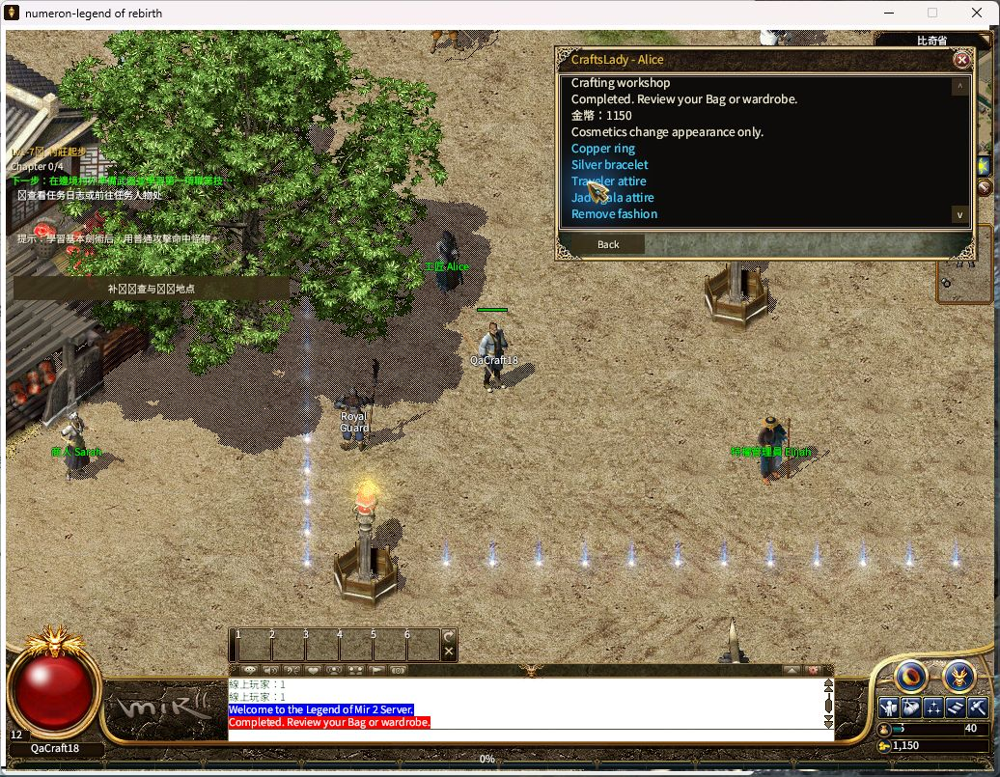

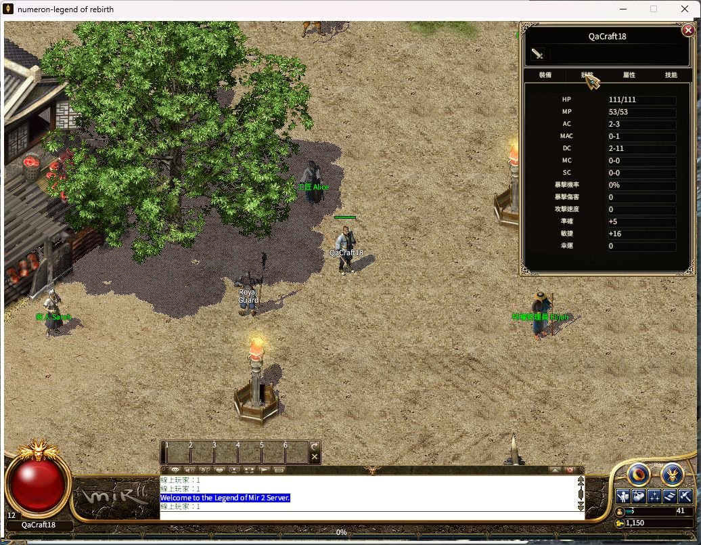

重选角后展示的HP111/111、MP53/53、AC2–3、MAC0–1、DC2–11、准确+5与原值一致。上述保存结论限定为**同一客户端进程中的普通退出至选角再进入**。01的文件名包含cold-runtime，且显示过既有File权威恢复后的世界，但它发生在银镯制作前，不能用来证明新银镯在冷重启后持久保存。

## 断线及原会话收束

旧客户端后续的新鲜观察出现断线，日志包含WebSocket reset；原因尚未确定，不能归因于银镯、材料加工、会话到期或某项新代码，也不宣称已经修复。此前首次进入后NPC停滞、普通重选角后恢复的现象同样保留为未定位问题。

断线前，银镯已有10–11所示的正常保存重选角证据。之后按普通Alt+F4关闭客户端，再通过私有关闭控制请求收束原resume helper，helper退出码为0。本报告不公开私有控制地址或授权参数；退出码0仅说明该辅助进程的关闭已完成，不是新的保存、冷启动或玩法验收结果。

## 已完成的受控隔离前置

用户已明确批准为后续休闲验收建立**新隔离角色**，受控设置人物100级和5,000,000金币。现已通过普通`NewAccount→Login→NewCharacter→StartGame`建立隔离角色`LeisureQA100`，再经typed checkpoint仅调整等级、金币及对应XP前置，通过正常校验和CAS保存，并以新`SimulationSession`执行普通`Login→StartGame`重入核对。此结果明确标记`controlledBootstrap=true`和`noOrdinaryGrowthClaim=true`，不计作普通升级或自然赚金证据。

实际结果见[受控bootstrap公开回执](generated/player-qa/native-leisure-20261020/controlled-bootstrap-outcome01.json)：人物100级、金币5,000,000、背包4个普通新手初始化堆叠，装备、腰带和仓库堆叠均为0。保留普通建角的新手初始化，未额外发放物品、技能或任务，未补造矿石、装备、时装、宠物或坐骑。物品数量是初始化核对结果，不代表额外grant；后续获得、购买、制作、使用和保存仍须通过普通UI完成。

执行使用新的受限QA目录：[目录ACL准备脚本](../.mir2-player-qa/leisure-acceptance-20261020/prepare-controlled-root01.ps1)先建立当前用户及SYSTEM保护的目录和只读授权marker，[离线bootstrap](../apps/simulation/examples/seed_leisure_acceptance.rs)核对路径、marker及不存在的store/receipt。Root已完成执行前后的外部ACL复核，Rust不宣称自行验证ACL。File loader的内建demo记录完整保留并与基线一致；唯一新建账号为隔离QA账号，所有正常登录只使用该新账号，不使用demo回退登录，未读取或修改旧验收角色存档。公开回执不含私有登录凭据。

隔离前置使用`crystal_full`原版完整内容，即CrystalWorld且无platinum内容profile。该范围用于核对原版休闲玩法，**不等于platinum发布配置已接通或发布集成已通过**。新增采集、种植和组合生产仍须落实100级资格、功能开关、材料来源、设施及权限；原版挖矿、钓鱼、精炼和既有独立石材作坊不能因此误封。

## QA helper修复与配对构建

前两次bootstrap失败及回执已保留，均在生成账号主存档前退出；第二次的白名单静态诊断明确为`normal_new_account_rejected`，无未知stderr。独立Windows I/O实验确认根因是QA helper自身的目录pin使用`FILE_SHARE_READ=1`，允许创建子文件却阻止`MoveFileExW`以flags9原子发布，返回Win32错误32。该问题不归因于玩家业务、原产品存储或旧客户端断线。

修复仅将example的目录pin改为`FILE_SHARE_READ|FILE_SHARE_WRITE=3`，仍不允许delete共享；marker和新文件的共享策略仍为Read1。新第7条测试实际调用正常`FileAccountStoreRepository::save`原子发布路径：旧pin失败且主文件不存在，释放后使用实际新pin保存成功、typed正常读取完整一致，同时持有新pin时目录改名失败，证明仍禁止目录替换。独立修复后实验的发布结果为成功、Win32错误0。example现有7项测试已全部通过，其中1项为上述真实Windows I/O回归；随后fresh root的实际bootstrap也已通过。

`frozen-source04→05`共1458项输入中，仅`apps/simulation/examples/seed_leisure_acceptance.rs`变化，其余1457项输入的字节哈希和长度均未变；本次未修改runtime核心。修复后example SHA256为`ff43a7c1984da53d3471c22f11689d736303bcd17c018f2924d33a8a99c75ebf`。`seed-tests02`、`seed-build02`、`gateway-build03`和`native-build02`均已通过Guard，退出码0、1458项输入、receipt与product接受、source drift为空。

隔离runtime-controlled01已实际启动并完成普通GUI购买、装备。启动器对Cargo shim的检查已限定为原先受Guard接受的确切symlink及其rustup目标哈希，其余路径仍保留原严格检查。LeisureQA100从比奇288,616通过普通大地图NPC寻路抵达Albert，购买蓝色鱼竿、鱼钩、浮漂、探鱼器、卷线器和10份鱼饵，共54,800金币，余额4,945,200；五个附件已通过普通界面装入对应格。购买后商店提示仍残留“发送/未确认”，尽管背包和金币已经更新，此显示问题未宣称修复。

17号截图证明一次普通退出重选角后鱼竿、鱼钩、余额及其余购买物保留；18号截图证明随后五个配件全部装好。19号是独立截图，实际显示比奇岸边340,242、金币4,945,200及该帧无钓鱼状态窗；附件及鱼饵10份由18号另证。向西南水格337,245点击未下竿属于Root现场观察，不能由19号单帧独立证明点击时序或持续时长。源码确认移动方向输出小写downleft，而Native钓鱼分支按DownLeft严格匹配，无法进入合法下竿分支；这是修复前的实际停点。

修复前已普通Alt+X保存返回选角、Alt+F4关闭Native，再正常关闭自有Gateway；runtime-controlled01收束回执为两进程退出码0、1458项source05未变、私有pins与资产未变、日志完整且未强制终止。恢复继续复用同一隔离File权威及原密钥。

方向修复后`frozen-source06`共1459项输入：原1458项中仅`platform-windows/src/input.rs`变化，新增独立`fishing_world_click_tests.rs`，其余1457项未变。同一八方向解析同时用于鼠标方向和原始SelfPlayer朝向，缺失或无效朝向保持未知。`fishing-native01`真实mouse系统9/9通过（0失败/忽略，0.07秒），`fishing-provenance01`相邻发送归属5/5通过（0失败/忽略，0.01秒）；两次Guard退出码0、1459项输入、receipt/product接受且无source drift。配对`native-build03`与`gateway-build04`同样退出码0、1459项输入、receipt/product接受且无source drift。这些通过结果限定于source06，不转记给后续snapshot改动。

## runtime-controlled02的普通钓鱼现场记录

以下为Root控制普通客户端时的现场观察。**20–29号归档JPG存在下述重复问题，不能把编号当作对应步骤的有效截图证明。**所有金币、鱼饵、鱼类及背包描述均来自普通GUI现场记录，未解析角色存档或根据state哈希推测资产。

| 阶段 | Root普通GUI现场观察 | 记录编号 |
| --- | --- | --- |
| 正常进程冷重入 | 同一File权威及原密钥恢复，角色位于340,242，金币4,945,200；鱼竿、五附件及鱼饵10份保留。 | 20 |
| 第一次手动下竿及收竿 | 普通水面点击打开钓鱼状态；满进度后普通收竿提示FishEscaped，鱼饵10→9，没有新增鱼。 | 21–22 |
| 购买及替换鱼饵 | Albert普通购买99份鱼饵，每份80金币，共7,920；金币4,945,200→4,937,280。先卸下旧9份至背包保留，再装99份至空鱼饵格。 | 23–24 |
| AutoCast及显示滞后 | 普通开启AutoCast后观察到进度重置和多次结果；停止时旧界面仍显示98份鱼饵、鱼获未显示并提示NeedBait。没有可靠的实际耗时记录，不声称“约10秒”或其他循环耗时。 | 25 |
| 正常重选角核对 | 普通Alt+X→确认→选角→StartGame后，已装99份鱼饵确已耗尽，旧9份仍在背包，六个新增掉落堆叠可见，金币4,937,280。此前NeedBait不是后台误报。 | 26 |
| 查看实际鱼获 | 背包格9的Walleye×1普通tooltip显示价格1000。六个新增堆叠不一概记作六条鱼。 | 27 |
| 普通出售 | Albert→Sell Fish，将Walleye×1放入出售格，报价1000；普通Confirm后鱼消失，金币4,937,280→4,938,280，与报价一致。 | 28–29 |

售出后已普通Alt+X保存返回选角、Alt+F4关闭Native，并通过Gateway stdin正常shutdown。runtime-controlled02的stop回执确认Native/Gateway退出码均0、source06的1459项输入未变、私有pins及资产未变、日志完整、无强制终止；helper未编辑账号。**该次停服本身不证明售后重入；后续source07新进程的有效30号图及正常恢复记录已补证金币4,938,280与原Walleye格为空，见下节。**当前现场核对HP为3464/3464；先前HUD裁切造成的误读已更正，不据此编造治疗或药品购买记录。

## 图像归档核验及待补证据

已对01–19号全部19张JPG逐张独立读盘查看实际像素，并核对实际SHA与各JSON内的图像SHA；19个图像哈希互不重复，Q原件与public图片、元数据均逐字节一致。01–11的银镯有界结论继续由前后图、既有基线及Root现场普通操作联证；02的自然挖矿来源、03的持续停滞、04及10–11的重选角时序均不能单靠各自单帧证明。12实际显示WebSocket reset，13显示Lv100及5,000,000金币，14–18实际显示商店、购得渔具及装配变化；18可见五附件和鱼饵10份。19只支持当帧岸边位置及未显示钓鱼状态窗。这些逐图支持范围和限制已写入outcomes，不从note反推像素。

20–29号共10张JPG均为274,857字节、SHA256 `75b5bebf2ea383bed5b5a5e18da91f67d7ff1a4c8589f4f9e4a03291648a140c`。独立查看29号的实际像素仍是欢迎面板、340,242与金币4,945,200，没有钓鱼状态、背包、Walleye、报价或出售窗口；20号对“五附件及鱼饵可见”的原注释也不受该图支持。这些文件不能证明所标注的后续操作。

原JPG和JSON均完整保留，25–29号已复制至公开证据目录，每份元数据的实际SHA256已登记于[公开outcomes](generated/player-qa/native-leisure-20261020/outcomes.json)。元数据中的不同说明文字、`source`自述及`recordedUtc`不能替代图像内容；时间字段只记元数据记录时间，不认作已验证的图像捕获时刻。20–29号统一标记`invalid_duplicate_capture`，仅保留Root现场inline工具画面的普通操作观察，不提升为持久截图验收。Root随后确认归档函数`saveQa`捕获了旧cell变量`state`；已改为`globalThis.saveQa(name,note,observation)`强制显式第三参，并在保存后重读文件字节核对SHA。这是截图归档工具修复，不是游戏行为修复。截图工具修复时游戏已正常停止。后续runtime-controlled03的新30–33号图均已独立`view_image`检查像素、实际SHA与元数据匹配，四图哈希互异；30补证售后冷重入当前状态，31–33补证下竿和耗饵刷新。旧20–29号始终无效，不能由新图追认旧记录；后续34–40号已对新的SwordFish实际获得、报价、成交和正常保存补得有效新图，见下节。

## snapshot显示问题与新增SLG边界

源码定位到低延迟item-event flush未请求完整snapshot：普通自动垂钓已经消耗鱼饵并产生掉落，界面仍保留旧计数且隐藏新物品，正常重选角的完整snapshot才显示实际结果。不能把旧98显示解释为99份鱼饵尚未消耗，亦不宣称后台NeedBait误报或生产时间异常。

Gateway的`web.rs`及新的独立`web_tick_item_snapshot_tests.rs`已在`frozen-source07`完成有界Guard验证。低延迟与一般flush共用item状态判定，`GainedItem`、`DeleteItem`、`DuraChanged`触发完整snapshot，单独`FishingUpdate`继续仅发包；未改钓鱼概率、耗饵、持续时间或账号Schema。

source07清单SHA256为`ac7a142cdbbe10f577650e6d86fc20fcc38de85f18f17a1eab0a1c19196a00e9`，1460项输入；相对source06仅`apps/gateway/src/web.rs`变化并新增`web_tick_item_snapshot_tests.rs`，其余1458项未变。实际`web.rs` SHA为`0a5339fcb5990eeb5d9dfbe8870aa7a0f8795590cf5e1e2f2434db6639de2287`，新测试SHA为`0ad955c839597e41a83c0e3d0d68c345fe25a85d6fa2b7f6108c21517639b214`。

| source07实际调用 | passed/failed/ignored | 测试耗时 | 范围 |
| --- | --- | --- | --- |
| fishing-tick01 | 5/0/0 | 79.48秒 | 实际Tick/AutoCast批量、鱼饵耗尽、嵌套浮漂耐久、真实钓鱼掉落及仅进度事件；覆盖两种flush模式。 |
| fishing-tick-adjacent01 | 7/0/0 | 29.87秒 | 既有低延迟Tick、XP升级、任务及地图bootstrap、普通移动仅包路径。 |
| fishing-tick-calendar01 | 1/0/0 | 0.00秒 | idle日历变化的既有snapshot触发。 |

三次测试均为原Guard退出码0、1460项输入、receipt/product接受、source drift为空；完整具名测试去重为**13项**。实际`native-build04`与`gateway-build05`亦均退出码0、1460项输入、receipt/product接受、无漂移，实际EXE哈希和长度匹配各自回执。随后runtime-controlled03的source07 preflight已通过，并完成下述有界普通钓鱼GUI复验；构建本身不替代GUI结果。结果、具名用例及result/audit/log和EXE指纹见[公开outcomes的snapshotIssue记录](generated/player-qa/native-leisure-20261020/outcomes.json)；原始回执保留在外层QA的各同名Run目录。

上述是隔离内存fixture、真实原版地图及正常WebSocket flush的测试范围，不是普通玩家获取材料或本次GUI复验。随后source07实际钓得新的SwordFish，并在无需重登或重选角的情况下显示新掉落和鱼饵耗尽，再经普通出售和保存重选角闭环。20–29号仍为`invalid_duplicate_capture`，source06售鱼现场观察不能当成source07的新截图；本轮有界钓鱼通过只采用真实匹配的新证据，其余休闲流程仍待完成。13项有界结果不提升全局parity、Goal或Candidate100。

### source07的首次有效冷重入与耗饵刷新截图

runtime-controlled03复用同一隔离File权威和原密钥，preflight绑定source07的1460项输入，账号内容未解析，普通Login/StartGame未发注册或grant。该运行现已通过普通退出及Gateway stdin shutdown完成收束；独立runtime-controlled03 stop及两个child exit回执均为0，source07的1460项未变、私有pins和资产未变、日志完整且实际哈希匹配，无强制终止。此处采用本次03回执，不沿用02结果；不由stop回执推断冷重入游戏资产。

30–33号均由显式传入本次observation的保存函数生成，保存后读回字节核SHA，再独立打开实际像素检查；四张哈希各不相同、均匹配各自元数据。它们是新的有界视觉证据，不能使旧20–29号转为有效。

| 新有效图 | 实际像素及普通现场时序支持 | 验收界限 |
| --- | --- | --- |
| 30 售后冷重入 | 金币4,938,280、背包原Walleye格9为空、旧鱼饵9份在格5；普通新Native/Gateway进程、同权威恢复时序由现场记录和preflight联证。 | 首次有效售后当前状态截图，不是旧报价或确认成交画面；不重绘旧20–29号历史。 |
| 31 新下竿基线 | 五附件齐，鱼饵格2为9份，背包格5为空，金币仍4,938,280；旧9份经普通装备操作移入空鱼饵格。 | 只是本轮9份鱼饵基线。 |
| 32 普通下竿 | 真实FishingStatus窗口可见，38%机会和下方满进度，背包仍开；普通水面click及未重选角由现场时序记录。 | 证明真实下竿状态，尚非新鱼获。 |
| 33 同会话鱼饵耗尽 | AutoCast后鱼饵格2已空、NeedBait聊天可见，其他四附件保留，金币4,938,280，背包与31基线一致。现场确认本轮31→33未重选角或重登。 | 该9份鱼饵样本只证明删除刷新；后续34–37另证新鱼获刷新，均不推断实际耗时。 |

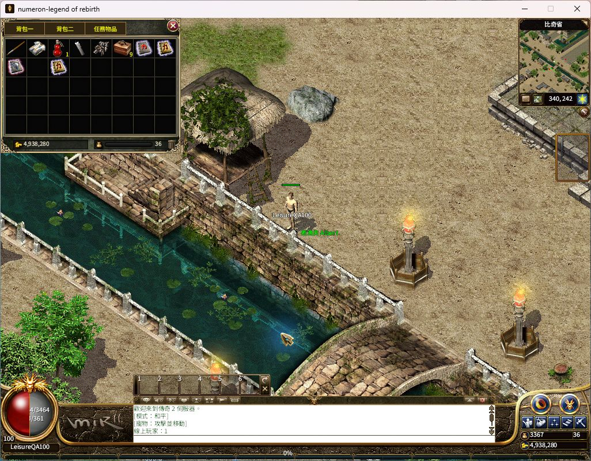

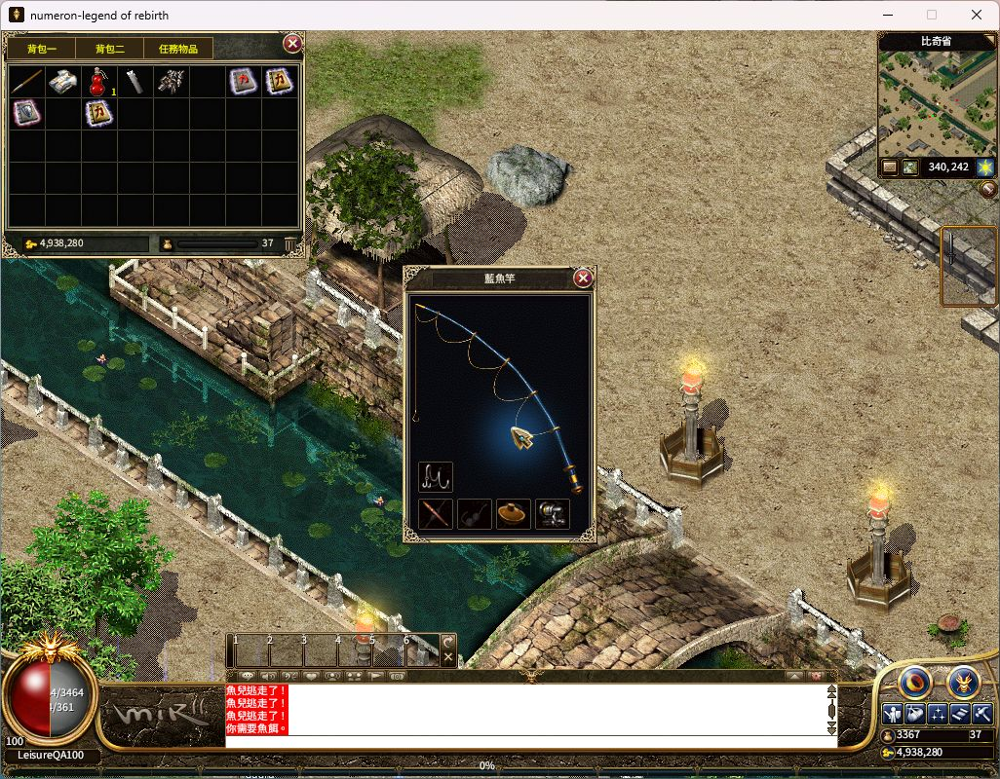

### source07新鱼获、普通出售与保存闭环

34–40号逐张独立`view_image`核对实际像素，七张图像各自SHA互异且匹配原元数据；Q与公开目录的图片、JSON均逐字节一致。普通操作时序由Root现场控制记录与这些前后图联证，不从单张截图反推未显示的操作。

| 有效图 | 普通路线及实际变化 |
| --- | --- |
| 34 普通补购 | Albert购买99份鱼饵，每份80金币，成本7,920；金币4,938,280→4,930,360，鱼饵99在背包格5。商店可见此前Walleye回售2000行，Root现场记录没有点击购鱼，本次只买鱼饵。 |
| 35 装备基线 | 99份鱼饵普通装入空鱼饵格2，其他四附件保留，背包格5为空；新鱼所在的背包格13在此时为空，金币4,930,360。 |
| 36 自动钓鱼后刷新 | 同一Native和session普通AutoCast后，鱼饵格空、NeedBait聊天可见，背包比35新增5个堆叠。其间未重选角或重登，新增物品无需重登已可见。五堆叠不是五条鱼。 |
| 37 查看新鱼 | 普通查看背包格13的SwordFish×1，tooltip明确Fish、重量1、售价1300、最大合并20。结合35空格、36新物品和只进行普通垂钓的现场记录，确认本次实际新鱼获。 |
| 38 普通报价 | Albert→Sell，正常将SwordFish从背包格13拖入出售格，显示报价1300，Confirm可用，售前金币4,930,360；未使用Hold自动出售。 |
| 39 普通成交 | 点击Confirm后，SwordFish从背包格13消失、出售格为空，金币4,930,360→4,931,660，增加1300与报价一致，其余掉落保留。 |
| 40 普通保存重选角 | Alt+X→Yes→CharacterSelect→StartGame后，金币4,931,660、背包格13为空、其余掉落和鱼竿及Hook／Float／Detector／Reel保留，鱼饵格2为空。 |

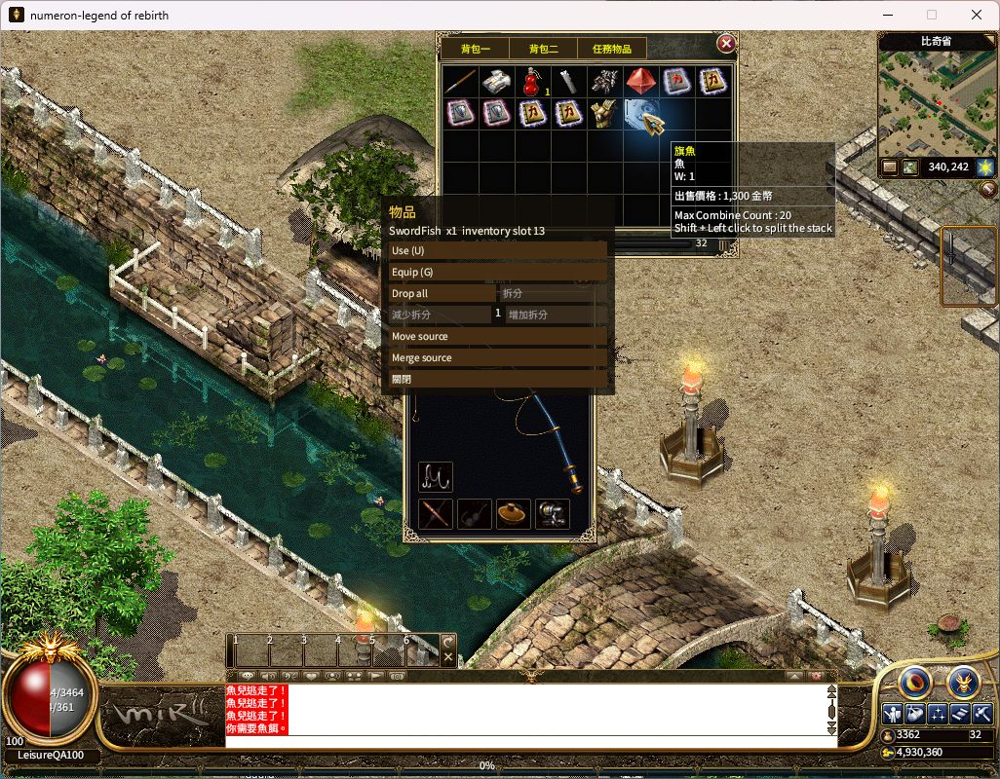

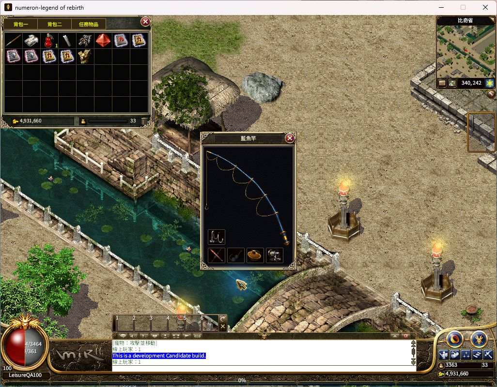

据此，钓鱼标记为`passed_bounded_ordinary_gui_loop`：普通渔具购买15、装配18和31、真实下竿32、自动耗饵33、补饵34–35、新鱼及新增物品刷新36–37、报价和成交38–39、保存重选角40形成有界闭环。source07的item-trigger snapshot在本次普通GUI中通过鱼饵删除及新增鱼获两个分支。

**40号只属于同一Native进程内的正常保存重选角，不是SwordFish售后客户端或Gateway冷重启持久化。**30号的有效冷重入仍只对应此前Walleye售后金币4,938,280及原格9为空。runtime-controlled03现已正常退出并通过source07 post-exit核对；这一收束不补成SwordFish售后冷重入。本轮不声明发布profile集成、真PostgreSQL、部署、其他休闲组、Goal、Candidate100或最终人类验收通过。

### 坐骑普通购买装配与骑乘外观刷新缺陷

41–44号已逐张独立读盘查看实际像素，实际图像SHA均匹配各JSON，四图互异；Q与公开副本图片、元数据逐字节一致。本分支仍为source07/runtime-controlled03，未改运行源码、未发物或读取角色存档。

| 有效图 | 实际支持的普通购买及装备范围 |
| --- | --- |
| 41 Mary商店 | 普通大地图搜索、GO TO及NPC View由现场控制记录；图中Mary商店显示BengalTiger100,000、Saddle50,000、LeanMeat10,000和RawMeat25,000，购前金币4,931,660，人物位于351,279。 |
| 42 普通购得 | BengalTiger和Saddle各正常购买一次，背包格13、14分别可见，金币4,931,660→4,781,660，支出150,000与两件价格之和一致；没有购买食物。 |
| 43 坐骑已装备 | 普通Equip后虎从背包格13消失；原生坐骑窗显示BengalTiger、忠诚度20,000/20,000，四个可见附件格为空，Saddle仍在背包格14。此时尚未装鞍或骑乘。 |
| 44 鞍已装配 | 普通将Saddle装入坐骑slot2，第三个可见附件格出现鞍，背包格14为空，忠诚度20,000/20,000，金币4,781,660。人物仍步行，其他可见附件格为空。 |

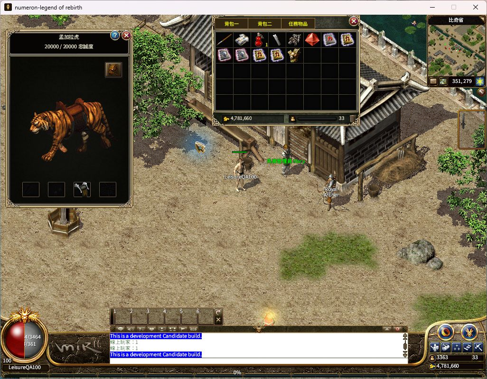

45–46号新增对照也已逐张实际看图，图像SHA与元数据匹配且两图互异：45在单次普通Mount面板Ride动作后，世界角色仍以步行造型显示；46关闭面板后普通与Mary交互，在同一351,279原地出现骑虎造型。Root现场确认期间没有第二次toggle。单张图不独立证明点击次数，但现场操作时序和两张有效前后图共同确认即时外观刷新缺陷。

| 对照图 | 实际像素 | 验收结论 |
| --- | --- | --- |
| 45 单次Ride后 | 坐骑窗、鞍仍可见，世界人物在351,279保持步行，金币4,781,660。 | 单次骑乘动作未立即投影世界外观，不能算骑乘即时刷新通过。 |
| 46 普通NPC刷新后 | Mary普通对话打开，人物在同一351,279已显示骑BengalTiger，金币不变。 | 无第二toggle却在普通NPC交互后才显示骑乘，确认延迟外观刷新；不能据此把原Ride操作判为即时GUI通过。 |

45–46保留为source07的MountUpdate立即世界外观刷新缺陷证据，当时坐骑GUI未通过。图片审计只确认当时现象；Root与独立源码审查随后定位到完整snapshot触发缺少MountUpdate，并在正常结束runtime-controlled03后准备source08修复。下述47–55为source08新的实际有界复验，未把旧图或57项旧回归转记成新源码通过。钓鱼有界结论和其他全局验收边界保持原范围。

### source08坐骑MountUpdate状态投影修复与有界owner实机通过

source08只将MountUpdate加入一般与低延迟flush共同的完整snapshot触发判定，仍先发普通协议包、同批最多追加一份权威完整状态；Native沿完整状态派生坐骑和武器造型，没有客户端自造骑乘外观。未改骑乘条件、账号Schema、经济、概率、移动/传送或权限规则。随后48–49已在普通owner客户端收到异步响应后自动切换骑乘及步行外观，无额外NPC、重登或移动刷新；没有测得响应时长，不作毫秒延迟结论。observer实机尚未进行。

冻结`frozen-source08` SHA256为`8acb91c0c1670bbd35390a97e1355fee16682730237ac2097afcf6ef54fbf121`，仍为1460项输入；相对source07只改既有`apps/gateway/src/web.rs`和`web_tick_item_snapshot_tests.rs`，无新增或删除，其余1458项未变。两文件实际SHA分别为`9a66b45452365def24f07b8934344472ca0fdf2040a99de8ca18f64d6e47205c`、`60e00f2cb721d44f4516f3bb5bbce8d0eee20e62768c58d799690c9ffacfc420`；[源码审查](generated/player-qa/native-leisure-20261020/source08/source-review.json)保留独立审查边界。

首次`mount-snapshot01`因LNK1104链接失败，exit101、零测试执行、receipt/audit拒绝，source drift仍为空；其中`productAccepted=true`不使该Run成为通过。Root只读RestartManager观察到DeltaForce PID242940占用旧测试EXE，没有停止进程、删除或移动文件。随后caller10仅给gateway-tests增加package test debug=1以生成独立artifact名，保留原CargoGuard及原源码、测试和断言；[失败及诊断记录](generated/player-qa/native-leisure-20261020/source08/link-lock-diagnostic.json)完整保留，不把失败转标为成功。

| source08实际调用 | passed/failed/ignored | 测试耗时 | 有界范围 |
| --- | --- | --- | --- |
| mount-snapshot02 | 1/0/0 | 31.63秒 | GM0内存fixture通过普通装备、装鞍、@ride实际响应，在两种flush模式验证骑上及下马的完整造型投影。不是普通GUI获得或实机结论。 |
| mount-snapshot-adjacent01 | 6/0/0 | 109.76秒 | 前述骑乘用例加保留的5项钓鱼item-snapshot用例；包含前述1项，不重复计数。 |
| mount-snapshot-low-latency01 | 7/0/0 | 30.32秒 | 原低延迟tick、XP升级、地图/任务bootstrap与普通移动仅包相邻路径。 |

三个通过Run均Guard exit0、1460项输入、receipt/product/audit接受、生命周期完整、source drift为空。完整具名union为**13项而非14项**，不与source07或旧57项重叠结果相加为全局覆盖。[公开验证汇总](generated/player-qa/native-leisure-20261020/source08/validation01.json)列出各原result/audit/log哈希和完整用例；日志不全文发布。

新配对构建`gateway-build06`及`native-build05`均Guard exit0、1460项输入、receipt/product/audit接受、无漂移，实际EXE长度和SHA已独立匹配回执。Gateway为123,383,296字节、SHA`52ce516fe0c6605b82c594b8a2d85944916fc0839b33fd0424763947f98bf202`；Native为131,212,288字节、SHA`e676311c88f173f05c1cb62b6d5923e243bbe755ed15211ba04135dc01e4b7e0`，后者与既有Native字节一致但本次构建回执独立保留。构建本身不启动游戏；随后runtime-controlled04的source08 preflight及下述owner有界GUI已完成，observer实机仍待。

此前source07/runtime-controlled03已普通保存退出、关闭Native，再经Gateway stdin shutdown正常收束。新[03停服脱敏回执](generated/player-qa/native-leisure-20261020/source08/runtime-controlled03-stop.json)及两个child exit核对0/0、1460项source07未变、私有pins及95项资产未变、日志实际长度/SHA匹配，无强制终止、未解析或编辑账号。这里只记录正常停服，不推断下一进程冷重入的装备、金币或骑乘状态。source07钓鱼34–40有界普通闭环保持通过，20–29仍无效，45–46仍为旧源码缺陷证据；这些历史回执不转记给source08。

### source08坐骑普通GUI闭环：47–55

47–55号九张JPG均已逐张独立读盘查看实际像素，9个实际SHA互异且匹配各原JSON；图片和原元数据均已逐字节复制到公开目录，元数据实际SHA登记于outcomes。截图中的普通操作时序由Root现场控制记录与前后状态联证，不从单帧或note推断按钮点击。逐图支持范围见[新坐骑GUI审计](generated/player-qa/native-leisure-20261020/source08/mount-gui47-55-audit01.json)。

runtime-controlled04的[脱敏preflight](generated/player-qa/native-leisure-20261020/source08/runtime-controlled04-preflight.json)已核对source08的1460项、同一File权威和原密钥、95项资产、正常prior03关闭，以及build06/05的原result/audit和实际EXE哈希；原preflight SHA为`1999db8d2ec02012468c45e84a8b9606b0f1910c618a09116fb3241f2f90a378`，helper03实际SHA匹配。普通Login/StartGame未发注册或grant，未解析账号。此前validation01里的pending旗标仅保留构建时点的历史状态，本次实际preflight与GUI另以新回执追加，未改写旧回执。

| 有效图 | 普通路线及实际可见结果 |
| --- | --- |
| 47 冷进程重入 | 正常停止03后启动04，在351,279显示金币4,781,660、BengalTiger忠诚度20,000/20,000、Saddle仍在wire slot2对应的第三可见附件格，人物正常步行。证明装备和金币保留；新session步行不认作骑乘保存失败，也不宣称骑乘flag冷持久。 |
| 48 骑上自动刷新 | 单次普通J窗Ride后，收到异步响应即在同一351,279显示骑虎，J窗仍开；未额外与NPC交互、重登或移动刷新，金币不变。 |
| 49 下马自动刷新 | 单次普通J窗切换下马后，同一位置恢复步行，J窗仍开、金币不变，无额外刷新动作。 |
| 50 普通快捷键 | 关闭窗口后普通M键再次骑上，世界虎和骑手可见，仍在351,279、金币4,781,660。 |
| 51 普通移动 | 普通大地图Kyle GO TO后骑虎移动，图中可见跑动姿势及355,283；再到52的371,312。寻路调用和连续路线由现场记录与50–52的位置变化联证。 |
| 52 普通传送报价 | Kyle可见菜单列明每次2000金币；人物仍骑虎，位置371,312、金币4,781,660。普通选择吉龍城链接。 |
| 53 普通跨图到达 | 到map4吉龍城264,257，金币4,779,660，扣2000。自然Orc遮挡部分虎身，但骑手下方仍可见橙黑虎前身与腿部；只按该可见范围与现场普通传送记录确认骑乘保留，不宣称完整无阻挡轮廓。 |
| 54 普通返回 | 通过Denzel正常付费返回比奇map0的296,222，世界仍显示骑虎；金币4,779,660→4,777,660，再扣2000，往返合计4000。Denzel菜单及选择由现场控制记录，54只直接支持返回位置、骑乘外观及金币结果。 |
| 55 普通保存重选角 | Alt+X→Yes→实际CharacterSelect→StartGame→关闭欢迎后，仍在比奇296,222、金币4,777,660，虎忠诚度20,000/20,000、鞍slot2保留，世界仍骑虎。此为同一Native进程，保留的是当次transient骑乘状态，不能写成冷重启riding flag持久。 |

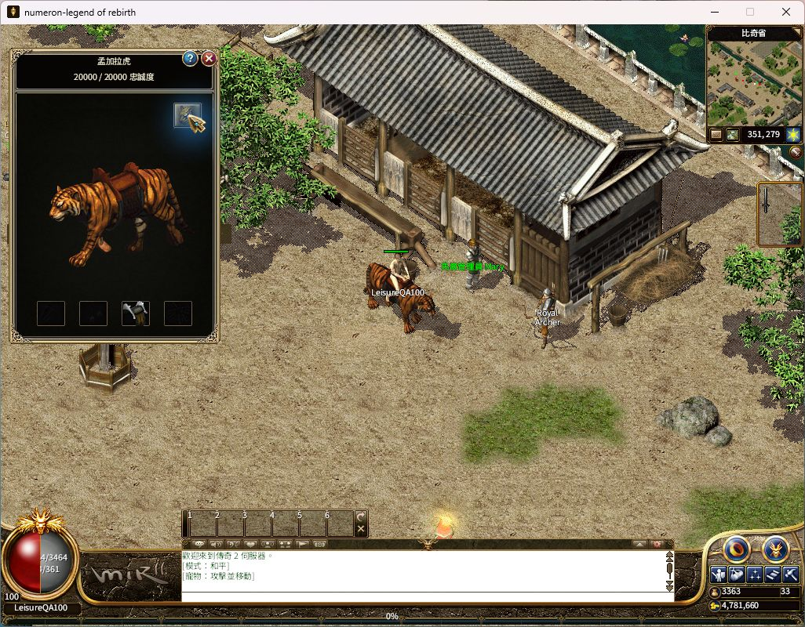

坐骑可标记`passed_bounded_ordinary_gui_loop`，仅覆盖**source07普通购买装配的BengalTiger+Saddle，与source08的owner外观修复、普通移动、付费往返换图和同进程保存联证**。原生面板本次可见四个附件格；只操作鞍wire slot2，没有接受全部五槽或其余附件。AOI/observer、其他NoMount地图、完整坐骑变体、骑乘标志冷持久及最终人类Accepted仍未覆盖；57–58另行补证普通Inn0125门切图的自动撤骑。47单独证明当时冷进程装备和金币保留，55只证明同进程保存；56另补中断后虎/鞍、忠诚度、往返后余额及上次保存位置恢复，不补成riding flag持久。runtime-controlled04后续中断，原退出码、正常关停和日志完整性未知；05曾沿同一权威启动继续验收，随后仅Native已证实正常退出，Gateway收束未知；06另有独立正常0/0关闭及source08 post-exit收据，均不沿用03结论。

### runtime04中断与同权威runtime05恢复：56

继续时已观察不到runtime-controlled04的Native/Gateway进程和原监听端口，04也没有stop或两个child exit回执。中断原因、原退出码及日志是否完整排空均未知，不能追认为正常停服。原04的preflight和47–55有界玩法证据继续按各自范围保留；03的正常停服收据不转记给04。[脱敏中断摘要](generated/player-qa/native-leisure-20261020/source08/runtime-controlled04-interruption.json)与[独立恢复审查](generated/player-qa/native-leisure-20261020/source08/interrupted-resume-review01.json)保留原始收据SHA；未公开私密路径、存档内容、密钥或恢复文件明细。

离线独立核对source08全部1460项、95项覆盖资源与原base链接均未变；现有构建缓存和04 EXE符合build06/05，原密钥与身份输入哈希保持一致，恢复目录只有原4个控制文件。当前存档仅按字节长度和哈希核验并完整备份，没有解析或编辑账号、读取封存结果、用备份替换权威或生成新密钥。新helper的37个函数中36个保持原字节，只将历史`CheckPriorStop`替换为明确的中断证据核验，仍由普通Gateway File权威和恢复流程处理启动；缺失存档、非空发布标记、异常恢复内容等仍拒绝，不绕过恢复检查。这些是恢复准备核验，不能证明最后一个界面操作已保存。

[05脱敏preflight及ready](generated/player-qa/native-leisure-20261020/source08/runtime-controlled05-preflight.json)已确认source08、同一File权威及原密钥、原配对EXE、95项资产和正常产品恢复入口；`priorNormalClosureVerified=false`、`priorLogDrainCompleteClaimed=false`，未补写04停服收据。普通Login/StartGame未发注册或grant，没有重新执行受控等级/资金bootstrap，账号内容未解析。05启动和ready只是当前运行资格，单独不构成玩法持久化结论；实际journal replay计数未另行观察。

56号已独立读盘查看像素，实际JPG SHA `e789fc7f99d0a70bf7e97566391632f7c4784c90e04b6b809f572ba4ce222c53`匹配显式observation归档元数据，与旧55图不同，Q与公开图片/元数据逐字节相同。[56审计](generated/player-qa/native-leisure-20261020/source08/recovery05-gui56-audit01.json)仅接受：LeisureQA100在比奇296,222、金币4,777,660、BengalTiger忠诚度20,000/20,000、Saddle仍在第三可见格/wire slot2，世界人物正常步行。结合普通启动时序，证明这些已保存状态在新进程恢复；不声称全背包或骑乘标志冷持久。Root此前后续走到302,254的移动未正常保存，05恢复的是296,222，该后续移动没有保留；不能据此宣称所有未保存操作都能恢复。

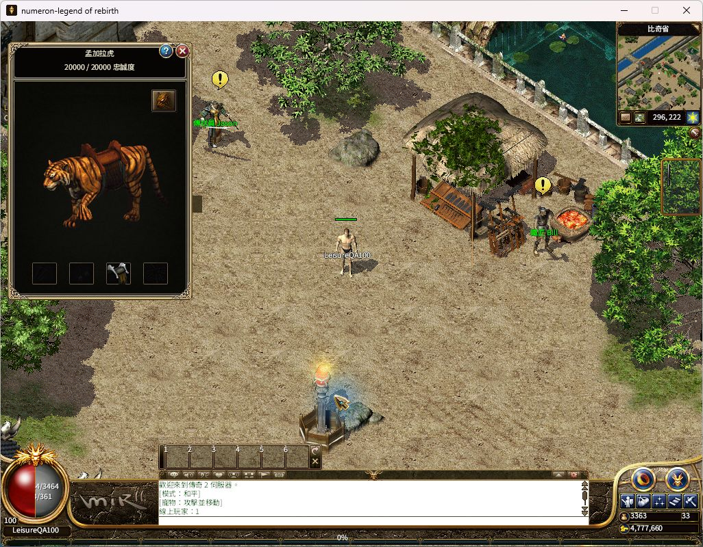

05现已停止：Native实际退出码0、disposed及日志完整已核对，Gateway退出码、正常关停和日志收束没有回执，不能追记全程正常；04的原生命周期结论继续未知。06另有下述独立正常停服证据。钓鱼和BengalTiger+Saddle既有有界GUI结论不变；本节56本身不新增宠物、玉晶礼服或SLG验收事实，后续57–69的新增范围单列如下。Goal、Candidate100、真PostgreSQL、部署和最终人类Accepted均未完成。

### runtime05普通客栈NoMount与休闲宠物部分实机：57–69

57–69共13张图片已逐张独立`view_image`查看，均为目标runtime-controlled05自身窗口，未见其他聊天或非目标应用遮挡；实际图像SHA与各原JSON一致、13图互异且不同于已有01–56，图片及元数据均逐字节复制到公开目录。[逐图审计](generated/player-qa/native-leisure-20261020/source08/leisure-gui57-69-audit01.json)与outcomes保留实际SHA及每帧支持/限制。普通点击顺序由Root现场控制与前后帧联证，不由单帧或note单独推断。

| 证据 | 实际观察及限定范围 |
| --- | --- |
| 57–58 普通客栈门 | 57在比奇295,252、金币4,777,660，门檐部分遮挡骑虎形象；随后普通门步行切到Inn0125(8,16)，58人物已步行，聊天明确显示“Mounts are not allowed on this map. You have dismounted.”，金币未变。只接受这一次客栈NoMount自动撤骑，不外推全部受限地图。 |
| 59 购蛋报价 | Andy普通List商店选BabyPigEgg×1，价500,000金币、要求35级，袋13为空；角色仍是已说明的受控100级。 |
| 60 购蛋结果 | 一次普通Buy后袋13出现蛋，金币4,777,660→4,277,660。商店仍显示“Purchase sent; result unconfirmed”，作为界面文字现象保留，未重复购买；不先断言其根因。 |
| 61 普通Use蛋 | Root普通Bag Use消费蛋后，E显示BabyPig、Never、Summon及初始营养7,500/10,000。描述实际出现0x0半自动/鼠标范围文本，仅记录显示问题，不能据此推断后台拾取范围为0或已证实拾取失败。 |
| 62 普通召唤 | 一次E Summon后世界出现BabyPig及LeisureQA100的宠物标签，位于Inn15,16。该帧不证明跟随移动、拾取或保存。 |
| 63–65 普通金币商城食物 | Y GameShop选择使用金币，Cherries×1报价及确认均为2,970,000；普通Yes后余额4,277,660→1,307,660，成功提示从邮件领取，未读邮件图标出现。未使用Credits或现金。 |
| 66–67 正常邮件领取 | Mail Read显示Gameshop包裹、Cherries×1、金币附件0及Collect；正常Collect后67袋13出现Cherries，E仍为Dismiss，营养实际为5,298/10,000，金币1,307,660。61的7,500是更早的初始观察，不当作紧邻喂养前值。 |
| 68 一次Use无效果的保留观察 | Root在E与ItemActions叠窗时尝试一次Use，未观察到消耗；正常关闭E后，68明确显示Cherries×1仍在袋13及Use菜单。原因尚待源码检查；不将叠窗或后台拒绝先写成确定根因。 |
| 69 关闭E后的普通喂养 | 随后正常Bag Use消费唯一Cherries，袋13为空；再开E显示9,616/10,000且Dismiss仍在，余额仍1,307,660。营养持续变化，没有紧随Use的精确10,000帧，也不把旧7,500与9,616当作相邻变化。 |

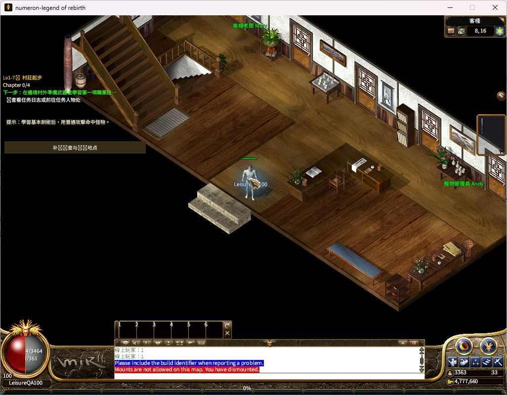

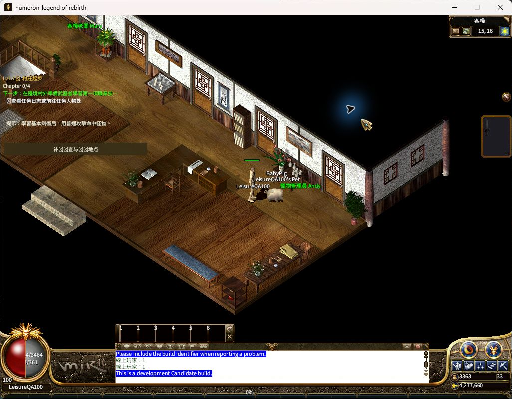

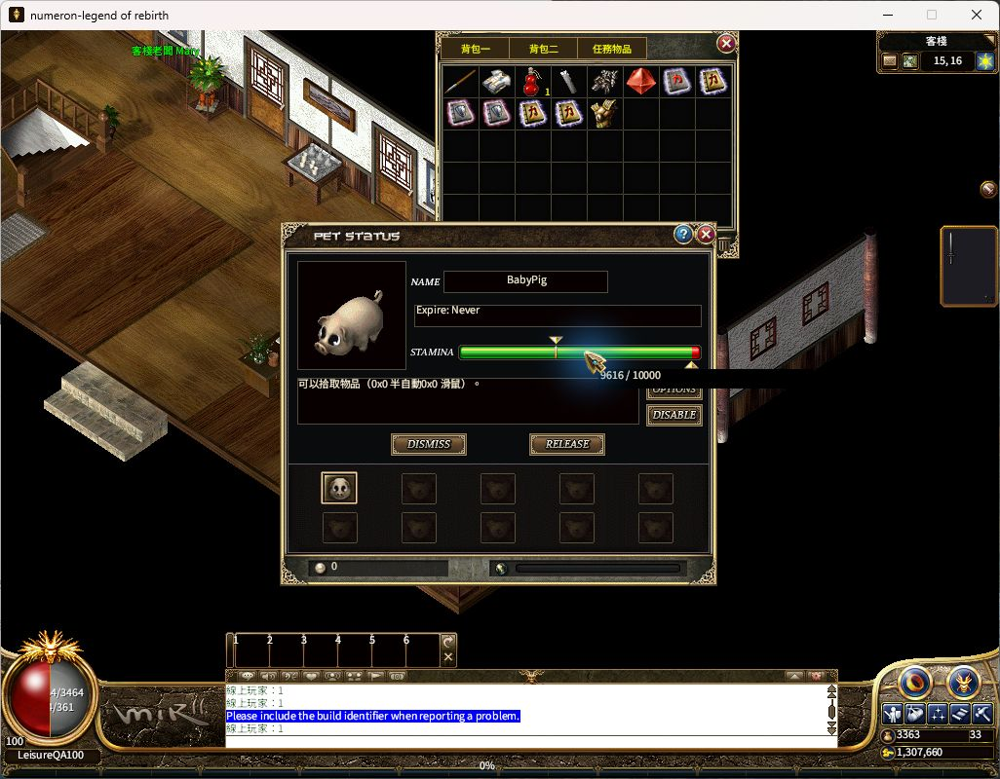

宠物仍标为`partial_ordinary_gui_acquire_summon_mail_feed`，**不标pet passed或整链通过**。本批59–69尚未完成跟随、实际拾取或完整保存；70–72新增范围见下节。0x0说明、叠窗Use和冷重入面板请求随后经source11下述有限GUI复验；叠窗使用的是猫蛋，新增食物仍未复验，商店结果文字仍未定位。59–69发生于source08/runtime05；未新发物或解析账号，原有截图结论不迁记为source09实机通过。玉晶礼服、新SLG及全局目标状态不因本批上调。

### 宠物拾取前基线、冷重入面板停点与06正常关停：70–72

70–72已逐张独立读盘查看实际像素，三图互异，实际SHA与原JSON一致，公开图片及元数据均保留原字节；见[逐图限定审计](generated/player-qa/native-leisure-20261020/source08/leisure-gui70-72-audit01.json)。70只显示Inn15,16、金币1,307,660、Bag第3格Candle×1及8/8耐久和ItemActions，是丢物前基线，不能据此接受已丢下、宠物拾回或怪物掉落拾取。

71为runtime06同一权威的冷重入世界帧：Inn15,16、BabyPig及主人标签、金币1,307,660可见；Root现场普通E和菜单Creature未打开宠物面板。失败输入顺序来自现场观察，单帧仅证明当时面板未显示。**该图Bag关闭，不能用来证明食物或Candle缺失**；此前内联背包观察与此图的直接证据范围分开。只接受宠物世界actor、位置和余额的有界恢复，不接受营养/模式/过滤、跟随、拾取或完整保存闭环。

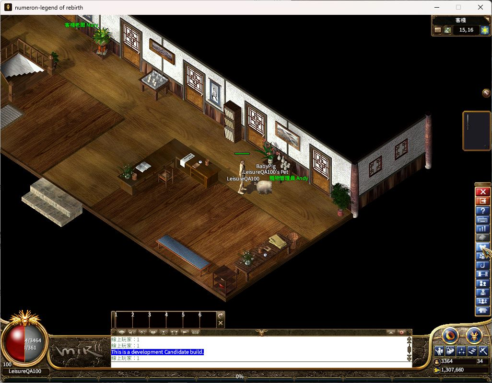

[05生命周期摘要](generated/player-qa/native-leisure-20261020/source08/runtime-controlled05-interruption.json)明确区分：Native05实际退出0、disposed、日志完整且哈希匹配；Gateway05的退出/日志/正常关闭仍未知，未补造stop。06仅复用同一隔离File权威和原密钥，通过普通产品恢复及Login/StartGame，没有新grant或重做受控bootstrap，存档仍只按opaque字节核验。72显示普通Alt+X→Yes后实际CharacterSelect中的LeisureQA100、战士100级；随后正常Alt+F4结束Native，再由原owner发送Gateway stdin shutdown。[06独立stop摘要](generated/player-qa/native-leisure-20261020/source08/runtime-controlled06-stop.json)核对Native/Gateway实际0/0、双日志完整、source08全部1460输入及原pins/95资产未变，无强制终止或生命周期失败。此正常关闭只属于06，不修补05未知Gateway结论，也不等同宠物整链通过。

### source09/10准备历史与source11实际回归、构建

Root在06正常收束后应用staging07。第一次子目录git apply未改变目标，被实际叶hash断言拦住；随后从外层根加`--directory=mir2-web3`应用，独立复核三叶已匹配staging07。source09共1461输入，SHA `eb09513b23437eb45b1a6b9e625cd8fd9a32a3b6db584e9e2226a0db84f97a57`：仅改既有`equipment_creature_host.rs`及`creature_dialog_render.rs`、新增独立`equipment_creature_input_tests.rs`，其余1458旧输入未变。修复让前层ItemActions的实测几何命中取得指针，纠正半自动/鼠标范围说明，并通过原有准入及typed列表请求处理冷重入首次打开宠物面板；后台拾取范围、经济、UID、存档Schema及mail/pending门槛未改。

[source09准备时点记录](generated/player-qa/native-leisure-20261020/source09/prepared-fix-review01.json)仍保留原字节。实际focused01因依赖rustc `0xc0000043`且review缺path字段失败；02为features不允许用于workspace外包，03为非workspace包的dev-dependencies拒绝，三次均零测试。source10仅补齐review文件绑定，与09的1461源码行完全一致。focused04实际35通过、1夹具失败、0忽略，原mail guard正确忽略无真实选择归属的lock回执；此失败不转记为通过。source11只修独立测试中的真实attach→receipt→锁断言，并改用已在冻结闭包内的Native字体，其他1460输入不变，生产guard未改。

source11冻结SHA `9e7b794b57fbedcfc7f11629d58bdf9f093cf17ea21bb34b09abb1b024bd9e5a`，caller15沿原Guard执行。focused05实际**36/0/0，2.32秒**（24条新测试、12条既有）；`inspected_`相邻过滤实际**仅1/0/0，0.01秒**，具名集合无交集，union37。四次失败及各自输入/日志SHA保留，失败执行不计入37。新Native06和Gateway07也均exit0、receipt/product/audit接受、1461输入、sourceDrift[]；Native实际131,243,008B、SHA `c196eebfd0584243d609d596868a9f239cf2ab570e7d868c6d12c396bcd372a7`，Gateway实际123,383,296B、SHA `52ce516fe0c6605b82c594b8a2d85944916fc0839b33fd0424763947f98bf202`。独立只读审计核对原policy、nonce、实际probe、50GiB/2000ms/15秒、Policy B生命周期、全部源码和EXE指纹，没有调用或覆盖原auditor。完整具名结果及失败历史见[source11验证收据](generated/player-qa/native-leisure-20261020/source11/validation01.json)，source08旧通过范围保持独立。

### source11普通GUI有限复验与Kitten同图跟随：73–83

[runtime07启动摘要](generated/player-qa/native-leisure-20261020/source11/runtime-controlled07-preflight.json)绑定source11、新pair、原95资产、同一隔离File权威和密钥、06真实正常停服；普通Login/StartGame未注册、未grant或重新bootstrap。07目前尚无正常退出及post-exit通过回执。73–83共11张已逐图独立查看实际像素，图像SHA匹配原JSON且互异，原图/元数据逐字节归档，见[逐图审计及严格边界](generated/player-qa/native-leisure-20261020/source11/pet-gui73-83-audit01.json)。

| 证据 | 已证明范围和限制 |
| --- | --- |
| 73 冷E及说明 | Root在新进程首次普通E成功打开BabyPig；画面显示3×3半自动，禁用的鼠标0×0片段消失，营养实际3288/10000、余额1307660。只验面板请求与文字，未证明拾取或新增喂养。 |
| 74–75 普通购猫蛋 | Andy正常KittenEgg×1报价500000、要求35级；一次Buy后袋3出现猫蛋，金币1307660→807660。商店仍显示unconfirmed，未据此重复购买。 |
| 76–77 E保持打开的Use | 猫蛋ItemActions覆盖已打开的BabyPig面板；Root一次普通Use后袋3为空，第二个Kitten图标出现，E位置和金币807660保持。接受这次猫蛋Use命中修复，**没有以猫蛋代替新增食物喂养复验**。 |
| 78–80 自丢药拾取未确认 | 78自有HP小药×1袋2为基线；79普通确认Drop后袋2空、地面黄字可见，Kitten在旁。Root随后一次Alt+A后黄字消失，但背包/腰带及普通Andy刷新均未见药返回。80只见后帧Kitten为Summon、营养4952/10000；该值并非按键瞬间的证明。拾取维持unconfirmed，原因未知，不能因黄字消失、后帧营养或可能超时计为成功或确定原因；也不属于怪物掉落拾取验收。 |
| 81–82 Kitten同图跟随 | 普通步行Inn9,8→8,9→7,9，前后帧显示猫从原地图格移动并仍在角色近旁，金币807660保持；接受此次同客栈Kitten跟随，未接受跨图跟随。 |
| 83 普通侧门切图 | 普通Inn6,9出口到比奇0(328,264)，E列表仍有猪和猫、金币807660；所选Kitten显示Summon，未证明活动宠物跨图跟随，撤回原因未定位。 |

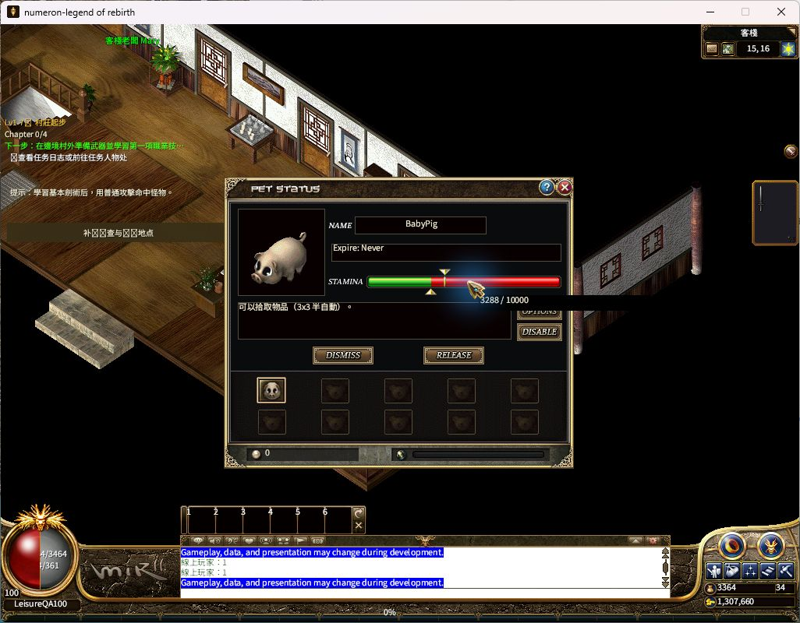

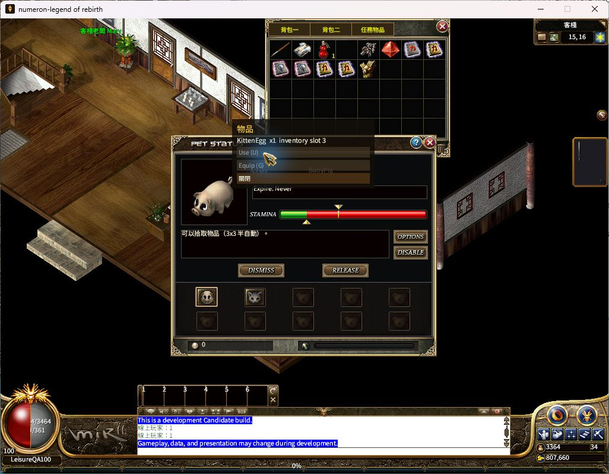

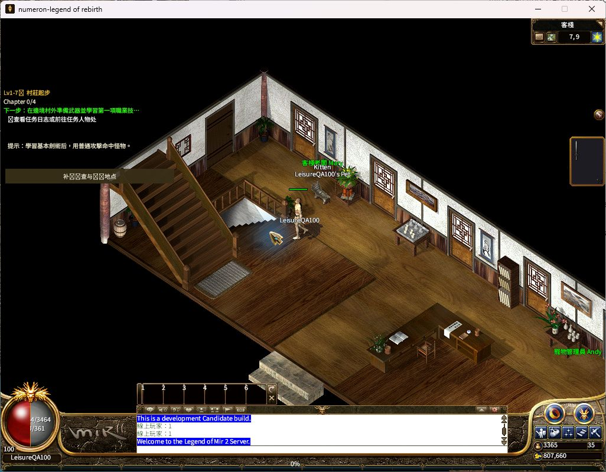

宠物仍为部分验收：source08的BabyPig邮件领食物及喂养按69原范围保留；source11的新叠窗Use只验猫蛋，同图跟随只验Kitten。83余额807660低于此前Cherries报价2970000，本批没有新增食物购买/叠窗喂养，也未追加资金。有效拾取、活动跨图跟随、完整普通保存重登及Kitten冷持久仍待完成，**pet passed=false**。玉晶礼服与新SLG未因这些结果上调。

### 普通矿镐购买、同进程保存读回与开挖起点：84–89

本批6图均独立查看实际像素，实际SHA匹配原JSON、6图互异；原图及metadata逐字节归档，见[逐图审计与保存范围](generated/player-qa/native-leisure-20261020/source11/mining-pet-gui84-89-audit01.json)。没有读取私密存档或以隐藏状态推断材料。

| 证据 | 有限实际结果 |
| --- | --- |
| 84–85 普通买矿镐 | Vincent武器店普通PickAxe×1报价2500金币、要求12级、攻击0–8、耐久10/10；一次Buy后袋2出现矿镐，金币807660→805160。商店unconfirmed文字继续保留，未因此重复购买。 |
| 86 普通装备 | Character武器格和纸娃娃均显示矿镐，虎物品仍可见、金币805160。只接受装备外观及普通替换武器，不是材料或采矿收益证明。 |
| 87–88 同进程重选角 | 普通Alt+X→Yes到实际CharacterSelect，再Start/Welcome；88中E正常打开，两宠图标仍在，所选Kitten为4401/10000、Never和Summon，矿镐、虎物品及金币805160可见。接受双宠所有权及该次营养/未召唤状态、工具、余额的有界读回；营养不是保存瞬间精确不变的证明。**这是同一Native进程中的重选角，不是冷进程、服务器重启或宠物整链保存通过**。 |
| 89 矿洞开挖起点 | Root普通移动经比奇0(663,215)到D401(24,181)，左墙先转身再普通点击开始采矿动画。图片只直接显示矿洞24,181、举镐姿势及金币805160；连续动作属于现场操作观察。尚无矿石掉落/入包、纯度、铜矿、JadeCrystal或制作完成证据。 |

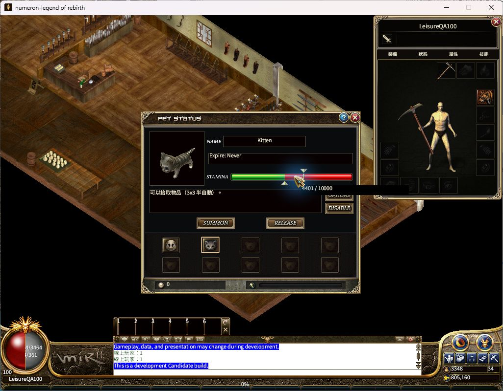

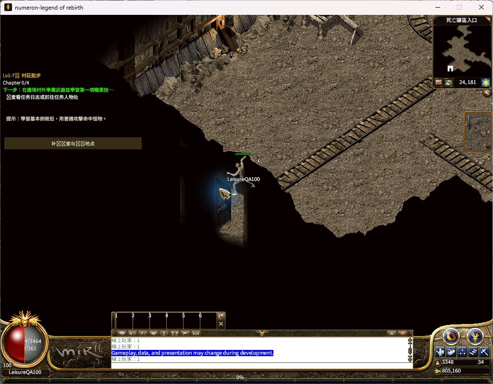

87–88补的是有界普通保存读回；有效拾取、新增食物叠窗喂养、活动跨图跟随、完整设置及冷持久仍未通过，`petPassed=false`不变。玉晶礼服仍须自然材料、制作、穿脱、属性/外观及保存全流程；原版采矿起点也不能替代新增SLG采集、种植、烹饪接线验收。

新增SLG仍未接线。外层QA仅准备三个新增服务器物品SlgGrainSeed50101、SlgGrain50102、SlgGrainMeal50105及默认关闭的最小目录：种子100金币，1种子30分钟产3粮，厨房2粮加50金币、1分钟产1份HP50餐食；草药两个ID未登记。数据补丁及8个独立测试仅已准备，未应用或运行。100级资格、四块私有田、batch1、普通NPC入口、可信UID/保管/CAS及产物使用的实机闭环仍待实现，不能算原版parity或新增SLG验收通过。

## 后续实际数据的记录位置

继续使用`docs/generated/player-qa/native-leisure-20261020/`存放可公开的截图、元数据及结构化结果。本次已同步[公开outcomes](generated/player-qa/native-leisure-20261020/outcomes.json)，分别记录Guard结果、Root现场观察、正常停服和图片重复缺口；不把缺失的有效截图补写为通过。

隔离前置的实际公开回执已归档于上方链接。其余流程实际发生后，再追加以下数据；下表仍是待完成范围：

| 待记录范围 | 必须具有的实际数据 |
| --- | --- |
| 玉晶礼服 | 84–89仅完成矿镐普通购买/装备/同进程读回及开挖起点。自然出矿、铜矿/JadeCrystal、制作扣料扣金、穿脱外观、属性对照和成品保存仍待验。 |
| 钓鱼后续边界 | 本轮有界普通GUI闭环及runtime-controlled03正常收束、source07 post-exit已完成。SwordFish售后冷重启、发布profile与真PG未覆盖，30的Walleye冷重入不延伸至SwordFish，20–29仍无效。 |
| 休闲宠物 | 59–69普通购蛋/召唤、金币食物/邮件/喂养保留；70基线、71冷世界actor/地图/金币及72正常选角各按限定范围使用。source11真实37项回归及新pair通过，冷E/说明/叠窗猫蛋Use和Kitten同图跟随有界通过；87–88另证双宠列表、Kitten4401未召唤及工具/金币的同进程读回；新增食物叠窗、有效拾取、活动跨图跟随、完整设置和冷持久仍待验。 |
| 坐骑后续边界 | BengalTiger+Saddle有界普通闭环已通过；56另证05恢复已保存虎/鞍/忠诚度、往返后金币和位置。57–58补证Inn0125普通门切图自动NoMount撤骑；其余附件与完整wire槽、AOI/observer、其他受限地图及骑乘标志冷持久未覆盖。04退出/日志未知；05仅Native正常、Gateway未知；06独立正常0/0关闭已核对。47、55、56各按独立范围使用。 |
| 新增采集、种植、烹饪 | 服务端资格和普通入口实现、真实来源与持久提交、产物的正常用途、拒绝/竞争/断线恢复以及完整GUI闭环。 |

本轮不更新整体parity比例，不将目标标记完成，不声明真PostgreSQL、线上部署、签名外发包、Candidate100或最终人类Accepted通过。
