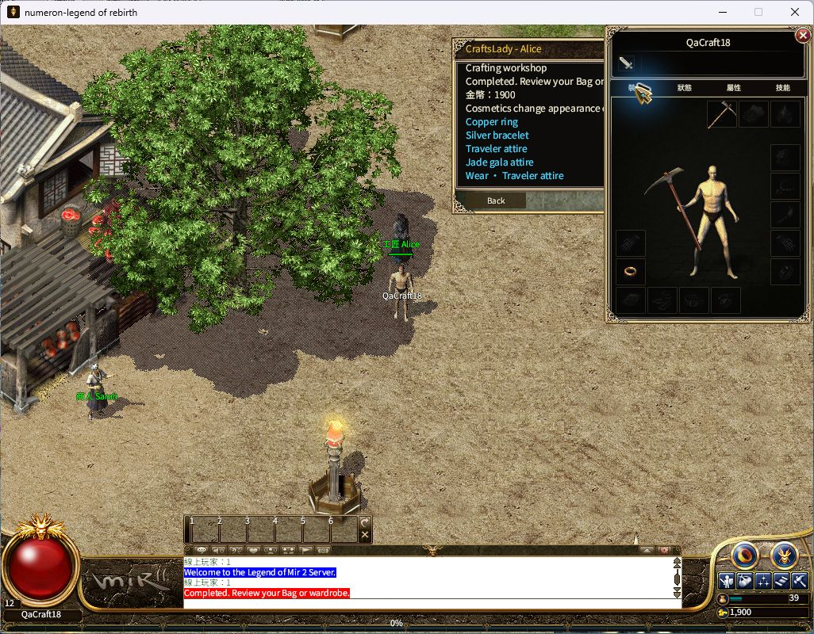
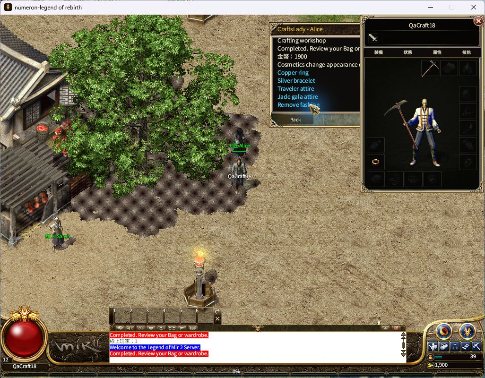
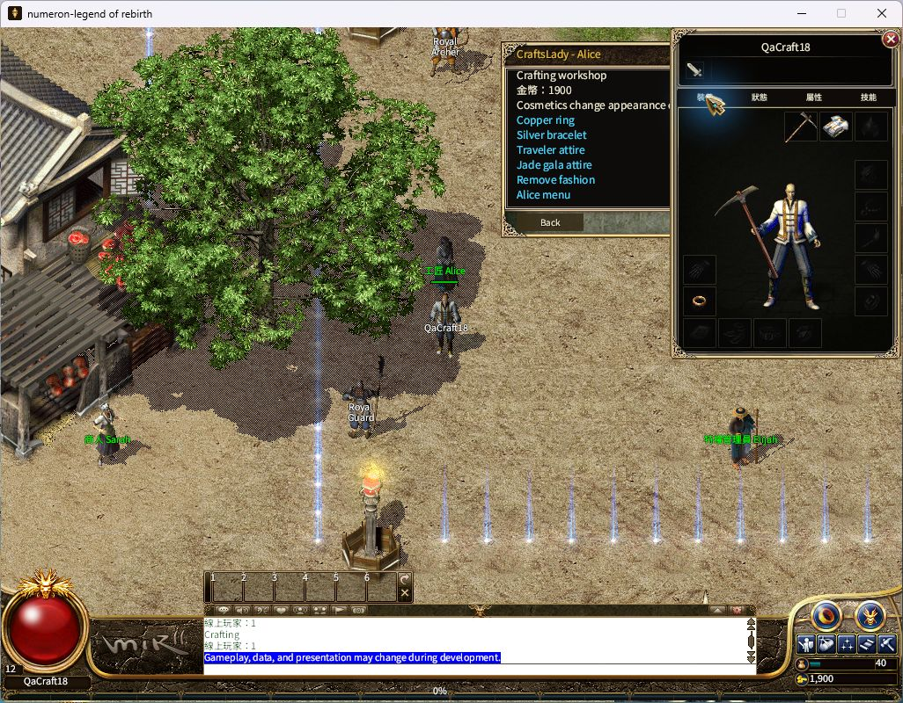
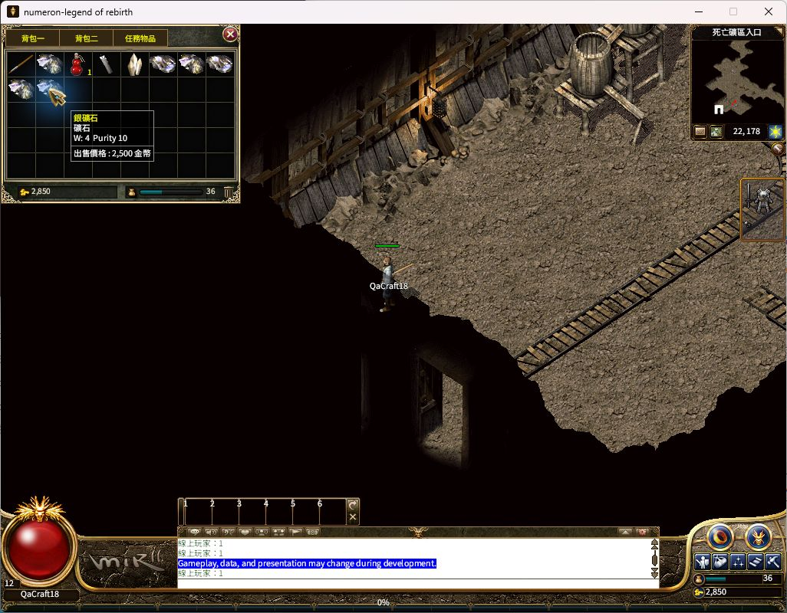

# 原生挖矿与工坊画面验收（2026-10-18）

2026-10-19继续验收已完成：天然矿石封存、鉴定、首次切割得到铜矿，铜戒指制作与普通穿戴，以及旅行者时装制作、穿脱、属性对照和普通保存后重新选角均通过真实 Windows 游戏窗口复验。下述结论只覆盖已执行分支，不提高全项目 Candidate 或 Accepted 状态。[本次结构化结果与50组截图哈希](generated/player-qa/native-mining-visual-20261018/jewelry-fashion-outcomes-20261019.json) 与[原始挖矿结果](generated/player-qa/native-mining-visual-20261018/outcomes.json) 分开保留。

## 2026-10-19首饰与时装复验结果

同一 QaCraft18 角色沿用完整 File 存档。当前实际客户端为 runtime11/client02，源码 `830395cbe42c040c492fae85eeab5907ed7861e7`，Native 131211776字节，SHA-256 `95b321888264d78d5e1925ccd241e998a81514d69bd86f4a419789fa6886da45`；启动收据记录1456项源码输入匹配。本次续验没有修改产品代码或重新运行产品测试；下面旧版1149项测试仍只归属于其原始源码。

| 实际普通操作 | 结果与证据 |
| --- | --- |
| 第一块天然银矿封存、鉴定、首次切割 | 封存免费，鉴定250、切割2500；实际铜矿，2850→2600→100金币。见16–19。 |
| 出售天然余矿 | 黑铁1500、黑铁1350、银矿2500；100→5450。见23–27。 |
| Alice制作铜戒指 | 铜矿×1和300金币，5450→5150；新戒指进入背包后普通Equip到左戒指格7。见28–31。 |
| 戒指与旧物核对 | 新装备戒指攻击0–1、等级3、耐久5/5、重量1；旧铜戒指仍在背包。见57–58。 |
| 第二块天然银矿加工 | 恢复普通选角后封存公开载体#6，鉴定250、首次切割2500，实际铜矿；5150→4900→2400。见39–42。 |
| 制作旅行者时装 | 铜矿×1和500金币，2400→1900；解锁衣橱，制作本身未生成护甲。见44。 |
| 穿脱时装 | 普通Wear、Remove fashion、再Wear；世界人物及纸娃娃均实际变化，无重复扣金。见52、55、56。 |
| 保存后再进世界 | Alt+x→是→选角→StartGame；1900金币、六格背包内容、原布衣与新戒指、两页属性保留；Alice交互正常，菜单仍为Remove fashion。见59–65。 |

旅行者复用原版BaseDress(M)的shape1/StateItem60，而角色原先正穿同款布衣，所以最初穿戴前后的身体同图不能独立证明外观改变。为消除这个混淆，先普通卸下真实布衣，保持护甲格为空，再对照穿时装→脱时装→再穿：世界人物和纸娃娃确实白蓝衣→裸身→白蓝衣。随后已把同一件原布衣穿回。

实际装备相同时，时装前47、穿后50、保存再进世界62的战斗属性逐值相同：HP111/111、MP53/53、AC2–3、MAC0–1、DC2–11、MC0、SC0、暴击0%、暴伤0、攻速0、准确+5、敏捷+15、幸运0。第二页48、51、63也一致：背包负重16/98、装备负重6/22、腕力10/23，所示抗性、恢复及元素攻击加成为0。无真实布衣对照53与54均为AC0–1、MAC0–0，其余战斗数值一致；真实卸甲引起的防御减少不归因于时装。

44–65共22组新增截图经独立只读复核：原图哈希全部匹配，外观与属性比较成立。最终角色停在比奇省(321,267)，原布衣、新铜戒指和旅行者时装已穿戴，金币1900。银镯及玉晶礼服未执行；天然两次切割实际均出铜，不重掷结果。本次保存复验是同一客户端内正常退出至选角再StartGame，不宣称新进程、重新认证、服务重启、跨玩家观察、真PostgreSQL或部署通过。最终人类Accepted与Candidate100仍开放。

## 2026-10-18原始挖矿操作

同一 QaCraft18 角色、PickAxe836，通过普通矿区入口进入 D401，先转向再点击相邻矿墙，松开鼠标后继续挥镐；I 打开背包停止。自然得到 SilverOre 四块（纯度19、14、11、10）和 BlackIronOre 两块（纯度10、6），没有补造矿石。金币保持2850。

正常移动离开矿区，经过地图入口回到比奇省，再用普通大地图寻路走至 Bill 附近，当前为地图0的303,222。未发送 MoveTo、Stage5、QA或管理员指令；没有读取封存随机结果。

银矿与黑铁矿 tooltip 原图另见 [SilverOre](generated/player-qa/native-mining-visual-20261018/10-natural-silver-ore.jpg)、[BlackIronOre](generated/player-qa/native-mining-visual-20261018/11-natural-black-iron.jpg)。

## 2026-10-18挖矿输入修复与验证（历史构建）

产品提交945f396edd6fb1646fef63d63e147ce5832b55d9，按 Crystal AutoHitMine 行为修复松开鼠标后不能持续挖矿的问题。首次异向点击只转向，收到权威方向后再次点击才建立本次挖矿动作；鼠标释放延续原矿墙方向，新操作、界面、失焦、地图、工具及权威来源变化会取消，旧队列不得重新启动动作。Alt采集与Shift强制攻击的原优先级保留。

首次 host01 因新测试缺少 CommandSource trait import 而编译失败，执行测试数为0，失败记录保留。4d1f0ec80069c6ad77a97243ec6e307a60de4d4d仅补测试局部导入；当前完整 Windows host02 实际1149通过、0失败、7项既有忽略，包含17项具名挖矿测试。当前 Native 与 Gateway 均从该源码在原 Guard 下重新构建，1456项输入、0 drift；原50GiB / 2000ms / 15000ms及Policy B未变。

| 产物 | 字节数 | SHA-256 |
| --- | ---: | --- |
| Native | 131210752 | 996126afff0620c072c8a72e3192b992b30bbd5dbd02a1a406972b9c320f02fa |
| Gateway | 123378688 | e7255fdbc946469fda038e57674fa38922121e82e19eff0ed2eb3b74c05d5b57 |

当前 runtime10/client02 仅启用已有的输入与移动诊断日志，不改变玩家输入、状态或网关权限。早先 client01 未建立世界点击响应，原因尚未确定；随后同一二进制的正常输入成立，不据此宣称该观察已经定位修复。UserLocation 的 accepted 分类仅表示位置回执，不能单独证明矿墙命中或产矿；本轮产矿结论来自实际背包与矿石 tooltip。

## 工坊入口观察修正与已恢复的历史停点

点击 Bill 后误将 Special 页脚和特殊修理链接当作工坊入口，打开的是 Special Repair 空报价窗口。证据14的旧文件名含 refine，原图和原注释保留，另有 workshop-menu-viewport-diagnosis01.json 明确更正。没有确认物品或提交费用。

公开菜单和渲染源码核对表明，真正的 Stone workshop 位于 Close、Special 之后；NPC菜单只显示9行，说明文字换行后入口在下方，需要正常向下滚动。未发现路由代码缺陷，也未据此修改代码。

当时游戏窗口连续失去焦点，激活后下一次操作仍受遮挡，因而暂停鼠标输入并请求确认其他操作者，未操作无关应用。后续确认后已恢复；证据15实际滚动看到工坊，16–19完成封存、鉴定和切割。该停点已解除。第二次封存前另有会话中断及首次恢复后世界交互停滞（34–36）；正常选角后交互恢复（37–38），随后39–42完成加工。本次64再次确认重入后工坊交互正常，不把恢复现象写成根因修复。

## 已完成分支与仍开放范围

- 已完成：两块天然银矿各自首次封存、鉴定及切割；自然余矿普通出售；铜戒指制作、穿戴和旧戒指回包核对。
- 已完成：旅行者时装制作、世界及纸娃娃穿脱、同装备属性对照、正常退出至选角后重新进入的保存复验。
- 仍开放：银镯与玉晶礼服等未走到的产物分支、新客户端进程及服务器重启后的保存、跨玩家外观、真PostgreSQL、线上部署与最终人类验收。

本轮沿用既有账号和完整 File 存档，未新增等级、金币或物品前置。历史受控12级/10000金币不记为自然收入。原工作区 HEAD 及41份既有差异经哈希复核未变；未部署线上，未验收真实 PostgreSQL，Candidate100=false，整体人类 Accepted 不变。
