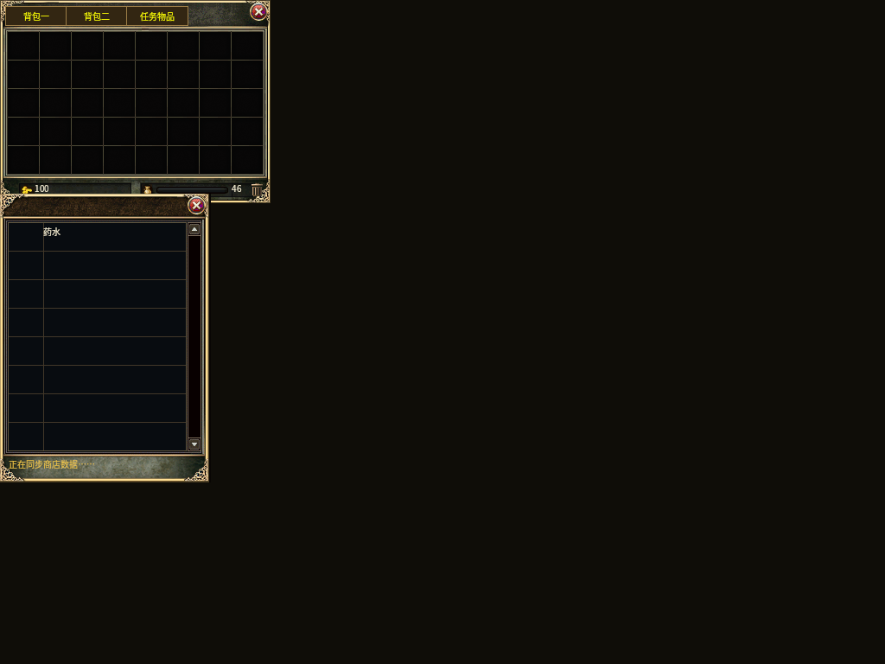
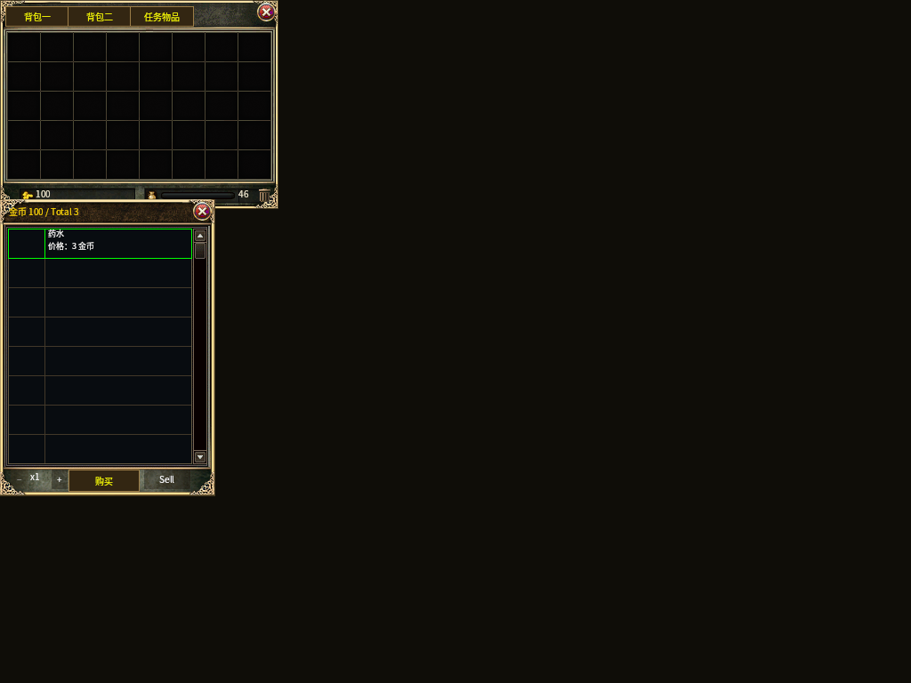
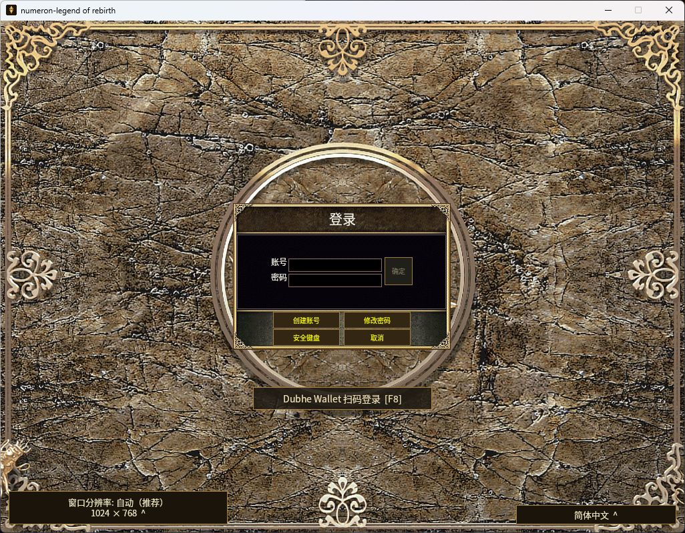

# Windows 药店窗口与聊天栏点击穿透修复（2026-11-01）

范围为用户选择的“先修界面，给可测试版本”。基于 release 工作树
`b6c739d964f3d8744cf84916f6f3b6cd9c557f91`，分支
`codex/windows-ui-shop-pointer-20261101`。未改主工作树的既有修改、账号、
金币、充值规则、Docker、远程服务或公网更新频道。

## 故障与改动

- 药店：普通金币商店缺少当前购买来源时，共享绘制器拒绝无 stamp 的购买界面，
  原生适配层却直接返回，造成背包打开、商店不可见、服务仍占用输入。
  现在保留原 `Prguse/1000` 的 244×334 商店框，显示已收到的商品及
  “正在同步商店数据……”；此状态没有选择、数量或购买控件，当前 Gate 的
  关闭按钮可退出，Esc 沿用原关闭流程。没有 Gate 的瞬间关闭图标禁用，
  待 Mutate 绑定 Gate 后可用；没有伪造购买来源。
- 买卖合一商店：真实 `NPCGoods → NPCSell` 收包后，本地模式为 Sell，
  同轮完整 owner catalog 为 Buy。仅在显式同时具备 buy/sell 能力且模式为
  Buy/Sell 时，将模型授权比较键规范化为 Buy；UI 选择仍使用原状态。
  商品 UID、价格、完整目录、背包、连接、owner 和来源版本继续严格匹配。
  已进入/结果未知的购买不会因关闭或重开窗口解除屏障。
- 底部聊天栏：世界鼠标发送系统先于 Bevy `Interaction` 更新，原生几何捕获
  遗漏共享 `CrystalChatRoot`。现在使用已完成的实际 UI 布局，在世界指令
  发送前捕获可见聊天框和控件；透明的全屏定位根不遮住地图。
  指针按下来源、可见性、裁剪与 DPI 变换沿用现有机制，悬停光标与目标高亮
  使用同一捕获结果。没有修改服务器移动、AOI 或战斗权威。
- 简体提示通过既有固定 OpenCC 1.4.2 `tw2sp` 离线生成器补充，目录共
  9,902 键；只有一个新键及其来源摘要/计数变化，不改其他文案或经济数据。

## 验证

最终冻结的 14 个变更 Rust/JSON 文件逐项 SHA256 与所选运行记录一致，
9 组共 **189 项通过、0 失败**。完整运行、源码摘要和此前失败尝试均保留在
[集中证据](generated/native-ui-shop-pointer-20261101/validation.json)及其
[日志归档](generated/native-ui-shop-pointer-20261101/focused-checks.zip)。

| 检查 | 通过数 | 证明范围 |
| --- | ---: | --- |
| 原生聊天指针 | 4 | 三种聊天尺寸、两种缩放、十个控件、左右键；拖出控件不移动；透明区域/隐藏聊天与方向键正常 |
| 原生 BUYSELL 激活 | 2 | 实际 provenance 激活系统启用一次意图；能力/价格/UID/owner 不符拒绝 |
| 原生金币购买传输 | 31 | 购买来源与重复/未知状态屏障的相邻回归 |
| 原生既有指针 | 31 | 地图、任务等既有捕获与有序指针行为 |
| 共享购买 Gate | 10 | 模型比较、生命周期与单次保留 |
| 共享商店 | 73 | 绘制/关闭/重开/过期控件、布局、购买和同步状态 |
| 原生 runtime 收包 | 1 | 实际队列/ingest 的 Goods→Sell→完整 owner 顺序与可用购买模型 |
| 商品数据适配 | 36 | 完整 owner 商品和相邻个人数据适配 |
| 离线 GPU | 1 | 生产控件、实际打包资源、简体字体，两张画面 |

runtime 通过 Windows manifest 的 `-p mir2-bevy-runtime` 和现有 `--locked`
依赖图测试；独立 runtime 的历史 Cargo.lock 已落后于本地依赖声明，
本轮没有更新该锁或升级依赖。目录生成 `--check` 通过，另有生成器自身
2 个正例和 10 类负例通过，未计入上表。

早期失败包括测试误用 UI 快捷键 D、Sell 消息后未重新选择商品的夹具、
新增简体键遗漏、生成器“资料→数据”与断言不一致，以及测试入口的环境/
锁文件设置；均保留原始失败记录。最终仅采用冻结源码且实际匹配测试的成功结果。
编译器仍有既有 warning；GPU 日志含 ICU4X 日语分词模型提示，本次简体
截图没有缺字，未将该提示当作全语言验收通过。

### 离线画面（不是实账号交易截图）

画面使用显式本地商品与来源夹具，未登录、未连接游戏 socket、未发出购买。
夹具中的 Potion 按既有模板显示“药水”，不作为真实商品名称/价格验收。

## 实账号验收边界

离线与原生系统回归通过，不等于远程药店已经完成真实买卖。Windows 新包
仍需登录测试服检查：点药店“查看”后同时显示商品和背包；购买一份药品后
核对原库存与金币；X/Esc 可关闭并重开；点击交易、频道与尺寸按钮不改变人物
坐标，地图点击和方向键仍能移动。真人前端最终 Accepted 保持开放。

## 已生成的独立测试版

`WN-CANDIDATE-20261101-ui-14` 已从干净提交
`1e06de683a2a6aa8779a464bcf08e35d4508bbde` 完成 Rust 1.95.0 Release 构建，
包含 209 张地图和 255,079 个文件。EXE 为 133,762,560 字节，SHA256：
`A288FF34D6B68BAE291C1D69CFAA294F19C1E6B98BB4C6632EAEB2795F720A28`。

打包器自身的完整 v4 校验通过，`failures=[]`、`detachedSignatureValid=true`、
`currentSourceValidated=true`；校验发生在暂存目录，随后由原脚本在同一父目录
整体改名交付，原报告未改写。另有最终目录的 EXE/清单/构建证明与版本绑定
检查，没有再运行第二轮全量资源哈希。
[成品摘要](generated/native-ui-shop-pointer-20261101/delivery.json)与
[构建、资源补齐和校验原始记录](generated/native-ui-shop-pointer-20261101/release-checks.zip)
固定了这一区别。使用既有内部 CMS 签名，非生产发布者 Authenticode。

首轮打包缺少独立 Git 工作树未带上的生成图集而失败。确认五个资源目录的
版本定义与原 `4300c7aef` 一致后，从保留的 r13 构建树核对 204,131 个输入：
保留 104,479 个一致文件，补齐 99,652 个缺失文件（298,038,879 字节），
逐文件散列一致、工作树保持干净；复用原 Release EXE 后再次出包通过。
失败记录保留，未放宽资源或签名检查。

实际可执行文件：
`C:/m2ui1101/mir2-web3/dist/mir2-windows-candidate/WN-CANDIDATE-20261101-ui-14/mir2-platform-windows.exe`。
电脑控制已启动该文件，真实简体登录画面与 Dubhe Wallet F8 入口可见。
窗口从屏幕边缘移至完整可见的显示器，客户端仍为 1024×768；未登录或发起
购买。[原始启动范围记录](generated/native-ui-shop-pointer-20261101/native-startup.json)
与下图只证明原生启动，不替代前述实账号验收。

直接运行以上独立测试版；桌面旧快捷方式和公网更新频道仍指向旧版本。
后端、现有安装与账号数据没有更新，本次不包含安装覆盖或公网发布。
