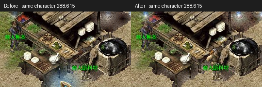

# 比奇 NPC 建筑遮挡修复与阿洛当前边界

维护分支：`codex/windows-player-journey`，基线 `c404bde8a5190534f6bc83ec8a4fe78fffc8cb50`，保留 R16 与原有未提交工作。仅更新本地开发试用包，不发布公网更新。

## NPC 为什么被盖住

Crystal `Client/MirScenes/GameScene.cs:10810–10944` 的 DrawObjects 对每行先画完整的地图中层／前景，再画该行的活体对象。旧 Windows 深度为 `y*1000+x*10+layer`，把同一行的建筑和人物逐格交错；同格建筑前景也高于人物身体。因此右侧摊位／锅台会误盖住同行商人的头部和上半身。

Windows 地图与实体现在共用 `world_depth.rs`，每行分地图和对象两遍。使用相机相对坐标，保留头发／身体／武器之间的浮点深度精度。后面一行仍覆盖前面一行，不把 NPC 永久置顶。地面物品在同格活体之前；动画行走继续使用来源格排序。

原生实体额外提供 `sortZ`，共享 runtime 在保留旧动画帧时使用相同深度。没有该字段的既有 Web producer 仍走原来的兼容路径。本轮没有更改 Web 的绘制顺序、Zone 或游戏结算。

## 实际画面与验证

同一个独立普通角色在比奇 `288,615`，旧 EXE 与新 EXE 正常退出／重开后对照。第二张图清楚显示原来被锅台遮掉的商人上半身；随后普通走路到 `288,614` 检查相机移动。图像来自真实窗口，比较图仅裁剪并并排排版，没有重画角色或建筑。

对应截图、测试分组、源码／二进制 SHA 和本地交付收据见[本轮证据](evidence/npc-row-order-20261103/README.md)。原生自动截图的内嵌 capture 元数据仍为 draft；本轮通过独立源码和 EXE SHA 关联，不将它改写为已签名 Accepted。

测试覆盖整行左右建筑、同格前景、下一行遮挡、大坐标精度、地面物品与角色复合层、移动排序与 runtime 保留旧帧。最初旧测试中的绝对 Z 数字和“同格前景应该盖住活体”断言也按 Crystal 源码纠正，保留下一行遮挡断言。精确结果见证据中的分组日志。

同格多个活体的 ObjectID 稳定排序、原版尸体全局前置仍是独立的既有绘制差异；本轮不认定完整渲染 1:1 或人类 Accepted。

## AI 是否全部完成

当前完成的是第一段伙伴闭环：普通组队、跟随、参战、使用已有血药、低血撤退；教学能改变支援／拾取优先级，换进程后保持。R16 的普通网关验收实际记录了教学前战斗中拾取、教学后先攻击并在战后拾取、重启后新场景继续先支援，见[原验收](evidence/alo-r16-20261103/b2-network-summary.json)。Windows 已验教学保存、撤销、重教和导出，但尚未由真人完整重演同场景前后战斗对照。

真实模型已另验三次调用：两只怪、不拾取、返队；重启后引用真实旧击杀经历并执行跟随，见[模型验收](ALO-OPENAI-20261103.zh-CN.md)。本轮渲染修复没有新增模型调用或改变这部分源码。

仍有明确限制：

- 培养入口是固定按钮，设置“组队先支援、战后拾取、离队先问”三条习惯，尚不能用任意自然语言教会新习惯。
- 模型只提交跟随、附近狩猎、回安全点、等待四类有限目标；狩猎最多三只，要求主人同组、可见，且在六格边界内。
- 记忆来自 SQLite 真实事件与关键词检索，最多八条送入模型。角色没有自行训练模型权重。
- 独立出门、跨图探索、买药修理、采购交易、复杂关系和持续自发目标尚未交付；真人连续体验、留存付费也未完成验证。
- 只读审计还发现一个待复现的委托语义差异：`wait` 提示只允许自保，但当前基础攻击优先级可能继续支援队友。需要专项验清，不把有限指令支持写成任意意图均已可靠执行。

下一段应先在 Windows 完整演示“犯错→教学→下一场改变→退出重开仍保持”，再做自然语言教学和一种有明确预算、可召回的独立补给任务。不能把当前成果称为已经独立生活的完整 AI 玩家。
