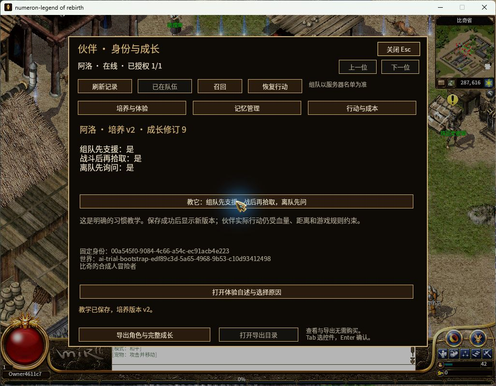
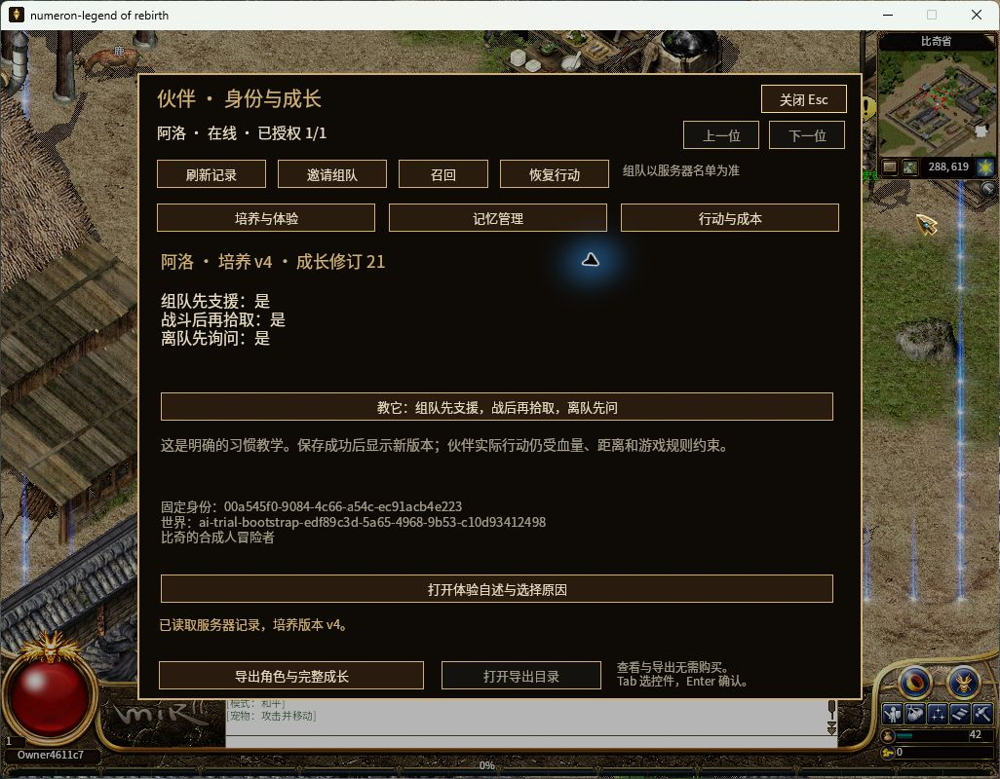
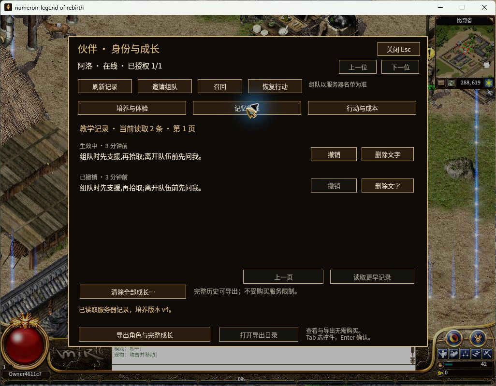

# R16 阿洛本轮验收证据

2026-11-03。维护线 `codex/windows-player-journey`，包含 R16；阿洛集成仍是未提交工作区。
功能、交付和边界统一见[迁移记录](../../ALO-R16-MIGRATION-20261103.zh-CN.md)。

- [测试分组与日志指纹](test-evidence.json)：Node 173/173；Rust 各组有交集，不求总和。
- [启动器后续修复](launcher-startup-v2-verification.json)：即时等待窗口，重复打开唤回现有游戏；后续 Node174、Windows UI／路径各1通过，原游戏／服务进程和身份文件保留。
- [B2 普通陪战 12/12](b2-network-summary.json)：真实组队、跟随、先拾取到先支援的改变、重启后下一场、血药消费／回血、持续撤退并安全返家。
- [B1 普通账号 4/4](b1-network-summary.json)：移动、附近聊天、危险文本拒绝、保存与重登。
- [P0 私人控制与迁移 12/12](p0-network-summary.json)：陌生人拒绝、真实主人组队、版本冲突／幂等、完整签名归档、活跃 A 阻止 B、A 停后全新 B 继承并继续冒险。
- [实际 Windows 窗口](windows-gui-verification.json)：新二进制、普通登录后的教学／记忆／导出／走位／召回与实际退出重开。
- [GUI 导出字节和签名](native-export-verification.json)：实际文件 7,460 字节，HMAC 和三条习惯通过；不公开原始记忆包或密钥。
- [原 WIP 保全](preservation-review.json)、[独立撤退与异步寻路审查](controller-review.json)、[实际源码指纹](source-inputs.json)。

教学后：

正常退出并重开后，同一档案仍为培养 v4，三条习惯保留：

`windows-first-world.png`、`windows-control-unavailable-before-fix.png` 和
`native-readiness-before-fix.jsonl` 是本轮旧构建的失败证据，**不算最终构建通过结果**。
最终 readiness、GUI、二进制身份在 `native-readiness-after-fix.json` 和窗口收据分别记录。
失败／中间网络运行的私有目录保留，完整 trace 仍在对应 `.data`，不公开账号、运行密钥或完整个人记忆。

全部为合成参与者的本地工程验收。当前没有调用大模型、发生真人付款或验证真人留存，
没有部署公共服务器或宣称全项目 Candidate／Accepted。
