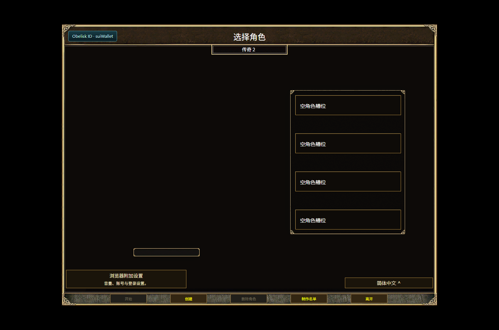

# R16 扫码交接诊断与正文读取边界候选

2026-11-16。当前正式仍为 `e0ceea22964c03041d45e49e506b3a8badd6984e`／`dpl_FoNUgjSRpw56hwUFDNrSs7LZZQFN`；本轮没有发布或恢复数据库。新补丁已在隔离生产构建和本地真实 Gateway 验证，**尚未取得新版公网资格，整体 Goal 继续 active**。

## 公网对照说明了什么

此前 8bf 的原 R1 保留 `APPROVED_WALLET_LOGIN_NOT_OBSERVED`，没有进游戏；不能用这轮对照改写其结果。[原试发与成对回退](../r16-font-body-progress-20261116/production/README.md)。

1. 当前 e0 上额外运行完整原流程，并增加只读观测，再次失败。14 个实际读完的 pending 正文**全部发生在手机批准前**；批准后两次请求没有收到响应头，分别在 12002／12000 毫秒取消。88 条页面状态均为 visible。已收到的第一方响应为 no-store／CF DYNAMIC／Vercel MISS。这不证明上游缓存错误，也不能将 pending 说成批准后返回的旧状态。[时序结果](control-findings.json)
2. 无游戏资源的 API 对照使用官方手机尺寸 Testnet PWA 正常创建 Passkey 钱包、一次批准同一真实会话。签名类型 Passkey，批准结果 2531 字节；离线真实验签 269 毫秒、无网络调用。批准后的浏览器空 POST 295 毫秒返回 approved，显式 `{}` 为 1618 毫秒，独立 Node 为 798 毫秒。只说明这次实际请求正常。[API 对照](control-api-probe.json)
3. 又一次完整游戏对照增加了**两个主动探针**：批准后同源 version GET 和独立 Node 同意图 status POST。原浏览器轮询 212 毫秒拿到批准，完成兑换、LoginSuccess、创建角色及 StartGame；随后失败于 `FIRST_PLAYABLE_SCENE_NOT_OBSERVED`，走路为 0，并正常注销。额外探针可能影响调度，不能取代原失败场或作为新版发行通过。[登录网络](control-loaded-auth.json) · [原流程结果](control-loaded-summary.json)

目前只确定交接存在间歇失败。资源竞争、请求正文适配、上游传输或服务端处理均不能凭上述结果直接定因。两次失败和一次完整流程中的登录成功同时保留。

## 本地修补与验证

独立代码检查发现一个可复现的无界路径：服务端读取 NextRequest 空 POST 流时没有正文期限；超大响应还会等待生产者的 `cancel()` 完成。与上面的公网偶发失败是否同因，**尚未证实**。

- 客户端创建／轮询都发送显式空 JSON 对象，意图仍仅放在 Authorization。
- 服务端请求正文最多 1024 字节／2 秒；不完整正文拒绝，不能先接受已有的 `{}` 而忽略未结束的流。
- Relay 的原 8 秒期限同时约束响应头和完整正文，最多 32768 字节；异常路径不等待生产者确认取消。
- 意图、来源、消息、签名、公钥、网络、固定有效期及 Gateway 一次消费均保留。原创建 20 秒、轮询 12 秒及一次重试保持；没有放宽游戏 8／65／120 秒和六字体／113 图门槛。

认证相关 **28 项通过**，补了真实 WebAuthn Passkey、错误 challenge／公钥、未结束的请求正文、超大正文且取消永不完成、8 秒响应正文截止。另有工作树相邻 50 项通过，但其读取了保留的 Native／shell WIP，不作为隔离候选资格。[命令、哈希与边界](validation.json)

隔离构建校验 2181 个 app／lib 文件、1 个既定生成输入例外，排除外部 WIP。严格 Next 生产构建通过，候选 `r16-auth-body-56c223a0`，BUILD_ID `r67J94QSlDcfY9pD2xWm2`，耗时 46011 毫秒；既定生成资源、运行包与资源配置不变。[构建回执](isolated-build.json)

本地浏览器使用实际编译 UI、第一方 Next 路由、内存测试 Relay 的真实 Passkey 签名和实际 Rust Gateway，未拦截请求或注入登录：

- 真实未传完 HTTP 请求在 2014 毫秒得到 400，未创建 Relay 会话。
- 实际二维码、pending、批准后兑换、唯一 PasskeyLogin／LoginSuccess、选角可见通过；没有创建角色或发送玩法命令。
- 再读固定同一证明，用正确的 `credential` 字段再次兑换，得到精确的 401／`channel identity proof was already used`。
- 本地 R1 在界面检查中超时，原 false 保留。R2 为明确标注的补测，保留原选角等待期限，以只读 CDP 抓当前像素，不等待无关字体全部完成。R1 未执行的旧 replay 分支原先使用错误字段，R2 已纠正并验证精确拒绝原因。
- R1 的 next=false 清理标记未覆盖信号退出；后续端口／所属目录进程核对无残留。R2 已修清理判定，浏览器、Next、Gateway、Relay 均关闭。

[R1 原失败](local-auth-r1.json) · [R2 补测](local-auth-r2.json) · [清理核对](cleanup-confirmation.json)

选角截图只证明当时画面和四个空槽可见，未计原版背景、纹理、Native 接管或 Windows 视觉 1:1 通过。本地测试 Relay 不代表官方手机或公网签名验收。

## 保留与下一步

29 份原始内容 WIP 的 SHA 保持；19 个私有源码覆盖已逐项恢复。构建在恢复源码后不能直接重新启动，需先重新取得覆盖并核验。[恢复回执](restoration.json)

额外公网完整对照通过正常协议创建了一个隔离 QA 账号／角色并保存；没有删除 QA、重置存档或恢复数据库。本轮没有重新读取此前 320／232／232 原始行的哈希，不能把上轮保留证明当成新的线上快照。

下一步以新提交冻结代码、重新取得同源发行资格，在公网原流程验证签名交接和完整资源／移动门槛。原偶发根因、字体性能、首次 Q、语言和完整 Windows R16 1:1、实体手机仍开放；不原样重发旧候选，也不以本地补测宣布修好公网。

应用源已固定为 `fea64484b6`；[发行控制器准备与111项保护](release/README.md)单独记录。同源后端工作流已触发，记录时仍在构建，没有切换正式服。
