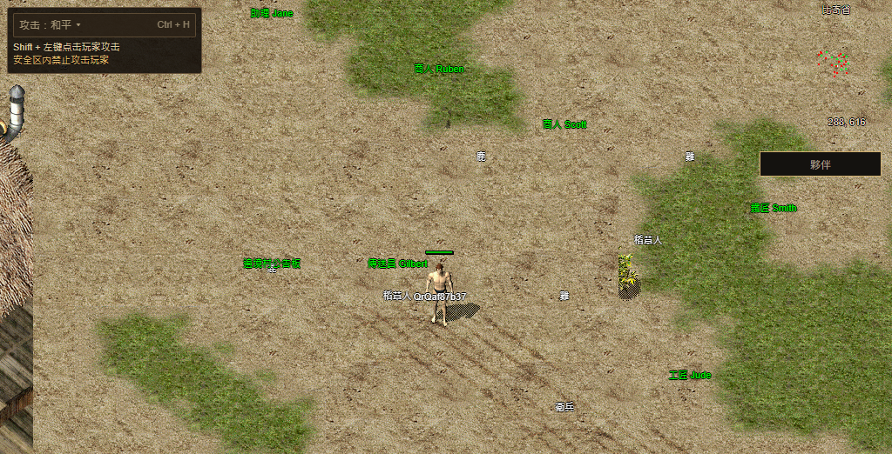
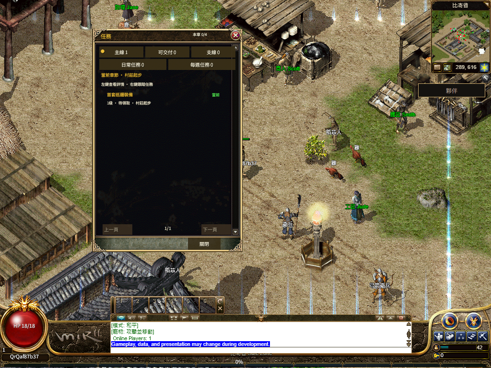

# R16 正文边界候选实际试发与成对回退

2026-11-16，Asia/Shanghai。应用源 `fea64484b6a25ccd59a22d8f52a5718aa6e57df6`，发行控制器 `2cf385ceaa1a99ad0dc472f6123d703bb4064010`。**公网原R1未通过，R2未执行，新版没有保留在线；整体R16 1:1 Goal active，Candidate／Accepted均未完成。**[机器状态](status.json)

## 当前公网与数据

[游戏入口](https://numeron.obelisk.build/game) 的前端和Gateway已恢复为 `e0ceea22964c03041d45e49e506b3a8badd6984e`，Vercel为 `dpl_FoNUgjSRpw56hwUFDNrSs7LZZQFN`，Gateway PID `1787421`。独立域名映射、公共版本和外部Gateway健康值匹配。[别名](alias-after-rollback.json) · [独立HTTP](postrollback-independent-http.json) · [实际后端回退](backend-rollback.json)

未恢复旧数据库、未删除QA记录。原321个账号、233个角色及233份存档的规范化字节数／SHA均保持，当前322／234／234包含本轮正常协议新增的一个QA账号和角色。原24份配置保持，仅移除本轮自建的两个切换覆盖文件。[回退后只读核对](postrollback-preservation.json)

简中和繁中均重新验证实际二维码像素、pending和取消：各创建一次，取消后无新轮询。[简中](restored-qr-zh-cn.json) · [繁中](restored-qr-zh-tw.json)。**恢复e0后的签名交接没有再测，实体手机相机没有测试。**

## 发行与隔离资格

发行闭包为9个提交、139个文件，两个检查点90／59，111项保护通过。下列工作流均已终态成功；不用重新触发来补证据。

| 工作流 | Run | 结果／证据 |
| --- | --- | --- |
| 同源后端 | 43809422151 | 钱包登录、Gateway及后端发行包成功 |
| Web stage | 43810036864 | [READY候选Hr7与同源记录](web-stage-summary.json) |
| Web check | 43811555491 | [切换前检查](web-check-summary.json) |
| Web promote | 43816295547 | [实际切流](web-promote-summary.json) |
| Web rollback | 43818203903 | [恢复Fo](web-rollback-summary.json) |

Linux artifact `14200204143`，95700095字节，原ZIP SHA256 `9cbaf87eca1f09a43a5fbef5908f9921f48df309b4be7eb5a499ce0f72b08fda`，独立GitHub摘要及1841个文件SHA逐项匹配。Linux共享世界相关310项、Native PostgreSQL216项均通过，七项必需执行测试实际运行、skip为0。ELF 93576560字节，SHA256 `22bb54130b2084a34c31d7b0b7bd604cc99a260a08e8d924a5513b329ee4ec96`。[包验证](linux-package-verification.json)

包传输首个重构尝试网络失败，原部分保留；第二次下载新元数据／改变的压缩体，复用经验证旧ZIP中逐字节相同的压缩体，重构后**整个新ZIP官方SHA**及全部文件校验通过。较慢的完整Range传输只在完整替代包验证成功后停止，部分文件保留。[传输、原失败与主动停止](artifact-transfer.json)

正式库一致快照与24配置备份后恢复独立canary；克隆旧行全部SHA匹配。仅普通协议注册／建角／进城、116.594ms移动、自然中立怪行走、两次注销和同角色重登通过，debug命令为0；正式服务／存档当时未改。[备份](server-backup-summary.json) · [canary](server-canary.json)。实际切流后安装同一ELF，仅改变版本环境；失败后按原路径回退，没有恢复数据库。[后端试发](backend-rollout.json)

同源本地English／默认WebGPU与繁中／WebGL2两场完整流程通过：首步83／108ms，Native113473／28505ms，六套完整字体／113图、行走自然帧、Q开关、正常注销及同角色保存重进均通过。覆盖19个私有文件随后恢复，29份原内容WIP的SHA保持。[本地结果与恢复](same-source-local-results.json)。后核对英文场的helper参数虽然叫compatibility，实际选包／编译后端均为webgpu、fallbackFrom=null；前文据参数名称判断未覆盖默认后端有误。本地缓存／路径仍不是公网冷启资格。

## 公网原R1的判定

原23个固定helper和原classifier不变，没有额外主动诊断请求；原8秒移动／65秒行走／120秒Native及完整六字体／113图门槛均未放宽。[原判定](public-r1-original-acceptance.json) · [选择性原始回执](public-r1-result.json)

| 项目 | 原观察／结论 |
| --- | --- |
| 官方钱包签名交接 | 手机尺寸Testnet PWA真实Passkey签名，一次批准；创建200、8次轮询200、approved、兑换200；唯一PasskeyLogin／LoginSuccess通过 |
| 普通建角／进城与移动 | 正常创建角色，StartGame；首步136ms、288616→289616且渲染确认通过 |
| 静态入场包 | 通过；不等于完整自然行走帧或对象场景通过 |
| 六套完整字体／113必需图 | 通过，全量SHA保持 |
| Worker停启恢复 | 通过 |
| 场景对象包 | `entry-objects-1`两次20秒无响应头／字节后取消；完整场景未通过 |
| 完整行走包／自然帧 | 原JSON两次8秒无头取消，自然帧资格未过 |
| 原120秒Native | 首帧后229253ms，失败；运行包正文110805ms虽通过自身120秒，不覆盖Native失败 |
| 共享Q | 开窗通过，第二次Q已消费但窗未关闭，失败 |
| 正常注销 | LogOut=0、LogOutSuccess=0，`LOGOUT_COMMAND_NOT_OBSERVED`，失败 |

首个主失败为 `PUBLIC_VISUAL_PACK_BODY_NOT_OBSERVED:entry-objects-1`。首个可操作画面缺NPC／建筑等对象，后来的场景齐全截图不能代替首次画面通过。

共享Q关闭失败当时焦点是游戏Canvas，第二次Q的记录为accepted=false／handled=true／defaultPrevented=true，窗口仍开，之后Alt+X没有发出注销；不能从“执行退出阶段”的标签认定正常退出，也不能在未分离复现前断言Alt+X有独立缺陷。[Q事件记录](quest-key-observations.json) · [原失败阶段](quest-failure-stage.json)

官方手机尺寸PWA／虚拟CTAP验证不是实体手机或相机扫码。钱包网络守卫通过、禁止资助路径0；浏览器均已关闭。[钱包批准](phone-approval.json) · [网络边界](wallet-network-guard.json) · [关闭](mobile-browser-closed.json)

## 下一项与完整范围

公网默认走WebGPU；本地通过路径实际为英文WebGPU／繁体共享WebGL2，不能因英文helper的compatibility名称而误判为后端差异。WebGPU manifest的primarySharedUiCompiled=false／primarySharedUiStartup=false是既定有效合同，单凭该标记不能认定bug或擅自改为true。被动时序显示共享HUD明显晚于首帧，Q确实被消费却未关闭。[被动诊断](passive-failure-analysis.json)

下一项以繁体默认WebGPU做受控完整回放，检查世界持续更新时的Q关闭，并分别检查场景包超时／重试和共享界面启动。原偶发签名交接根因、首次Q／语言／像素、其他地图／寻路、三职业新手至30级、技能、组队／交易／阿洛、Native同档及真人最终Accepted仍在整个Goal内。

原失败保留、不跑原样R2。所有自建浏览器／Next／Gateway／Relay进程和SSH控制会话已关闭，两个canary服务已停止，私有工厂19覆盖均恢复。[SSH关闭](owned-ssh-closed-after-rollback.json)。大原始trace／全部脚本及失败部分保留在私有主题目录；此目录只发布选定脱敏回执，文件摘要见[evidence-manifest](evidence-manifest.json)。
