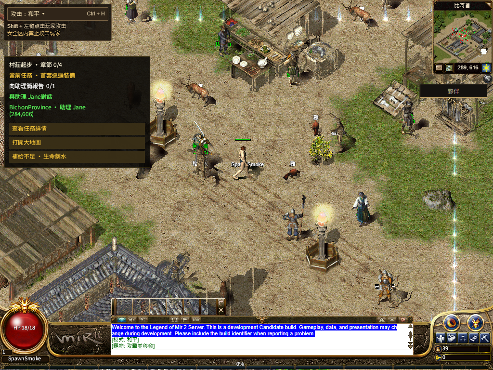
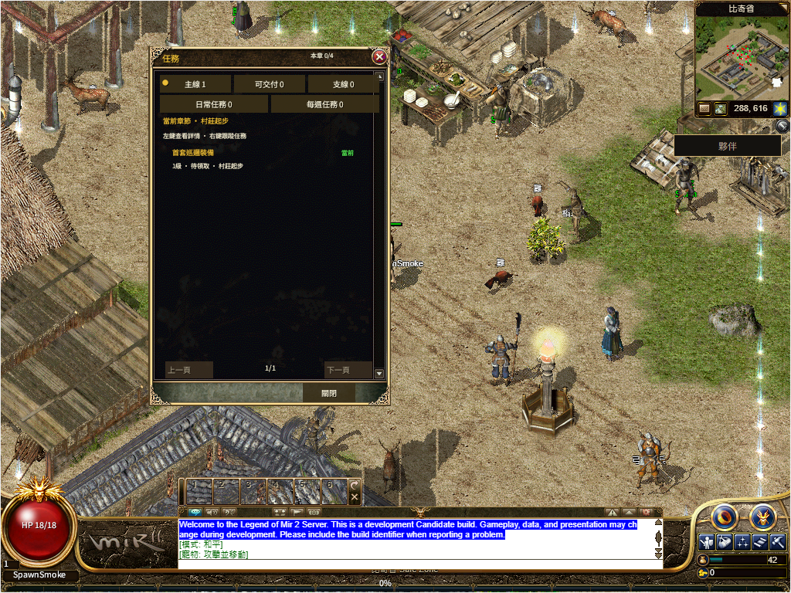

# R16 首帧后的独立资源并行启动

2026-11-13。本节记录发布前的本地候选，当时正式站仍为491819b20e。后续发布及保留的首步失败见[正式回执](production/README.md)。

首个可操作画面之后，不再等待完整HUD预取结束才开始原六份字体和固定运行包下载。HUD预取与失败恢复仍执行；Native就绪、首帧、Canvas/GPU/启动校验和退出取消继续由原逻辑负责。未缩减字体、运行包或UI。

- 原Page测试13项中3项红灯；修改后相关88项全部通过，零跳过。
- 生产构建通过，58个输入按Git blob绑定，运行包及素材版本不变。
- 默认路径与共享WebGL2的Native就绪分别34.313/34.373秒，缓存完整关闭浏览器再开为1.385/1.337秒。时钟从实际firstPlayableFrame开始，包含提前物理行走。前一版同受控夹具约41.3秒；这两次比较不代表公网延迟保证。
- HUD尚未就绪时，四次真实方向键至权威坐标和提交画面为85/554/146/503毫秒，均在原8秒内；Native仍按原120秒判定。
- 两路径均完成113/113预取、六套完整原字体SHA、繁中共享Q开关、后续移动、真实Worker停止后恢复图片/配置、普通退出存档及完全关闭浏览器后重开。
- 单列下载未启动引擎时退出、同页面普通重进，再完成Native/Q/移动/存档和浏览器重开。R4从重进Start点击前起算120秒，比首帧起算更严格；不把这一项当冷启基准。

额外R3验收脚本曾错误要求同页面的firstPlayableFrame指标重发，失败完整保留，原文件SHA见[回执](receipt.json)。这些指标按页面去重；R4核对新的StartGame回包、当前世界和提交画面，未改产品指标或放宽期限。就绪指标也没有被当成独立启动次数。

本轮构建前的第一次保护检查发现其他线程新增后端提交，停止于编译前；核对其没有Web/客户端数据/构建配置差异后，唯一一次实际编译成功。旧134份未提交文件内容保全，未归入本轮实现。

[结构化回执](receipt.json) · [构建输入](build-receipt.json) · [88项回归](regression.log) · [原红灯](before-unit-red.log)

入库测试日志仅移除行末空格；原始日志SHA保存在回执，私有原文件未修改。

正式站491的158.084秒冷启失败仍保留，等待新候选发布后重新验原120秒；本地受控结果不能覆盖公网失败。完整三职业当前路线、后续地图/技能、Hosted、实体手机及整体100% Candidate/人类Accepted仍未完成。
