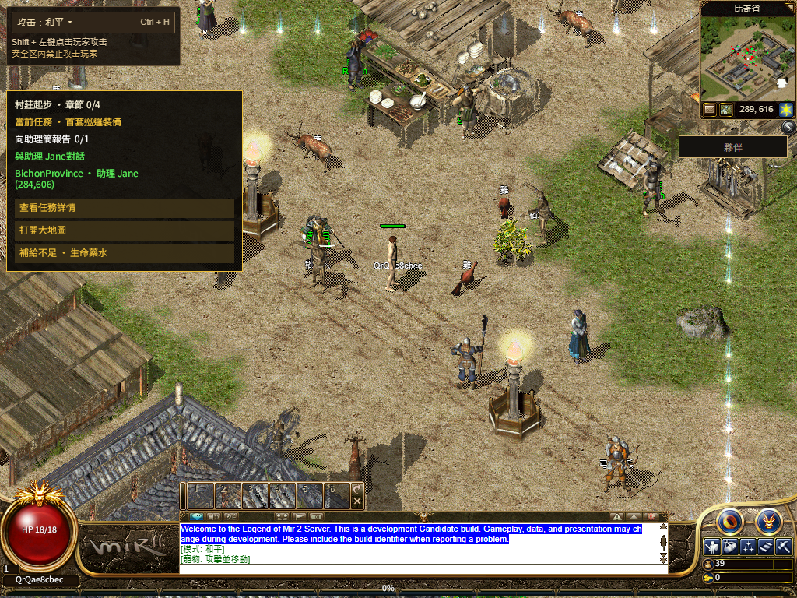
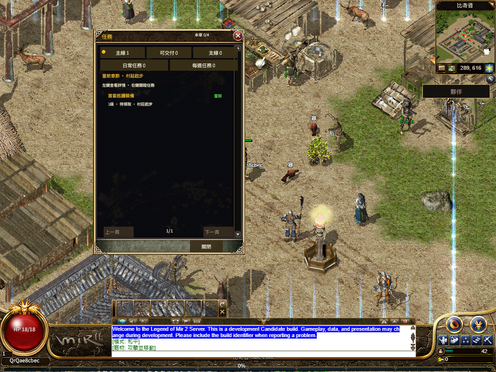

# R16 首帧后并行启动正式发布

正式入口：[numeron.obelisk.build/game](https://numeron.obelisk.build/game)。游戏源码`40be2972ea`，部署`dpl_wCsFGQLi1W6GNr9L28kdQkWvjGmG`，包含用户指定的6997f810ed玩家反馈提交。本轮只发布游戏项目。

70项发布保护通过，候选使用与本地构建一致的58个源码输入。Stage43291101922与Promote43292542803均通过，正式项目及域名都指向同一候选，没有回滚。9条公网文件读回通过，Worker及固定client-core文件字节与SHA一致。

普通Chrome简繁扫码均出图并到待确认。另一手机尺寸浏览器打开官方钱包PWA，使用一次性虚拟通行密钥和Testnet登录签名；准确会话只确认一次。普通建角、进比奇、113/113资源、共享HUD/繁中Q开关、六套原字体完整SHA（29,517,096字节）、真实Worker停止/恢复及普通退出均通过，所有自有浏览器关闭。实体手机相机/生物识别仍待验。

- 点击至首个可操作画面：8.094秒。
- 本轮首次真实行走最终收到正确权威坐标，但用时15.913秒，超过原8秒门槛。原始runner与全流程资格均为false，未放宽或重跑冲掉失败。先前仅凭后续阶段开始便判断首步通过过早，最终按失败回执修正。
- 首可操作后至共享HUD观测：83.587秒；原120秒Native门槛为通过。发布、访问流程、首步和Native冷启分别记账。

只读CDP定位：发出行走后、收到UserLocation前又收到666条共716,395字节的消息，其中包含156项任务、141项物品、79项配方及106项商店定义；同一段KeepAlive也延迟。传输单调时钟差15.912秒，与页面15.913秒一致；该段Native未boot，浏览器错误为0。它定位了收包前的延迟，尚不能独立归因服务器或代理。源码已有可选serverCatalogGzipV1，但当前普通Web未接入，下一轮核对有序解码/协商及初始化回包写入；不因此省略原数据或改变8秒门槛。

新版保留在线上：发布、扫码和资源流程通过，本次前端没有修改移动规则或Gateway。旧首步长尾再次出现，当前没有证据证明回退可以解决；不能将本次记为完整验收通过。

[结构化回执](receipt.json) · [首步失败定位](first-walk-failure-localization.json) · [公网文件读回](public-readback.json) · [运行时采样](runtime-timeline.json) · [Worker字体上游事件](worker-font-network.json) · [本地候选与生命周期](../README.md)

保留此前491版本158.084秒冷启和历史首步长尾失败。新结果只覆盖当前一次默认渲染公网回放；完整三职业当前路线、后续地图/技能、其他渲染路径、Hosted及100% Candidate/人类Accepted仍开放。原134份改动内容保持不变。
