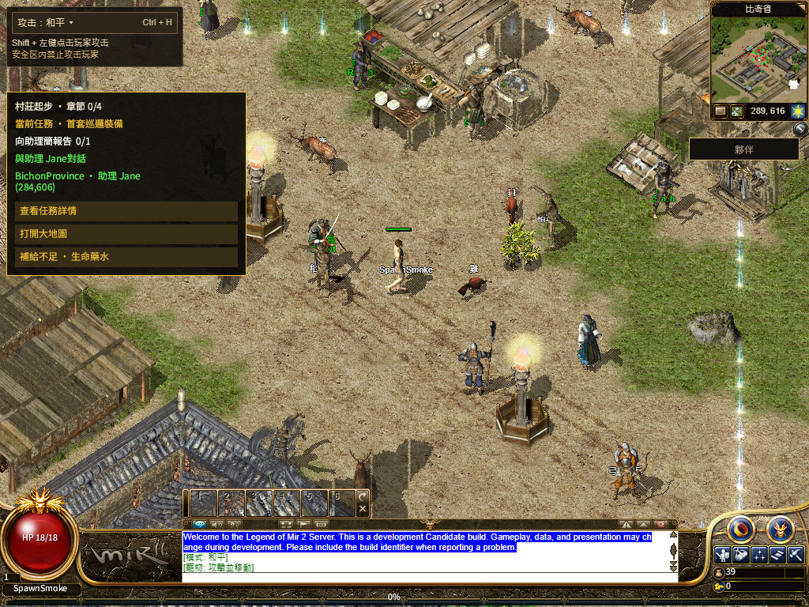
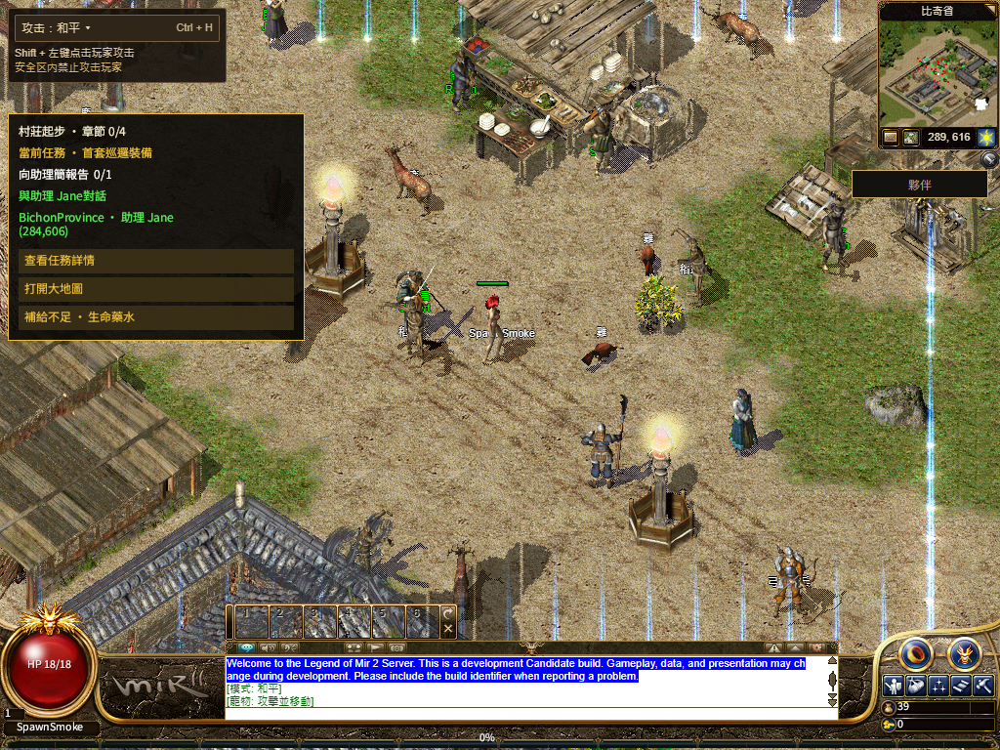

# R16 关键首屏 JSON 的验证分包回退

产品源 `2029b44abdee104445c569204477a219a1353f79`，父提交 `bfbee701891748d7897ea228677165fa0fed0d46`，共 10 个产品/生成/测试文件；发布保护源 `6f62eaa79043731b568db739f10867dc0631c37d`。正式发布和公网范围另见 [production/README.md](production/README.md)。

## 改动依据和实现

上一轮公网地图、地砖和词库只收到部分正文，未提交场景，已回退。新轮先固定 B209 正式部署，用干净默认网络 Chrome 单独读取地图：458,475 字节和原 SHA 完整一致，HTTP/2、br、Vercel HIT，读取 345 毫秒。读前后版本及独立 alias 均一致。这只证明一次独立读取可完成，没有据此归因 HTTP/2 或并发，也没有将它计为整场游戏冷启动通过。[单文件诊断](single-scene-receipt.json) · [前后映射](platform-after-single-scene.json) · [上一轮失败](../r16-entry-download-recovery-20261113/production/README.md)

保留现有静态文件读取和两次有界重试。仅最后一次是瞬时网络/响应头/正文失败或可重试 HTTP 时，scene、floor、完整 gameplay 词库才尝试固定的 Next JSON 分包。正常读取不触发 import；404、Retry-After、完整短包、超限、SHA 错误等终态结果保持失败，不借备用路径掩盖。

分包继续还原原文件字节再校验原大小/SHA，不改 pin：scene 是紧凑 JSON 无末尾换行；floor 是两空格缩进并带末尾换行；locale 是紧凑 JSON 加换行。生成器检查固定字面 import、版本关联和精确格式。词库仍保留全部十语值、匹配来源、顺序及 NPC 的 gameplaySha256，没有裁掉语言。

每份分包每页只有一个共享、20 秒有界观察。超时会在当前文档保留失败；之后可以重试原 HTTP，但不会重新启用这个观察。Webpack 的底层共享脚本不能真正取消；迟到结果不会改变已拒绝的观察，也不能交给已退出的场景消费者。

生产构建实有三个独立分包，完整解析其实际 JS 静态 AST/JSON 后，三份原始内容的字节和 SHA 均一致。JS 解码大小约 439,514 / 458,590 / 3,336,037 字节，离线 gzip 302,945 / 40,329 / 793,100；这是备用传输，不是缩小词库或公网速度提升的证明。[实际分包及原 pin](bootstrap-chunks.json)

## 本地验收

- [111 项相关检查](checks.log)、[70 项发布保护](release-guards.log)及 Next 生产构建/类型检查通过。候选 `bfbee7018917-bootstrap-chunks-14dc8914`，BUILD_ID `7l6TKq_mcOqP9GASfj8Uz`。[构建](build-receipt.json) · [源码绑定](source-inputs.json) · [精确提交](staged-product.json)
- 默认渲染和共享 WebGL2 各完成一次冷启动、正常注销、关闭整个浏览器进程及同档普通重登，共四会话通过。三个原 JSON 各连续无响应头 20 秒两次，然后真实加载对应生产 JS；浏览器完整 JS 字节/SHA与离线静态解析得到的原 payload/SHA相等，实际比奇场景提交并可操作。[逐组记录](local/cohort.json)
- 同时保留已有慢 PNG/人物包接管、NPC 两次头超时、运行包 8 秒无头和两次 15 秒零正文、字体失败恢复等夹具。每条最终流程都有六套完整字体、113/113、共用 HUD/Q、实际移动、Worker 真正停启及普通保存。原 8 秒移动、120 秒 Native、60 秒本地首场景观察没有放宽。
- r1 已恢复三份内容和前两次真实移动，但旧人物探针仍引用上一轮回执文件名，后段检查停止。仅修正该文件名后冻结 r2 脚本再跑；原失败保留，不计入四个通过会话。[首轮失败](local/quest-after-r1.json) · [修正与冻结](browser-preparation-r2.json)

## 保全与范围

运行包仍为 `bevy-0c553a754308e5b8`，资产仍为 `20261108-r16-08ec86d5105c`，没有重编 Rust、上传新资产、修改 Gateway 或 DNS。构建检查了 45 个继承输入和既有固定生成数据，Shell 使用干净的已提交版本。

本轮最初观察到 159 个未提交/未跟踪文件；另一个 Windows 任务随后更新了 Native 文件。本轮写入的 10 个 Web 文件与这些路径零重合，没有覆盖或纳入它们。变化在构建覆写前只读记录，其他任务文件并未全程保持字节不变。[并行变化记录](foreign-observed-changes.json)

这是受控网络恢复证据，尚不能替代公网整场、公开旧档或当前完整三职业到 30 级路线。截图仍见 NPC 名字局部缺失及指导文字混合英文；原 Fishing 断言、其他地图/技能、实体手机和最终人类 Accepted 仍开放。日志只规范空白和换行，原 SHA 见 [格式记录](log-format.json)。
