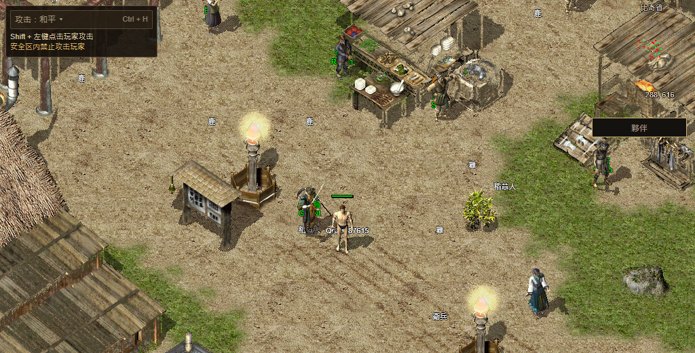

# 关键首屏分包候选发布、原失败和回退

本轮完整公网资格仍为 false，已回退。当前 [numeron.obelisk.build/game](https://numeron.obelisk.build/game) 为 `b2097fdfd13a2d8bc0acde435cd612fd83672cac`、部署 `dpl_3Hf6tBQxshV6qvoHR1oSakTBokMd`，包含 `6997f810ed` 玩家反馈修复。回退后独立版本/11 文件与简繁扫码复验通过；不将其当作 B209 的新一轮完整冷加载验收。[最终状态](final-state.json) · [平台确认](restored-platform.json)

## 发布与实际范围

- 本地 [111 项、70 项发布保护、生产构建及两后端四会话](../README.md)通过后，提交产品源 `2029b44abdee104445c569204477a219a1353f79` 与保护源 `6f62eaa79043731b568db739f10867dc0631c37d`。
- [Stage 43399952619](https://github.com/Zombieliu/mir2/actions/runs/43399952619) 成功并独立确认 `dpl_MS6JwmRmgJzqH411PKzFrDRaACmu` READY、production、源一致；[Promote 43401010043](https://github.com/Zombieliu/mir2/actions/runs/43401010043) 切换后，alias/version、Worker 及 8 个 Core 文件完整读回一致。[切换回执](release-receipt.json) · [候选文件](candidate-files.json)
- 简繁两次真实二维码、待确认文案和取消后零轮询通过。[候选扫码](candidate-qr.json)
- 一次普通默认网络 Chrome，经官方手机尺寸 PWA、隔离虚拟 Passkey Testnet 钱包，仅登录签名、选角、普通创建角色、进比奇、一次权威移动、完整城市画面、繁中 React 任务窗、113/113 和正常注销通过。App/default 未初始化，共用 Native HUD/Quest 未出现；完整六字体缓存检查失败，实际 0/6。完整验收 false，不能用本机 Native 通过补齐。[完整尝试及 SHA](failed-replay.json)
- 本次点击 Start 到首帧 6,606 毫秒，走路回包 190 毫秒。仅为一次观测，正常 JSON 已完成且没有请求备用分包，不作为本次修复提速或公网回退恢复的证明。
- 冷浏览器结束后才读取实际线上分包：三个新备用 JS 的完整静态 AST/JSON 均还原原字节/SHA，前后版本仍为 2029；另 16 个站立分包/128 张图静态一致。它们证明可用性，不证明本轮由备用分包提供首帧。[三份备用内容](bootstrap-public-files.json) · [站立内容](standing-public-files.json)
- [Rollback 43403319810](https://github.com/Zombieliu/mir2/actions/runs/43403319810) 已恢复 B209。回退文件读回有一次网络失败，有限第二轮完成；简繁出码再验通过。[恢复文件](restored-files.json) · [恢复扫码](restored-qr.json)

## 真正卡住的阶段

运行包三次尝试分别为：第一方 8 秒未获响应头；固定 CDN 200/gzip/HIT 但只收到 1,769,498 解码字节和 668,693 编码字节，之后 15 秒无进展中止；同 CDN 最终尝试 120 秒未获响应头。最后的响应头期限按既有策略属于终态，不授予额外重试组，不能称为恢复额度实现失效。Native 后来明确失败，package/HUD/Quest 一直未实例化。[运行包与字体原值](runtime-font-failure.json)

第二次请求的 Chrome 时序记录发出前等待约 43.012 秒，发出到响应头约 189 毫秒；这不足以认定 HTTP/2 或具体并发原因。字体独立缓存读取为 0/6，70 条已捕获上游观察无完整 200；观察到的 404 来自旧 release，不是当前字体不存在的证明。Worker `Network.enable` ACK 超时，虽已收事件，不能把覆盖当完整，也不能把 ResourceTiming 的零大小当零网络流量。[字体观察边界](worker-font-observation.json)

随后单独建立普通 Chrome 上下文，仅从 `/version` 发出同一固定 CDN WASM GET，没有游戏、字体、Worker、glue、编译或 App。31,452,436 字节和 SHA 完整一致，HTTP/2/gzip/HIT，约 55.807 秒；响应头约 438 毫秒，最大正字节间隔 718 毫秒，浏览器关闭。说明对象在更少并发工作时可完整传输，不证明完整场景或根因。[单对象诊断](single-runtime-read.json)

## 下一步与保全

只读源码核对显示，第一方版本 URL 经 [版本路由](../../../../apps/web/lib/bevy-runtime-local-route.ts) 重写到本地 `/bevy-runtime-releases/<pin>/…`，构建会物化并校验固定副本；本次 Numeron Git 发布没有运行通用裁剪器。字体也被保留，但 [注册器](../../../../apps/web/app/components/asset-cache-registrar.tsx)和 [Worker](../../../../apps/web/public/mir2-asset-worker.js) 设置了先 CDN 后第一方。现有证据不支持“第一方文件已被裁掉、始终代理同一 CDN”。

下一项先完整读取现有第一方 immutable WASM 与字体并核对 SHA，再决定请求调度；同时注意 glue 当前仍由 CDN 导入。保持原时限、同一运行包 `bevy-0c553a754308e5b8` 和资产 `20261108-r16-08ec86d5105c`，不盲改协议或扩大重试。

159 个原脏路径与本轮 10 个写入路径零重合；独立 Windows 任务的后续改动按现状保留、未纳入构建。前端原动画 WIP 没有进入提交。[保全](preservation.json) 当前完整三职业至 30 级、公开旧档、NPC 名称/混合语言像素、其他地图技能、实体手机和最终人类 Accepted 仍开放，持续 Goal 未完成。
