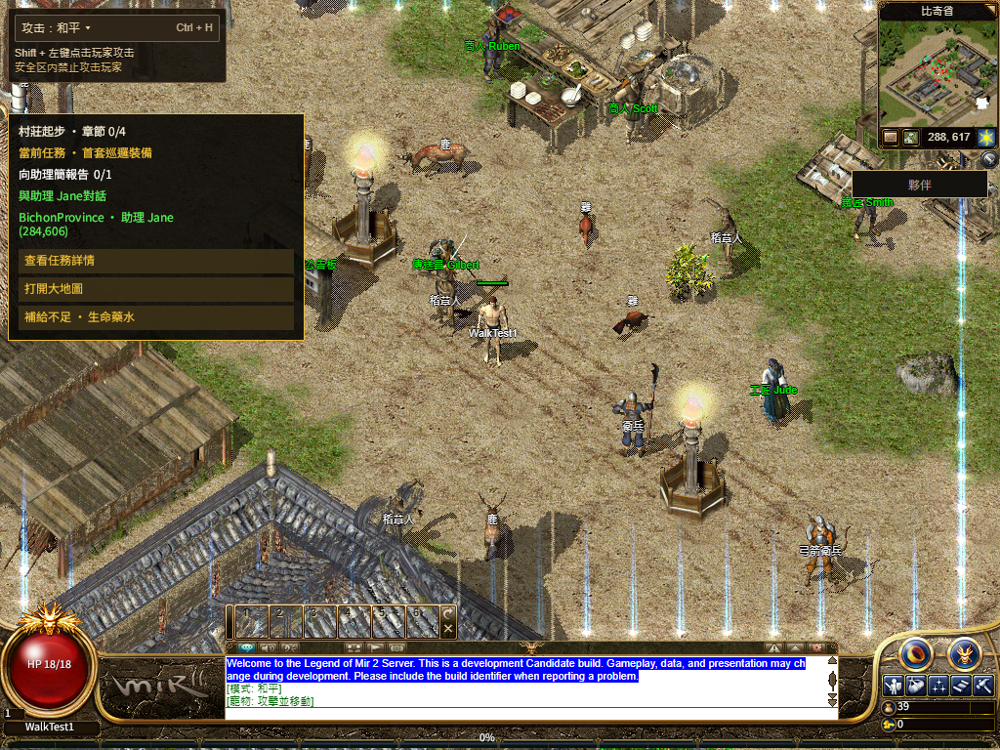
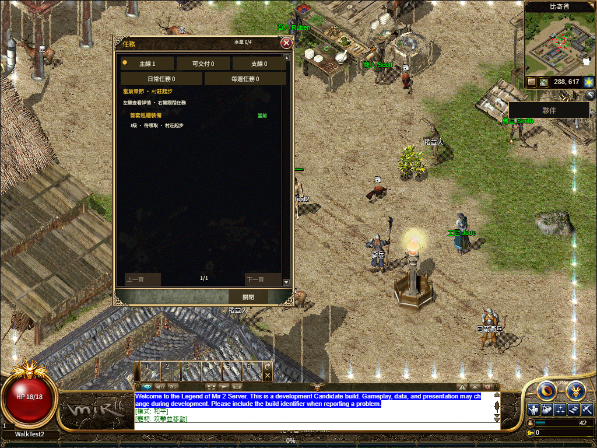
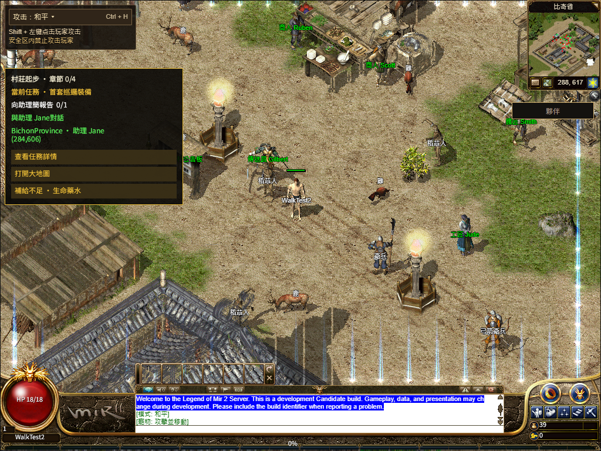

# R16 日记关闭后快速重开的导航交接

2026-11-16，Asia/Shanghai。父提交 `c4b2e44c5ed2ca59050f092dbeb8ec7702b7a8a5`，隔离候选 `r16-diary-nav-259e9823`。**73项检查、严格生产构建及繁体两个后端完整流程通过，48次快速开关全部通过。尚未发布；完整Windows R16 1:1 Goal仍active。**[状态](status.json)

## 证据和修补范围

上一轮共享WebGL2的第一次Q开关通过，紧接着再次打开失败，原整场false保留。[原失败](../r16-entry-object-recovery-20261116/README.md)。未改源码、只加被动状态读取的补测这次通过，没有复现原失败；控制器最初读错HUD诊断DOM字段，故其navigation列表为空，不能据此定因。[对照摘要](unchanged-control-summary.json) · [原被动观察](unchanged-control-diary-observations.json)

实际Page／Shell函数的两个回归先红，证明存在两个丢键边界：

- HUD先前发布的ready仍为true，但当前导航请求被拒绝。通用路由的返回true表示窗口已接管，旧日记逻辑误将其当作请求已接受。
- Native日记已经关闭，旧的捕获标记还没刷新，下一次Q仍走关闭分支。

日记改用真实dispatch接受结果；被拒绝的当前UI请求写入最新host状态和导航revision，后续快照仍能应用。开关依据当前已绘制日记状态，未应用的连续请求依据同步ref，不能只依据较旧的React投影或HUD toggle。通用HUD路由的接管语义保持。

新增只读日记状态使用当前runtime／会话／角色／场景令牌、已绘制revision、开关revision、布局／语言、活跃帧和模态窗检查。普通怪物／背包变化不阻断这个UI状态读；**世界操作仍要求原完整最新草稿**。HUD未可用时，现有独立关闭日记的能力保持。没有改变Native ABI、服务器命令、权限或存档格式。

原R2未保存失败按键内部状态，不能认定本轮两个边界就是其唯一原因。中途一次实现仍把通用路由返回值当作accept，43项中1项继续失败；修正为真实dispatch后通过。[先红、原中间失败和最终检查](validation.json)

## 隔离源码和实际运行

最终五套共73个不同检查通过，failed=0、skip=0；在隔离源再次执行得到相同结果。严格Next构建通过，BUILD_ID `z0fksFkgrRyq5Jcfejke1`，42227ms。2181个app／lib输入和一个既定生成例外核对；七个本轮草稿按仓库LF固定，Shell使用已提交版本加本轮位置，不混入外部WIP。[构建与逐项SHA](isolated-build.json)

| 本地场次 | 首步 | 首帧后Native | 快速开关 | 完整流程 |
| --- | --- | --- | --- | --- |
| 繁体默认WebGPU | 99ms | 30773ms | 初次与重登共24次，最长91ms | 通过 |
| 繁体共享WebGL2 | 105ms | 29704ms | 初次与重登共24次，最长67ms | 通过 |

原8秒移动／65秒完整行走／120秒Native门槛、三个对象包／90图原SHA、六套完整字体SHA／113图、原公网Q helper及首次／重登Q、两次正常注销和同角色保存均通过。[默认WebGPU](webgpu-tc.json) · [共享WebGL2](webgl2-tc.json)

新增快速检查每次等待Native日记实际边沿后立即按下一次Q，不另等HUD稳定；每场进入前后各六次开关循环，48个边沿没有世界指令，最终日记和主HUD都关闭。共享场实测有3次在旧捕获分支内正确重新打开，并观察到4条不同的HUD拒绝记录后仍正确响应；诊断记录没有逐条拒绝时间戳，不将它们逐个绑定到原R2失败事件。

这是实际Edge和普通游戏UI／Shared Zone协议，原本地HTTP对象／行走故障仍保留，成功正文原样转发。复用真实资产CacheStorage、清除HTTP缓存；不是公网冷启动、实体手机、纯GPU全方向或全局1:1资格。不同场次耗时不作性能因果结论。

## 像素和保全

四图已查看：两后端日记可打开、关闭，地图与角色仍正常绘制。仍有简中标题、英文人名／系统消息等混合语言，视觉1:1未关闭。

原有28份其它WIP的字节SHA保持，Shell本轮位置逆变换后逐字节还原修改前工作文件；提交只纳入本轮位置。[所有权证明](source-ownership.json)。全部浏览器／Next／Gateway／代理已关闭，27个私有覆盖恢复；未删除制品。[恢复与两场结果](restoration.json)

独立Vercel域名仍为Fo，公共游戏／版本／Gateway健康均200，前后端source仍e0。本轮无部署、DNS、正式重启或数据库恢复，恢复版签名未重测。[域名](alias-readback.json) · [HTTP读回](public-readback.json)

下一项固定新应用提交和发行控制器，取得新的同源发行资格，再按原公网签名／完整冷加载／退出门槛验收。旧公网fea原R1、旧C4B本地R2及所有原失败不改写。完整目标仍包括UI、登录／选角／进城、战斗／药品／拾取／组队／交易、阿洛、语言、新手至30级三职业、技能／地图、Native同档和最终人体验收。[文件摘要](evidence-manifest.json)

新源码 f05 的三段来源与 111 项发行保护见 [发行准备](release/README.md)；同源构建仍在运行，尚未切换公网。
