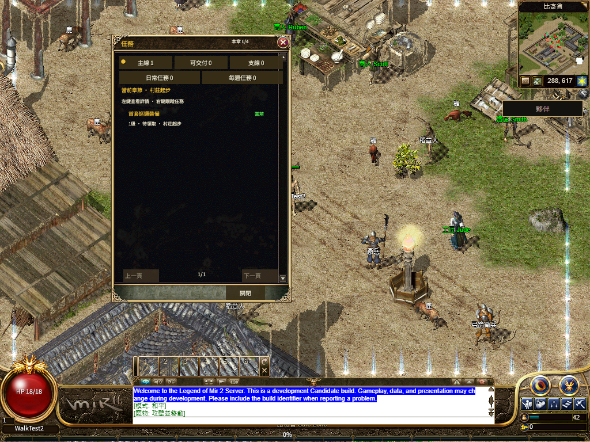
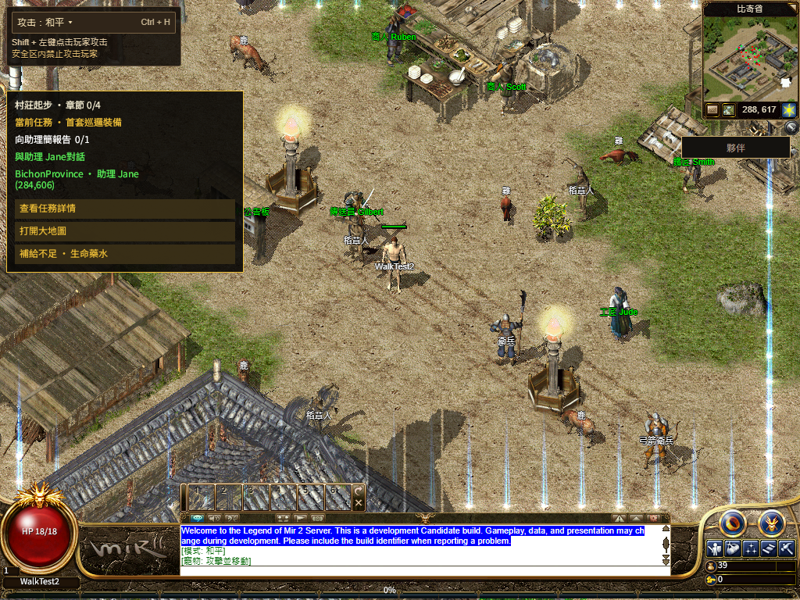
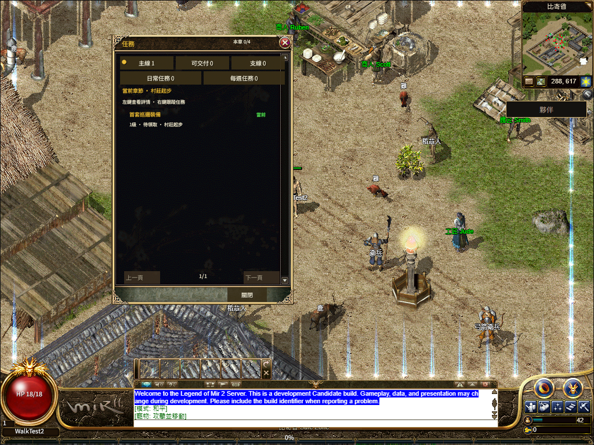
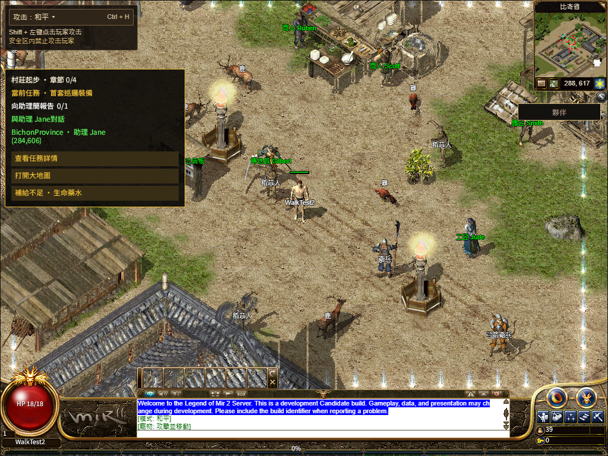

# R16 世界更新时仍可关闭日记

2026-11-16，Asia/Shanghai。本轮修补共享任务日记的关闭条件，不改变战斗、寻路、交易或存档规则。父提交 `bf97cdd479c25d71bcb7f51438740fc5d3ee95c8`，两个源码／测试输入逐项SHA固定，隔离候选 `r16-diary-world-615e1a69`。**本地候选通过，尚未发布；完整Windows R16 1:1 Goal继续active。**[状态](status.json)

## 问题和改动

关闭当前日记原先同时要求整份世界草稿相同，包括附近怪物位置、背包和角色数据。普通服务器更新发生在UI轮询之间时，日记仍然有效，但关闭会被拒绝。若新快照已提交、Native尚未绘制，要求精确最新revision也会造成同样问题。

新增回归先在原hook上失败：普通怪物移动／金币／HP更新后，`closeCurrentDiary()`返回false；原场景替换拒绝检查通过。[先红记录](red-regression.json)

修补将关闭令牌绑定到已绘制的日记所属连接、会话、角色、地图／场景和generation。普通内容更新保持令牌；新身份必须等到对应revision实际绘制。原开关revision、布局／语言、前台可见、活跃帧、其它模态窗及错误检查保持。攻击、任务交互与寻路仍校验整份最新世界草稿，关闭本身不发世界指令。

Crystal参考 `Crystal/Client/MirScenes/GameScene.cs:660` 的 `KeybindOptions.Quests` 直接按日记可见性Show／Hide；该参考文件SHA256为 `935d1ca35ddf4800bccdac4cd1675fcb59a269560a57bf98c2b952a459ffb504`。怪物走动不构成拒绝关闭日记的条件。

此前公网fea原R1仅记录关闭回调返回false，没有记录其内部拒绝分支；**本轮证明并修补一个真实可复现缺陷，未证明它就是那次公网失败的唯一原因。**[原公网失败及成对回退](../r16-auth-handoff-20261116/production/README.md)

## 检查和实际流程

任务／Q快捷键37项，共享HUD／键盘归属相邻29项，共66个不同检查通过、skip为0。覆盖未提交内容更新、已提交但未绘制的普通更新、新场景必须先绘制、旧runtime／generation、重复关闭，以及既有错误、其它模态窗和停止帧边界。相邻输入守卫首次用错fixture文件名，未执行测试；纠正路径后四个输入与已提交版本匹配，29项通过。[验证](validation.json)

严格Next生产构建通过，BUILD_ID `fWjKe2MusS0UCC7HkC0Fu`，44507ms。编译校验2181个app／lib文件和一个既定生成输入例外；仅纳入两个本轮草稿，排除外部WIP，原运行包及生成素材不变。[隔离构建与输入](isolated-build.json)

| 本地场次 | 实际后端 | 首步 | 首帧后Native | 结果 |
| --- | --- | --- | --- | --- |
| 原R1，繁体 | WebGPU | 99ms | 尚未判定 | 抓自然行走图时等待CSS字体超时，未到Q检查，原false保留 |
| 补测R2，繁体默认 | WebGPU，无后端参数 | 116ms | 111853ms | 完整通过 |
| 相邻R3，繁体共享 | WebGL2／webgl2-shared | 115ms | 23280ms | 完整通过 |

原R1失败于附属`locator.screenshot`的字体等待。补测只继承已有的CDP当前像素抓图方式，不改变游戏、字体加载、字节SHA、原8秒移动／65秒行走／120秒Native门槛。[原失败](r1-original-capture-failure.json)

两条通过场次均使用普通UI登录、建角、进比奇，实际选择后端有断言。固定的原公网Q helper SHA256 `d584dd70091f9861f532385f4a31cf5c5e7a34a14776f6cd14dcfc2ee4ec6a8b` 未改，按真实出站玩法计数验证开关零世界指令；另完成首次和重登后Q检查、原行走完整包与自然PNG、六套完整字体SHA／113图、两次Alt+X正常注销、同角色同坐标重进及原角色／存档保持。[默认WebGPU](webgpu-tc.json) · [共享WebGL2](webgl2-tc.json)

这是复用真实资产CacheStorage、清除浏览器HTTP缓存的本地测试，使用既定Shared Zone网关和受控HTTP失败；没有拦截WebSocket、注入怪物动作或预填合格正文。不作为公网冷加载、实体手机或性能改善的证明。Native耗时差不能直接解释成补丁收益。

## 实际像素与剩余差距

四张图已查看：两条路径日记确实出现并在Q后消失，场景仍在运行。截图仍见简体“任务”标题、英文人名／地区、英文系统消息等混合语言，不能计为完整语言／视觉1:1。

另更正早期覆盖判断：上一轮英文helper参数名虽为compatibility，原准备／ready记录实际都是webgpu、fallbackFrom=null；不能把那场称为未覆盖默认WebGPU。本轮新增的是繁体默认路径、世界更新回归和原公网Q helper对照。[原ready记录与更正](prior-coverage-correction.json)

## 公网、保留与下一项

独立Vercel域名读回仍为 `dpl_FoNUgjSRpw56hwUFDNrSs7LZZQFN`，公共游戏／版本／Gateway健康均200，前后端source均为 `e0ceea22964c03041d45e49e506b3a8badd6984e`。本轮没有发布或重启正式服务，也没有重测恢复版签名。[域名](alias-readback.json) · [公共读回](public-readback.json)

所有本轮浏览器、Next、Gateway和代理已关闭；21个私有源码覆盖逐项恢复，29份原内容WIP的SHA保持。旧构建只在确认进程关闭、路径／数量／字节及关键SHA后迁到私有归档，无制品删除。[恢复与三场原结果](restoration.json)

下一项检查公网场景对象包两次20秒无头后的恢复路径，以及完整行走／Native冷启；不原样重发旧候选，不覆盖此前公网原R1失败或伪造公网R2。混合语言、其他地图／寻路、三职业1–30、技能、组队／交易／阿洛、Native同档和真人最终Accepted仍在整个Goal内。文件摘要见[evidence-manifest](evidence-manifest.json)。
