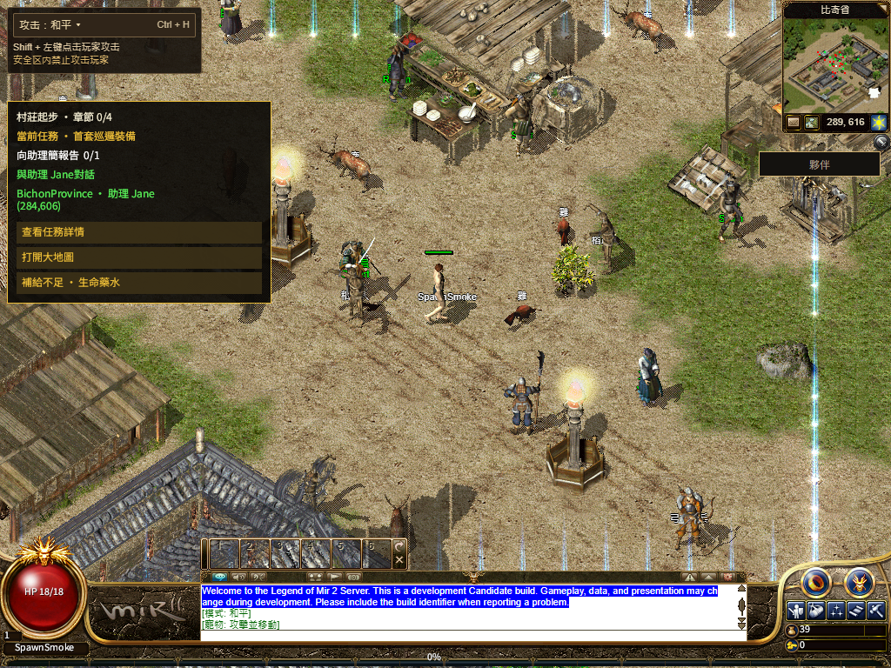
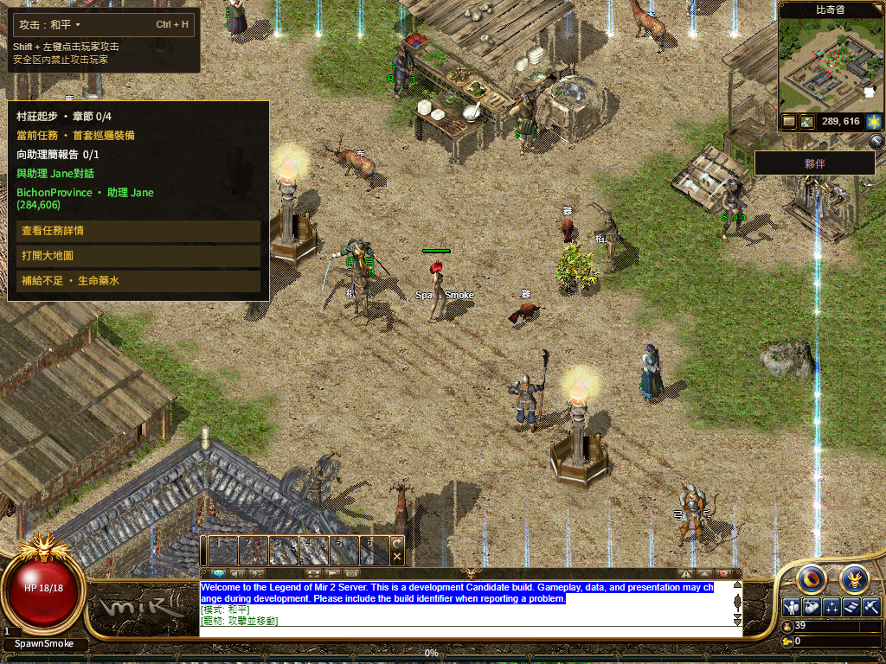

# R16 进城下载中断恢复（2026-11-13）

产品提交 `9dc7294c0269eee93086e88ac83d2bc9d93d387e`，父提交 `31e9b6a74661c31d6515dd7322b466285f975d71`；12 个产品/测试文件。发布保护提交 `82efae2f89760a8760a9f81dda3f8b647289b9ac`。正式切换和公网结果见 [production/README.md](production/README.md)，本页记录本地候选。

## 修复

NPC 包原先用完两次响应头等待后不再恢复，后来的原图回退也可能受同次下载拥塞影响。现在提高包请求优先级，瞬时传输失败后等待一秒，再允许一个有界读取组；单个观察者至多四次 GET，读取继续共享。离开场景只取消旧观察者，不破坏其他消费者。版本、大小和 SHA 校验继续生效；确定的 HTTP 拒绝、Retry-After 和损坏数据不授予额外重试。

运行包原先用尽三个来源尝试后会停止启动，即使最后一次正文中断仍被标为可重试。现在仅在最后失败属于可重试的响应头/正文传输阶段时，允许同次入场再执行一个下载/编译组。每次入场、每个固定运行包来源至多一次额外组，总计至多六次 GET。原 8 秒替代来源响应头、最终来源 120 秒响应头、正文无进度 15 秒、总时限与 32 MiB 上限不变。脚本导入、canvas、default/App 初始化不因此重复；校验、编译、绝对期限及消费超时不授予额外组。

运行实例归入场观察者持有。取消时同步移除尚未初始化的匹配缓存，旧失败不能清掉替代实例；初始化已经开始而结果不确定时，当前文档会阻止再次初始化其他后端，要求重新加载。已完成的缓存仍能复用。字体在短暂下载恢复期间继续准备，退出或最终失败才取消。

先前公网运行包已观测到 gzip：31,452,436 解码字节对应 6,450,271 编码字节。本次修复下载停止后的恢复，不据此断言 CDN 长尾的底层原因，也不把本地固定字节镜像当公网提速结果。

## 本地证据

- [213 项检查](checks.log)与 [68 项发布保护](release-guards.log)通过。初轮唯一失败来自既有 wasm 指纹测试虚拟夹具缺 `packages/protocol`，已补齐夹具与敏感性断言；生产指纹规则未改。原失败日志的 SHA 留在私有任务目录，既有 Fishing 帧断言未由本轮修复或宣布通过。
- Next 生产构建及类型检查通过，最终候选 `31e9b6a74661-entry-recovery-2bfdd3ba`，BUILD_ID `1PFz3tK0klkmZrhmowX3-`。[构建](build-receipt-r2.json) · [12 个输入及继承输入](source-inputs-r2.json) · [精确提交 blob](staged-product.json)
- 旧候选在同一故障序列下耗尽三次运行包读取，未在原 120 秒内恢复；没有用退出再进绕过失败。[旧版失败](local/quest-before-r3.json)
- 新候选默认渲染及共享 WebGL2，各完成一次冷启动和关闭整个浏览器后的同档普通重登，共四会话。NPC 前两次各无响应头 20 秒，第三次恢复原 313,909 字节；运行包先无响应头 8 秒、再两次 200 零正文各 15 秒，第四次恢复完整固定二进制。原走路 8 秒和 Native 120 秒门槛不变。[逐组索引](local/cohort.json)
- 两条冷启动 Native 等待为首个可操作画面后 40,212 / 40,276 毫秒；暖重登 Native 阶段 1,265 / 1,192 毫秒。六套字体完整字节/SHA、113/113、共用 HUD/Q、Worker 真正停启、正常注销保存和浏览器重开均通过。这不是当前完整新手到 30 级路线复验。

## 故障夹具与保全边界

固定运行包仍为 `bevy-0c553a754308e5b8`，资产仍为 `20261108-r16-08ec86d5105c`，没有重编 Rust 或上传新资产。真实 Chrome 使用拥有者控制的 HTTP 流镜像注入零正文；只对精确 WASM 地址使用保留请求属性的 fetch 转接。它用于受控恢复复现，不代替公开 TLS、移动网络或实体手机验收。

before-r1 在源绑定检查提前停止；before-r2 的 Playwright HTTPS→HTTP 转发不支持；after-r1 资源已恢复但字节观察器漏记镜像地址。三项原失败和 SHA 均保留，不计通过；最终只补正转发方式与观察范围，没有降低完整字节、SHA 或时限要求。[夹具冻结及修正](browser-preparation-r3.json) · [源切换](source-swap.json)

原 131 份脏文件/未跟踪文件按字节保全。Shell 只增加 NPC 读取/清理这一窄改动，提交从干净 HEAD 加本轮改动生成；原动画和 Native WIP 没有进入发布。[保全](preservation.json) 日志仅规范空白与换行，原始 SHA 见 [格式记录](log-format.json)。

截图仍见 NPC 名称不完整及任务提示夹杂英文。完整公网冷加载、公开旧档、当前完整三职业路线、其他地图/技能、实体手机和最终人类 Accepted 继续开放，不由本地恢复测试替代。
