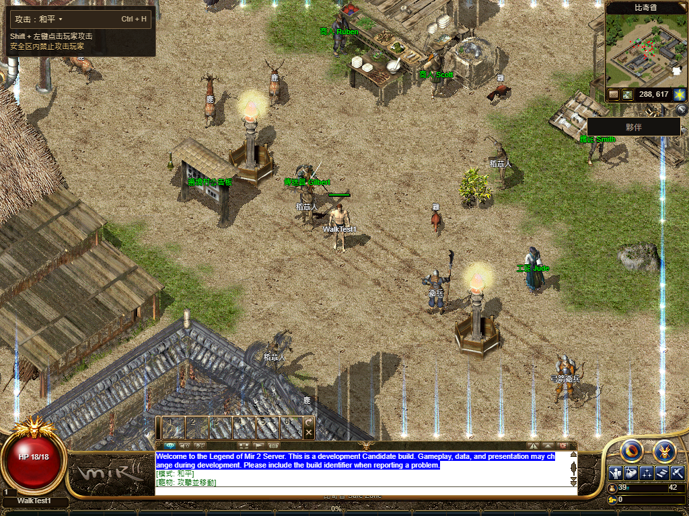
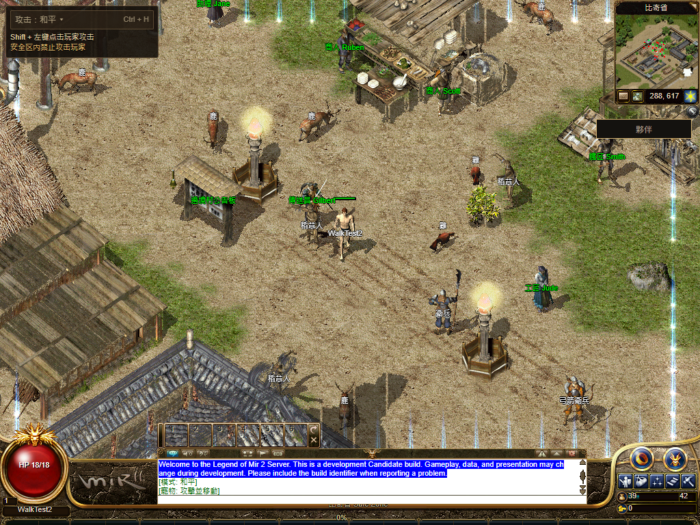

# R16 比奇场景对象包的有界恢复

2026-11-16，Asia/Shanghai。父提交 `8ebc4f2c2eb06dbe7a6d3455effcebb693623041`，隔离候选 `r16-objects-668e8e04`。**两个后端的原场景包都恢复成功；默认WebGPU完整流程通过，共享WebGL2随后重开Q失败，整场false保留。尚未发布，完整R16 1:1 Goal仍active。**[状态](status.json)

## 修补的实际缺口

此前公网三个对象包均两次20秒没有响应头，原首个画面缺少建筑等对象。[原失败与回退](../r16-auth-handoff-20261116/production/README.md)。这不证明是优先级造成网络超时；源码中另有确定缺口：对象包只读两次，失败后本次entry-art观察不会补读。

三个原包为395412／395320／395216字节，共1185948字节、90张原PNG。它们覆盖比奇默认视野及初始步行，改用high请求提示。新增一次补读：仅传输超时／瞬时错误可触发，在1秒退避后沿用原两次HTTP读取，单包最多四次请求；已验证的其它部分保持。404、Retry-After、错误字节数／SHA都不授权补读。

Shell的entry-art生命周期同时管理NPC和对象包观察。离场后不启动新的补读、不提交晚到画面；共享请求仍可供活跃观察者和后续缓存使用。没有改变原JSON路径／完整字节／SHA、图片、地图数据、战斗或存档规则。

## 代码、原先红与构建

实际Shell effect的新增回归先在旧实现上失败：两次原20秒等头结束后，缺失包仍未恢复。原大输出私有保留，摘要和日志SHA见[验证](validation.json)。修补后在隔离源执行六个相关套件，**60个不同检查通过，failed=0、skip=0**，包含离场、并行观察、晚到共享完成、永久失败上限、完整性拒绝及相邻NPC／人物／行走／HTTP边界。

严格Next生产构建通过，BUILD_ID `v7dIaJP8ie1eoQJnfQgbA`，42204ms；校验2181个app／lib输入、一个既定生成例外和四个本轮源码／测试草稿。运行包及生成素材不变。[隔离构建与输入SHA](isolated-build.json)

原Shell含未提交的其它工作。本轮只改入场资源import和effect；候选构建使用“已提交Shell＋本轮两个位置”的独立副本，排除外部WIP。对工作文件做逆向替换可以逐字节还原原文件，提交也只纳入本轮两个位置。[保留与部分暂存约束](source-ownership.json)

## 两场真实浏览器，原完整判定不改写

两场均为真实Edge、普通登录／建角／进比奇、原Shared Zone网关；只在本地HTTP代理制造明确故障，成功响应原样转发真实Next，不注入合格正文、不拦截WebSocket、不强制怪物动作。复用真实资产CacheStorage并清除浏览器HTTP缓存；不是公网冷启动或实体手机验证。

| 本地场次 | 对象包故障 | 首步 | 首帧后Native | 结果 |
| --- | --- | --- | --- | --- |
| 繁体默认WebGPU R1 | 三包各两次无响应头 | 108ms | 31606ms | 原三包／90图SHA、自然行走、六字体113、原Q helper、首次及重登Q、两次正常注销和同角保存完整通过 |
| 繁体共享WebGL2 R2 | 三包各先8192字节原正文后停滞，再503 | 131ms | 28933ms | 三包／90图SHA及自然行走通过，原Q helper首次开关通过；随后独立Q再次打开失败，整场false |

原8秒移动／65秒行走／120秒Native门槛保持。另在相同65秒视觉观察窗口核对三个原canonical JSON完整正文、字节数、SHA和全部90图，均通过；CDP实际记录high优先级。不同缓存／网络／后端下的Native耗时不构成性能收益的因果证明。[默认WebGPU完整原结果](webgpu-tc.json) · [共享WebGL2原失败](webgl2-tc.json)

R2在独立Q检查处停止，后续六字体缓存SHA、113图完整检查、正常注销及同角重登未执行，不能借R1或Native ready计为通过。没有原样重跑来覆盖这次失败。

## 实际恢复画面及下一项

两张图已查看：包恢复后比奇建筑、场景对象正常出现。简繁混用、英文人名／系统消息等视觉差距仍在，不能计为全局1:1。

R2原Q helper关闭后记录为diary=false、HUD questOpen=true；接着独立Q未重新打开。失败按键内部状态未被该helper保存，尚不能确定拒绝分支。[原开关观察](webgl2-original-Q-observations.json) · [下一项依据](next-Q-investigation.json)

源码显示`onCloseDiary`会推进host navigation revision，而`setShowQuestLog`在HUD ready时无论dispatch是否接受都会return；HUD当前读又会拒绝尚未应用的新navigation签名。这是需要真实回归的pending边界线索，不能当作已经证明的R2唯一根因。下一项先复现关闭后快速重开及HUD未应用快照的行为，并保留HUD不可用时独立关闭日记的能力。

## 公网和保全

本轮没有发布、修改DNS、重启正式服务或恢复数据库。独立域名仍为Fo部署；游戏／公共版本／Gateway健康均200，前后端source均为e0。[域名读回](alias-readback.json) · [HTTP读回](public-readback.json)。恢复版签名及实体手机没有重测，旧公网fea原R1失败不改写。

所有自建浏览器／Next／Gateway／代理已关闭；24个私有源码覆盖恢复，28份原内容WIP字节SHA保持，Shell外部差异由逐字节逆变换保留；只按检查过的路径迁移了关闭的旧构建，没有删除制品。[恢复与两场原结果](restoration.json)

整体仍包含登录／选角／进城、战斗／药品／拾取／组队／交易、阿洛、语言、新手至30级三职业、技能／地图、Native同档及最终真人Accepted。当前不是完整双后端Candidate，不满足新发布资格。[文件摘要](evidence-manifest.json)
