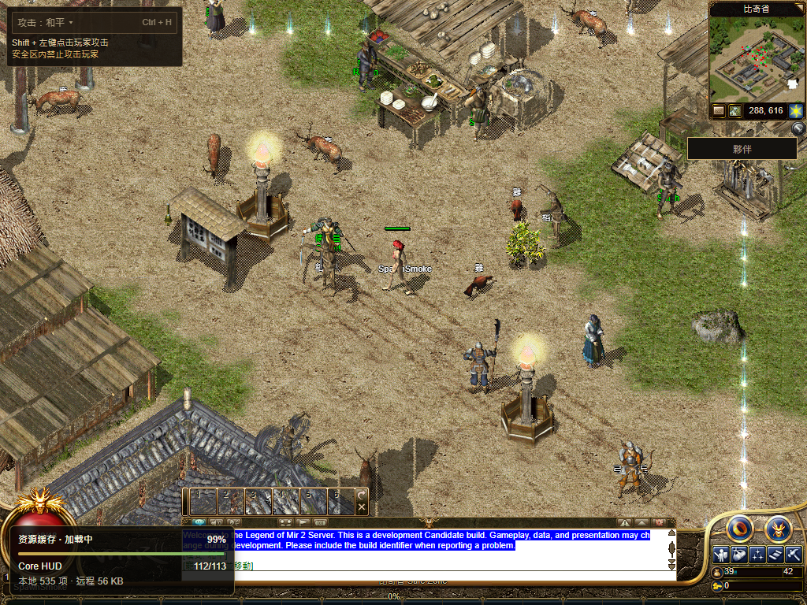

# 默认人物完整帧目录先行（2026-11-13）

本轮完成本地候选，**尚未发布**。正式站仍为
`e7cbab02f030ae50b28031ca0237d630eccb7c03`；本轮没有改 DNS、Gateway、R2、官网、链上状态或既有玩家档案。
实现已提交 `ff957548919e9d306c11af57dad224f2178c2d0f`。最终候选为 `8e82f53fcd74-player-meta-1e35025e`，基于干净 Windows R16
`8e82f53fcd749e8c2f6a69cb9b911c3165de006a` 加本轮独立补丁。编译目录见
[构建回执](build-receipt.json)，来源闭包见 [输入记录](source-inputs.json)。

## 已定位的等待

上一正式版的公网记录：Start 点击 71912ms、权威自体 76006ms、地图索引 76122ms、
`sceneSpritesReady` 76152ms、`firstPlayableFrame` 116991ms。这里的 sprites 标记只表示地图索引已安装，
不能当成图片完成、像素已画或整屏一直未画的证据。

男性动作图片包首次只收到 98303B 后取消，重试等头 19049ms，116977ms 才完整收到 289851B；
首帧晚其 14ms。与此同时默认身体/头发远程目录都从 76149ms 等到 125176ms 才返回 504，
116977ms 前没有默认身体/头发的单帧 PNG 请求。大型运行包直到 117073ms 才请求，
因此不能把这段等待倒因为运行包下载。详细原始公网记录见
[上一正式发布](../r16-ui-asset-recovery-20261113/production/README.md)。

## 最终改动

- 将默认 `CArmour/00`、`CHair/00` 的完整帧目录按性别内置，每库每性别 808 帧，保留原 count1616。
  数字元组共 74900B，gzip17197B，没有 PNG、余额或奖励数据。
- 来源是已提交的完整原始 metadata，大小/SHA 与固定 release manifest 完全一致；生成器
  `--check` 重建比较，`--from-assets` 延用完整 manifest 的字节/SHA 校验。
- 先发布目录，让当前真实 PNG 立即有路径和尺寸；完整图片包仍独立读取、校验、去重和有限重试。
  图片包只有站立/走路帧，其回调不能把完整动作目录缩回 80 帧。
- 目录没有图片时不启用完整图片包的 3 秒解码兜底，必须等当前身体图片实际加载。
  完整库晚到时仍按原覆盖顺序接管；其他衣服缺失时不能套用默认衣服。
- `original-client-shell.tsx` 只暂存本轮 readiness 条件，既有动画 WIP 保留；其余六个代码文件为独立整文件。

canonical manifest SHA：`32255399aaae2dc9a133a5827252256ece782aaae5d237152ffebc2d8f272155`。
默认身体目录 751892B / `b04b37ca81426b1f344a7f60295c042f112d5866aa61c8ee3587751be759a6fc`；
头发目录 748868B / `7073311ff92bef1c2ad393a46272d6c60b533affe571bf43e597b9c7543a36c3`。

## 检查与真实浏览器

生产 Next 构建、生成器检查、已注册的核心 57 个检查通过。扩展执行中 70 个通过，
另有一个未修改的 Fishing 导出范围旧断言失败，零跳过，见 [输出](focused-tests.log)。
真实 `buildViewportEntitySprite` 对照两性、八方向、跑步/攻击各六帧的路径、尺寸及偏移；
在完整图片包到达前后重复，缺少 `/01` 时不错误替换 `/00`。这是渲染函数验证，不能代替真人实战。

最终两条独立 Chrome 流程各包含冷启动和彻底关闭浏览器后读回同档，共四个会话。
隔离 File Gateway 正常创建 QA 角色；扣住完整人物包及远程目录，初始身体 PNG 统一延迟六秒；
角色实际显示并走两步后才释放包，并验证实际 data PNG 接管。未预填缓存、修改存档或降低门槛。

| 路径 | 身体首请求到首帧 | 两次 Walk ACK | 输入到画面 | 冷 / 重开 Native 就绪 |
| --- | --- | --- | --- | --- |
| 默认 / 男 | 6028ms | 37 / 12ms | 95 / 522ms | 26455 / 1352ms |
| 共享 WebGL2 / 女 | 6023ms | 32 / 1ms | 121 / 514ms | 26542 / 1366ms |

完整包未释放时可见的真实身体路径分别为 `/original-ui/CArmour/00/68.png` 和 `/876.png`。
两个冷会话的点击到首帧分别 22714 / 22681ms，其中包含权威 bootstrap、地图等待及人为六秒故障。
不能拿这些受控结果与公网 45.079 秒直接相减或宣称公网速度已改善。

四个会话的共享 HUD、原字体 Q、六套完整字体 SHA、113/113、正常注销及保存通过；
两条流程的实际 Worker 停启通过，所有自建浏览器/代理/Next/Gateway 已关闭，原始夹具未变。
保留原 Walk8秒 / Native120秒门槛。[逐项回执](browser-cohort.json)

## 保留的失败和范围

早期仅站走目录候选已被完整目录替代，其通过记录不冒充最终资格。
初期夹具一次抢在首帧 RAF 标记之前断言，一次把同毫秒 release/finish 错当未完成；
修正夹具后重跑，旧失败保留。附带旧地图缓存源码正则、Fishing0..175/0..351 断言失败也保留，
相关源与测试均未改。[失败及资格](qualification-and-retained-failures.json)

正式发布及公网冷读仍待执行。其他服装、完整战斗像素、NPC 名称、既有英文提示、公开旧档、
实体手机、完整三职业路线及整体 1:1 继续开放。100% Candidate 和最终人类 Accepted 均未成立。
