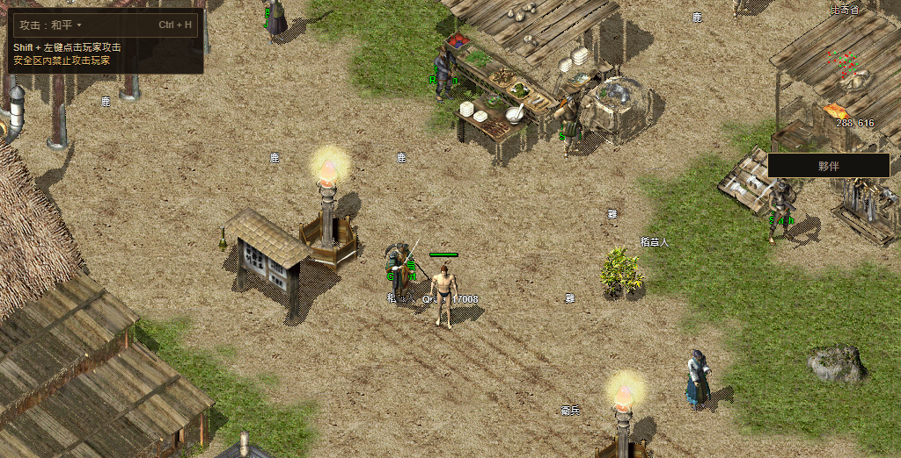

# 发布后回退到 e7cb（2026-11-13）

`ff957548919e9d306c11af57dad224f2178c2d0f` 已发布并完成一次公网签名回放，
**完整资格失败，已回退**。当前正式入口 [Numeron 游戏](https://numeron.obelisk.build/game)
读回 `e7cbab02f030ae50b28031ca0237d630eccb7c03`，游戏项目别名恢复到
`dpl_4jjpevpspsVtf61hUCgTHiKxRatZ`。回退后 `/version`、`/game` 均 200，简繁二维码复验均通过。

## 发布身份与结果

- 发布实现 `02c1e6104b4b9fc66ea1698114f92ea922ef6b46` 固定七份产品代码改动，未带入动画等 131 份 WIP。
- [Stage43353683006](https://github.com/Zombieliu/mir2/actions/runs/43353683006)、
  [Promote43354733274](https://github.com/Zombieliu/mir2/actions/runs/43354733274) 成功；发布保护 68 项通过。
- Vercel 候选 `dpl_MEDVQnVnEgkfV4UsJMUpE67TfQFK` 云端构建 READY，源码/项目/生产环境核对通过。
  页面、Worker 和八份固定 Client Core 文件公开读回通过；候选启动资源与扫码 canary 在切换前后校验。
- 完整运行包仍为 `bevy-0c553a754308e5b8`，没有新 Rust 编译或 R2 发布。
- 公网字体/HUD 失败后，通过 Vercel 连接器回退；事前检查当前别名属于本轮候选、基线 READY 且同一项目/源码，
  事后再读别名、版本和入口。官网、DNS、Gateway、链上状态及用户旧档未改。

[分项回执](receipt.json) · [Stage](stage-numeron-r16-release.json) ·
[Promote](promote-numeron-r16-release.json) · [切换后固定文件读回](final-public-readback.json)

## 本次公网通过的部分

| 项目 | 观测 |
| --- | --- |
| 简繁出码 | 各一次真实 QR 矩阵、待确认、取消后零轮询 |
| 确认身份 | 官方手机尺寸 PWA / 虚拟 passkey 的独立 Testnet 钱包，一次登录签名，forbidden0 |
| 普通游戏流程 | 已批准连接建一名 QA 角色，进比奇、实际走路、普通注销回选角 |
| 首步 | 真实 ArrowRight；149ms 权威 ACK，165ms 输入到画面，通过原8秒门槛 |
| 首画面 | 点击后34502ms；地面和身体实际可见，不由地图索引标记代替 |
| HUD预取 | 最终113/113，含六项补读恢复 |
| 备用任务窗 | 繁中任务入口可打开；这是备用页面，不能冒充共享 Native Q |

所有自建浏览器已关闭。没有用真实用户的钱包，没有资金操作；本次是手机尺寸自动化，不是实体手机手扫验收。
此次没有执行公开旧档重登、完整三职业路线或 Worker 停启。

## 失败必须保留

- **原字体缓存只有5/6**：缺 `NotoSansCJKsc-Regular.otf`；其余五份有完整大小/SHA，
  [实际缓存读回](original-fonts.json)。因此 `verify-six-original-font-cache-bodies` 失败。
- 运行包正文完成观测在303981ms，较首可操作标记111778ms晚 **192203ms**。
  最后运行 App 已启动，但 Quest 返回 `quest UI font or skin failed to load`，HUD 未 ready。
  原120秒资格不成立，额外观察也未完成共享 HUD/Q。[运行时采样](runtime-progress.json)
- 113/113 不代表字体完整或共享 HUD 就绪。本轮控制台257条 error、pageError0，未称零错误。
- 本轮完整 `passed=false`，不能以扫码、移动或预取通过替代。回退后的 e7cb 既有完整资格见
  [前次发布记录](../../r16-ui-asset-recovery-20261113/production/README.md)；这次没有重跑其完整签名流程。

## 人物单帧的新发现

内置目录确实让身体单帧在80836ms开始请求，但 `/16.png`、`/18.png`、`/19.png` 共49次请求均
在零字节、无响应头后取消，中位数分别500/501/502ms；`/17.png` 也在约30.9秒后取消。
完整图片包重试111761ms完成，首帧111778ms只晚17ms，首次采样身体是 `data:`/packed1。
**这次进场仍依靠完整图片包，不能宣称已用单帧提前解锁。**[请求记录](entry-player-reads.json)

固定源码的站立动作每500ms换帧，可见 img 直接更新 src；独立 Image 预载仍受完整远程 metadata
就绪条件限制。源码与时序支持“换帧取消拖住单帧”的判断，CDP 未提供取消调用栈。
这不能直接证明 SC 字体和 HUD 的其他网络失败由目录变更造成。

下轮应为自体当前方向/当前动作做有限、稳定的共享 Image 读取，保留最后已解码图及对应几何，
目标帧完成后再替换；换对象、性别或衣服时清掉旧图。过期完成只暖缓存，不覆盖新目标。
不能展开全部 preloadPaths，也不能把四个站帧预载当作完整走路修复。

验证需使**每次**站立/步行 PNG 持续等待超过1秒，同时扣住完整包和完整 metadata；要求站帧完成、
单帧解锁且走路时身体持续存在。此前“最初六秒不可用、之后立即返回”的本机故障没有覆盖这条路径。

100% Candidate、最终人类 Accepted、实体手机和完整跨平台玩法仍开放。
