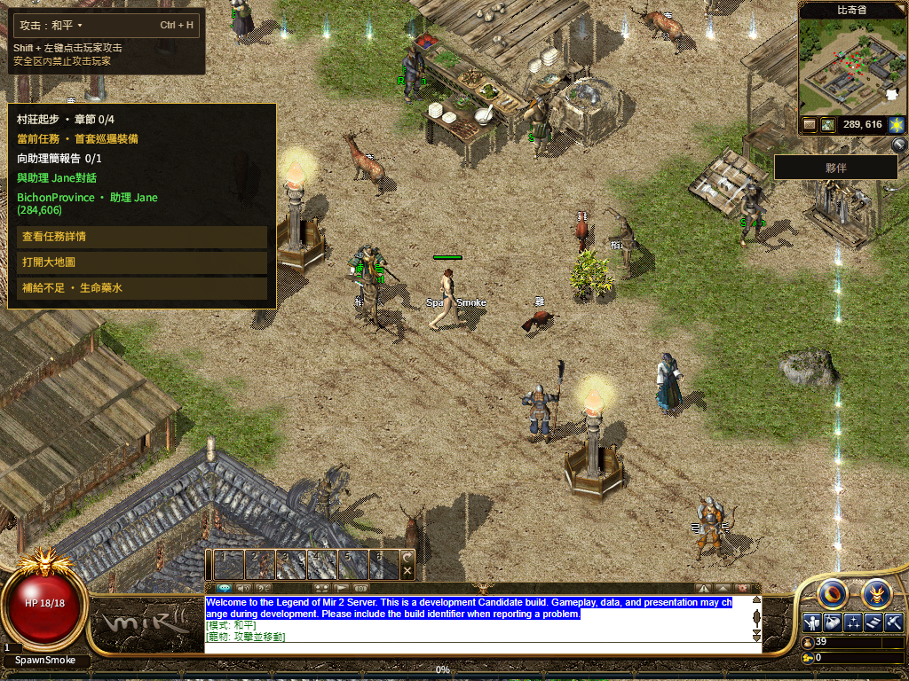

# R16 第一方完整字体与运行包加载顺序

产品源 `d99212e3cdde834b6eb751dd36e9a6361bc2d100`，父源 `e10a84e129234092e1f6f69bcffdf14537789eb3`，发布保护源 `088efb63471d490a7fddb948fd6007ac61f038fe`。已发布正式站；公网功能完整通过，原 120 秒 Native 冷加载仍失败。[正式发布及边界](production/README.md)

## 先验证已有的副本

普通干净 Chrome 直接完整读取现有第一方 WASM 和繁中字库，分别得到原来的 31,452,436 / 11,941,968 字节及 SHA，约 51.474 / 68.990 秒。两者放在同一干净上下文并行读取，使用同一 HTTP/2 连接，完整校验仍通过，分别约 105.519 / 117.709 秒。没有游戏、Worker、glue、编译或 App。这些是资源读取诊断，不证明并发或 HTTP/2 是上轮故障的根因，也不是整场性能验证。[WASM](diagnostics/firstparty-wasm-receipt.json) · [繁中字库](diagnostics/firstparty-tc-receipt.json) · [并行读取](diagnostics/joint-receipt-r2.json)

最初的并行尝试在打开 `/version` 时连接关闭，没有发出两个目标资源请求；保留为独立前置网络失败，不记成资源读取失败。[原记录](diagnostics/joint-receipt.json)

## 实际改动

- Page 在最终后端的模块加载成功、确认当前消费者仍有效后，才主动预热六套字体。字体完成仍不阻塞 App boot；已有 DOM 字体请求可以提前发生，不能声称 WASM 独占网络。退出、失败、后端回退和同页恢复额度保留。
- 注册器优先使用构建中已有的第一方字体，原固定 CDN 和继承源仍作回退。显式请求 `fontMirrorFirst:true` 的 Worker 调用仍可使用先 CDN 的策略。
- App 和普通回退字体也必须读完整正文才交给消费者及缓存。正文停顿、部分范围、空体或超限不会发布前缀；原 app/普通源 7 秒响应头组、显式 preferred 源 8 秒响应头、15 秒正字节 idle、32 MiB 上限和请求顺序保留。
- 保留原六套字体、十语词库、游戏规则和运行包。不重新编译 Rust、上传资产或改 Gateway、DNS、账号及存档。

## 检查与完整浏览器流程

[231 项相关检查](checks.log)、[70 项发布保护](release-guards.log)、生产构建及类型检查通过。候选 `e10a84e12923-firstparty-fonts-c84e5706`，BUILD_ID `TW6xQE3YEKz09lx851qwH`。[构建](build-receipt.json) · [输入绑定](source-inputs.json) · [精确提交](staged-product.json)

默认渲染与共享 WebGL2 各完成冷启动、正常退出、关闭整个 Chrome 进程、同一档案普通重登与再次保存，共四会话通过。受控冷 Native 就绪为 52.097 / 52.145 秒，重开为 1.299 / 1.250 秒；这不是公网提速数字。[四会话](local/cohort.json)

每条流程都真实发出 app 繁中字库前缀，等待 15 秒无进展后取消，再从固定镜像取回完整原字体。另四套健康字体直接从 app 完成，无需镜像；全部六套缓存完整字节及 SHA、113/113、共用 HUD、繁中 Q、普通移动、真实 Worker 停启和保存均通过。保留场景/地砖/词库各两次 20 秒无响应头、NPC 两次超时、运行包 8 秒无头和两次 15 秒零正文等已有故障。原 8 秒移动、120 秒 Native、60 秒本地首场景门槛没有放宽。[默认流程](local/quest-after-r2.json) · [共享 WebGL2](local/quest-after-r3.json)

首轮在新增顺序断言处停止：真实缓存指标只保留每个名字第一次调用，未存下载完成状态。该轮 Native 52.288 秒及完整六字体已通过，但不计完整资格。时钟字段修正稿在重放前即被进一步核对并废弃；最终只读包装记录每次诊断调用，原方法的参数、接收者、返回值与缓存记录保持原样，再复测全部流程。[原失败](local/quest-after-r1.json) · [原 Native 分项](local/failed-r1-native-font-readiness.json) · [最终观察冻结](browser-preparation-r3.json)

## 保全与仍开放范围

481 个原脏路径与本轮七文件写集零重合。采样时 477 个仍相同，4 个由独立任务继续修改，均按现状保留；未提交的 Shell/Native/Windows 内容没有进入此次构建。[保全](preservation.json)

运行包仍为 `bevy-0c553a754308e5b8`，资产仍为 `20261108-r16-08ec86d5105c`。截图仍见 NPC 名称不完整、混合英文等既有像素差异；完整三职业至 30 级、公开旧档、其他地图技能、实体手机和最终人类 Accepted 仍开放，整体 1:1 Goal 未完成。
