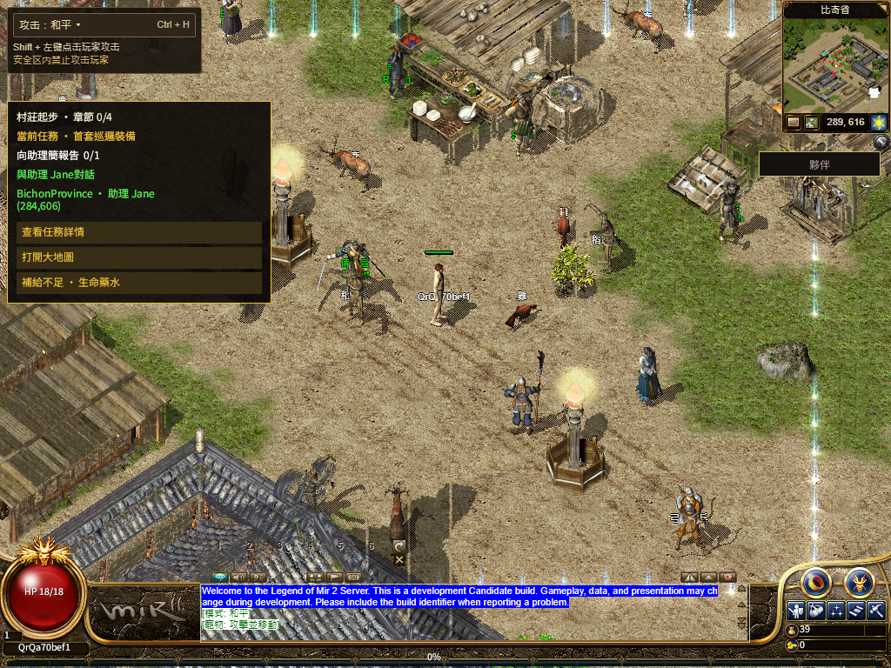

# 第一方完整字体正式发布

[numeron.obelisk.build/game](https://numeron.obelisk.build/game) 已更新为 `d99212e3cdde834b6eb751dd36e9a6361bc2d100`，部署 `dpl_7jUyC8yS8wxhfznJ8z5P42CPwbkX`。保留上线，未回滚。功能回放通过，原 120 秒 Native 冷加载资格仍为 false；不能称为整体 100% Candidate。[最终状态](final-state.json) · [平台读回](platform-readback.json)

## 发布与功能证据

- [Stage 43413507134](https://github.com/Zombieliu/mir2/actions/runs/43413507134) 创建候选后，独立平台确认 READY、production、游戏项目与产品 SHA 一致；[Promote 43414645150](https://github.com/Zombieliu/mir2/actions/runs/43414645150) 切换。其余官网/原项目按原保护流程保持。[发布回执](release-receipt.json)
- 公网版本、游戏页、Worker 和八个 Core 文件共 11 条完整读回，Worker 与提交字节/SHA 一致；有界第二轮完成一次网络重读。[文件](public-files.json)
- 简繁中各一次真实二维码、待确认文案和取消后零轮询通过。[出码](qr-pair.json)
- 普通默认网络 Chrome 经官方手机尺寸 PWA、隔离虚拟 Passkey Testnet 钱包完成一次登录专用签名，普通新建 QA 角色、进比奇、一次权威移动、城市画面、繁中 React 和共享 Native 任务窗、六套完整原字体 SHA、113/113、真实 Worker 停启和正常注销全部通过。未使用实体手机，没有操作真人钱包、付款、已有公开角色或完整三职业路线。[实际回放](replay.json) · [Native 采样](native-samples.json)
- 浏览器关闭后，才读取新三份备用 JS 和 16 份站立包；静态 AST/JSON 还原的原始内容及 PNG 一致。这个分项证明线上内容有效，不代替实际使用路径或提速证据。[三份完整内容](bootstrap-public-files.json) · [站立内容](standing-public-files.json)

## 冷加载失败仍保留

本次点击 Start 到首画面 18,569 毫秒，首步权威回包 1,652 毫秒，通过原 8 秒移动门槛。共享 HUD 在首画面后 185,240 毫秒观察到就绪，超过原 120 秒；独立粗采样首次 HUD/Quest 同时 ready 为 185,183 毫秒。180 秒可选观察从后续检查阶段起算，只用于记录后来确实恢复，不把超时改成冷资格通过。[原计时与范围](replay.json)

这是一轮默认网络观测，没有对照公网前后 cohort，也没有 Lighthouse/CWV 结论。第一方完整字体提高了本轮可恢复性，但不能据此声称全局提速或确认 HTTP/2 根因。继续降低关键启动等待和验证公开旧档、完整玩法及各语言像素。

## 新玩家反馈

发布验证期间又收到 Edge 蓝色“无效手势”和图片右键菜单照片。确认它们属于浏览器手势/原生菜单与游戏右键输入的冲突；当前源码已有 frame 内菜单拦截，尚未复现该照片对应的菜单穿透。它不是本次字体修复已解决的项目，下一轮优先做真实 Edge 右键按下、拖动、释放与事件取消记录，避免用盲目阻止 `pointerdown` 破坏经典 `mousedown` 移动。[反馈与源码边界](../../r16-edge-right-button-report-20261113/README.md)

运行包仍为 `bevy-0c553a754308e5b8`，资产仍为 `20261108-r16-08ec86d5105c`。481 个原脏路径与七个产品文件零交集，独立 Windows/Native/Shell 工作按现状保留。[保全](preservation.json) NPC 名称裁切、混合英文、其他地图技能、三职业至 30 级、实体手机及最终 Accepted 仍开放，持续 Goal 保持 active。
