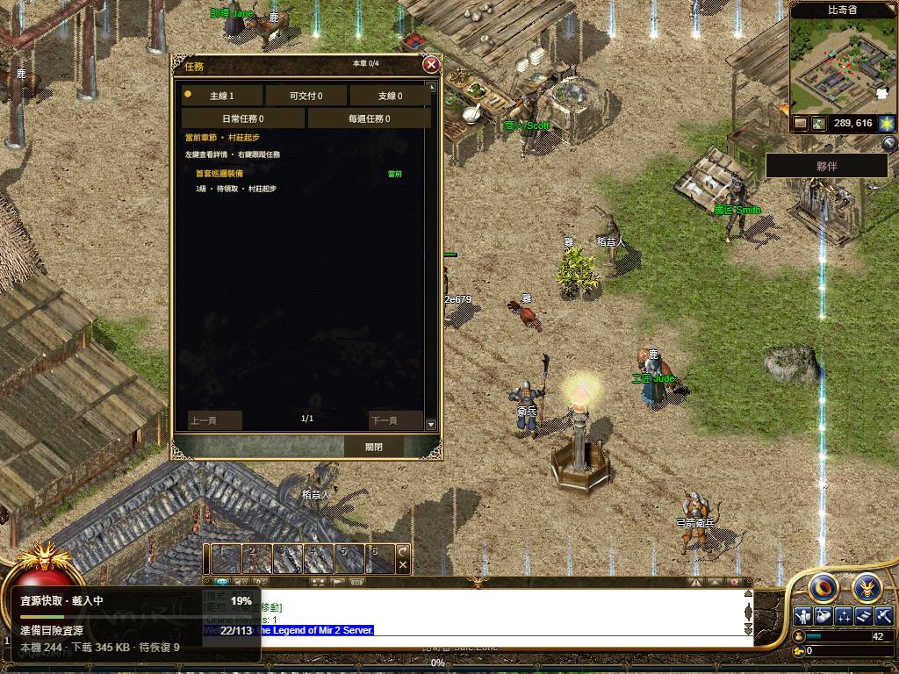
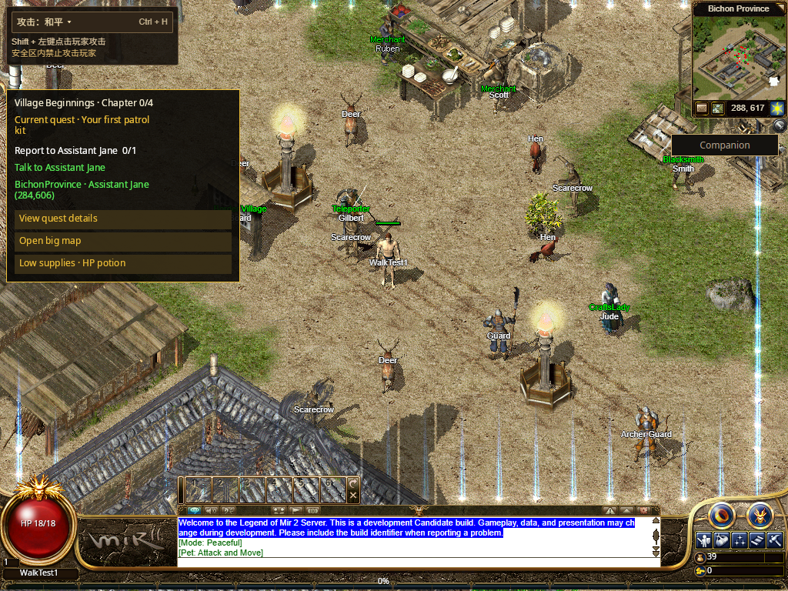
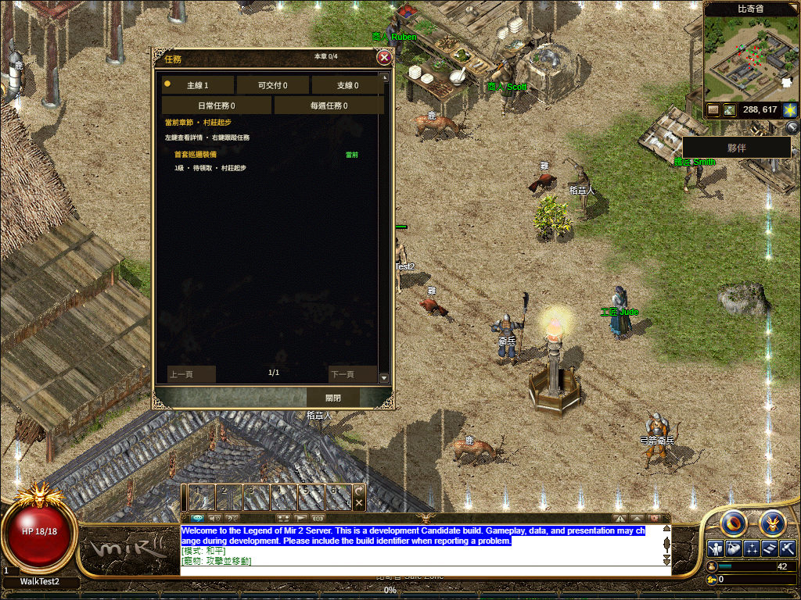

# 字体合并读取、公网失败与完整 HUD 补读候选

2026-11-15。正式站已经回退为 Web `20de5ea4fd93`／`dpl_AWssgszkpKJznMksLsP7hiRFK6U8`，Gateway `fd3fcedc8b8a`。回退后简繁真实二维码、同一登录意图待确认、取消停止轮询均通过；原 308 账号／220 角色／220 存档与 22 份配置保持，新增的内部 QA 账号、角色和存档各一份保留。没有恢复旧数据库覆盖新进度。

本轮 `0bcd61e0f2` 匹配 Web／Linux 包曾实际发布，公网首场完整判定 **false**，未继续第二场。后续 `44b986b8a5` 修复 HUD 补读遗漏，32 项、独立严格构建及原两组本地升级冷流程通过；**44b 尚未发布或通过公网两场，整体 Candidate／Accepted 仍为 false，Goal active**。

机器记录见 [verification.json](verification.json)、[不可变源码](source-pins.json)和 [42 份私有原始记录摘要](private-evidence-pins.json)。后者只记录路径、长度及 SHA；钱包状态、登录意图令牌、凭据和数据库原文留在私有目录。

## 1. 被动观测与字体变化

旧 `4ad` 前端的繁中冷场再次超过原 Native 120 秒。被动 Worker CDP 观测到 SC 字体 55 次请求、54 个 `206 / HIT / SIN / h2`，完成 53 段；请求头中位 1,942 ms、正文中位 2,513 ms，首帧后 117,946 ms 时仍只完成 13,893,632 字节。这次记录支持“小段重复请求的时延累积”，不能归因为该场 CDN 未命中，也不推导所有旧失败的原因。

`88002a0000` 将相邻四个缺失的 256 KiB 分段合为至多 1 MiB 请求，初次完整读取从 63 次变成 16 次。保留全部 63 个原段 SHA、缓存键、失败后续读和完整 SC 的 16,437,364 字节／SHA；只合并连续缺段，不重读已存段。每段和最终字体均校验后使用。合并失败可在同一额度内退回单段，仍最多两个字体读取者、8 秒响应头／15 秒正文空闲预算；图片通道独立。

- 131 项相邻检查通过，包含 24 项字体 Range 检查，不重复相加。新增断言检查实际缺失段覆盖，不以 HTTP 请求个数替代字节覆盖。
- 真实 Edge 中断后保存 62 段，停启后只补 1 段；六套完整字体原 SHA 和 FontFace 解码通过，所有自有进程关闭。
- 被动观察器真实 Edge 双上下文试验通过，只采集所选 Worker 的字体 Range、公开缓存头及时间；不暂停请求、不采集认证头／查询／正文。
- 本轮没有再发布 CDN Worker；此前已验证的 `f7abaa19` 保留。原分段及 CDN 证据见[上轮记录](../r16-font-edge-cache-20261115/README.md)。

## 2. 独立构建与本地原门槛

独立源目录在 D 盘，未从工作树打包 Native／Web 的其他 WIP。核对 2,179 个 app/lib 源文件、一个已固定的生成输入例外及 27 个原候选输入；`880-font-batch-22e56501` 严格 Next 构建 43,724 ms，build ID `fc0G_1lU42khjq6-WhMAZ`。`0b` 与 `880` 的产品前端源相同，新增的是 Linux 发布检查。

沿用原两个升级冷场、私有存档与既有真实资产 CacheStorage，清浏览器 HTTP 缓存，首次六字体均未缓存；普通 UI 新建角色、入城，临时行走包故障后核对完整原包和自然 DOM PNG，随后 Q、注销、同角色重进、再次 Q 和注销保存。

| 候选 | 路径／语言 | 首步 | Native 自首帧 | 自然 PNG 自首帧 | 结果 |
| --- | --- | ---: | ---: | ---: | --- |
| 880 | compatibility／en-US | 136 ms | 18,692 ms | 1,544 ms | 完整通过 |
| 880 | 共享 WebGL2／zh-TW | 119 ms | 27,975 ms | 29,347 ms | 完整通过 |
| 44b HUD 补读修复 | compatibility／en-US | 153 ms | 22,159 ms | 5,928 ms | 完整通过 |
| 44b HUD 补读修复 | 共享 WebGL2／zh-TW | 104 ms | 50,192 ms | 31,985 ms | 完整通过 |

四场均六字体完整 SHA、113/113、首次与重进 Q、两次正常注销／同一落点、旧角色和存档保持，四类自有进程关闭。自然 PNG 的观察器起始时间另存 JSON，不能混同首帧起算。原移动 8 秒／自然画面 65 秒／Native 120 秒不变。本地使用冻结 `dca152` QA Gateway；最新匹配 Linux 网关资格另列，不能以本地结果冒充后续合并的容量验收。

## 3. 真实 Linux 包、克隆旧档与匹配发布

`0bcd61e0f27147f005dee3d6c49abb6a1af15157` 的 [Linux 构建 43706354711](https://github.com/Zombieliu/mir2/actions/runs/43706354711) 成功：310 项共享 Zone 相关检查（含 Gateway 40 项和强制的 7 项 background execution）及 216 项真实 PostgreSQL／billing 检查通过。下载原 artifact `14159169191`，1,841 个包内文件逐一 SHA 通过；ELF 93,576,560 字节，SHA `22bb54130b2084a34c31d7b0b7bd604cc99a260a08e8d924a5513b329ee4ec96`。这些检查不证明 CCU 容量。

生产 PostgreSQL 同一导出快照备份 308／220／220 行及 22 份配置，克隆为独立数据库／Redis／端口。隔离新包普通注册、密码登录、创角、StartGame、105.01 ms 权威移动、中立怪行走、两次正常注销和同角落点通过；未发 debug/admin 指令，原生产进程和原行保持。切换前停自有 canary，生产无活动会话／连接／重连租约后只切执行文件和版本标识，未换内容或存档配置。

发布控制器 `353a94bff1` 固定 47 个提交／272 个变动文件的完整源码闭包。Web `dpl_GbgiT5prQBFsm32vkfQ9kJc7CRRd` 独立读回 READY、正确项目和 `0b` 来源；[stage](https://github.com/Zombieliu/mir2/actions/runs/43706928930)、[check](https://github.com/Zombieliu/mir2/actions/runs/43707588125)、[promote](https://github.com/Zombieliu/mir2/actions/runs/43712070140) 均成功。15 个公开入口资产／新 Worker 62,863 字节 SHA、第一方扫码待确认及别名均通过。随后才运行正式域名完整试玩，预览站通过不代替公网结果。

## 4. 公网首场失败，保留原判定

普通已安装 Chrome 的默认系统网络、正式域名和 TLS，独立桌面及官方手机尺寸钱包；内部新 Testnet 钱包仅一次登录签名，无充值或资产交易。没有改代理参数、注入游戏状态、预填缓存、减少六字体／113 项或放宽时限。手机尺寸浏览器不算实体手机相机验收。

首场能出真实码、钱包确认、建角进比奇、权威走一步、读完整行走 JSON、打开和关闭共用 Q、停启 Worker、正常注销。首步 202 ms；Native 自首帧 106,358 ms；运行包正文 24,121 ms。六套完整字体通过，其中 SC **16 次 Range 均完整 `206 / HIT`**。

完整判定仍为 **false**：HUD 初始 9 项各经过三次头超时后失败，恢复只选择前 8 项，最终为 `112/113`。第 9 项 `/original-ui/UI_32bit/472.png` 留在 `unattemptedUrls`。另观测到它在会话时钟 172,638 ms 后到的上游 `200`／383 字节；这不等于原预热读取已完整成功，也不能倒填 `113/113`。这里确认的是补读遗漏，未宣称该图永远不会被其他读取补齐。

原分类器 SHA `17086d553a3eebddb9a656d09c94024417081656e1e3c939a6bc3916f61ee402` 未变；原始分类、预热详情和网络均保留。第二场只有冻结准备文件，**没有执行**，没有原样反复发布以挑一次通过。

## 5. 两端回退与读档核对

Web 第一次回退调用误把目标基线填入“当前候选”参数，[43713129702](https://github.com/Zombieliu/mir2/actions/runs/43713129702) 被 `qrCandidateInputInvalid` 拒绝，未执行写入。修正为当前候选后，[43713420269](https://github.com/Zombieliu/mir2/actions/runs/43713420269) 成功，生产项目和独立别名均返回 AWss。Gateway 只撤销本轮两个固定 SHA 的覆盖文件，确认无人在线后回到原 fd3 二进制；不恢复数据库。

12:31Z 公网 `/version` 和网关 `/health` 均 200，分别为 20de 和 fd3。回退后简繁各一次真实二维码矩阵／同意图待确认／普通取消通过，零取消后轮询，两浏览器关闭。服务器只读逐行核对：原 308／220／220 行 SHA 和 22 配置保持；当前 309／221／221，新增 QA 进度保留，容量配置仍 66／51／51。SSH 控制器随后正常关闭。

## 6. HUD 修复及仍待的公网资格

`44b986b8a51682f1c72c552b82c0f21c32ce0d2a` 只改预热恢复和相关检查。一次恢复遍历本包所有失败 URL，最多为该有限包的数量；不重读成功项、不循环整包。仍最多两个恢复读取者，每 URL 原三次请求、10 秒头／15 秒正文空闲预算和 owner 取消行为不变；完整 EOF 才能将失败改为成功。没有把 112 当成 113 或延长验收窗。

新增原 113 项首次暂败后恢复的回归在旧代码上因 `8 != 113` 失败，修复后 32 项通过；永久失败仍最多一轮恢复，取消正文保留诊断、健康项不重读。独立严格构建 `44b-hud-recovery-44a2780a`／`S4jWwWWsvzY3qzXebQG2-` 用时 47,823 ms，29 输入 pin／2,179 源核对，其他 WIP 排除；实际两场结果见上表。9 项失败遗漏由公网原记录与定向回归共同证明；新的两场本地试玩不冒充故障注入或正式网复验。

下一轮从匹配 44b 的独立 Linux／Web 候选与源码闭包开始，再做两场完整公网 8／65／120 和六字体／113／Q／Worker／正常注销。不能复用 0b 的二进制版本标签冒充新包，不能由这轮本地通过恢复正式候选资格。

资源浮层在公网截图中仍遮血球；混合语言、原 Q 关闭偶发失败定因、6 项旧夹具依赖失败、公开旧档冷重登、当前三职业 1–30、其他地图／技能、阿洛跨端实战、Windows 窗口及实体手机仍开放。

## 保全与诊断纠错

30 个原内容 WIP 中 29 个原始 SHA 不变；容量 README 的另一份改动对应并发提交 `766d81d4dc`，没有回退。其他用户／代理改动不进入本轮候选。私有失败记录保留：LF／CRLF 脚本摘要不匹配被本机控制器挡在远程执行前；可复用工作流直接查询 404 后改用已注册入口；发布 POST 成功后的 CLI EOF 只恢复同一运行，不重复派发；Node 元数据探测超时与实际普通浏览器结果分开；测试端 ArrayBuffer 哈希及只读脚本分隔错误修正后另存新回执。没有把这些诊断错误重算为产品通过。
