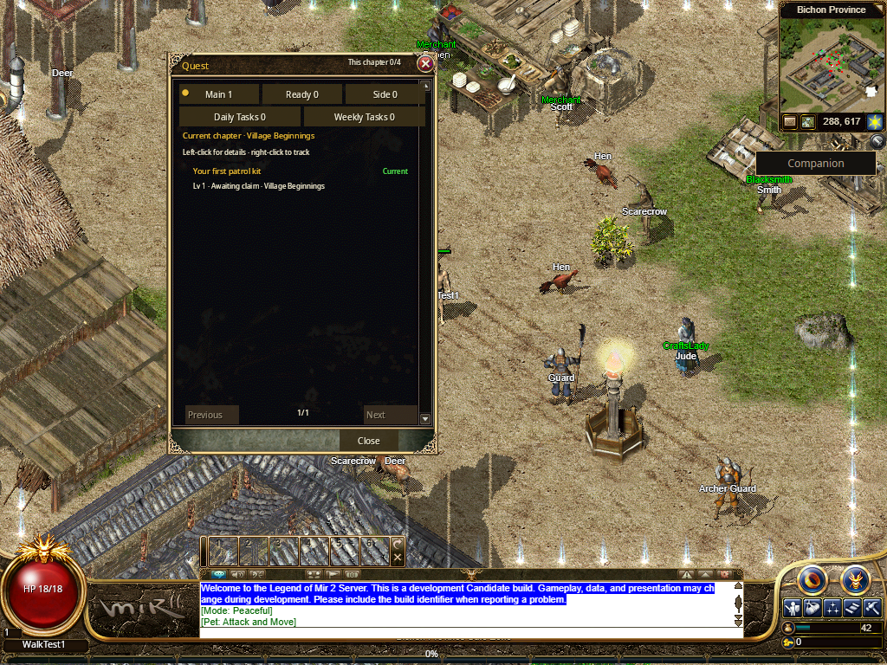
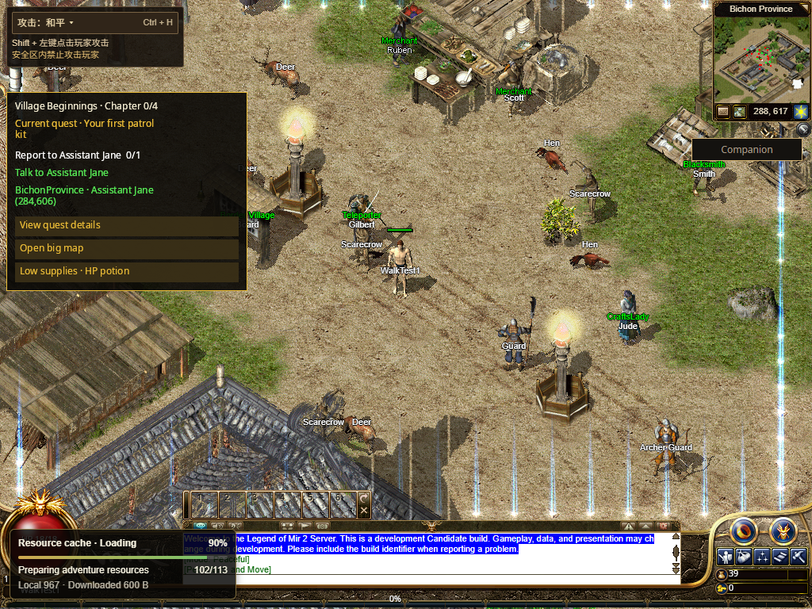
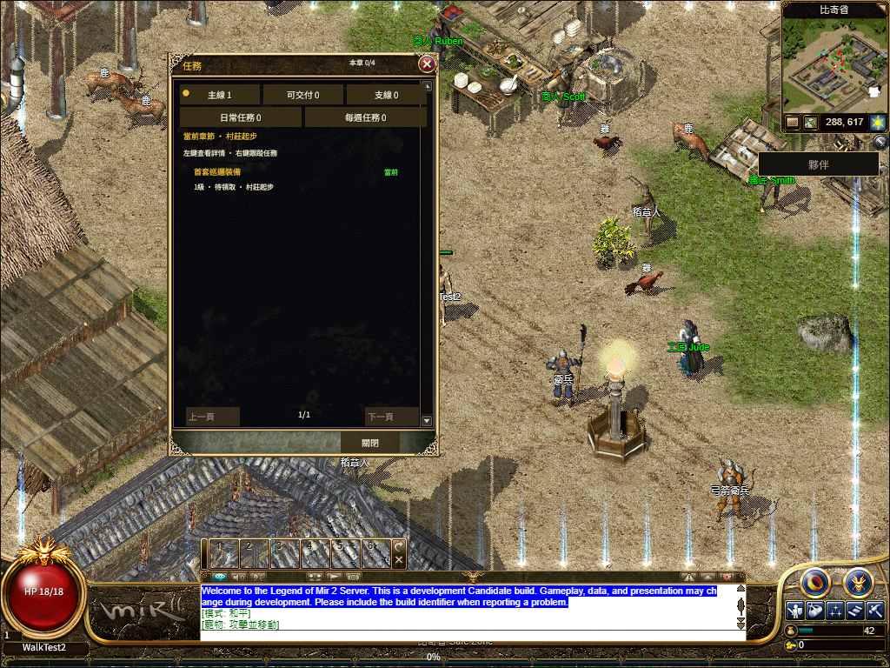
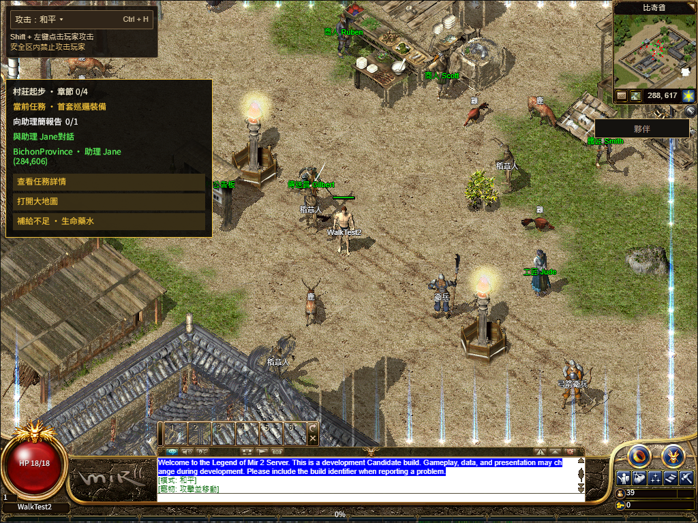

# 字体分段复用 CDN 完整缓存与两组冷加载

2026-11-15，继续 Windows R16 的 `codex/windows-player-journey` Goal。`b33533f4aa4c3fa00d9f35f2ad9d4942dd638045` 已提交推送并发布资产 CDN Worker。两组原本地升级冷加载流程均通过；**Web 前端仍未发布这批候选，完整两场公网资格尚未完成，整体 1:1 仍开放。**

## 改动与发布

原 Worker 对所有 Range 直接读取 R2，即使同一位置的 Cache API 已有完整字体。这次只让 `original-ui/fonts` 的有效单范围 `.otf`／`.ttf` 请求尝试读取完整缓存的切片。缓存读取最多500毫秒；未命中、抛错、超时、完整200、编码表示或范围／长度不符时，仍走原 R2 路径。206不写入缓存，Worker不缓冲完整字体，未改资源来源、原字节、字体数量或浏览器并发。

这依据 [Cloudflare Cache API 的 Range 行为](https://developers.cloudflare.com/workers/runtime-apis/cache/#match)：已缓存完整响应带有长度时，可以返回对应切片。缓存只在观测的数据中心生效；本改动不会在范围未命中时额外下载完整字体，也不保证其他位置已有缓存。

| 项目 | 实际结果 |
| --- | --- |
| Worker 版本 | `f7abaa19-3fcb-4320-8be4-3372772441b9` |
| Deployment | `24d4384c-7f2e-4f9d-8cfa-f0b54396a079` |
| 实际代码 | 13,039字节，SHA-256 `7f4bfbd4f8d77dcfaebfeb8a9febc6bf87a2a6e448ea7f9098d6bc36a326888a`，独立 API 下载与合格包一致 |
| 可回退版本 | `9e9b30bd-b567-4f5d-8bf6-f8f43eb4fd69` |
| 配置 | 原域名路由、R2绑定、四项变量、兼容日期与日志／trace设置保持 |
| 公网字体 | SIN位置，首次范围即HIT；canonical及hotlink共5个范围响应的原字节／范围／长度通过，HEAD通过；未额外预填完整字体 |
| 游戏服务 | `2026-11-15T10:11:36.652Z` 读回Web `20de5ea4fd`、Gateway `fd3fcedc8b`，均200；本轮未切换前端、重启网关或修改正式存档 |

## 验证

新增缓存命中检查在旧代码下4项均失败。最终41项范围传输检查通过，包含完整缓存命中、hotlink和查询归一化、开放／裁剪范围、错误元数据与编码回退、缓存抛错／超时及晚到正文取消、不缓存206、非字体／gzip／HEAD保持。相邻选测共127项通过，**包含前述41项，不能相加**。输出见 [checks.tap.txt](checks.tap.txt)。

真实Miniflare／workerd的9项检查通过：先缓存完整响应，再删除模拟R2源文件，仍返回正确切片，证明读取的是真实 Cache API，而非桩返回；TTF、未命中、overlay、图片范围、gzip及HEAD也通过。固定Wrangler4.112.0预演、生成运行时类型及严格TypeScript检查通过。首次类型检查的可空timer错误原日志保留，修成判空后复验通过。

## 原两组本地冷流程

使用上一轮已严格构建的 `4ad940554d` 前端候选和冻结 `dca152cd15` 网关，保留同一角色数据库及真实旧缓存输入。原两组升级夹具、8秒首步、65秒自然PNG、120秒Native、编译备用全字节与六字体门槛不改。没有伪造就绪、预填浏览器缓存、管理发物或传送，也没有把恢复档案改成首次冷场。只换为本轮已发布的 CDN 代码，并保留失败Q关闭诊断。

| 原流程 | 首步 ACK | 合格自然行走PNG | 完整Native | 六字体／113资源 | Q及保存 |
| --- | --- | --- | --- | --- | --- |
| 默认兼容渲染／英文 | 108ms | 14,796ms | 24,979ms | 全部通过 | 首次及重进Q开关、两次正常注销、同角色保存通过 |
| 共享WebGL2／繁中 | 136ms | 46,949ms | 118,490ms | 全部通过 | 首次及重进Q开关、两次正常注销、同角色保存通过 |

两组均读到原764,724字节／240PNG的备用载荷与原SHA，并验证一帧真实可见的原行走PNG；不是纯GPU全方向验收。所有原角色、存档和输入快照保持。四个进程边界均已关闭。完整安全摘录在 [qualification.json](qualification.json)，30份不可变私密回执的字节和摘要在 [private-receipt-pins.json](private-receipt-pins.json)。29份原外部WIP逐文件原始SHA保持。

四图均已查看。英文重进仍有资源进度浮层遮挡血球；攻击说明、NPC姓名和繁中追踪仍混合语言。字体／Native就绪不能代替这些视觉差距的验收。

## 剩余边界

繁中118.490秒仅比120秒上限提前约1.5秒；本轮通过不构成稳定时延保证。该场SC主字体在首帧后约118.3秒才完成，仍需用被动Worker网络观测区分队列、缓存位置、响应头和正文长尾。公网字体读回只覆盖SIN位置，不能推出所有地区的效果。

[上一轮默认重进Q关闭失败、繁中120秒失败与41段未完成](../r16-font-resume-20261115/README.md)保持原判定；本轮四对开关未复现Q失败，尚未定因。原组合故障与夹具误判也未被本轮重写。

下一项先收集繁中字体长尾的被动网络证据，再做匹配发行候选及两场完整公网冷资格。当前本地网关不代表后续合并的CCU代码已合格。其他地图／目标、三职业完整自然1–30、阿洛、语言与像素、6项旧夹具依赖失败、Windows窗口、实体手机和最终人类Accepted继续；Goal active。
