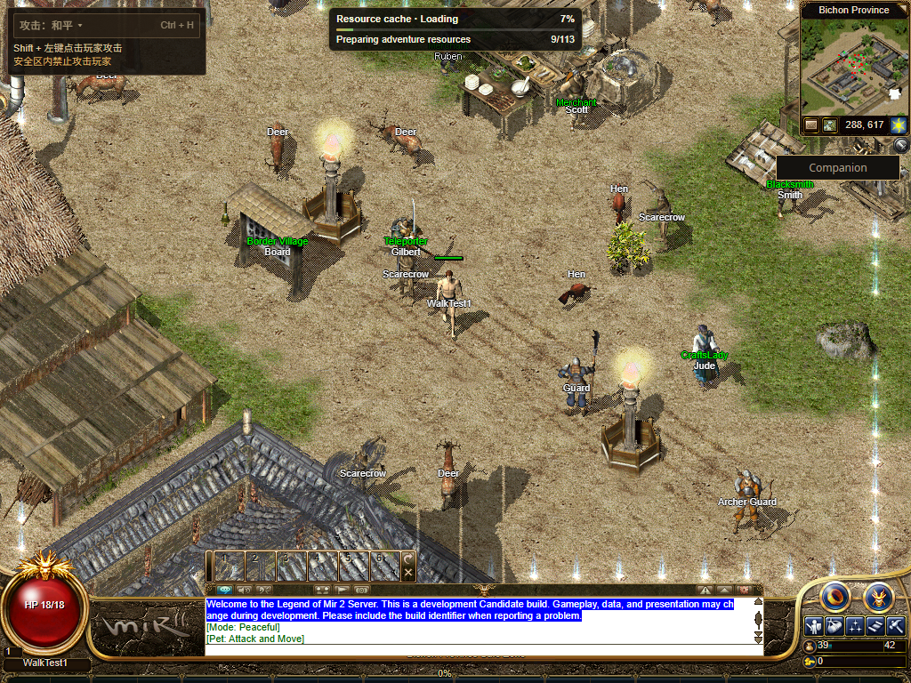
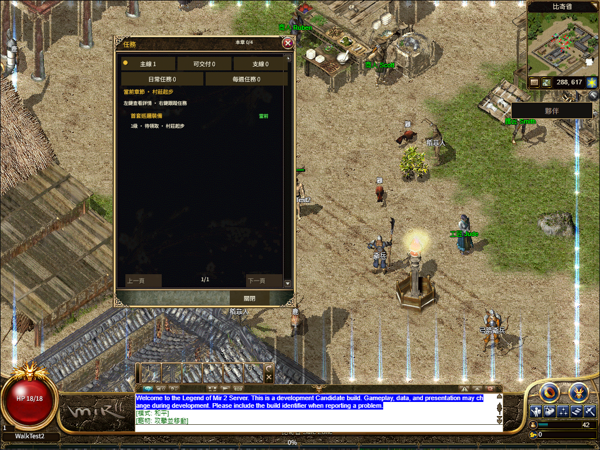

# R16 必需 HUD 图片下载优先级（2026-11-15）

本轮修复已请求的 HUD 核心图被普通场景资源长期挤在队尾的问题。缓存分区、原 113 项清单、首帧后后台预热、六个图片响应头准入、七秒单来源响应头期限和字体通道均保留。原公网 `4204` 的 Native 163326ms 失败不改写，详见[原判定与回退](../r16-hud-public-budget-20261115/README.md)。本页记录发布前本地资格；随后已实际发布，但公网原门槛未过、两端回退，详见[生产验收及恢复](production/README.md)。本候选未保留在线上；整体 100% Candidate / Accepted 均未成立。

## 原因与改动

公网原记录中，`Prguse/1.png` 页面请求至 Worker 真正上游请求相隔 159162ms；十五项必需图有多项在首帧后 160–163 秒才完整。Worker 最终配置为 critical 19 / background 161，实际 `hud-core` 的 113 项全部属于 background。队列此前直接使用缓存分区作下载优先级，因而将这些必需图排在未分类地图、人物等 runtime 请求之后。该错误已用真实 manifest 在受控浏览器复现；它解释了一个确定的排队缺陷，不证明公网其余网络长尾只有这一项原因。

Worker 现在单独从 `hud-core` 建立必需图集合，优先调度已经排队的对应请求；同级仍按先后顺序。它不提前启动预热、不抢占已开始的请求、不把后台缓存迁到其他分区。该集合随已有配置持久化，停启后恢复；旧配置缺少新字段仍可使用原来源和缓存。新版配置继续防止延迟的旧恢复结果覆盖当前状态。镜像来源、完整正文缓存、共享下载的所有权及字体分段 SHA 没有改变。

## 可复测结果

- 173 项定向及相邻检查通过，零 skip。以原 Worker 跑两项新增回归均失败；原日志保留。
- 安装版 Chrome、相同最终夹具：六个无响应头的场景请求先占位，另有 42 项场景请求先排队，再请求真实 113 项 HUD。旧版观察满 18015ms，HUD 完整体为 0；新版 7427ms 完成 113 项，均先于后续场景请求，完整缓存体 SHA 全匹配。112 张正常图片解码；原 `MMap/0.png` 是 65 字节、零尺寸占位图，只校验其原始完整字节，未替换素材。
- 相邻真实 Chrome：72 项图片、重复消费者和两套完整原字体并行，72/72 与两字体 SHA、完整缓存通过，服务端图片峰值 6；所有浏览器和服务器关闭。
- 独立干净源码生产构建通过，编译/类型检查开启。2179 个 app/lib 输入对照已提交源码，只有一项既有、已固定的生成运行包投影例外；29 个额外输入固定。仅覆盖本次 Worker 和已提交 `627b68ae4d` 的浮层组件，排除工作区其他未提交内容。构建 ID `bhVGnvOmbE0bDxYKQZz6s`；运行包仍为已固定的 `bevy-0c553a754308e5b8`，本轮未重编 Rust/WASM。

| 原始完整场次 | 英文默认路径 | 繁中共享 WebGL2 |
| --- | ---: | ---: |
| 首步权威回包 | 170ms | 191ms |
| 首帧至 Native 就绪 | 19002ms | 23048ms |
| 六套原字体完整 SHA | 6/6 | 6/6 |
| HUD 预热 | 113/113 | 113/113 |
| 实际 Worker 必需图 / 原缓存分区 | 113 / background | 113 / background |
| Q 首次及重进开关、两次正常注销、同角保存 | 通过 | 通过 |
| 原档、源快照、四项服务关闭 | 保持 | 保持 |

两场沿用原 8 秒首步、65 秒完整行走包/自然 PNG、120 秒 Native 门槛，使用旧真实 CacheStorage、清 HTTP 缓存和未预置六字体的相同条件；未用 QA/admin 命令或改档代替普通登录、新建角色、StartGame 与注销。它们是本地升级冷场，不能替代公网冷启动资格。

这次英文自然行走截图实际拍到 `9/113` 加载浮层，位于顶部中央，血球、主 HUD、小地图和左侧引导保持可见。它补充了上一轮“组件夹具通过、真实游戏尚未观测到可见浮层”的本地证据；不据此宣布十语实战或正式站布局验收。繁中共享 Q 的实际画面如下，混合语言和文字像素继续单列。

## 保全、失败记录与下一步

29 份既有内容改动的原始 SHA 全部保持，独立构建目录的两份覆盖源在两场结束后已恢复。完整私有记录位于 `D:/mir2-builds/r16-hud-admission-20261115`，摘要及 SHA 见 [verification.json](verification.json)、[source-pins.json](source-pins.json) 和 [private-evidence-pins.json](private-evidence-pins.json)。原始日志、失败及截图不覆盖。

夹具最初遗漏 Playwright 工具路径，未启动浏览器；第一次新版夹具把原零尺寸 MMap 当普通位图解码而失败，原回执保留。补充明确的原始字节校验后，旧/新 Worker 用同一最终夹具重验。整局准备器另有两次启动前断言/历史路径错误，均修正于新冻结目录，未冒充完整游戏失败或成功。

2026-11-15T14:43:45Z 独立公网读回仍为 Web `20de5ea4fd93b3c61e4aa590dca2ea2d8f5d2339`、Gateway `fd3fcedc8b8a4d0b6bb16f6c45cd57a77364c8b5`，两端 200；未在本轮修改 CDN、DNS、账号或生产配置。接下来准备匹配源码的候选和两场原门槛公网验证，失败则回退。更多寻路目标/地图、三职业完整 1–30、阿洛实战、语言像素、六项旧夹具、Windows 窗口和实体手机继续。持续 Goal 保持 active。
