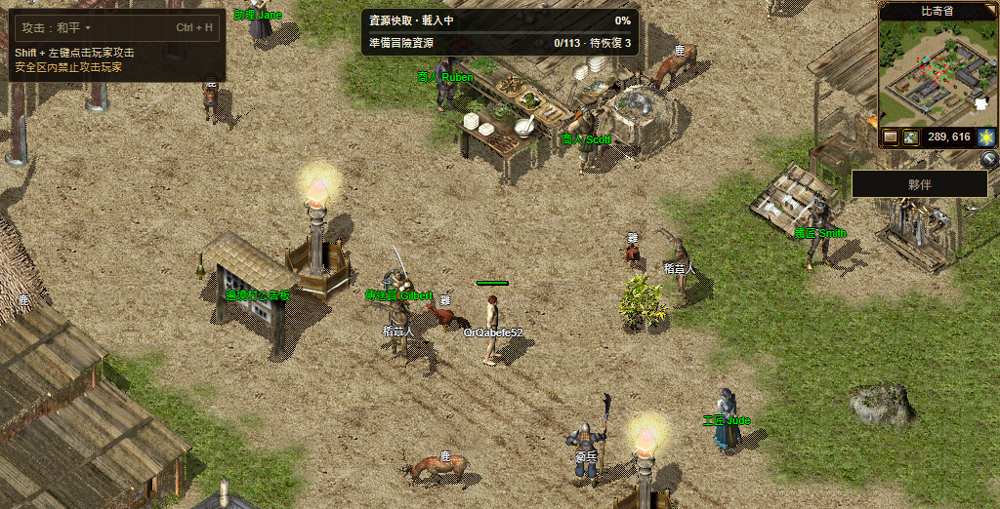
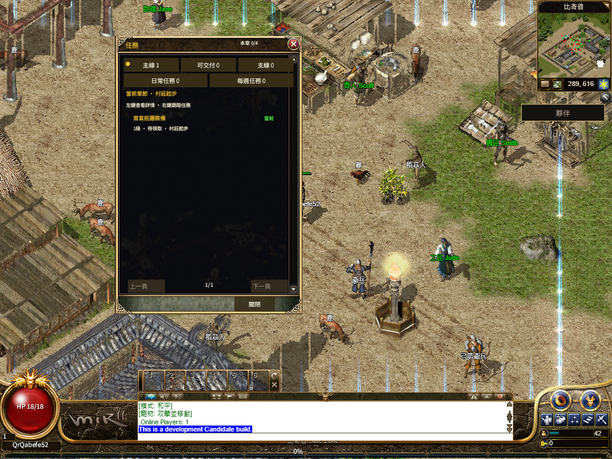

# 必需 HUD 优先级候选的公网验收与回退

记录于 2026-11-16（Asia/Shanghai）；本轮事件 UTC 时间为 2026-11-15。

`20e79131a2` 已实际发布并跑完首场公网流程，但原判定为 **false**。完整行走包未在原窗口内交付，原版界面与共享 Q 的观测时间为首帧后 **133427ms**，超过原 120 秒。第二场仅准备、未执行。两端已经回退并核验：Web `20de5ea4fd93b3c61e4aa590dca2ea2d8f5d2339` / `dpl_AWssgszkpKJznMksLsP7hiRFK6U8`，Gateway `fd3fcedc8b8a4d0b6bb16f6c45cd57a77364c8b5`。本候选未保留在线上，持续 Goal 仍为 active，整体 100% Candidate / Accepted 均未成立。

[本地修复、173 项检查、严格构建及两组完整回归](../README.md)仍有效。本次没有修改原 8 / 65 / 120 秒、六字体、113 项资源及完整原字节门槛。

## 匹配源码与发布资格

- 产品源码 `20e79131a23a4c22dbadf118dc514f33bdf85a80`，控制器 `b299be39fbace1d57fcb2d29efcffad23e4d0f57`；从 `20de` 至产品源码的 54 个提交、296 个文件经 Git 与独立 GitHub 比对，发布保护 80 项通过。
- Linux CI `43726382939` 成功；新构建产物 `14168150599`，ZIP 95700108 字节，SHA256 `e6e840e4e68925e5dc02caaa7cf2e162384b9e4fba73ee481934503a1ccbcfbc`。1841 个包文件逐个校验，310 项共享世界测试（含 7 项后台执行边界）与 216 项 PostgreSQL 测试通过。
- ELF 93576560 字节，SHA256 `22bb54130b2084a34c31d7b0b7bd604cc99a260a08e8d924a5513b329ee4ec96`。Rust 源未变化，因此与此前 ELF 相同；本次仍取得并校验了新源码的完整 CI 包与回执。传送时才复用服务器上 SHA 相同的压缩字节，没有改写旧包的源码或测试记录。
- 下载工具第一次 240 秒总限时过短，在 82526208 字节处中断；原部分保留，Range 续传余下 13173900 字节后核验完整 ZIP 与 GitHub 摘要相同，之后才解包使用。
- 同一导出快照恢复隔离库，310 / 222 / 222 行及 22 份配置保持。新网关使用独立库、目录和 Redis，关闭采购与支付；普通注册、登录、建角、StartGame、权威移动、两次正常注销与同角色保存通过，debug/admin 指令为 0。切流前隔离服务已停止，正式原行及配置再验一致。
- Web `dpl_BhnpPu3yzJmL6quhBbdWcwoKHsK2` 独立读取为 READY、源码准确。stage `43726716442`、check `43727535327`、promote `43731004730` 成功；保护入口和公开入口的 15 项资源及扫码待确认通过。Worker 完整体 64313 字节、SHA256 `17d387d77329dda4b769d89cb7733a20f5642e145c0f4a0e797ebe0661430d6f`。

## 公网首场的实际结果

普通安装版 Chrome 使用原系统网络，真实公开域名与 TLS，独立官方 Testnet 钱包手机尺寸浏览器进行一次登录签名。没有资产交易或资金操作；实体手机相机验收另列。

| 项目 | 原值 / 结果 |
| --- | --- |
| 点击开始至首帧 | 7402ms |
| 首步权威回包 | 原 8 秒内，通过 |
| 运行包完整体至首帧差 | 72529ms，原 120 秒内 |
| 原版界面 / 共享 Q 观测至首帧差 | 133427ms，原 120 秒失败 |
| 行走包 | 原 JSON 两次各 20 秒、0 字节中止；只观测到两份编译回退体，约在首帧后 72.8 秒才校验完成，超过原 65 秒 |
| HUD | 初始 104 / 113，9 项失败全部补读；最终 113 / 113；预热总长 116804.5ms |
| 六套原字体 | 完整缓存体 SHA 6 / 6，通过 |
| Q、Worker 停启、正常退出 | 分项通过 |
| 登录签名、资产操作、浏览器关闭 | 1 次 / 0 次 / 两端均关闭 |
| 原始分类器 | accepted=false；完整功能及 Native120 两项 false |

65 秒画面实际看见顶部资源浮层，小地图和左侧引导保持可见；此时显示 `0/113 · 待恢复 3`。该图是地形裁图、不包含血球，血球间距的本地完整画面见父页，不能由这张裁图新增公网血球视觉验收，也不能据界面仍可走路推定资源门已完成。共享 Q 后来出现，但晚到不倒填原门槛。

## 诊断事实与边界

`Prguse/1.png` 页面请求至首次上游请求仍相隔 95026ms，首次完整体在首帧后 106910ms。该段期间观察到的上游尝试主要为其他 HUD 项（95 次），不是大量场景正文同时占满：观测到的成功图片正文峰值为 3。现有记录没有早期 Worker 必需集合、准入队列与 CacheStorage 读取阶段的快照，因此还不能把这段等待归因于单一队列或缓存步骤，也不能由本地最终集合 113 推定公网早期状态相同。

字体观察记录中，TC 应用源正文约 78 秒完成；SC 的首个 1 MiB Range 只观察到 262351 编码字节、`encodedBytesComplete=false`，约 15 秒结束，随后多个当前 CDN 尝试没有观测到响应状态，应用源完整回退在首帧后 105365ms 完成。观察器有一次 `Network.enable` 超时，不能把 14 条观测当作完整请求普查；最终六字体 SHA 来自独立 CacheStorage 完整体读取。

行走回退约在首帧后 40.2 秒才发起。当前观察器只合并五份编译回退，本轮只记录两份，不能凭它重建完整原包；需要补齐 JSON / 编译混合来源的独立证明。已有两份在原 65 秒之后才完整，故这一覆盖边界不改变本轮失败结论。后续保留原完整 SHA、240 PNG 和真实可见行走帧要求。

下一项先补早期 Worker / 缓存读取与准入状态的只读观察，复现首批 DOM 必需图为何让其他 HUD 项先读；同时核对行走 JSON 的两次 20 秒等待与编译回退启动时序、SC 当前源失败后转应用源的时序。不要原样重发 `20e79131a2`，不要仅由观测推断去限流所有图片正文或放宽时间/资产门槛。

## 回退、数据与保全

Web rollback `43732258169` 成功，独立 Vercel alias 及 16:01:23Z 的公开版本 / Gateway 健康均确认稳定版、200。回退后简繁各一次真实二维码与同一意图待确认、正常取消通过，取消后轮询为 0，浏览器关闭。

原 310 个账号、222 个角色及存档的逐行原始 SHA 保持；当前为 311 / 223 / 223，测试新增进度保留。22 份原配置保持，只删除本轮自己创建、SHA 相符的两个覆盖文件，没有恢复数据库。隔离服务、SSH 和本轮本地浏览器均已关闭；29 份原工作区内容改动 SHA 保持。

细节见 [verification.json](verification.json)、[private-evidence-pins.json](private-evidence-pins.json)；私有原始记录为 `D:/mir2-builds/r16-hud-admission-20261115`。本地候选、原始公网失败、观察器覆盖边界和恢复结果分别保留；其他三职业、地图、技能、阿洛、语言像素、旧夹具、Windows 窗口和实体手机继续单列。
