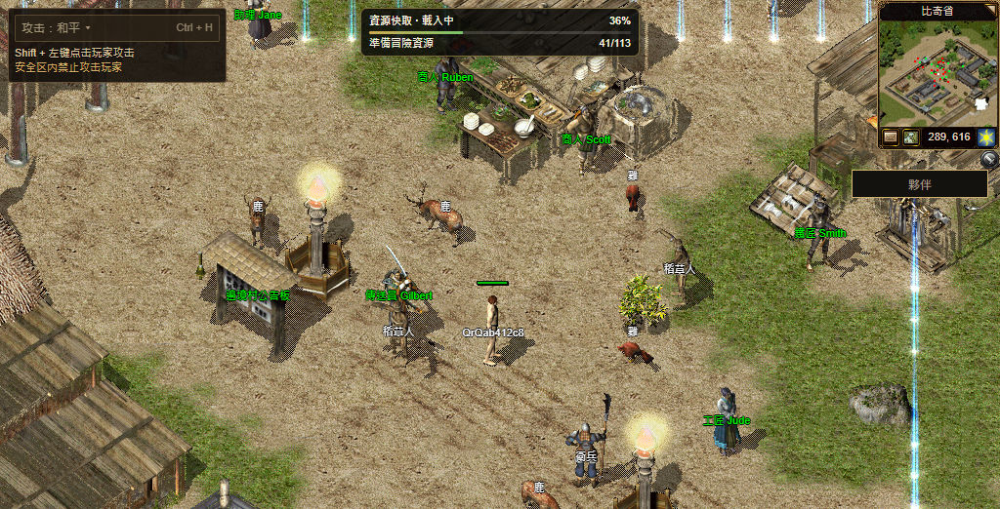
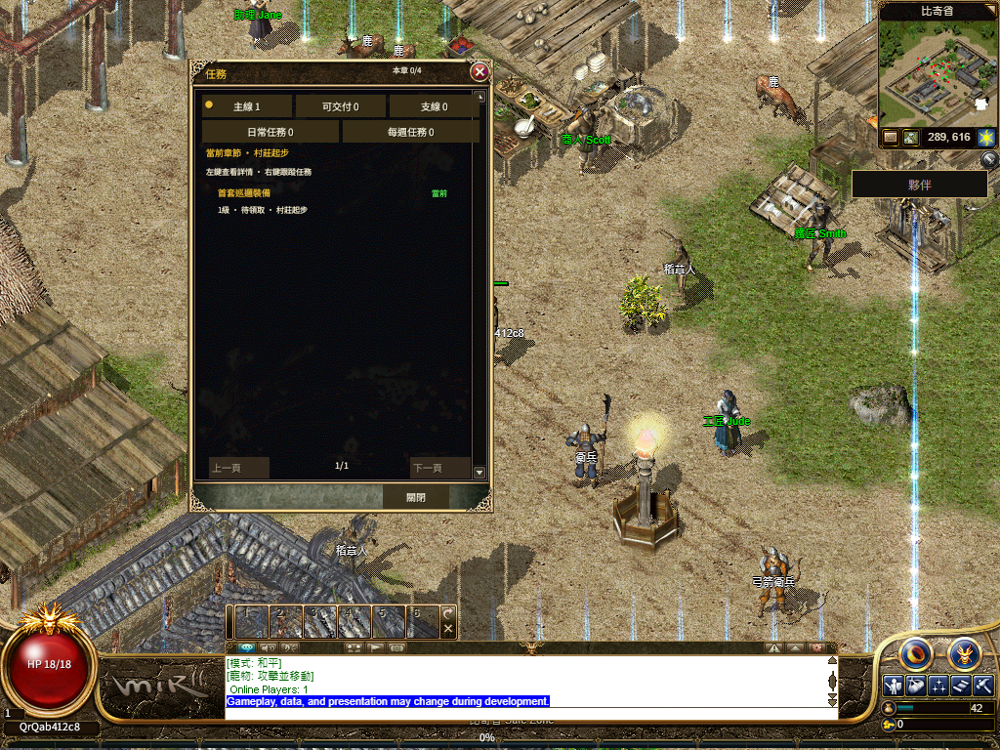

# ef6 实际发布、原性能失败与回退

`ef6d20c095a20460908ae9fab311ae39aaa55f6e` 已实际发布，首场完整功能流程通过，但原验收为 **false**：运行包正文在首帧后 146,013 毫秒完成，Native 界面在 191,284 毫秒观测到，均超过原 120 秒。第二场仅准备、未执行。两端已回退，原 311／223／223 行逐行保持，新增 QA 进度保留，没有恢复数据库。

当前回退目标为 Web `20de5ea4fd93b3c61e4aa590dca2ea2d8f5d2339`／`dpl_AWssgszkpKJznMksLsP7hiRFK6U8`，Gateway `fd3fcedc8b8a4d0b6bb16f6c45cd57a77364c8b5`。独立别名、公开版本和健康检查以及简繁扫码均已复验。Goal 保持 active，整体 100% Candidate／Accepted 未成立。

## 发布资格和来源

- 产品源码 ef6，控制器 `0b2a5e7abfcd408f1a8c0b15e80e2b348d1a15eb`。[235 项检查、严格构建及三场本地流程](../README.md)仍是本地资格，不能代替公网结果。
- [完整来源清单](source-closure.json)将 20de → 20e 的 54 提交／296 文件与 20e → ef6 的 3 提交／30 文件分别同 GitHub 核对，再精确组合为 57 提交／314 文件。没有截断 Compare 的 300 文件上限，20e 只是来源检查点。113 项发布及相邻保护检查通过；不连续、额外文件、后段坏 blob 和截断清单会在发布写入前拒绝。多段目前只支持新增／修改，其他转换需先扩展校验。
- [Linux 包核验](linux-package-verification.json)：CI `43739146537`、artifact `14172603180`，ZIP 95,700,089 字节，SHA `3e287371435fede7f5267fdb7513478a77047acbc4dad30a392e90659521c9a6`。1,841 文件 SHA、310 共享世界检查（含七项后台执行边界）及 216 原生 PostgreSQL 检查通过，非 Docker、原要求零跳过。
- ELF 93,576,560 字节，SHA `22bb54130b2084a34c31d7b0b7bd604cc99a260a08e8d924a5513b329ee4ec96`。Rust 内容未变，执行文件与前包一致；本次仍校验新 CI 包、来源与测试回执，之后才复用服务器上 SHA 相同的压缩传输缓存，没有改写旧包来源。
- [隔离旧库普通协议](canary.json)完成注册、登录、建角、进城、移动、两次注销及同角色落点保存，原行保持，debug／admin 指令为 0，观测到一条中立怪行走。隔离库、Redis 和目录独立，外部收费关闭，切流前隔离服务已停止。
- [独立候选](independent-candidate.json)为 `dpl_G5MYZuxtdS9hbphJD2xweK4hMZgn`，正确项目、分支及 ef6 源码，READY。stage `43740767323`、check `43741513926`、promote `43743442117` 均成功，保护及公开入口 15 项资源 SHA 和扫码待确认通过。Worker 65,861 字节，SHA `4ea2465084ba90eafe9f969a5ba3c42c8b0d2ff61fb05febb14a72f21916de40`。

## 公网首场原值

安装版 Chrome 使用原系统网络、公开域名及 TLS；独立官方 Testnet 钱包在手机尺寸浏览器完成一次登录签名，资金操作为 0。实体手机相机未验。

| 项目 | 原始结果 |
| --- | --- |
| 点击开始至首帧 | 9,700 ms |
| 首步权威回包 | 原 8 秒内，通过 |
| 运行包正文至首帧差 | 146,013 ms，原 120 秒失败 |
| Native 界面／共享 Q 至首帧差 | 191,284 ms，原 120 秒失败 |
| 行走资源 | 原 JSON 一次完整 764,724 字节，约请求后 35,410 ms；未触发 compiled 回退 |
| 原 HUD 与六套字体 | 完整 113／113、六字体缓存体 SHA 6／6，通过 |
| Q、Worker 停启、普通注销 | 通过 |
| 完整功能／原分类器 | true／false，分别记录 |
| 两浏览器 | 均关闭 |

[原分类及功能回执](public-r1.json)固定原 8／65／120／20 秒与完整字节要求，没有因晚到而扩大门槛。原 JSON 分支通过完整包检查，但不新增 compiled 分支的可见 PNG、纯 GPU 或全方向动画验收；本地三场自然帧资格仍单列。

截图中基础城镇、小地图和资源进度可见，仍有混合英文名字；裁图不含血球，不能据此新增血球像素验收。

## 实际下载长尾

[被动网络证据](network-evidence.json)显示：

- 唯一观测到的运行包读取在首帧后约 92 ms 发起，应用源 HTTP 200、Brotli、Vercel MISS／Cloudflare DYNAMIC，浏览器报告约 6,027,048 编码字节；响应头至完整体约 142 秒。它没有在进城前开始读取。
- TC 应用源先等响应头 7 秒失败，当前 hotlink 源完整正文随后约 108 秒完成。
- SC 两次分段尝试后确实在约 24 秒转向应用源，说明新总时限起作用；但应用源完整正文又花约 135 秒，完成时间为首帧后约 163 秒。仅缩短分段等待不足以解决整场长尾。
- 主页面观察的最长 long task 为 217 ms，共五条；这不是 GPU 内部工作的完整测量。字体 Worker 附加有一次 `Network.enable` 超时，十条字体观测不能当完整请求普查；六套字体的完整 SHA 来自独立 CacheStorage 校验。

继续核对运行包下载启动时机、同源及备用源正文、两套大字库与它的实际竞争，再做保持扫码先出码、取消后不残留读取的有界恢复／预读。不能强迫测试额外等待、减少原六字体／113 或放宽原时限来制造通过。

## 恢复和数据保全

[回退与逐行数据核验](rollback-and-preservation.json)：Web rollback `43744581874` 成功；Gateway 恢复 fd3，PID 1631255，仅移除本轮两份 SHA 保护的覆盖文件，原 22 配置保持。原 311 账号、223 角色和 223 存档全部保持；现为 312／224／224，新 QA 冒险进度留存，没有恢复数据库。

[简繁冷扫码](rollback-qr.json)各一次真实二维码、待确认及取消，取消后新增轮询 0，浏览器均关闭。[公开版本和健康回执](final-public-readback-r3.json)为两端 HTTP 200、20de／fd3。SSH 已关闭，无本轮本地服务或浏览器残留。

本轮来源保护及发布记录已保存；停止原样重发 ef6。完整三职业 1–30、地图／阿洛／Native 同档、混合语言及全局视觉／交互 1:1 仍开放，最终人类 Accepted 继续单列。
