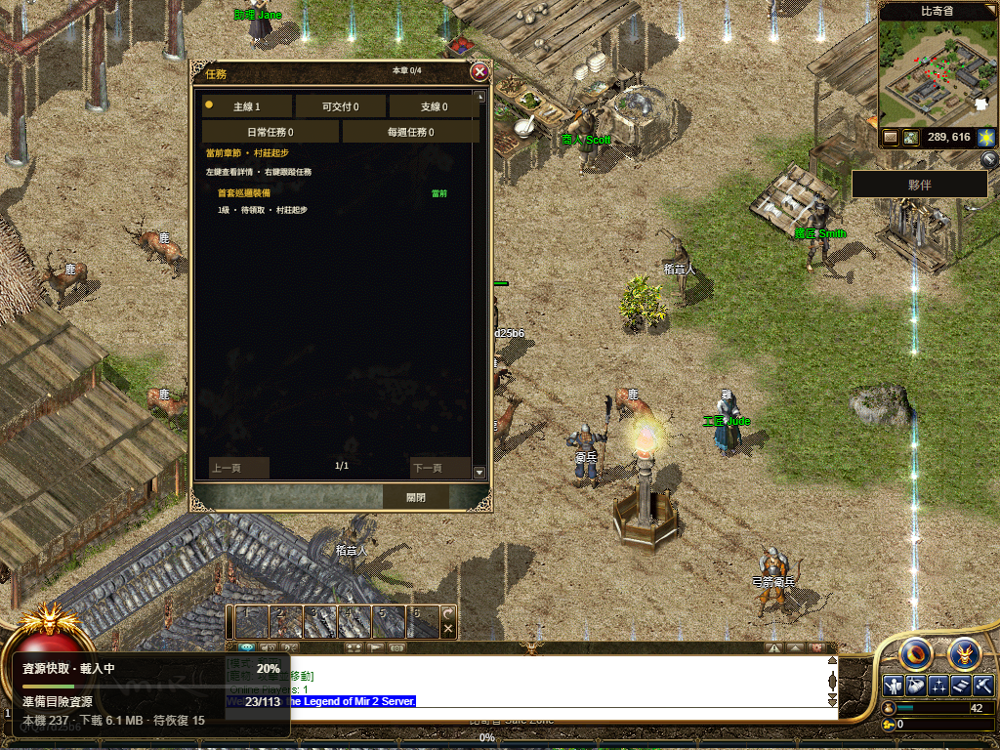
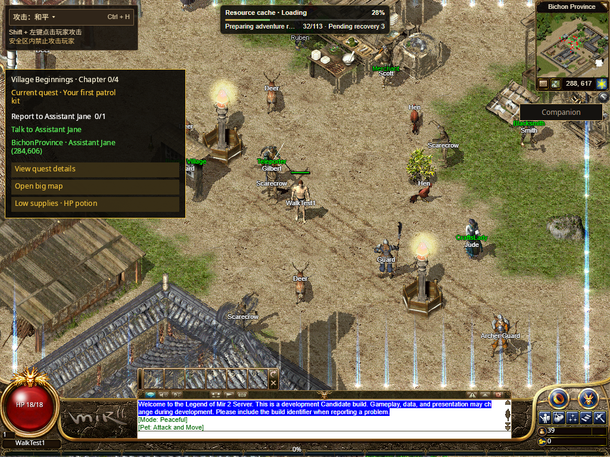
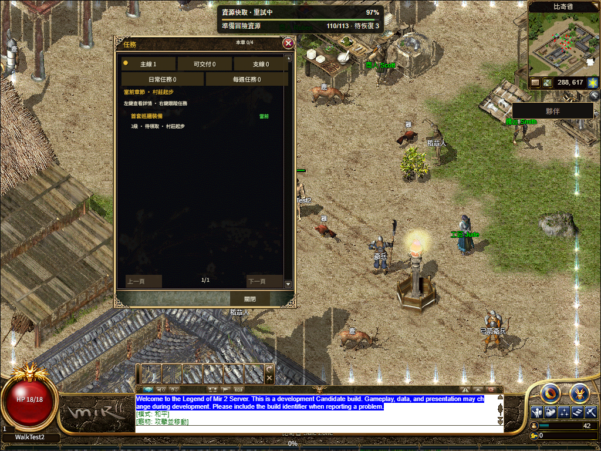
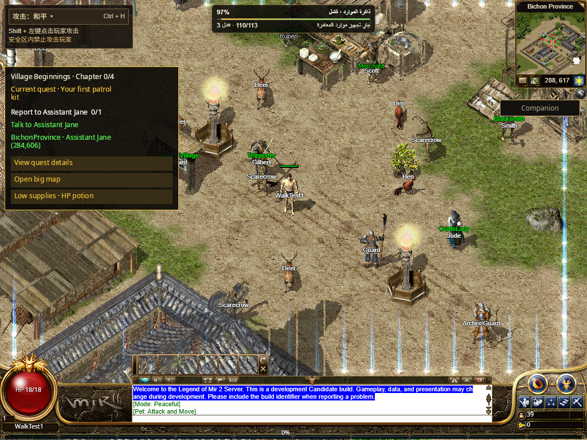

# HUD 补读公网通过，Native 时限失败后的回退与布局候选

2026-11-15。正式站已回退 Web `20de5ea4fd93`／AWss、Gateway `fd3fcedc8b8a`；回退后简繁真实出码、同意图待确认及普通取消通过，原 309 账号／221 角色／221 存档和 22 份配置保持，新增 QA 进度保留。

本轮有两项独立进展：**补读遗漏在公网真正修复，初始失败的 15 项全部恢复，113/113；资源状态浮层改到上方的布局候选 `627b68ae4d` 已提交。**本次匹配 `4204` 的公网整体资格仍为 false：Native 自首帧 **163,326 ms**，超过原 120 秒。因此两端均已回退，第二场没有执行；不能用功能回放通过代替原时限通过。整体 Candidate／Accepted 仍 false，Goal active。

原值及范围见 [verification.json](verification.json)、[不可变源码](source-pins.json)、[43 份私有记录摘要](private-evidence-pins.json)。旧失败与原门槛继续保留，前置补读设计见[上一轮](../r16-font-coalescing-20261115/README.md)。

## 匹配包与旧档资格

产品源 `4204e920edde1d2c4a27e7bb7a2bba50ebd00860` 与已验的 `44b` 前端代码一致，额外为已提交的文档；本轮没有将工作树其他 WIP 打入候选。控制器 `d809add41e` 固定 50 提交／280 文件完整闭包，经本地 Git、独立 GitHub 对照和 blob SHA 核对；57 发布检查＋23 域名检查通过。

[Linux 构建 43715338164](https://github.com/Zombieliu/mir2/actions/runs/43715338164) 完成 success，310 项共享世界相关检查（含 Gateway 40 项、7 项 background execution）及 216 项原生 PostgreSQL／billing 检查通过，无 Docker 跳过。下载 artifact `14163186544`，ZIP 95,700,094 字节 SHA `840acb59187870b571845e512e574eb3eb46f2f9571ada5066fcbbcbe0d92616` 与 GitHub 元数据一致；1,841 包文件逐一 SHA 通过。ELF 93,576,560 字节、SHA `22bb54130b2084a34c31d7b0b7bd604cc99a260a08e8d924a5513b329ee4ec96`。后端源码未变，二进制与上轮一致；这是本轮原 artifact 和来源回执的核验，没有把旧包改标签冒充新包。

生产 PostgreSQL 同一导出快照备份、独立数据库／Redis／端口克隆后，309／221／221 行摘要一致。新包普通注册、登录、创角、105.686 ms 权威移动、1 条中立怪行走、两次正常注销和同角色落点通过，未发 QA／admin 指令。切换前停自有 canary，生产会话／连接／重连租约均零，原配置和快照仍一致。

正式网关曾切相同 ELF，只改变版本环境与执行文件，22 原配置保持。[Web stage](https://github.com/Zombieliu/mir2/actions/runs/43715571294)、[protected check](https://github.com/Zombieliu/mir2/actions/runs/43716220739)、[promote](https://github.com/Zombieliu/mir2/actions/runs/43719066800) 均 success。独立 Vercel 读回 READY、正确项目／产品源；DJX 候选的 15 个公开入口资产、原 Worker SHA、公开二维码待确认和别名通过，才从正式域名开始完整试玩。

## 公网结果与实际补读

普通已安装 Chrome、默认系统网络、正式域名／TLS。桌面和官方手机尺寸钱包独立启动；内部新 Testnet 钱包仅一次登录签名，无充值或资产交易。这里不包含实体手机相机验收。

| 记录 | 原值／结果 |
| --- | --- |
| 开始冒险点击 → 首个可操作画面 | 9,732 ms；测试时钟首帧为 100,109 ms，含之前的建钱包／登录流程，不能混作进城耗时 |
| 物理键盘首步 → 权威回包 | 132 ms，原 8 秒通过 |
| 运行包正文，自首帧 | 51,677 ms，原 120 秒通过 |
| Native 共享界面，自首帧 | **163,326 ms，原 120 秒失败** |
| 完整原字体／预热 | 六字体原 SHA 通过；113/113，零最终失败 |
| HUD 恢复 | 初始 98 成功／15 失败，15 项全部完整补读，unattemptedUrls 为空 |
| 其他功能 | 真实码、签名、建角进城、完整行走 JSON、共用 Q 开关、Worker 停启缓存、正常注销及两个浏览器关闭通过 |

原分类器 SHA `17086d553a3eebddb9a656d09c94024417081656e1e3c939a6bc3916f61ee402` 未改。功能程序返回 success，但该分类器的 `originalNative120=false`，故整轮 `accepted=false`；保留两者原始结果。没有执行第二场，也没有原样重发挑一次通过。

## 下一个瓶颈已收窄到晚到界面图

被动 Worker 观测正常清理、零错误／零丢行：TC 网络在首帧后 44,937 ms 完成；SC 43 次 Range，30 个 206/HIT、13 次未观察到状态，最后网络结束 109,979 ms。六字体完整性最终通过；网络结束并不等于 Native 字体／图集已就绪。

多张必需 HUD 图第一次观察到完整 `200` 网络结束很晚：Prguse `1/4/6/13` 约 160.3 秒、`8` 161.8 秒，UI_32bit `473/472` 为 162,994／163,031 ms；Native 在 163,326 ms 才就绪。HUD 预热总时长 169.8 秒。观测到的主线程最长任务为 323 ms，不能据此排除 Worker 或 Native 内部等待。

这些是时间与依赖方向的证据，不直接证明哪一段源站／调度代码负责。下一步检查初始 HUD 读取的来源与准入、Worker activation／control／配置 ACK，以及 Native 必需图的失败恢复时点。不要仅凭本轮去修改 TC 或把问题归因于主线程冻结；不减字体／113、不延长原 8／65／120。

## 两端回退与保存

[回退 43720357247](https://github.com/Zombieliu/mir2/actions/runs/43720357247) success，独立别名与项目均返回 AWss；回退参数为当前 DJX 候选，未重复上轮参数错误。网关只移除本轮两份固定 SHA 覆盖文件，在无玩家连接／租约时回到 fd3，没有还原数据库。

13:51Z 正式 `/version`／网关 `/health` 均 200，分别为 20de／fd3。只读核对原 309／221／221 行完全一致，当前 310／222／222，新增内部 QA 进度保留。22 原配置保持。简繁各一次真实二维码矩阵、同意图待确认、普通取消、零取消后轮询通过；浏览器与 SSH 控制器均关闭。

## 独立的资源状态布局候选

`627b68ae4dd5575a40ea37df16603087ed68a522` 将四行左下角浮层缩为上方两行，保留状态、百分比、完成数与待恢复／失败数，移除普通玩家不需要的缓存条数和传输统计。保留十语／RTL、完整成功后隐藏及 pointer-events:none，不修改读取、计数、失败历史或授权。

46 项原展示检查通过；严格 Next 构建 `44b-progress-layout-2102c056`／`pq72WF2-YPIhKCFQ-xzuP` 为 61,976 ms。编译的精确布局源码与 627 提交一致；临时私有源已恢复，既有 4204 发布候选不受影响。

实际组件在十语×四状态×五个窗口变换（含 390×844）的 200 组布局检查通过，清楚避开原生命区、底部 HUD、小地图、任务指导和所观察的 Q 窗口；下图是**实际组件夹具覆盖在以前的真实游戏截图上**。阿语夹具的英文背景不是一次阿语整局验收。

两组本地完整游戏回归也通过：默认英文首步 188 ms／Native 35,803 ms，共享 WebGL2 繁中 210 ms／84,979 ms；六字体、113、自然 DOM 行走 PNG、首次／重进 Q、两次正常注销与旧档保持通过。两场沿用冻结 dca 本地 QA 网关和已封存真实资产缓存的升级场景，浏览器 HTTP 缓存清空，开始时六字体未缓存；不能资格化最新 Linux 网关。**两场采样的 loadingOverlay 均为空，没有观察到游戏里的可见加载浮层。**因此组件 200 组布局证据与整局功能回归分别记录，不能冒充已实测游戏中可见加载状态。布局尚未发布，该状态的实际画面和正式资格继续。

## 保全与边界

29 份启动时语义有改动的外部文件，原始 SHA 均不变；其他 Native／Web／GDI WIP 未回退、未入包。私有钱包、登录意图、凭据和数据库原文未拷入仓库。两处只读探测的 endpoint／字段错误已修正，不把观察脚本错误算作产品失败或成功。

当前三职业 1–30、公开旧档冷重登、后续地图／技能、阿洛跨端实战、混合语言／像素、Windows 窗口、实体手机、旧 6 项夹具依赖失败及全局 1:1 继续。后端分项与本轮回放不推定容量、全体 AI／巡逻或最终人类 Accepted。
