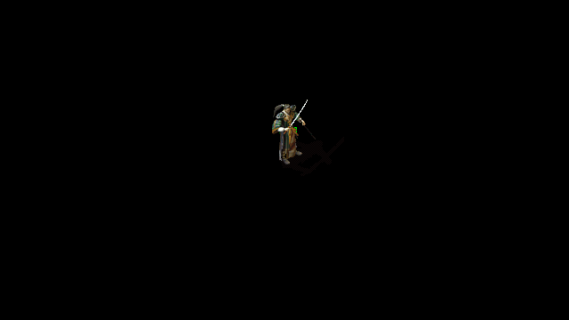
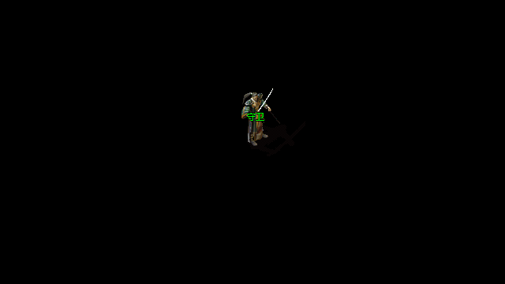

# NPC 姓名图层本地候选

后续状态：本记录保留最初组件验收范围；CSS层级与名字点击已随e6c923正式发布，AutoSize／完整行另有b19本地两后端四会话候选。[层级与点击发布](../r16-route-lookahead-20261114/production/README.md) · [后续姓名候选](../r16-name-autosize-20261114/README.md)

`globals.css` 将姓名整层从32761提高到3500000。当前人物最大深度3083125、普通效果3083131、显式定点／咬钩效果最高3100001；姓名仍低于掉落标签4000000。world自身隔离且z=1，不会穿过相邻游戏UI。未改48/50px名字定位盒、字图、点击回调或pointer-events规则。[原始源码审计快照](source-audit.json)

现有深度回归补充实际人物／特效／姓名／掉落的层级关系：旧CSS为14/15、只失败姓名覆盖约束；补丁15/15通过，无skip。[修前](depth-before.log) · [修后](depth-after.log)

实际Chrome组件绘制使用91b原CSS与本地候选CSS、真实 `/NPC/15/3.png`（84×88、偏移6/-48）及真实深度模块。人物bodyZ1544565，中文“守卫”的相同文字矩形下有230个完全不透明身体像素。前后几何、图片与相关输入样式相同，仅姓名层Z不同。root已通过view_image确认：修前文字被身体盖住，修后两字完整显示。[组件原回执](component-receipt.json) · [root视觉复核与文件SHA](visual-review.json)

这只完成组件绘制验证。完整游戏地图、NPC点击优先级和发布仍待验收，公开版本91b不含此CSS补丁；不计作人类Accepted。另一个独立问题尚未修复：Assistant Jane测量79px，却使用50px固定GDI位图，需要按Crystal AutoSize另做，不能靠提高层级恢复已截掉的像素。

本地下一次复测入口：`node C:/r16-npc-name-layer-20261114/smoke.mjs smoke-r2 --execute-reviewed-loopback-smoke`；r2未执行，r1已经执行并封存，不可覆盖。历史源路径和哈希见[输入](component-inputs.json)，不应把该C路径当跨平台项目根。源码回归从Web目录运行 `node --test scripts/test-crystal-world-depth.mjs`。
