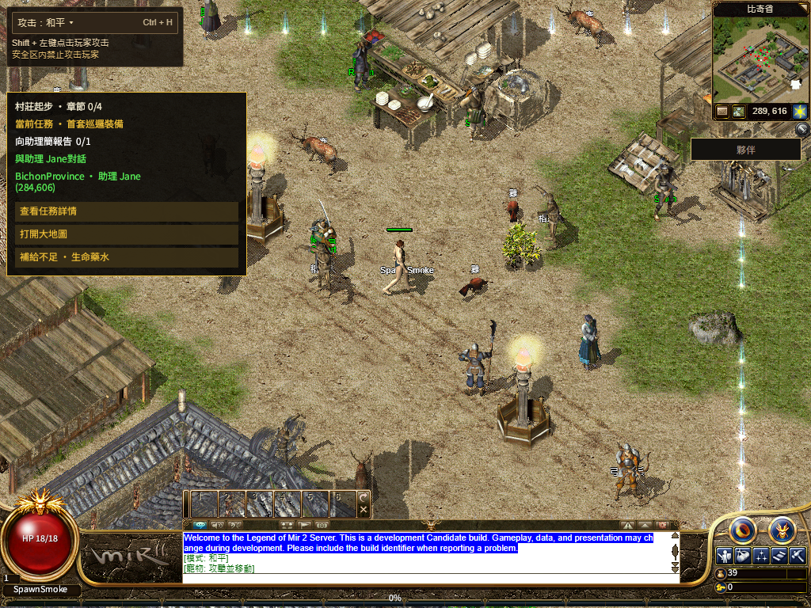
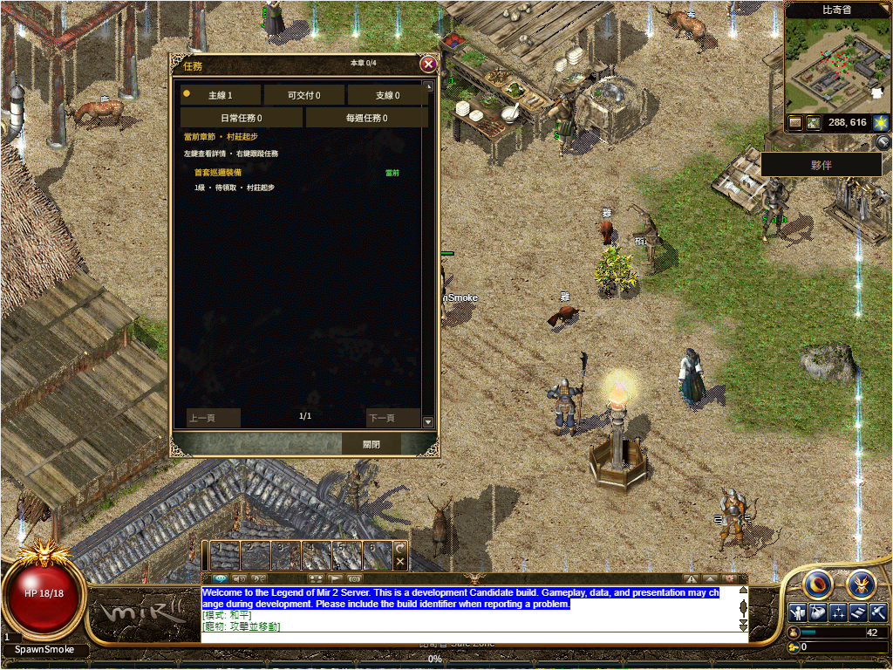

# R16 运行包正文恢复候选

候选 a92d080debc8-runtime-body-bd956c1d 通过生产构建、85 项 Node 检查、真实 Chrome 六场景，以及默认/共用 WebGL2 的完整游戏回放。已作为源码432c58a07e发布；公网运行包完整到达、App约46秒启动，但TC字库及HUD资源未齐、共用界面失败，移动本轮未发送，完整验收仍false。[本轮正式结果](production/README.md) · [上次正式回执](../r16-web-catalog-20261113/production/README.md)

原失败是两个固定地址用尽后，CDN 正文连续 15 秒没有正数字节，App 尚未 boot 就停住。现在只在编译阶段为暂时性错误增加一次重试：两个正常来源最多共三次 GET，最后一次使用此前暂时失败的固定来源。不会改版本、查询串或显卡后端；完整编译后才进入原 canvas 与初始化流程。

每次读取仍使用原 15 秒正文空闲、600 秒正文上限及 32MiB 解码上限；末源响应头、编译和初始化的原 120 秒终止边界不会因重试重新开始。有效持续传输与阶段超时的既有区分保留。404/403 本身不触发额外重试；无法编译或超限的字节立即退出，并在 Page 外层阻止再次进场重试和显卡后端回退。重试仍重新读取整包，公网延迟需要独立复验。

真实 Chrome 首轮发现：浏览器把超限流的 RangeError 包装为网络 TypeError，错误地触发第三次 GET。现在保留 reader 的原始失败，六场景最终通过；无效/超限均止于两次 GET、零初始化，真实 Page 策略不再允许回退。断流恢复 251ms 左右；真实 15 秒停滞后恢复另记为故障注入结果，不作为公网性能。

| 最终构建回放 | 默认路径 | 共用 WebGL2 |
| --- | --- | --- |
| 人为两个 503 后第三次交付原包 | 通过，完整正文/SHA | 通过，完整正文/SHA |
| Native 等待，原 120 秒门槛 | 26.413 秒 | 26.486 秒 |
| 关闭全部 Chrome 进程后，同一档案缓存重开 | 1.317 秒 | 1.499 秒 |
| 首个画面后、Native 未就绪时两次实际行走 | 100/561ms | 146/503ms |
| 113/113、六套原字体 SHA、繁中共用 Q | 通过 | 通过 |
| Worker 真正停止/恢复、普通退出保存、重开 | 通过 | 通过 |

两种路径都使用原 8 秒首步和 120 秒 Native 验收门槛；首步在全部目录及 Native 完成前发生。每个冷/热会话仍完整收到 529 条初始化目录、80448 线字节。原始隔离账号数据未变，所有自有 Gateway/Next/代理/浏览器均关闭。这里只验证两次传输故障后的恢复，不覆盖完整三职业任务、后续地图、其他设备、Hosted 或全局 1:1。

冷/热运行包的完整正文 SHA 来自 CDP Network.getResponseBody；附加 Playwright 正文读取失败也保留，未将它们当作第二份读取成功。

生产构建在 C 盘输出，80 个构建输入及 71 份共享源码逐项绑定 Git blob；原四个轻量 Core 包和 Bevy 包均未变化。首轮构建在页面数据收集时因 C 盘输出找不到外部 Next 模块而失败；修正本机依赖查找后成功，原失败留存。

[结构化回执](receipt.json) · [构建绑定](build-receipt.json) · [最终浏览器](browser-final.json) · [首轮边界失败](browser-first-failure.json) · [85 项检查](focused-tests.txt) · [首轮构建失败](build-first-failure.txt)

当前截图仍见 NPC 名称不完整、任务提示夹杂英文，HUD 球内血量文字在这些捕获帧未见；继续单列像素与状态对照。本轮恢复和交互通过不代表这些视觉差距通过。

本轮 131 份原有未提交文件内容保持不变。发布及公网分项已有正式回执，下一步补同实例字体／皮肤 Failed 重试与错误恢复，再验证剩余公网项目；上次正式失败及整体 1:1 未结项继续保留。
