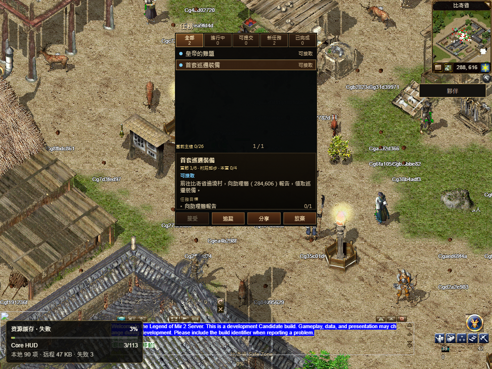

# R16 运行包恢复正式发布

已发布到 [numeron.obelisk.build/game](https://numeron.obelisk.build/game)，源码 `432c58a07e44db021679aab9a6562a02c9124b10`，部署 `dpl_YKNdqLqcPpNRCXDch444krb7Y1Vs`。**发布成功，完整公网验收仍为 false。**

80 个构建输入与 71 份共享源码绑定已提交版本。68 项现行流水线发布保护、7 项只读诊断／隐私检查、[Stage 43322488633](https://github.com/Zombieliu/mir2/actions/runs/43322488633) 和 [Promote 43323759045](https://github.com/Zombieliu/mir2/actions/runs/43323759045) 通过。发布工具固定提交为 `adb710d6a8`。Vercel READY 后才执行切换；只发布游戏项目，没有回滚。公网 11 条文件读回通过，八个不可变 Core JS/WASM 和 Worker 的完整字节与 SHA 一致。[文件读回](public-readback.json)

| 本轮公网步骤 | 结果 |
| --- | --- |
| 简中、繁中出码 | 各一次真实二维码、待确认、取消后停止轮询，通过 |
| 官方钱包确认 | 手机尺寸 PWA、虚拟通行密钥、Testnet 一次登录签名；准确会话确认一次，禁止操作 0 |
| 普通建角、比奇首画面 | 通过；普通退出成功、返回选角，所有自有浏览器关闭 |
| 运行包正文 | **完整到达 31441753 字节**；CDN 正文最大观测数据间隔 9097ms，低于原 15 秒 idle；原同源请求在约 8 秒后中断，固定 CDN 来源随后完成 |
| App boot | 首个可操作画面后 **45.948 秒**观察到 booted=true、WebGPU、Quest/Bag ABI1 |
| 共用 HUD／Quest | **失败**；始终未 ready。Quest 后续报告 `quest UI font or skin failed to load`；原 120 秒共用界面门槛未通过 |
| HUD 资源预取 | **112/113**；剩余 `/original-ui/Prguse/827.png`，恢复回执将其列为 unattempted |
| 六套原字体完整核验 | **5/6**；唯一缺失 `NotoSansTC.ttf`，其余五套字节和 SHA 通过 |
| 实际移动 | **未验过**；冻结脚本没有选出其已知可验相邻格，未发送 Walk，保留 `ORDINARY_WALK_NOT_VERIFIED` |
| 本轮 Worker 停启 | **未执行**；游戏子流程退出码 1，父流程没有进入该项，不能沿用旧版结果写成本轮通过 |

本轮两个固定运行包来源已经完成读取，没有用到新增的第三次机会；第三次恢复能力由[本地两种渲染路径的两个 503 注入](../README.md)证明。不能把此次公网传输变快单独归因于重试。流程结束后另行读取同一 CDN 完整 WASM，31441753 字节及 SHA `e66e0b11416233879b0a0c1e9778a86253c532b8e60fd4c5d8339e20264c1c82` 与固定 manifest 相符；这次独立读取不替代任何失败的浏览器门槛。[同轮运行时](runtime-timeline.json) · [流程后独立完整包](postflow-runtime-body.json)

目录内容保持完整：首十批 529 条初始化仍为 633495 字节原文／80448 线字节，另有一条商店通知，总计 11 帧、530 条通知；无共享 Rust 解码错误。[目录计数](catalog-observations.json)

移动检查没有发请求，不能据此判定游戏移动发生回归，也不能写成原 8 秒门槛通过。[原跳过结果](first-walk-not-attempted.json)。上版 `8654cdcb36` 的 1.919 秒移动通过仅属于上次快照，本轮没有重跑签名场景覆盖失败。

新的阻塞已从运行包读取缩小到共用界面资源：TC 完整缓存缺失、多项 504，HUD 827 未恢复；固定源码还存在失败字体句柄不再请求、HUD/Quest 图片仅首次加载，以及 Quest 资源错误未随恢复清除的路径。827 是 HUD 商城 hover 帧，不在 Quest required skins 中，不能据此认定它导致 Quest 错误。错误状态没有给出具体 Native AssetServer 路径，TC 与其他 skin 的实际 Failed 句柄还需在下一项中逐一证明。[固定源码核对及完整修复边界](font-skin-source-review.md)

下一步在共享 Rust 资源层实现按路径去重、带冷却和次数上限的 Failed 重试，保留句柄、角色 generation 和真实 FontCx fallback 映射；资源全部 Loaded 后只清对应 asset error。继续证明永久失败维持 ready=false。同实例恢复观察与原 8 秒首步／120 秒冷启验收分开，不能放宽字体、皮肤或时间检查。

[结构化正式回执](receipt.json) 保存执行前后相同的 19 个脚本 SHA 及原始证据 SHA。五套字体、112/113 和 Native 错误分别记录，`document.fonts.status=loaded` 不代表 Bevy 字体可用。页面 JS 错误 0，控制台错误 207；只读采样达到其 120 条 console／200 条资源错误上限，不是完整错误清单。Vercel 最近 30 分钟未返回函数 error/fatal 分组，该结果不覆盖浏览器的 504 和 Native 资源失败。

截图拍摄时预取为3/113；流程末记录为112/113。图中也可见多名其他角色；移动记录没有导出具体阻挡项，不能据此认定跳过的占位原因。

131 份原有未提交文件内容保持不变。保留 `8654` 的正文中断、`40be` 的 15.913 秒首步和更早 158.084 秒冷启失败。完整三职业当前路线、后续地图／技能、其他渲染路径、Hosted、实体手机及全局 1:1 Candidate／人类 Accepted 继续开放。
