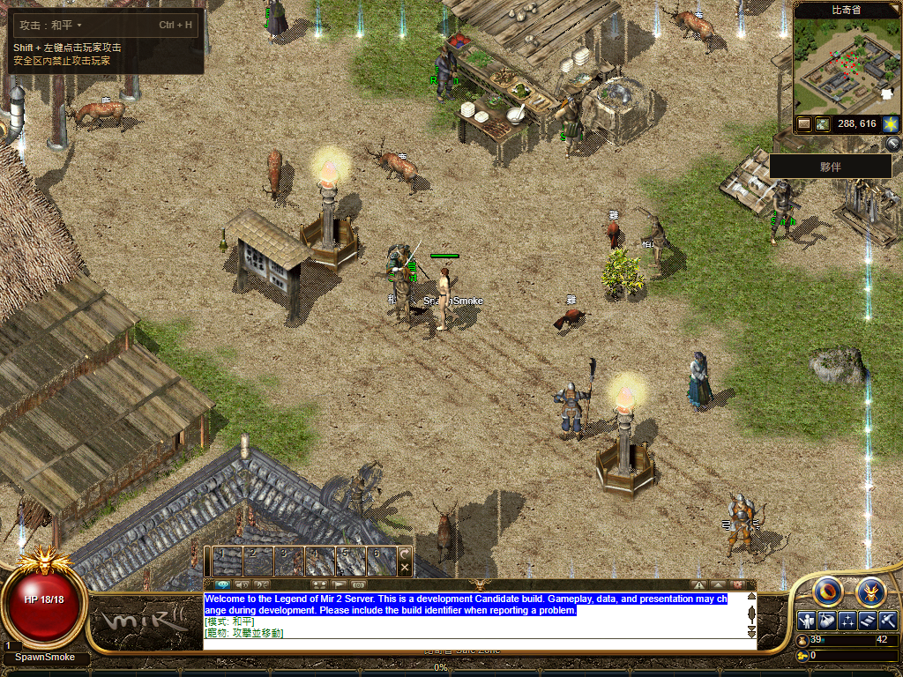
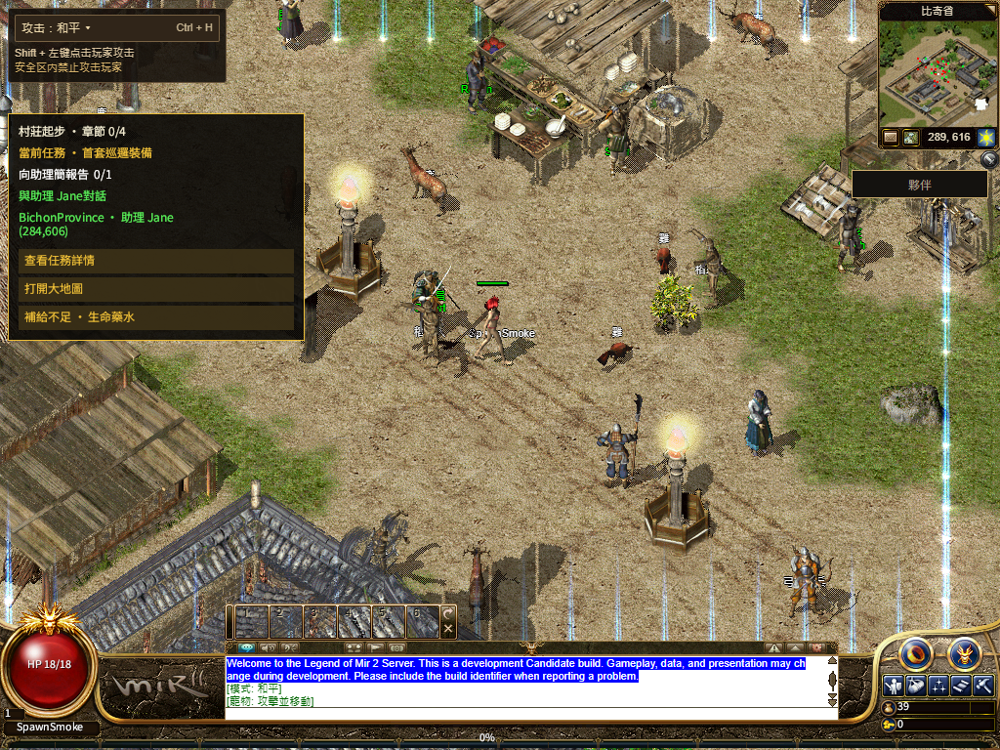

# R16 self sprite residency — 2026-11-13

Product commit `b2097fdfd13a2d8bc0acde435cd612fd83672cac`, parent `d269c56b33a4a1481622c022534d6b307277736b`. This includes the prior complete default-player frame directory; it changes the self actor's image ownership, not authority, frame selection or other actors' picking. Production rollout is recorded separately after public verification.

Animation changes no longer own or cancel PNG requests. One self actor owns a bounded image cache: four network reads, two local decodes, 64 entries/16 MiB, at most four same-direction standing-body warmups, finite retries and 256 failed-entry history. Reads verify bounded PNG bytes/dimensions and decode before publication. Each role retains its actual decoded `HTMLImageElement`; React moves that element into an owned slot. Copying a decoded URL into a new image was insufficient: the retained r3 failure observed transient `complete=false` during walking. Body/hair/weapons/mount publish together with their original geometry; effects retain the current timeline.

## Qualification

| Check | Result |
| --- | --- |
| Residency, image loading, first-body gate, scene request/preloader/retry | 76 passed, zero skips; [log](checks.log) |
| Release guards | 68 passed; [log](release-guard-tests.log) |
| Production build and TypeScript | Passed; [receipt](build.json) |
| Committed source vs isolated build | Seven owned files match after Git line-ending normalization; 11 changed inherited Web inputs match; [binding](source-binding-audit.json), [pins](source-pin.json) |
| Existing WIP | All 131 protected files unchanged before release; [receipt](preservation.json) |
| Independent read-only review | No blocking finding; [scope](review.json) |

[Browser cohort](browser-cohort.json) preserves all three failed attempts and the two successful full game runs. r1 assumed OS auto-repeat from Playwright `keyboard.down`; r2 released keys before the action interval; r3 exposed the real URL-copy blank. Final input holds the real key until an emitted walk, releases it, and checks an authoritative location ACK for each step. The original eight-second ACK and 120-second Native gates were retained.

| Real Chrome production build | Successful PNG reads before full pack | Minimum PNG TTFB | Pre-HUD two steps + repeated steps | Full cold / completely closed-profile warm |
| --- | --- | --- | --- | --- |
| Compatibility, male | 39 | 1,200 ms | 2 + 16 | Passed / passed |
| Shared WebGL2, female | 38 | 1,199 ms | 2 + 16 | Passed / passed |

The initial body is unavailable for six seconds; **every loose body/hair PNG** then still takes at least about 1.2 seconds. The full player pack and remote complete CArmour/CHair metadata remain withheld until the standing/walking check completes. Every sampled body after the first playable frame remains decoded, and real walking frames replace the retained standing frame. Verified pack takeover later uses actual data images. Each run continues through complete runtime bytes, six fonts, 113/113 prewarm, shared Q/HUD, physical movement, Worker stop/restart, normal logout/save, complete Chrome process exit, same-profile login and a second save. All owned processes close; original fixture bytes remain unchanged. These controlled responses are **not** public WAN latency measurements.

## Open scope

The unchanged player-frame test still reports the previously recorded Fishing range mismatch `351` vs `175`; [exact output](adjacent-with-baseline-failure.log). Its test and frame-selection source have no diff from this parent; the separate combat-state contract passes. This round does not claim actual React StrictMode browser mounting, public existing-role cold restart, physical-phone acceptance, three-class full routes, all equipment/skills/maps or global 1:1. Screenshots still show incomplete NPC labels and mixed English guidance; those visual gaps remain open. Controller stop/start/generation is covered by the focused tests, not substituted for a StrictMode UI run.
