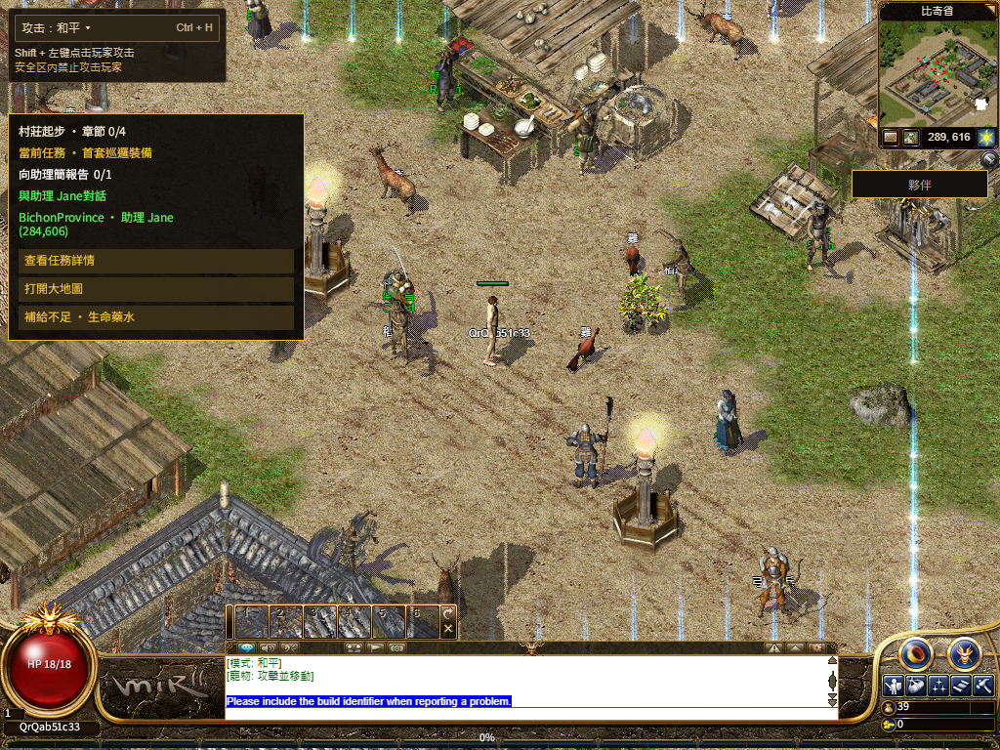

# R16 Web production deployment — 2026-11-13

**Deployed:** [numeron.obelisk.build/game](https://numeron.obelisk.build/game), source `b2097fdfd13a2d8bc0acde435cd612fd83672cac`, deployment `dpl_3Hf6tBQxshV6qvoHR1oSakTBokMd`. The release helper is `c4cc296c368bd6515cdd1dc2fd8975c4a97b113a`; [stage 43363537323](https://github.com/Zombieliu/mir2/actions/runs/43363537323) and [promote 43364327839](https://github.com/Zombieliu/mir2/actions/runs/43364327839) succeeded. Vercel READY, exact project/source and the public alias were independently checked. The six-leaf `bevy-0c553a754308e5b8` runtime and fixed `20261108-r16-08ec86d5105c` asset release are unchanged. No asset upload, Gateway replacement, save migration or marketing-site release was performed.

The [qualified local candidate](../README.md) and prior `6997f810ed` player feedback are included. Functional replay passes; **cold-load qualification remains false**. The release is retained with that open performance item; global 1:1 is not complete.

| Public check | Observed result |
| --- | --- |
| Source and startup files | Exact source, `/game`, unchanged Worker SHA and eight ClientCore files: 11/11, first attempt; [readback](public-files.json) |
| Simplified / Traditional QR | Both genuine 240×240 matrices, 2401/2401 matching modules, pending confirmation, normal cancel and zero polling after cancel; [sanitized receipt](qr-pair.json) |
| Wallet confirmation | Official PWA in a mobile-size Chrome context with a new virtual-passkey **Testnet** wallet; exactly one login approval, zero forbidden operations. This is not a physical-phone test. |
| Login → select → city | One ordinary new QA role, correct R16 `(288,616)` spawn and actual own body at first playable; [replay](replay.json) |
| Actual movement | One physical ArrowRight, authority ACK `(289,616)` in **127 ms**, input-to-render **165 ms**, no unexpected mutation |
| Player before complete pack | First own body decoded with packed count zero; the full player pack completed **1,162 ms later**. First two pack attempts failed and are retained; [PNG/pack reads](entry-player-reads.json) |
| Shared UI and resources | Actual HUD and shared Traditional Chinese Q open/close, complete runtime body, six full font byte/SHA matches, 113/113 resources, original quest-marker cache bytes |
| Worker lifecycle | Real stop/start with game running; same cached HUD SHA and configuration retained, Native ready, no test configuration message |
| Exit | Exactly one ordinary logout and ACK, returned to character selection; desktop and wallet browsers closed |
| WIP | All 131 pre-existing protected files unchanged; [preservation](preservation.json) |

## Cold-load boundary

Clicking Start to the first playable frame took **53.165 seconds** in this single public observation. The original `sharedHudObservedMs - firstPlayableFrameMs` metric is **120.651 seconds**, so the original **120-second gate fails by 651 ms**. The independent two-second sampler brackets joint Quest/HUD readiness between 118.542 and 120.544 seconds; it does not establish readiness before 120 seconds. No threshold or saved failure was changed. Runtime body completion was 109.737 seconds after first playable. Temporary resource failures recovered to 113/113 and six complete fonts; recovery does not make the cold gate pass. See [timings and qualification](replay.json) and [raw sampled states](native-samples.json).

No controlled before/after public cohort exists, so these numbers do not establish a speed improvement or attribute the WAN delay to this patch. The preceding `ff957` failure and rollback remain in [their original record](../../r16-entry-player-directory-20261113/production/README.md).

Only static paths, timings, hashes and QA outcomes are published. QR/session intent values, passkey material and browser state remain private. The onboarding helper contains a historical source label; the frozen wrapper separately verified the live official wallet commit `c74a27a48d57a6dd14cfc0ccfcf47e68ab58163b` before execution. Exact release/alias records are in [release receipt](release-receipt.json) and [final state](final-state.json).

Cold resource loading, incomplete NPC names, mixed English guidance, public old-role restart, physical phones, remaining class routes/maps/skills and final human frontend acceptance remain open. This release is a playable functional update, not 100% Candidate or Accepted.
