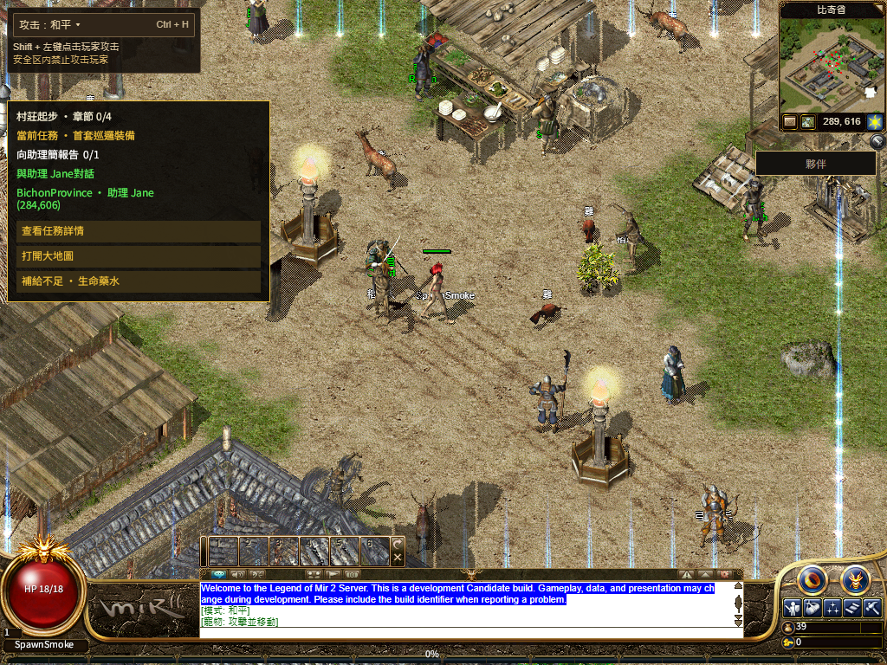

# R16 默认人物站立分包（2026-11-13）

产品源为 `440f82d4d2a7db2b44046cfbd7885680e437aa65`，基于 `210fa4716a24b7028ad7fd45aae4edb497ec7fd7`，仅 25 个文件。发布保护源为 `cf4c6896ce8599b50e6f8783e5b43b0ba8c0a612`。正式发布状态与公网验收见后续 [production/README.md](production/README.md)，本页只说明本地候选。

## 改动

默认 `CArmour/00` 人物的站立动作按男女、八向拆成 16 个延迟导入的 Next 分包。只读取当前性别、当前方向的四个 body 帧和四个 hair 帧，不把其他方向或另一性别加入首屏。128 张 PNG 的原始字节与宽高均与固定资产包一致；全动作目录和走路、战斗素材继续由原完整包/普通 PNG 提供。

实际进入场景已接受的资产 release 必须与生成数据一致，且 body 路径和尺寸匹配才使用分包。完整人物包优先于站立分包；首帧仍要求自己的 body 真正解码。角色或 release 切换时取消旧消费者，图片沿用已有按角色持有的原 Image 节点，不改变锚点、偏移、点击和其他实体。

每组导入共享、20 秒观察超时、5 秒失败冷却、每页至多两次真实导入；组件最多两次有界观察。慢失败时第二次观察可能仍等待共享导入或处在冷却期，因此不能承诺一定发生两次网络请求；普通 PNG 回退继续有效。两次观察完成后不无限重试。

最终 Next 构建中确有 16 个独立 JS 分包，总计 221,198 字节，单包离线 gzip 最大 10,767 字节。这里是实际构建文件的离线压缩值，不代表公网传输大小或速度。[分包清单](standing-chunks-r2.json)

## 验收

- 生成器 `--check`、核心 78 项和相邻 8 项通过；发布保护另 68 项通过。Next 生产构建与类型检查通过。[核心](checks-r2.log) · [相邻](adjacent-checks.log) · [构建](build-receipt-r2.json)
- 最终构建 `210fa4716a24-standing-chunks-7f8bb015`，BUILD_ID `bZPKg3-vl5yLX5Mz9okT_`；固定运行包 `bevy-0c553a754308e5b8`、固定资产 `20261108-r16-08ec86d5105c`，没有重编或上传新的 Rust/资产包。
- 默认及共享 WebGL2、男女角色、普通站立与行走、分包全部 503 的 PNG 回退、完整人物包接管、六套完整字体、113/113、共用 HUD/Q、Worker 真正停启、普通注销保存和关闭浏览器进程后同档重登均有实证。最终 r2/r4/r8 共三组冷/暖、六会话通过。[逐组索引](local/cohort.json)
- 男角色通过正常鼠标行走、服务器权威回包和八向各两个站立周期，确认每方向四个真实 PNG SHA；完成全部方向后立即放行完整包，再普通行走回原点并核对完整包的走路帧。没有注入位置、传送、角色状态或服务端管理指令。[八向记录](local/eight-standing-faces.json)
- 普通 PNG 初始受控等待 6 秒，之后每张至少 1.2 秒响应头；完整包与完整目录先扣住。正常女角色只读取当前方向的 14,605 字节 JS 分包，首次可操作比 StartGame ACK 晚 11,379 毫秒；全部分包 503 时正常回退。此为本地受控网络与既有完整流程，不作为公网提速结果。

发布的 build 日志只规范了缩进、行末空白与换行；原始日志保留，双份 SHA 见 [格式回执](build-log-format.json)。

## 保留的失败与范围

r1 是修复前自动重试策略的开发构建，虽通过，不计入最终六会话。r3 使用稀疏采样推算等待，5,950 毫秒未过 6,000 毫秒断言；原始实际 body 请求到首帧为 6,028 毫秒，后续改用真实请求起点，未降低门槛。r5 的 2.2 秒观察只捕获 Right 三帧；后续从真实站立开始观察两周期 4.4 秒，并保存逐帧时间，不据旧短记录断言当时没有产品问题。

r6/r7 八向四帧及真实移动通过，但测试持续扣住完整包超过既有恢复预算（分别约 91.3/82.3 秒），后半程失败。r8 在八向证据采完后立即放行，再验完整包接管、HUD 与重登；恢复次数、8 秒走路/120 秒 Native 门槛均未放宽。各原回执 SHA、失败和部分通过均保留在 [逐组记录](local/cohort.json)。

全部 128 张源图片有测试，女角色八向真实服务器行走尚未逐向复测；冷启动下个别帧间隔有波动，不宣称全程稳定 500 毫秒。截图仍见 NPC 名称不完整、任务提示夹杂英文；全地图/技能、当前完整三职业线路、公开旧档、实体手机和最终人类 Accepted 继续开放。既有 Fishing 帧索引断言失败未由本次修复，也未重新声明通过。

原 131 份脏文件/未跟踪文件按字节保全；Shell 仅额外插入本次两个 release 传递行，提交从干净 HEAD 加这两行构成，原动画 WIP 未进入发布。[保全](preservation.json) · [源绑定](source-binding-audit.json) · [精确索引](staged-product.json)
