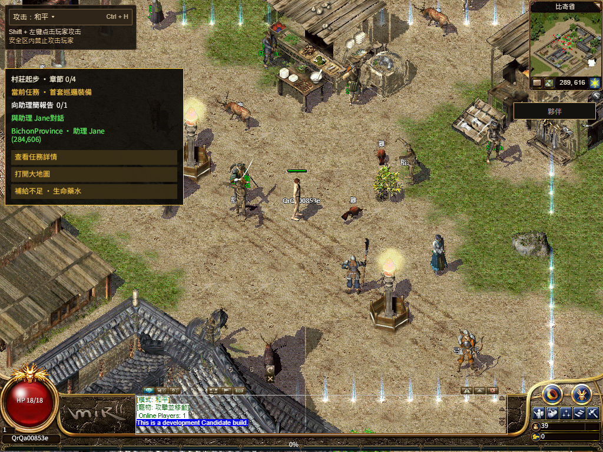

# 站立分包发布后回退（2026-11-13）

**当前正式站为 [numeron.obelisk.build/game](https://numeron.obelisk.build/game)，已回退到 `b2097fdfd13a2d8bc0acde435cd612fd83672cac`，部署 `dpl_3Hf6tBQxshV6qvoHR1oSakTBokMd`。** 本轮候选 `440f82d4d2a7db2b44046cfbd7885680e437aa65` 曾正式发布，但三轮公网完整验收均未通过，未保留在正式入口。没有把不同轮次的通过项合并为一次通过。

发布保护提交为 `cf4c6896ce8599b50e6f8783e5b43b0ba8c0a612`，候选部署 `dpl_46u3rSTnfvPrDpzCka6qUBmMhwed`。Vercel READY、生产环境、项目、源码和 alias 均经独立核对。[Stage 43375902204](https://github.com/Zombieliu/mir2/actions/runs/43375902204)、[Promote 43376896824](https://github.com/Zombieliu/mir2/actions/runs/43376896824) 和 [Rollback 43380032513](https://github.com/Zombieliu/mir2/actions/runs/43380032513) 通过。[完整发布/回退回执](release-receipt.json)

## 已验证与失败

| 检查 | 实际结果 |
| --- | --- |
| 本地候选 | 核心 78、相邻 8、发布保护 68 项；生产构建、两后端、男女与八向及三组冷/暖六会话通过。[候选](../README.md) |
| 首次发布文件 | 版本、`/game`、原 Worker 与 8 项 ClientCore，11/11 通过。[文件](candidate-public-files.json) |
| 线上站立分包 | 线上 webpack 的 16 个模块编号与本机一致，JS hash/文件名均不同；解析线上实际文件的静态 AST/JSON，16 个完整结构与 128 张 PNG 数据均与候选一致，没有执行远端 JS，HTML 未预载这些分包。[验证](standing-public-files.json) |
| 简繁二维码 | 候选和回退后均各一次真实出码、矩阵校验、待确认、取消，取消后零轮询。[候选](candidate-qr-pair.json) · [回退](rollback-qr-pair.json) |
| 公网第 1 轮 | 官方手机尺寸 PWA 的新虚拟 Passkey Testnet 钱包，一次登录确认，普通新角色进比奇，135 毫秒权威移动；NPC 包两次 20 秒无响应头而中止，完整城镇验收失败。后续共享 HUD/Q、六字体、113/113、Worker 停启与普通退出通过，不能覆盖原失败。[分轮回执](public-run-1.json) |
| 公网第 2 轮 | 同源新冷会话，一次 Testnet 登录确认；城镇、公共任务、222 毫秒权威移动和 113/113 通过。完整运行包未完成，HUD 未就绪，完整字体校验失败；正常注销与浏览器关闭通过。[回执](public-run-2.json) |
| 公网第 3 轮 | 新冷会话在登录素材就绪门超时 `LOGIN_RESOURCES_DID_NOT_SETTLE`；未创建钱包/游戏角色、未进入游戏，浏览器关闭。[回执](public-run-3.json) |
| 回退读回 | alias 与 target 均恢复 `dpl_3Hf6tBQxshV6qvoHR1oSakTBokMd`，公网源码为 b209；11/11 文件通过，一次网络重试保留。[读回](rollback-public-files.json) |
| 原有改动 | 131 份原 WIP 保全，Shell 只添加本轮两个 release 传递行；外来动画改动未提交、未进入构建。[保全](preservation.json) |

第一轮点击 Start 到首帧 **50.176 秒**，原 `sharedHudObservedMs - firstPlayableFrameMs` 为 **131.412 秒**，没有通过原 **120 秒**门槛。第二轮点击到首帧 **10.616 秒**，但未得到完整运行包/HUD，仍失败。第三轮未到达游戏。三轮不是受控的公网前后对照，不能据此宣称提速或把传输失败归因于某一项代码。[独立逐轮结果](public-runs.json) · [首轮 Native 采样](native-samples-1.json) · [第二轮采样](native-samples-2.json)

前两轮的附加 Next 观察器使用本机分包 hash，无法记录实际线上 hash；第三轮执行前改为从线上 webpack 解析的真实文件名，但未到游戏。因此，**本轮只取得线上分包静态内容一致的证据，没有取得该分包在一次完整公网通过流程中实际提供首帧的证据。** 原有场景/人物/字体/HUD门槛未修改；观察器缺口也不覆盖任何失败。

没有替换 Gateway、迁移存档、更换六叶 `bevy-0c553a754308e5b8` 运行包、上传新固定资产或发布官网。两次已执行的钱包确认均仅限 Testnet 登录，未发生资金操作；第三轮没有创建钱包。这些是手机尺寸浏览器与虚拟 Passkey 测试，没有实体手机相机验收。

只保存公开路径、时间、哈希、结果和游戏截图；QR intent、会话凭据、钱包状态和私有追踪未发布。运行错误分组查询未返回 error/fatal 行，但不能替代完整监控；drain 查询接口返回 404，未验证其配置。所有验收浏览器已关闭。

源码候选保留，后续继续定位登录/NPC/运行包冷读取的完整性。当前 b209 的[此前功能验收与冷门槛失败](../../r16-self-sprite-residency-20261113/production/README.md)仍有效；本次回退没有重新证明其完整冷加载。NPC 名称、夹杂英文、公开旧角色、实体手机、其余职业路线/地图/技能和全局 1:1 Candidate/Accepted 均继续开放。[最终状态](final-state.json)
