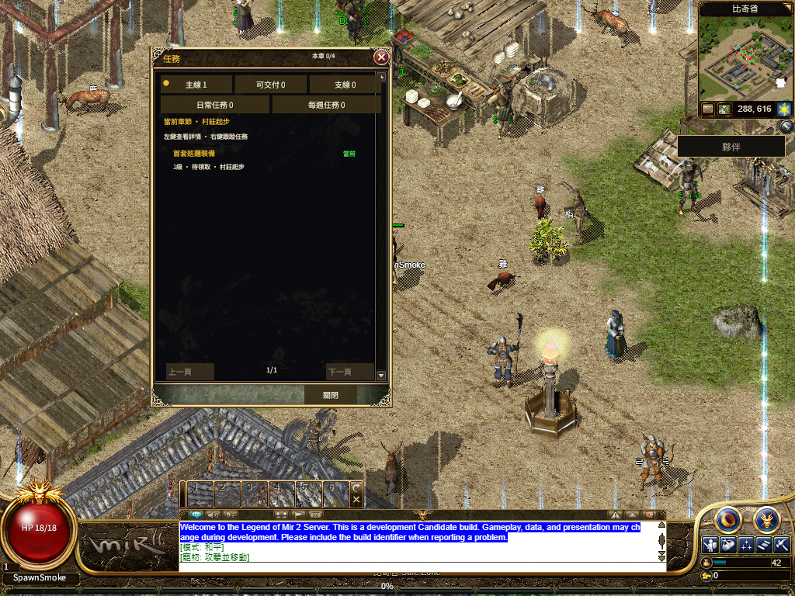
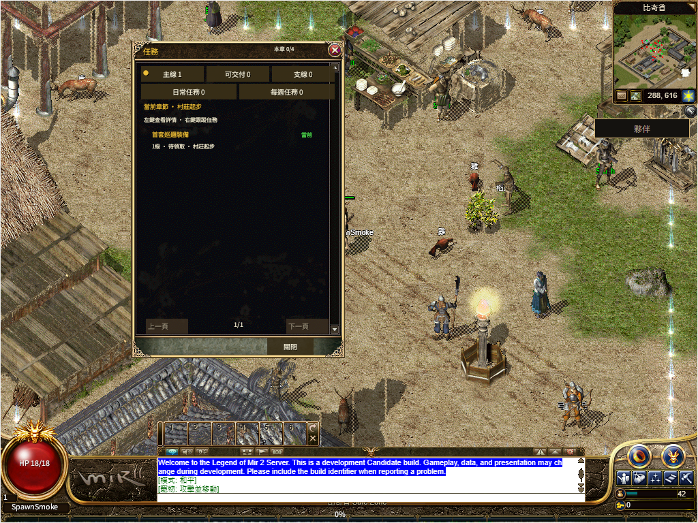

# R16 共用 UI 资源同实例恢复候选

本地候选 `63977fd7e102-ui-assets-fa52144b`，新运行包 `bevy-0c553a754308e5b8`。**本页记录候选，尚未发布这份新运行包。** 当前生产仍为 `432c58a07e`，其[公网失败与固定源码](../r16-runtime-body-recovery-20261113/production/README.md)保留；整体 1:1 与真人 Accepted 未完成。

共享 Rust 资源所有者保留原 Font/Image 句柄，按完整 AssetPath 去重。只对 Failed 使用 `Time<Real>` 的 1 秒／2 秒间隔，最多两次额外请求；Loading、Loaded、窗口开关与重复所有者不重置额度。HUD 和 Quest 注册各自必需皮肤，每帧系统可在没有新快照时恢复。全部资源实际加载、六套 FontCx 映射恢复后，仅清除对应 asset error；其他错误保持独立。

48 项 Rust 检查与 38 项 Node 发布／配置检查通过。真实 AssetServer IO 验证繁中字库、827 PNG 先失败再恢复、原句柄仍能读取有效字体／解码图片、原版繁中文字形可排版；永久失败总共三次，Loaded 但无效字体不能让界面就绪。原有裸 App 排版测试未新增时钟／AssetServer 前置。[检查](tests.txt)

默认 WebGPU、真实共享 WebGL2 各运行字体失败和 HUD＋Quest 皮肤失败两类场景，共四条完整流程、八个冷热会话。字体失败后实际出现 Quest asset error；恢复后同一 document、同一 runtime、同一 generation 的 HUD／Quest 接管。皮肤场景先恢复 HUD 的 827，再在 HUD 已 ready 时让 Quest 的 961 返回 503，随后只恢复该皮肤，证明共同字体已就绪时仍能独立恢复 Quest。原 8 秒实际移动、120 秒共用 UI 门槛、Q、Worker 停启、正常保存和完整关闭浏览器后同档重开均通过。[逐项回执](browser-cases.json)

这些是固定完整字节的受控 HTTP 故障测试，不是公网冷加载性能证明。保留两次隔离构建失败、首轮未命中故障，以及一次不正确的跨时钟诊断断言；没有删掉失败样本或放宽原 8 秒／120 秒门槛。浏览器墙钟间隔留作观测，精确 1 秒／2 秒边界由 Bevy 时钟与真实 IO 测试判断。[原失败](retained-failures.json)

新三包／六叶均以 Rust 1.95.0、bindgen 0.2.118、Binaryen 131 重新构建并通过原体积预算。固定源码快照为 `63977fd7e1`，460 份本地 crate 输入与本轮八份覆盖文件绑定；另一个任务的 `54706a8649` 只提交容量文档，已独立核对，不改变构建源码。未纳入 dirty lib.rs 或 Native 界面改动。既有 132 份 WIP 中 131 份逐字节相同，容量文档的外部更新／提交单列，本任务未编辑该文档。[运行包](runtime-artifact.json) · [构建](build-receipt.json) · [源码闭包](rust-source-closure.json) · [保全](preservation.json)

源码已提交并推送为 `e7cbab02f0`；运行包归档由新 tag `codex/r16-ui-asset-recovery-runtime-20261113` 保留。460 份输入中 454 份与 Git 原文逐字节一致，另六份仅为 Git 换行规范差异，已用 `git hash-object --path` 核对；本轮八份覆盖文件全部匹配。[提交与换行核对](source-binding.json)

新六叶已由 [R2 发布 43339966843](https://github.com/Zombieliu/mir2/actions/runs/43339966843) 上传并逐叶读回、核对存储表示；没有改动既有素材 manifest 或旧运行包。匹配 Web 生产候选尚待切换。
