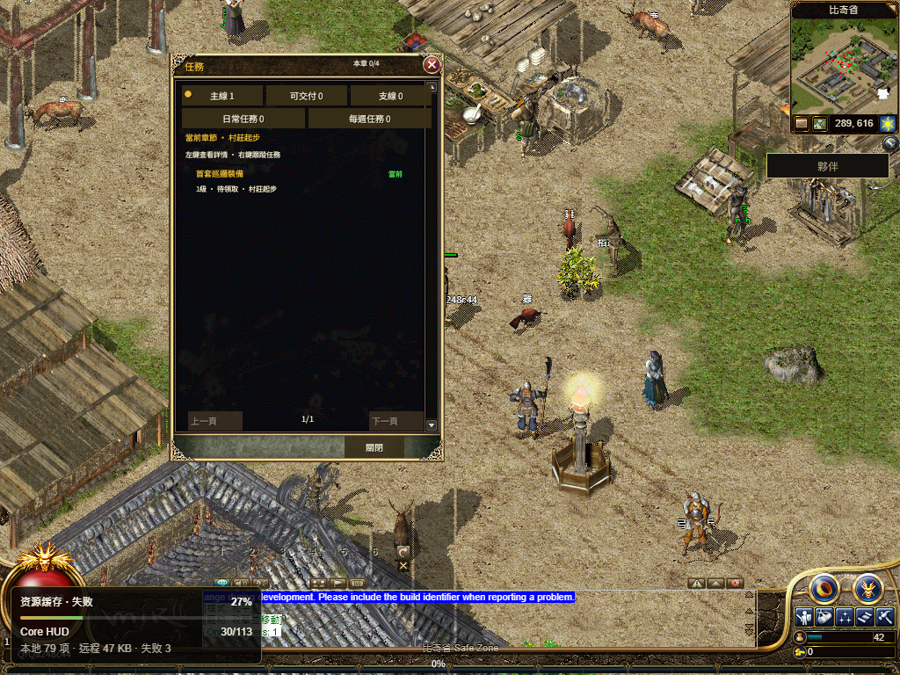
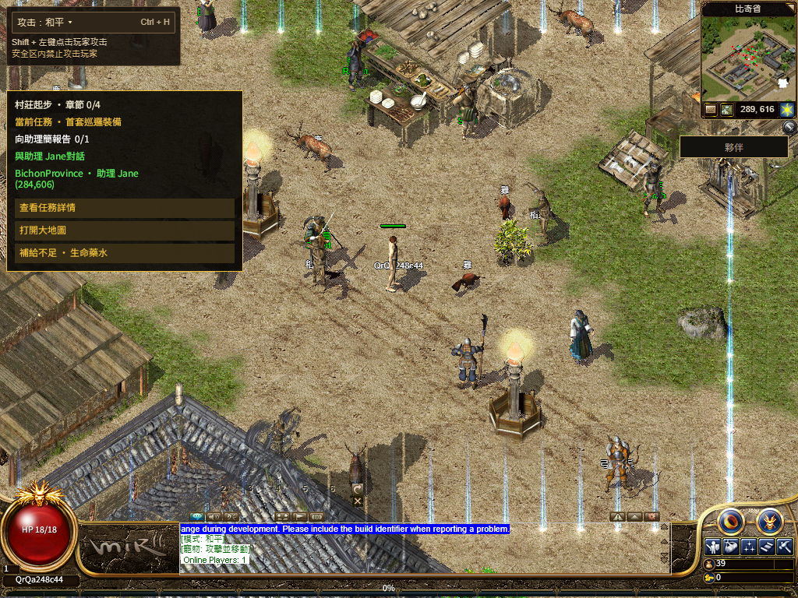

# R16 同实例 UI 资源恢复正式发布

已发布到 [numeron.obelisk.build/game](https://numeron.obelisk.build/game)，源码 `e7cbab02f0`，运行包 `bevy-0c553a754308e5b8`，部署 `dpl_4jjpevpspsVtf61hUCgTHiKxRatZ`。**发布及本轮公网功能样本通过；整体 1:1 Candidate、真人 Accepted 和实体手机验收仍开放。**

[R2 43339966843](https://github.com/Zombieliu/mir2/actions/runs/43339966843)、[Stage 43340773229](https://github.com/Zombieliu/mir2/actions/runs/43340773229) 和 [Promote 43342149133](https://github.com/Zombieliu/mir2/actions/runs/43342149133) 全部成功。新六叶完整读回，Vercel READY 后才切换。只新增版本化运行包文件并发布游戏项目，没有 DNS、Gateway、官网或链上写入，没有回滚。原 `6997f810ed` 玩家反馈已包含。

| 公网分项 | 实测 |
| --- | --- |
| 简中／繁中二维码 | 各一次真实二维码、待确认、取消后停止轮询 |
| 钱包确认 | 官方手机尺寸 PWA＋虚拟通行密钥；Testnet 一次登录签名，准确会话确认，禁止操作 0；没有使用真实玩家钱包 |
| 普通流程 | 新角色进入比奇；物理 ArrowRight、权威 UserLocation、实际画面位置、Q 和正常退出返回选角 |
| 首步原 8 秒门槛 | ACK 131ms；物理输入至画面提交 156ms |
| 同实例资源恢复 | 实际观测 19 个字体／皮肤错误样本；同一 generation 2、单调 frame，随后 Quest 与 HUD ready，未重启 App |
| 原 120 秒 Native 门槛 | 沿既有 `sharedHudObservedMs - firstPlayableFrameMs` 口径，118.667 秒，通过 |
| 独立联合采样 | 两秒采样首次同时观察 Quest/HUD ready 为 120.238 秒，原样保留；不宣称该采样早于 120 秒 |
| 字体／皮肤缓存 | 六套原字体完整字节／SHA、113/113 HUD 资源及任务标记通过 |
| Worker | 实际停止并重启，已有缓存及 Native ready 保持；测试未向 Worker 补发配置 |
| 退出 | 普通 LogOut 一次、ACK 一次、返回选角；自有浏览器全部关闭。公开旧角色冷重登另验，本轮不与本地同档重开混算 |

上述 Native 口径与[此前正式门槛](../../r16-boot-overlap-20261113/production/README.md)相同。冻结 19 个签名流程源码前后 SHA 一致，没有因结果调整时限。此次已实际发送 Walk，先前 `432c` 的未发送／Worker 未执行记录[继续保留](../../r16-runtime-body-recovery-20261113/production/README.md)。[本轮总回执](receipt.json) · [运行时原采样](runtime-timeline.json) · [实际移动](movement.json)

**冷加载仍偏慢。** 点击进游戏至首个可操作画面 45.079 秒；运行包同源请求约 8 秒中断，固定 CDN 响应头另等 55.860 秒，随后完整到达 31,452,436 字节。HUD 接管接近原门槛上限，需要继续优化；不能据单次通过宣称公网性能稳定。签名流程后另行完整读取同一 WASM，字节及 SHA `55024cc3…9c7552e` 匹配固定 manifest；该独立读取没有温热或替换先前样本。[流程后完整包](postflow-runtime-body.json)

诊断记录 67 条 console error、1 条 warning、61 个资源错误事件，包含恢复前失败；本轮功能通过不把它们改写成零错误。Vercel runtime-errors 连接器传输失败，没有宣称服务端日志扫描干净。既有 132 份 WIP 中 131 份逐字节一致，容量文档由另一任务单独更新并提交，本任务未编辑；原 index 保持。

