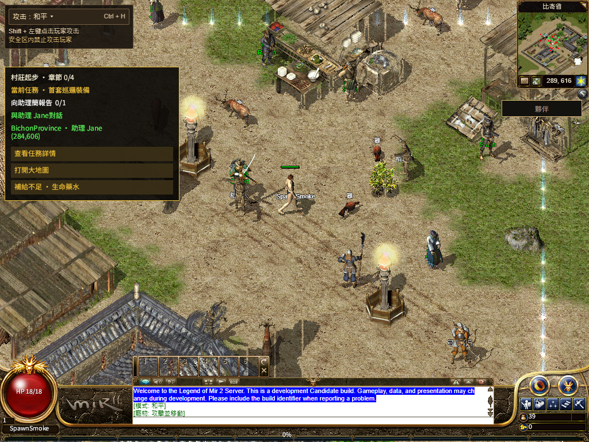
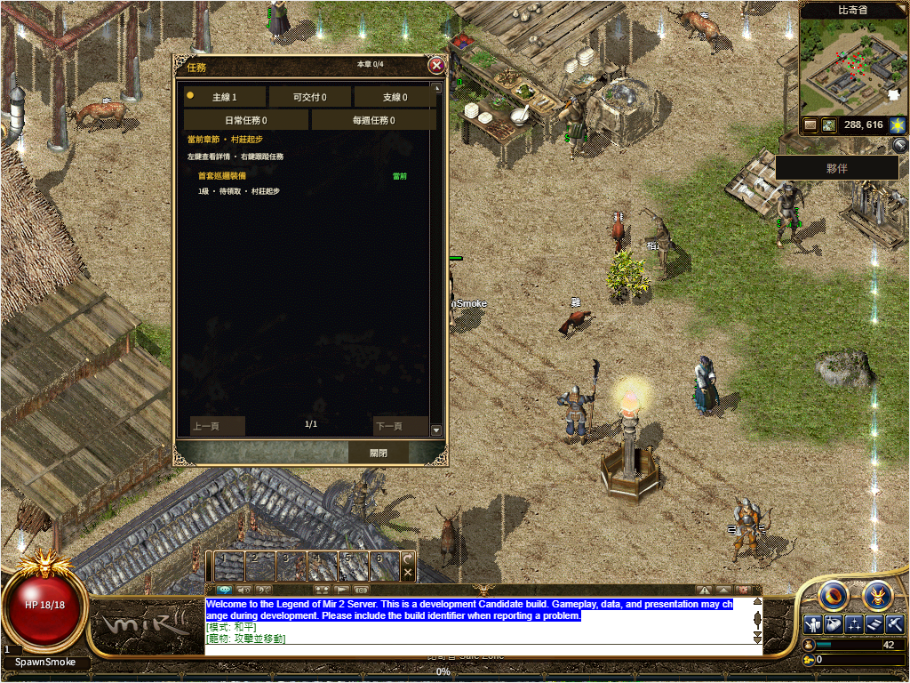

# R16 Web 共用初始化目录传输

本地候选`966bb8372e4c-web-catalog-5d6b4ddf`通过，已作为源码`8654cdcb36`发布；本轮公网首步1.919秒通过，但运行包下载中断、共用HUD失败，完整验收仍false。[正式发布及失败边界](production/README.md)。此前40be2972ea首步15.913秒失败保留。

普通Web在轻量Rust解码器就绪后声明serverCatalogGzipV1。网关沿用既有编码；Windows和Web共用整批验证器，检查单gzip member、CRC/ISIZE、132KiB线字节、128KiB正文、64条和真实四类结构。整批通过后原字符串依序进入既有处理器；任务、物品、配方和商店内容完整保留，顶层重复字段拒绝及内层last-wins合同沿Native。

传输策略独立小包：WASM190701字节，JS6063字节，保留原小于262144字节WASM门槛。旧Core/Presentation/NPC三包字节一致。四包共同源码指纹包含protocol；构建与打包检查完整第四包及编译内嵌manifest。

- Rust帧5项、整批语义16项、实际Native测试5项通过。Native第一次F盘失败保留，63个临时缓存文件逐一SHA相同后迁C；C盘编译后最初错误模块筛选为0项，不算验收，实际二进制随后执行native_catalog5项通过。
- NodeCore/打包/新传输55项、既有购买/owner/英雄196项通过；原AST fixture依赖失败未删，适配后使用真实Page helper和真实ingress，保留原断言。
- 实际Chrome157循环连接检查原文/Unicode/i64、文本和binary顺序、坏第二条零部分应用、未协商拒绝、代际更换和复制前上限。原1002关闭错误保留，改4002后确认真正关闭且后续Text不应用；[浏览器API约束](https://developer.mozilla.org/en-US/docs/Web/API/WebSocket/close)。
- 默认/共享WebGL2各完成普通新角色、提前两步、113/113、原六字体SHA、繁中共享Q、真实Worker停启、普通退出落盘及完全关闭Chrome后重开。每个会话收到四类完整529条，633495字节原文压成80448字节、10个binary帧；两端四个会话数量相同。
- 受控首次Native34.336/34.426秒，缓存重开1.351/1.328秒。提前输入至画面88/539/129/533毫秒，仍按原8秒和120秒门槛。没有通过等待全部定义再开始首步来缩短测量窗口。

[结构化回执](receipt.json) · [构建绑定](build-receipt.json) · [浏览器传输](browser-transport.json) · [Rust帧](protocol-framing.txt) · [Rust语义](protocol-envelopes.txt) · [Native5项](native-tests.txt) · [Core55项](core-tests.txt) · [购买/英雄196项](economy-hero-tests.txt)

本轮131份原有未提交文件内容未变；另一个线程并发更新的gateway-equip-logout验收文档保留新内容，未纳入本轮提交，前后SHA见回执。真实公网发布及原8秒首步已有本轮分项结果，运行包正文恢复、其他浏览器、完整三职业当前路线和全局1:1仍待验，不由本地数据压缩量直接宣布公网卡顿已解决。
