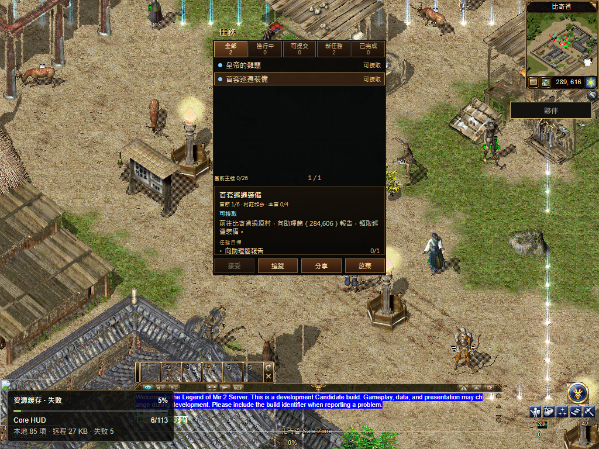

# R16 共用目录传输正式发布

已发布到 [numeron.obelisk.build/game](https://numeron.obelisk.build/game)。游戏源码为 `8654cdcb36e20e114f3e1d34cd142d0b5396638a`，部署为 `dpl_9KSedR4DePS2tFQGh4T5qZiMVdAK`，包含 `6997f810ed` 玩家反馈修复。**发布通过，本轮完整公网验收为 false。**

70 项发布保护、本地构建输入绑定、[Stage 43308400205](https://github.com/Zombieliu/mir2/actions/runs/43308400205) 与 [Promote 43310294840](https://github.com/Zombieliu/mir2/actions/runs/43310294840) 均通过。只发布游戏项目；生产目标及域名均指向同一候选，没有回滚。Stage 使用发布工具提交 `84c888f90c`，Promote 执行时分支推进到 `82efff2c8c`，两者的发布工具与工作流内容相同；实际游戏构建仍固定为 `8654cdcb36`。其他线程的 Gateway 与容量提交保留，未作为本轮游戏构建来源。

11 条公网文件读回通过，含四套 Core 的八个不可变 JS/WASM 文件，字节及 SHA 与候选一致。结束前再次读取 `/version`、`/game`、Worker，均为 200；版本及 Worker 固定值一致。[公网文件](public-readback.json) · [结束读回](final-check.json)

| 本次公网步骤 | 结果与范围 |
| --- | --- |
| 简中、繁中扫码 | 各一次真实矩阵出图、待确认、取消后停止轮询，通过 |
| 钱包确认 | 官方 PWA、手机尺寸浏览器、虚拟通行密钥、Testnet 一次登录签名；确认准确会话一次，禁止操作为 0 |
| 普通建角、比奇首画面 | 通过；点击开始至首次可操作观测为 10.979 秒 |
| 实际首步 | 发出普通 Walk 至正确权威 UserLocation 为 **1.919 秒**，通过原 8 秒门槛；随后画面坐标一致 |
| 初始化目录 | 首十个压缩批次完整接收 529 条定义：原文 633495 字节，线字节 80448；额外一条商店定义通知另记，共 11 帧、530 条通知，无解码错误 |
| 预取及原字体 | 后续恢复至 113/113；六套原字体完整字节及 SHA 通过 |
| 普通繁中任务窗 | 目标、章节、主线进度与 Q 入口通过；该次为 React 备用任务窗 |
| 共用运行包及 HUD | **失败**；运行包正文未完成，App 未开始 boot，共用 HUD 未就绪；原 120 秒 Native 门槛为失败 |
| Worker 真正停止、恢复 | 观察到 stopped 后恢复 running；同一 HUD 图片返回 200，缓存及正文完整字节/SHA 一致。最终联合检查因 nativeReady=false，仍为 false |
| 普通退出 | 一次 LogOut、一次成功回包、返回选角；所有自有浏览器关闭 |

目录采用同一固定 Rust 解码器验证，只归档计数、大小、时间和正文 SHA。四类初始化分别为物品 145、任务 200、配方 79、商店 105；最后额外一条商店定义未混作新的初始化内容。[目录观测](catalog-observations.json)

运行包失败记录：同源版本化 WASM 请求在 57032ms 发出、65033ms 以 `net::ERR_ABORTED` 结束；固定 CDN 备用地址在 65033ms 请求，84801ms 收到 200 响应头，187104ms 正文尚未完成便中断。随后采样为 bootFailed=true、bootAttempted=false，HUD 一直未就绪。两条请求与原始失败均保留。四套轻量 Core 均已交付；游戏 Bevy 版本仍为 `bevy-84ef836460a84e03`。网关前后健康版本均为 `62931e1c5111ca978808a3b0702c12183974d53d`。[同轮运行时采样](runtime-timeline.json) · [Worker 原回执](worker-restart.json)

本轮没有为取得通过结果重新跑签名场景，没有放宽 8 秒/120 秒门槛。保留上版 `40be2972ea` 首步 15.913 秒失败与 Native 83.587 秒通过、此前 `491819b20e` Native 158.084 秒失败。单次首步改善不能证明网络长尾已经全面消除。

下一项是运行包正文在 boot 前的有界恢复：核对取消、镜像切换与失败状态，保留销毁和只 boot 一次的约束，再按原时间门槛验证。全局 1:1、当前完整三职业路线、其他渲染器、已有角色/后续地图、Hosted 及最终人类 Accepted 继续开放。实体手机相机与生物识别尚未验收。

[正式结构化回执](receipt.json) 保存原始证据 SHA 和执行前冻结的 19 个脚本 SHA；结束时 19 个脚本仍全部相同。浏览器没有页面 JS 错误，但网络控制台错误和正文中断已保留。Vercel 最近 30 分钟未返回函数 error/fatal 分组，该查询不覆盖浏览器网络失败。

132 份发布前文件中，131 份内容保持一致；另一个线程继续更新的 `gateway-equip-logout` 文档保留其新内容，未纳入本轮提交，前后 SHA 见回执。[本地候选与原有失败](../README.md)

上图拍摄时预取尚在恢复，显示失败状态；后续同轮资源回执恢复为 113/113。它仅证明备用任务窗及城市画面，不能作为共用 HUD 成功截图。
