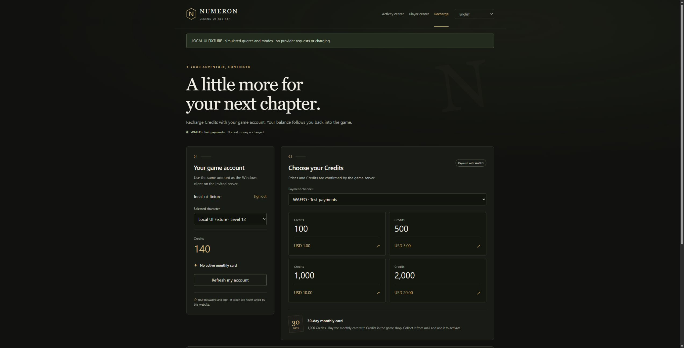
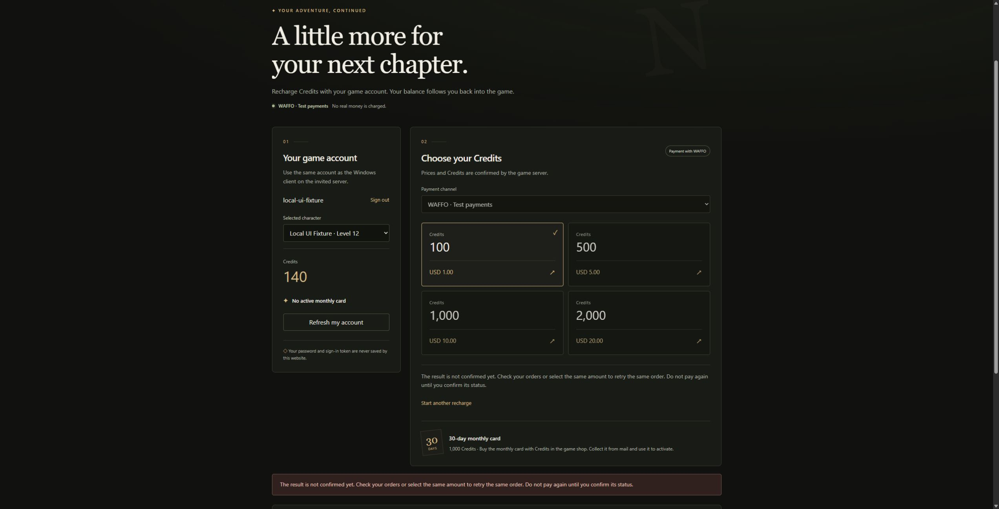
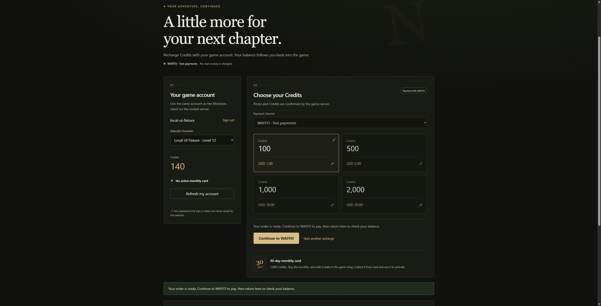
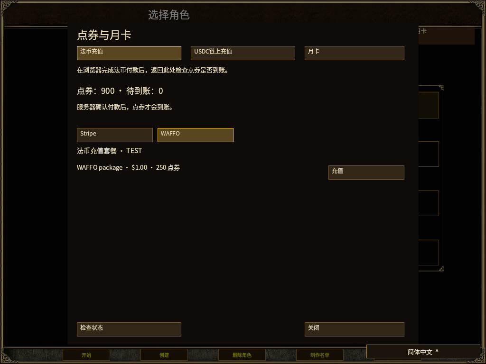

# WAFFO selectable recharge: local evidence, 2026-11-05

Scope and setup: [WAFFO recharge](../../WAFFO-RECHARGE-20261105.zh-CN.md).
Canonical base is `c404bde8a5190534f6bc83ec8a4fe78fffc8cb50` plus the shared
uncommitted working tree. No release artifact or public service revision was
created by this work. Current source hashes are recorded in
[`validation.json`](validation.json); unrelated WIP was retained.

| Check | Fresh result | Evidence |
| --- | --- | --- |
| Simulation recharge, monthly card, activities, provider isolation | 64 passed across four targets (27/8/5/24) | [simulation log](simulation-tests.log) |
| WAFFO unknown-request restore protection | 3 passed; two failures reproduced before the fix | [before](waffo-restore-before-fix.log), [after](waffo-restore-after-fix.log) |
| Existing paid-history restore and ordinary backup roundtrip | 1 + 1 passed | [paid history](paid-history-restore-regression.log), [ordinary restore](ordinary-backup-restore-regression.log) |
| Gateway billing subsystem, including Stripe, WAFFO, USDC and Source RPC | 80 passed, no skips; includes 11 WAFFO protocol/transport cases and new capability negotiation cases | [billing log](gateway-billing-tests.log) |
| Initial WAFFO signed-HTTP-only round | 11 passed; overlaps the 80 above | [initial log](gateway-waffo-tests.log) |
| Gateway + Simulation all targets | `cargo check --all-targets --locked` passed | [type check](backend-all-targets-check.log) |
| Recharge portal logic and event handlers | 35 passed | [Node log](portal-tests.log) |
| Static publisher/proxy candidate | 22 passed, including exact WAFFO callback addition and byte preservation | [Python log](proxy-tests.log) |
| Shared native billing state | 26 passed; GPU case run separately | [native log](native-billing-final-tests.log) |
| Exact Windows protocol/browser source modules | 7 passed | [transport log](native-transport-tests.log), [reproducible harness](check-native-transport.py) |
| Windows host and test targets | Offline check passed with temporarily resolved lock; original lock restored byte-identically | [guarded report](native-host-validation.json), [compile log](native-host-check-offline.log) |
| Native rendering | 45 offline images, en/zh-TW/zh-CN; zero missing glyph, text overflow or viewport escape | [GPU report](native-gpu/billing-entry-native-gpu.json), [native summary](native-validation.json) |

The original Windows lock needed an update because of existing runtime WIP.
The first `--locked` failure remains in [its log](native-windows-check.log).
For host verification only, path/workspace entries were resolved offline into
a guarded temporary lock. Original/final SHA256:
`16a4204573038f56ee1e036c7392f3ff3ea43319ccbeb6d3c5aed393f1a3b9d9`.
The source lock and runtime manifests/lock remain unchanged. This is a host
type-check result, not a release build against the original stale lock.

## Actual browser and renderer observations

The isolated loopback browser fixture exercised the real portal JavaScript:
select WAFFO, show its test mode and four offers, receive a simulated HTTP503,
lock the selected channel/amount, and retry the same nonce successfully.
The fixture banner explicitly identifies simulated data. Actual local requests
are retained in [requests.jsonl](portal-qa/requests.jsonl).

Computer Use stopped itself when it could not reliably determine the current
Chrome URL, so browser actions stopped. The final new-order confirmation/unlock
is covered by the event-handler tests, not claimed as a successful browser
observation. The owned loopback server was stopped and port17455 verified closed.
The inspectable [fixture server](portal-qa/fixture-server.mjs) is evidence-only;
it is not a production login or fake payment endpoint.

## Limits and missing external evidence

- All provider transport uses local RSA-signed fixtures. No merchant API call,
  sandbox card payment, refund, real charge, public deployment or new package.
- Current visible messages, repository and visible attachments did not contain
  WAFFO merchant test configuration. The channel remains disabled by default.
- Only the officially documented `cashier.waffo.com` hosted origin is enabled.
  A different real sandbox origin needs official evidence and another check.
- WAFFO tax evidence remains unverified, so its commission funding stays pending.
  Refund/chargeback events place a review hold rather than fabricate settlement.
- No new PostgreSQL or multi-host provider acceptance is claimed; File restart,
  shared account schema and existing Source billing boundaries were checked.
- These results do not change whole-project Candidate or human Accepted status.

The earlier test setup failures (native locale initialization, unseeded isolated
offline dependency resolution, and original stale host lock) remain alongside
the passing logs. They are not counted as completed provider acceptance.
