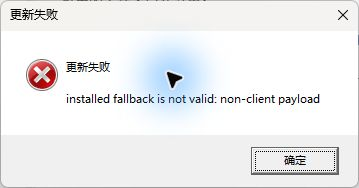
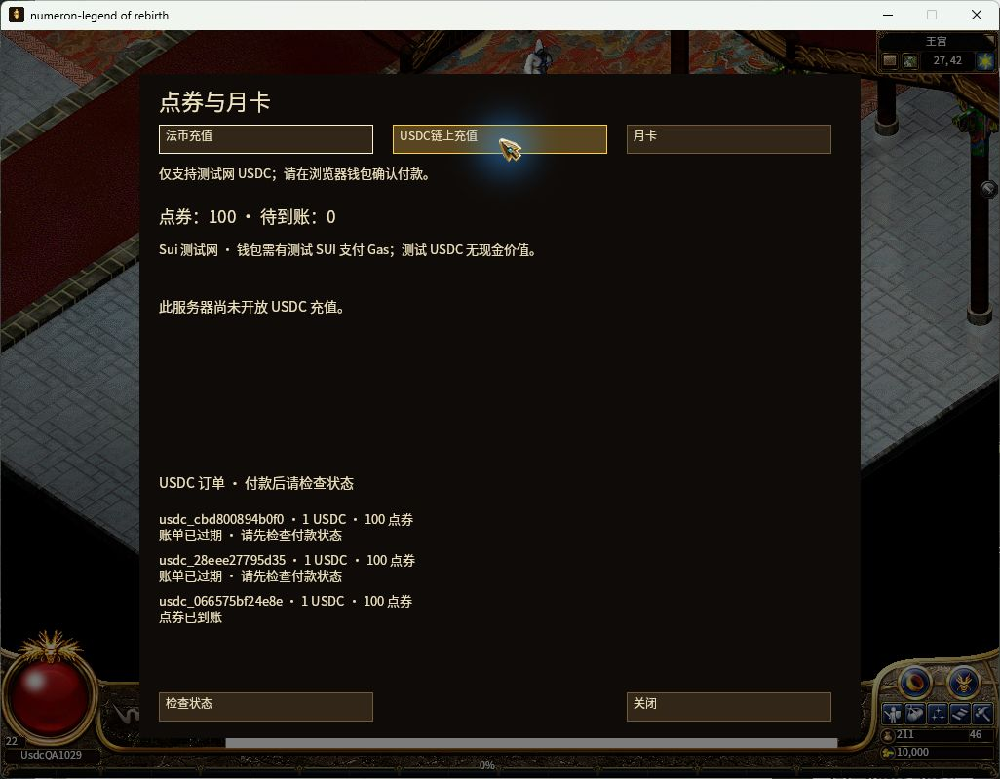
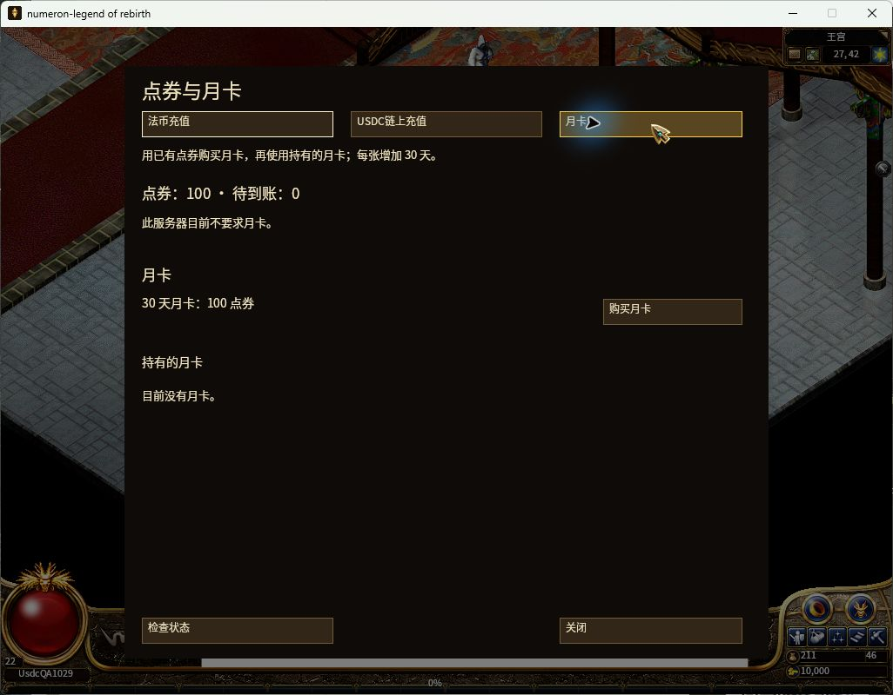

# 简体文案润色与完整 Windows 安装包（2026-10-29）

**本主题技术验收完成，`complete=true`；真人前端与文案 Accepted 仍单列。** r10 两份完整 Setup 已编译，隔离安装、无参数 Launcher→Updater→Game、实际卸载重装、简体语言保留及默认安装资源发现均通过。首次安装全面核对 255,027 个 Game 文件内容和九个 updater 文件；重装核对完整路径闭合与明确的选定内容，不冒称重复全面哈希。十二张原生 Windows 截图覆盖首次和重装后的简体界面及充值三页，余额仍为 100 点券、10,000 金币、三张既有订单，未进行购买。r9 启动失败历史原样保留并由 r10 实际成功解决；Game242 没有重建。

本轮仅润色系统目录中的简体文案并推进完整安装交付。旧[简体 UI 包](../native-zh-cn-20261029/README.md)、[充值导航包](../billing-entry-ui-20261029/README.md)、[USDC 付款包](../sui-usdc-recharge-v1-20261029/README.md)保持历史快照，不回写其 manifest 或将旧测试说成当前源码复验。

| 已有检查 | 证据与边界 |
| --- | --- |
| 完整键集 | [9769 键不变；873 条精确覆盖](editorial/validation.json)，所有参数、数字与 `@` 命令保持 |
| 离线生成器 | [12 项保护检查及 `--check`](editorial/generator-checks.json)：2 正向、10 负向；13 项语义区分另计 |
| 名词与身份 | [3545 键 / 3068 个去重中文文本的独立 AI/source 审校](editorial/content-review-coverage.json)，[167 条建议已整合](editorial/content-name-integration.json) |
| 完整简体字体 | [2007 个非控制字符零缺字](fonts/corpus-verification.json)，使用未修改的内嵌完整 SC 字体，不依赖系统语言包 |
| Native focused | [54 项通过、2 项 ignored](native/ui-debug-validation.json)：15 i18n、11 player text、19 billing、7 display、1 NPC/任务标题、1 任务计数 |
| Native GPU Mock | [任务/NPC/背包 3 图](native-mock/gameplay/zh-cn-gameplay-layouts.json)及[充值三语言 39 图](native-mock/billing/billing-entry-native-gpu.json)，均无缺字、溢出或越界 |
| 月卡系统名增量修复 | [billing 20 项及新 GPU 39 图](native/monthly-card-label-fix/validation.json)，精确已知月卡 label 本地化，未知 label 与原 UID/操作身份保留 |
| QuestPractice 相邻回归 | [7 项通过](native/quest-practice-validation.json)，相关七项源码与固定提交相符；不混入旧 native 阶段计数 |
| 干净源码 native release | [提交 24216899a 的 attestation 与二进制身份](release/native-attested-release.json)通过；它只证明游戏本体，后续 updater、Candidate 和安装器另验 |
| Updater 简体专项 | [12 项通过、20 项输入及提交 blob 核对](updater/zh-cn-fix/validation.json)，更新器源码为 11d8a75，游戏本体仍是 24216899a |
| Updater 简体 release 预编译 | [独立 clean sparse 11d8 源码及两个 EXE 身份](updater/sc-release-precompile/validation.json)通过；31.09 秒、20 项 tracked 输入，尚未绑定签发最终 bundle |
| r9 updater bundle 组件历史 | [实际 wrapper 构建与严格九文件验证](updater/final-r9/validation.json)通过，签名绑定 Game242/Updater11d8；随后真实启动失败，不能当最终交付 |
| 打包脚本完整 selftest | [最新 package-v3、verify-v1 通过摘要](packaging/pre-release-full-selftests.json)，实际候选产物及后改的最终安装器需另验 |
| 忽略资源恢复与生产前检 | [98,880 张 PNG 身份恢复、零缺引用、七类闭包](packaging/assets/recovery/validation.json)通过；没有 tracked 写入或覆盖已有文件，实际 Candidate 仍另验 |
| 短物理路径与 ADS 守卫 | [同一 worktree 移动及 PS7/PS5.1 正负探针](packaging/short-path-correction/validation.json)通过；正常文件接受、命名 ADS 拒绝，生产守卫未放宽 |
| 正式 Game Candidate v5 | [255,027 文件、CMS/原生产 verifier](candidate/validation.json)通过；Game242 clean、零失败，49.7 MB manifest 只固定摘要 |
| 显式 current-source 副验 | [副本 `RequireCurrentSource=true`](candidate/explicit-current-source-copy/validation.json)通过；四 metadata 同正式根，实际安装器仍取原正式 Candidate |
| Inno 与 r9 配方准备 | [官方 7.1.1 下载及编译器签名、10×281 消息/15 Custom 翻译闭包](packaging/compiler/readiness.json)通过；两种语法 fixture 使用 dummy payload，未当作实际安装包 |
| r9 两个实际 full Inno 编译历史 | [普通/隔离完整 payload、版本 Trim 收尾及 include 身份](installer/full-compile-validation.json)通过，随后启动失败，仍需 r10 |
| r9 silent 隔离安装历史 | [260.369 秒、exit 0、zh-CN seed、无自动启动](windows-live/first-install/validation.json)通过，安装后身份核对也通过；实际启动结果另列 |
| r9 真实启动失败 | [原生截图及原始两行 last-run](windows-live/r9-startup-failure/validation.json)：Updater 报 non-client payload，Game 未启动 |
| r10 精确策略修复 | [四源码绑定81942、五个精确名称、Rust/Python 回归](updater/root-policy-fix/validation.json)通过；没有放宽其他路径/大小写/CMS规则 |
| r10 updater 组件 | [实际九文件 bundle 与 Game242 绑定](updater/final-r10/validation.json)通过，sequence2026102910；组件阶段与后述实机启动分别证明 |
| r10 两个 full Inno 编译 | [两个约1.018GB实际 Setup、同recipe/两include](installer/r10/validation.json)通过，实际EXE hash重算匹配，不是dummy fixture |
| r10 首次 silent 安装 | [328.763秒、exit0](windows-live/r10-first-install/validation.json)通过，安装后完整校验与启动由下一项证明 |
| r10 首次实际完整运行 | [255027+9 核对、真实进程链与八张原生 PNG](windows-live/r10-first-runtime/validation.json)通过；100 点券/10000 金币/三订单不变；卸载重装由最终阶段另证 |
| r10 实际卸载重装与默认资产 | [相同 Setup 重装、三份 profile hash 保留、默认资产 complete](windows-live/r10-reinstall/validation.json)通过；完整路径 255027、选定 payload 7、metadata 4、updater 9，首次全面内容核对不重复计 |
| 最终 Windows 技术验收 | [首次8图与重装4图、真 Launcher 链、语言保留、经济不变](windows-live/final-ui-validation.json)通过；真人 Accepted 与生产部署均未声明 |
| r9 实际卸载 | [注册/EXE移除、旧正常状态保全](windows-live/r9-removal/validation.json)通过，验证 profile seed 保留；不改写 r9 启动失败 |

2362 条既有简体和 7407 条固定 OpenCC 1.4.2 `tw2sp` 是**基础生成来源**；873 条版本化覆盖替换其中的值，不增加键。生成器先生成固定基线，再应用[显式逐键编辑](../../../packages/game-data/data/native-i18n/extra/zh-CN-editorial-overrides.json)。每条保存精确旧值、修改理由和类别；旧值或审校依据变化会要求重新审校，不静默套用。运行时不调用 OpenCC，也不转换玩家姓名、行会名、聊天、公告、邮件或插入参数。

修正包含：将误译的“向助理演示文稿告”恢复为“向助理简报告”，空间传送与邮件发送分开，补齐雷电术英文正文并删除火球术尾部内部标识，区分 DC 物理攻击和生命值、MC 魔法攻击和 MP，统一账号/账单/到账及行会名称。点券与行会增益点数保持不同，未知付款状态不引导重复支付，链上确认与点券到账仍分开。

物品、怪物、技能与 NPC 按真实标识核对，不按相似中文名合并：870 为“沃玛号角”，1156 任务材料仍是“沃玛角”；Lightning 为疾光电影，ThunderBolt 才是雷电术；DoubleSlash 与 TwinDrakeBlade 双龙斩分别保留。这里只改显示文本，没有修改模板 ID、价格、概率或玩法机制。

本次为 **AI 编辑与源码核对**，`humanReviewedKeys=0`、`humanAccepted=false`。它不是 9769 条人工逐句批准。已有可靠中文名优先对齐；没有权威中文来源的韩文罗马字等专名保留原样，不杜撰正式译名。382 条 Latin/专名清单的原件哈希与示例在[整合记录](editorial/content-name-integration.json)。

已记录[上游说明冲突](editorial/upstream-mechanics-caveats.json)：Blizzard 英文说明与技能书对防护/攻击的描述不同；Fury 英文命中率与技能书攻击速度也不一致。本轮不凭语言润色改技能效果。`content.quest.57.description` 原本是 Example 占位，现译为“示例”，不声称新写了该任务内容。

Native 证据来自固定 873 条覆盖后的增量 debug 构建：149,412,864 字节，SHA-256 `70630edc42d528952f334858ef7cbbab541d8ea6d60745c72b3af618f4bf6b22`，不代替干净源码 release attestation。[534 项输入账本](native/input-ledger.json)已逐项重新核对；其 `files` 数组规范化哈希为 `35ca9060925e27e486398bd3b6b3dd85a033b5b0ff0ec78a0caf0ad3ad7e9fde`，账本文件原始哈希另为 `e89c3b647c0f8c29b30fc6ee3263028ebeed0d631b7941fb41afc1c0f79a4d93`。两项 ignored 是 billing 与 display 的 GPU 测试；另行执行的是 billing 39 图与独立 gameplay 3 图，未声称本轮另跑 display GPU。

这组 GPU 截图实际显示了“点券”；“传送”“雷电术”“行会”没有出现在这些固定 fixture 中，它们由逐键语义与完整字形覆盖检查支撑，不冒充逐词截图验收。Mock 返回的 `Small`、`Test package` 等未知套餐名保留原样。

月卡系统 label 的[后续独立阶段](native/monthly-card-label-fix/validation.json)仅修改 `native_billing.rs`：实际服务器固定 `30-day account access` 及另外三个精确别名使用已有月卡翻译，未知 label 保持原样。该阶段重新跑 billing 20 项及 39 图，其中九个月卡场景核对最大 UID 和激活动作；已目视[简体月卡图](native/mock-monthly-card-label-fix/zh-CN-both-disabled-monthly-1024x768.png)为“30 天月卡”。新 debug 为 149,413,376 字节、SHA-256 `05482ef64a0ed1558ba607d8312bfeec0b6ddb39c49653150db488e79a2fec05`；534 项输入账本前后相同，和前阶段相比仅该 Rust 文件变化。20/39 是增量复验，不与旧 54/42 相加，也不声称重新跑了其他模块或真实购买/激活。

打包脚本阶段保留 package-v1 的开发缓存前置失败、v2 的首次通过以及随后修正两处新建临时 atlas 引用后的最新 v3；verify-v1 完整通过。报告固定实际测试的脚本原始/LF 哈希。r9 安装配方、Inno 编译器、真实 release、Candidate、updater 和安装器产物不在这两份 selftest 的覆盖范围内。[资源元数据来源核对](packaging/asset-metadata-pin-provenance.json)确认旧 Title 349 帧和 Prguse2 382 帧逐项未变，仅固定已提交的新增五帧身份；源 Lib、frame set 和原 PNG 核验保持严格。

实际 Candidate 与 selftest 分开记录：[第一次真实打包](packaging/actual-package-attempts-before-success.json)严格拒绝 E: 的 junction；改用 F: 物理资源根后，第二次在干净 checkout 缺少 base atlas 时因 ENOENT 停止。这两次都不算通过，也没有放宽路径或覆盖率守卫。随后从固定提交的 16,816 张地图 PNG 重新生成[79 页 base seed](packaging/assets/fresh-seed-validation.json)，核对 13,148,168 个源像素和 783,028 个边角像素；这个 base seed 阶段没有复制历史缓存。此结果只覆盖 seed，209 图完整 Candidate 仍由后续真实打包证明。

第三次真实打包通过地图自身的阶段检查后，在缺少被忽略的 `CArmour/11/0.png` 时严格停止，整体仍失败。之后按冻结 full-pack 元数据及 PNG/RGBA 身份恢复 103 库、184 个来源页对应的 98,880 张 PNG，合计 145,604,378 字节；tracked 输入写入、已有文件覆盖、元数据修改均为零。恢复后的 324 份元数据、197,652 个图片引用缺失为零。另一份 `Monster/049` 缓存共 225 文件（224 PNG）明确来自验签通过的旧 `WN-CANDIDATE-20261011-invited-25`，不是新生成或未经验证的目录复制。原始 entity/player/item/stateItem/actor/petGuild/sound 七类生产闭包全部通过，[compact 汇总固定各报告身份](packaging/assets/recovery/asset-input-closure-final.json)。[逐文件大清单](packaging/assets/recovery/validation.json)只固定 schema、98,880 条数量、长度和哈希，不把 14.5 MB 清单放入 Git。

第四次真实 package 的源资源与 209 图阶段通过，但整体在最终 staging 的 ADS 枚举因物理路径过长失败，没有生成签名 Candidate；原 finally 清理 staging/temp。随后安全移动同一 worktree 到物理短根 `F:/m9`；提交、游戏 EXE 和原 build attestation 均重新核对不变，没有更改源或放宽 ADS/路径规则。原生产 ADS 函数在 PS 7.6.5 与 Windows PowerShell 5.1 两个环境的 236 字符代表最长路径上，都接受正常文件并拒绝命名流。历史报告保留其原物理路径。

第五次真实打包已 exit 0，产生正式 `WN-CANDIDATE-20261029-invited-09`，原生产 verifier 为零失败、CMS detached signature 有效，源提交 242 clean。[正式结果](candidate/validation.json)核对 255,027 个包文件；其中 payload manifest 为 255,023 条、1,211,263,759 字节，manifest 文件本身 49,703,926 字节、SHA-256 `ab86b5e083473c003863ead5c2ef09112cadc655684176e7ad757f7c60eb80ed`，aggregate 为 `2ca14d2c5ec7d2bccf5cbe5d9c2a3540233f070c9b9a68b93abc1368b59a1ddc`。大清单和签名二进制不入 Git；小 VERSION/statement/build attestation 原样固定，最终 manifest、四份绑定 metadata 和游戏 EXE 身份重新核对匹配。

原流程没有传 `RequireCurrentSource` switch，报告如实保留 `false`；包位于仓库内时原 verifier 实际执行了自动 source 校验，`currentSourceValidated=true`、proof clean。没有把 switch 改写成 true。[额外副本复验](candidate/explicit-current-source-copy/validation.json)明确传了该 switch，结果 true、零失败、CMS 有效、proof clean；副本与原正式根的四 metadata 独立重算完全相同。实际安装器 payload include 首行来自原正式 `F:/m9` 根，未改用副本。原 verifier 的 staging 路径也保留为当时真实路径，最终 rename 后的正式根由完成 receipt 单独指出。这些 Game 报告不代替实际启动验收。

干净 F: checkout 的 native release 为 132,739,584 字节、SHA-256 `6b657f869afc2baa8a086baf9bd39ce77b5011247d8b12a8f92eaeebe3cf2e9d`，构建 5 分 59 秒，attestation 固定提交 `24216899acd4301d8c3b1eff08b825f4896cc410` 和 `worktreeDirty=false`。这是内部 Candidate 构建证明，未冒充发布者 Authenticode 签名。[updater 预编译](packaging/updater-precompile-24216899a.json)同样只属于该阶段；随后十语 updater 修改与最终更新包绑定需新证据。

Updater 的[独立简体阶段](updater/zh-cn-fix/validation.json)保留 17 个 stage 的旧九语列，追加简体 index 9；严格 schema 1 个人语言偏好与 OS 别名分流，繁体/Hant/HK/MO 和阿拉伯语旧索引保持。四项 locale、三项 UI、三项隐藏 Win32、两项相邻进度检查共 12 项通过；实际隐藏窗口核对简体标题/取消/状态，十语离线文本在 96/144/192 DPI 测量通过。这些是自动化检查，不是实际更新安装或人工前端验收。测试当时 HEAD 仍为 24216899a，20 项明确输入随后逐项核对匹配已提交的 updater 源码 `11d8a75ba72e626a287630c3a8a4b6c6278d0647`；没有把此前 native release 改写为使用新版 updater。

随后从独立物理 sparse checkout `F:/u9` 的 clean 11d8 源码完成[简体 updater release 预编译](updater/sc-release-precompile/validation.json)：原 `AssertSourceTracked` 的 20 项输入通过，并逐项重算实际字节；Launcher 为 392,192 字节、SHA-256 `cf4782eb831b3ef417d614b3d06ddb5838e8cf77ce3648ec88102eed9f6eb7e8`，Updater 为 1,955,328 字节、SHA-256 `91216014357046dce1d4e405969f3cbd36695f4b0ea82abbb73f92a20d253231`。两个真实 EXE 身份已重算匹配，未复制入 Git。本阶段未绑定游戏 Candidate、签发或验证最终 bundle，没有触及 game 242 checkout。

关于复制速度，[只读观测](packaging/tools/robocopy-help-readonly-observation.json)确认本机 culture/UI 虽为 zh-CN，robocopy 帮助实际是英文，旧 COPY/DCOPY/X 三项匹配均为 true。没有复现“中文帮助文本导致能力误判”，该归因已撤回；package 源码未改，也没有新增能力探针或测试。本观察不推断 v5 的实际耗时原因。

r9 updater 曾由真实 wrapper 构建、签发并通过严格九文件 verifier，sequence 为 `2026102909`，绑定正式 Game Candidate 与独立 clean 11d8 源码。r9 Launcher SHA-256 为 `838c9bb6c2fd0e8478a704907fd98248b9bcdfa5a3c09b3ff07c8100f585d8ae`，Updater 为 `0d23aade70acaa6bb2c00941be5379971e6bd764ae585db8427c2e03dceed363`；先前预编译哈希保留历史。九个实际文件和八份 evidence receipt 均重算匹配，安装器 include 生成九项成功。detached CMS 以固定公钥 `6c70…900f3e` 验证；公开 Authenticode 状态仍是 `NotSigned`，两者不混称。[Game 与 r9 updater 的组件匹配](release/game-and-updater-result.json)通过，但后续实际启动已失败，不能把组件完整性当启动兼容性。

Inno 下载文件与实际 `ISCC.exe` 均重新核对为有效 Pyrsys B.V. 签名；版本以引擎输出 7.1.1 固定，Windows 文件资源的 `0.0.0.0` 单独说明，不混作版本。早期参数/安装路径纠正后编译器已就绪。普通与隔离语法 fixture 的两个输出只固定长度/哈希，空 quiet 日志不单独当作成功依据；它们均不是游戏 Candidate 安装器。

两个实际 full Inno 编译均 exit 0，[最终编译与独立收尾](installer/full-compile-validation.json)通过：普通安装器 1,017,970,518 字节、SHA-256 `b29f0638cefe77f95d1ced256a02e6260aa6e269b212f53548e39736a1272c20`；隔离验证安装器 1,017,971,207 字节、SHA-256 `5fd15cf92cfe4cdace0408c5f4e99897a67d2ac8e01b44c1dae71761b7d4de4c`。外部收尾脚本先因 Windows FileVersion 字段尾空格比较误判，随后只对外部比较做 `.Trim()` 并独立核验已有输出，归一化版本为 `2026.10.29.9`；没有重编或改源码。两份 recipe/payload include/updater include 实际 hash 均匹配，空 quiet 日志不单独作为成功依据。

[只读安装审计](installer/installer-readonly-audit.json)明确：正常安装器保留既有个人语言，无个人偏好时选简体才 seed zh-CN；独立验证版需要 silent 安装后通过 reviewed helper 设置隔离 APPDATA，交互完成页自身不设置该环境。审计只证明当时的静态源码与文件身份，不能替代运行。收集时九个审计输入中八个仍相同，外部 launch helper 已从 2679 字节调整为 2802 字节；旧审计没有改写。[当前 helper 独立复核](installer/current-helper-readonly-validation.json)随后确认仅增加 phase 校验、receipt phase 和分阶段文件名三处变化，内存逆投影精确回到旧字节/hash，启动与环境逻辑未变，Node 语法通过。这仍是源码/语法检查，最终实际运行证据另收。

安装前已固定[旧安装/个人偏好身份](windows-live/pre-install-preservation.json)及[金币与点券快照](windows-live/before-finish-install.json)：100 点券、10,000 金币、三张既有订单。固定 VC runtime 缓存为 14.51.36247.0、18,731,856 字节，[Microsoft 签名核对有效](packaging/vc-runtime-cache-validation.json)；该检查没有执行 runtime 安装。

首次实际安装使用验证安装器、`/VERYSILENT /CURRENTUSER /LANG=chinesesimplified` 与独立目录，260.369 秒后 exit 0；[执行 receipt 与启动前检查](windows-live/first-install/validation.json)固定 schema 1 的 zh-CN seed，刻意启动前安装目录所属进程为零。UI 前快照仍为 100 点券、10,000 金币、三张既有订单、原 stable economy hash。[严格安装后核对](windows-live/r9-startup-failure/installed-identity-verification.json)随后确认全部 255,027 个 Game 文件与九个 updater 文件匹配，旧正常注册、EXE 与个人偏好不变。

接着通过无参数 Launcher 真实启动，Updater 显示“更新失败”，错误为 `installed fallback is not valid: non-client payload`；Game 没有启动。[179 字节原始 last-run 两行](windows-live/r9-startup-failure/last-run-raw-receipt.json)按原 UTF-8 文本及哈希保存，另有原生截图和 sidecar。协调者定位为 Rust updater 与 Python archive 的精确白名单落后于五个新增简体文档/OFL/来源文件，随后做了仅精确名称的兼容修正与回归。r9 安装器本身的编译/安装通过仍保留，但不作最终交付；r10 sequence 为 `2026102910`，Game242 与完整资源不重建。

精确策略修复已提交为 updater 源码 `81942dda7fa09e869d42fb9560e57abdbd542495`，四项被测 normalized 源码逐项匹配该提交和当前文件。只补五个已属于正式包的精确根文件名，其他相对路径、大小写、可执行标识、大小边界、CMS 与 metadata/payload 绑定规则保持。[修复回归](updater/root-policy-fix/validation.json)为 Rust focused 5 项（另有 1 ignored）、相邻安全 2 项，以及单独执行的真实 Windows pinned-CMS Candidate 1 项；ignored 与该独立执行不重复计数。Python archive 33 项中 30 通过、3 skipped，其 fixture 的 CMS 是 Mock；真实签名验证由独立 Rust 用例承担。实际 manifest 255,023 个路径通过 Python policy 扫描。原报告保留 worker 的 focused-patch 阶段表述，本记录只把确切输入绑定后续协调提交，没有改写旧阶段为 release 成功。

r10 updater 以 clean 81942 source、Game242、sequence `2026102910` 重新构建和签发，[严格九文件验证](updater/final-r10/validation.json)通过并逐项重算。实际 Launcher 为 `76d46b6e52246462d4c57f1fb843bc0b0e557d06e735a4c02abdc24c07b957ac`，Updater 为 `10b94f60286afeaae43db0117a9c73b2dccecae1ddd79d562379ac316b40c6bc`。seed feed 的四项 Game metadata 与原正式 Candidate 仍完全相同。该组件验证阶段本身未覆盖安装与运行；后续实际 r10 安装/进程链证据另列。

随后两个 r10 实际 full Inno 编译都完成：[普通 Setup](installer/r10/real-installer-normal-compile-r10.json)为 1,017,971,015 字节、SHA-256 `e7a2438a6c73dcb3d529a75cbb2e7f19f7054c3909466952dcbe4544dc780d7f`；[隔离 Setup](installer/r10/real-installer-validation-compile-r10.json)为 1,017,971,039 字节、SHA-256 `6a196bc8010b95bed6c94ee9472ee56897bc7a23ac5e02e0bc72eb65176b16c8`。两个真实产物、同一 recipe/payload include/updater include 的 hash 已重新核对，版本 Trim 后为 `2026.10.29.10`。没有由 curator 重扫 255k 资源或重建 Game。[r10 首次 silent 安装](windows-live/r10-first-install/validation.json)在 328.763 秒后 exit 0；严格安装后校验和实际启动随后通过，见下述真实运行证据。

r9 失败安装已实际卸载：验证注册消失、Game EXE 移除，只有 `locale-seed.json` profile 文件保留；旧正常注册、Game 与个人偏好保持。[开始菜单只读审计](installer/installer-start-menu-audit.json)另记录，首次虽传 `/NOICONS /TASKS=""` 仍创建三条测试组链接；旧正常 D: 安装位于不同的“Mir2 联网试玩版”组，没有观测到路径冲突，但此前没有 lnk 字节 baseline，因此不声称全部旧快捷方式历史字节不变。测试新组已随卸载移除。

r10 验证版配方固化独立 `DefaultGroupName`；隔离安装与卸载由实际 AppId/注册/文件收据证明，不扩张为未记录的全部快捷方式字节证明。没有把仅加 `/GROUP` 当隔离：当前隐藏分组页会忽略该参数，且 `AllowNoIcons` 默认关闭，详见 [Inno 命令参数](https://jrsoftware.org/ishelp/topic_setupcmdline.htm)与 [AllowNoIcons](https://jrsoftware.org/ishelp/topic_setup_allownoicons.htm)。

[r10 首次实际运行](windows-live/r10-first-runtime/validation.json)已通过：全部 255,027 个 Game 文件与九个 updater 文件匹配，无参数 Launcher 经实际 updater 进程启动了固定 SHA 的 Game242，并非直接绕过更新器启动。八张实际 PNG 及 sidecar 已归档，curator 逐张查看了简体启动、设置与十语菜单、切换英文后恢复简体、法币充值/USDC 链上充值/独立月卡页面，未观察到缺字或阻断性文字重叠。更新器进度窗口过快消失，未成功创建该截图，不宣称有其图证。旧 last-run 的 r9 两行保留；本次拒绝远端较旧 sequence 属正常 fallback，启动成功以真实父子 PID/EXE 身份为凭。UI 后仍为 100 点券、10,000 金币、三张既有订单，同一 stable economy hash；未充值或购买月卡。正常退出后所属进程为零，实际 profile 的语言偏好与 seed 均为 zh-CN。

[r10 实际卸载重装](windows-live/r10-reinstall/validation.json)也已通过：卸载 exit 0、16.399 秒，独立验证注册消失、Game EXE 移除，zh-CN 的个人偏好和 seed 哈希保持。原样的同一 Setup 再安装 exit 0、263.702 秒，核对完整 255,027 个文件路径闭合、七个选定 Game payload 哈希、四项签名 metadata、九个 updater 文件及三项 profile 哈希。该阶段 `fullPayloadHashVerifiedThisPhase=false`，全面内容核对明确引用首次安装，未重复宣称第二次 255,027 内容哈希。

重装后再次无参数 Launcher→Updater→Game，未设置资产根覆盖变量；实际日志证明自动找到安装目录 `game/mir2-assets` 且 `complete=true`。简体偏好保留，四张新增原生 PNG 分别记录启动及法币、USDC、月卡页面。curator 逐张查看，未观察到缺字或阻断性重叠；金币、点券、三张既有订单和 stable economy hash 仍相同。最终游戏停留在月卡页供查看，未点击购买。

**交付边界：** [最终技术收据](windows-live/final-ui-validation.json)与 [index](evidence-index.json)的必需门已齐；`complete=true` 仅指本主题技术目标。普通 Setup 已实际编译，但没有覆盖安装机器原 D: 版本；实际运行使用独立验证版、silent 安装与 reviewed helper 的隔离 APPDATA，交互完成页自身不提供该隔离保证。公开 Authenticode 仍为 NotSigned，与内部 pinned CMS 分开。没有开启生产收费或部署生产，AI/source 审校不等于真人 Accepted。旧 r9 失败原文及旧阶段计数不覆盖。

公开证据只收摘要、小报告和截图；原始日志以长度/哈希和关键结果摘录固定。二进制、安装器、更新压缩包、临时工具、私钥、完整账号库和 APPDATA 不进入 Git。本次最终产物与实机证据齐备后，统一冻结 manifest 与当前源码 pins。运行 `node generate-manifest.mjs --verify --require-complete` 检查工作树快照，协调者暂存后再运行 `node generate-manifest.mjs --verify-staged --require-complete` 核对实际 index blob：证据文件按 raw bytes、声明的源码按 raw/LF 规则分别核对，并拒绝多余、缺失、冲突的暂存证据。该工具已用[独立临时 Git 仓库的 10 项正反检查](manifest-tool-validation.json)验证，没有修改用户仓库 index；必需最终证据未齐时 `--require-complete` 必须拒绝。
