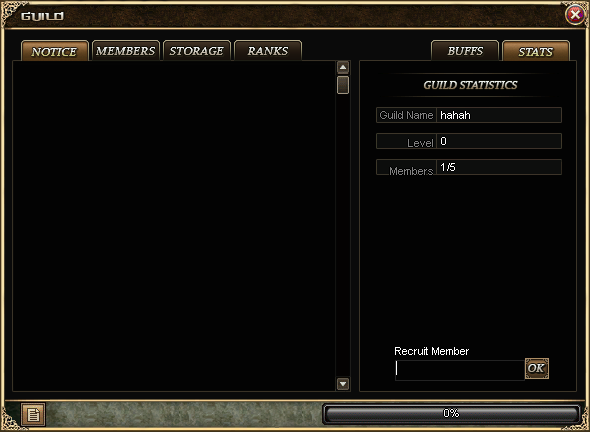

# Windows Guild 公告／统计页像素修正 — 2026-10-28

本轮修正玩家截图中的英文行会公告／统计页。验证条件为 Windows、Arial、96 DPI、1024×768 舞台；不是整个行会系统或所有语言／DPI的像素验收。

## 原版依据及变更

- 对照 `Crystal/Client/MirScenes/Dialogs/GuildDialog.cs`、`MirControls/MirLabel.cs`、`MirTextBox.cs`。完整原始坐标和素材源 SHA 见 [审计](reference-audit.md) 和 [机器可读记录](reference-audit.json)。
- 统计标题为一个75×300的右对齐标签，含原版空行；名称／等级／人数保留120×200控件及原版8pt字体。移除原先9px、左对齐、14px高行的替代布局。
- 英文保留原版图片标题和页签。招人OK按钮按24×24原PNG绘制、24×21命中，不再拉伸至40×25。
- 使用独立纯std `mir2-crystal-gdi-text` crate隔离 Windows GDI；`client-bevy` 的 `forbid(unsafe_code)` 保留。字体边距、四向黑轮廓及垂直对齐按原版WinForms绘制。依据另见 [WinForms官方实现](https://source.dot.net/System.Windows.Forms/System/Windows/Forms/Rendering/TextExtensions.cs.html)。
- Guild纹理缓存最多15MiB／256项，CPU栅格缓存2MiB／128项；非英文仍使用既有Bevy字体路径，不把GDI字体替代视为匹配。
- 找到漏导出的真实 `Prguse2/424`：原始Lib SHA与已有manifest吻合，帧为260×22、有976B压缩数据，**不是空帧**。见 [原库审计](source-frame-424-audit.json)。已通过既有解析／导出工具补图、同步manifest／严格索引／打包必需清单；401张既有PNG未变，新增PNG与原库RGBA一致。见 [导出证据](assets/source-export-proof.json)、[最终资源验证](assets/validator-final.json)。

## 本轮实际验证

| 检查 | 最终结果 | 记录 |
| --- | --- | --- |
| 最终Windows客户端构建 | exit0；131,709,952B | [构建](build/build-exit.json) |
| Guild定向回归 | 86通过、0失败；2项默认ignored | [回归](checks/guild-exit.json) |
| 共享widget相邻回归 | 20通过、0失败 | [widget](checks/widget-exit.json) |
| Guild原版素材 | 42项、0差异 | [资源](assets/validator-final.json) |
| 显式执行主窗口GPU测试 | 1通过、0失败；先前ignored的主窗口测试本次实际执行 | [退出记录](gpu/run-exit.json) |
| 独立C# GDI参考与当前纹理 | 六个标签，RGBA差异均为0 | [12项比较报告](gpu/guild-main-window-pixel-report.json) |
| 实际GPU与原版素材／GDI组合参考 | 标题、公告页签、统计页签、统计栏、招人文字、0%经验条六区域，像素差异均为0 | [完整GPU输出](gpu/guild-main-window-english-1024x768.png) |

独立参考使用原版 `MirLabel` 绘制设置和真正的.NET Framework `TextRenderer`，并组合原始PNG；[C#生成器](render-crystal-guild-reference-v2.cs)、[字形边界](reference/glyphbounds.json)、[参考验证](reference/reference-validation.json) 均保留。它没有运行完整Crystal D3D9客户端；不能把该参考称为原客户端实玩截图。回归86项在最终构建轮次通过，默认ignored的GPU主窗口项随后单独执行，不重复累加。

最终本地EXE SHA256：`d355d71967340320f50d70ba729eb0e7db624629425558a51c5dea39b1d5f0e7`。源码、原始验证输出及文件SHA见 [manifest](manifest.json)。

## 交付与边界

最终程序在独立本机验收目录启动，继续使用既有 `GuildQA22`／`hahah`，不重新创建行会或返还材料。素材overlay复用安装包的只读目录，仅在独立目录补入424；D盘安装包和远程服未修改。

成员／仓库／职位／Buff页面、输入框编辑／选区／IME／caret、其他语言、125%／150%显示缩放，以及完整原客户端配对实玩截图和最终真人Accepted仍未覆盖。本次不能标记整个Guild系统或全游戏像素一致；输入框10pt与标签8pt也仍应分别验收。
