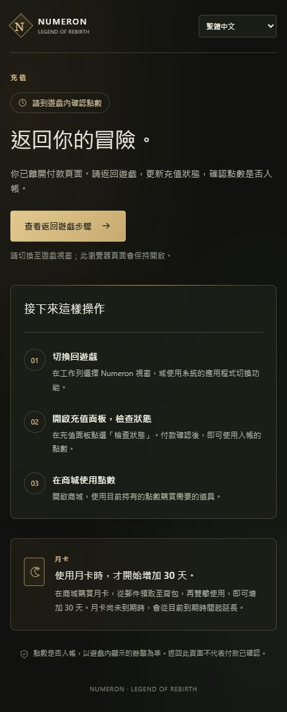

# Public Stripe sandbox acceptance

See [the configuration and player-flow record](../../../STRIPE-TEST-ACTIVATION-20261011.md).

`GATEWAY-APPLIED.json` records the drained normal stop, fresh private backup,
six-variable configuration apply and restart of the unchanged4006d988 binary.
`provider-provision-01.json` records actual test endpoint creation and readback.
`PROVIDER-PAID-READBACK.json` records the exact paid test Checkout/PaymentIntent,
two official-provider event resends and rejected signature/live-mode bodies.
`ORDINARY-WS-REDACTED.json` retains both failing and passing ordinary player
phases; the last corrected monthly phase and post-resend relogin qualify
purchase, actual parcel, one exact-UID claim/use,30days and no extra Credits.
`POSTFLIGHT.json` independently reads service state and checks nine public
URLs, including unchanged feed19/CMS on both download hosts.

`RETAINED-FAILURES.json` explains excluded attempts. The BUY retry assumption
was a test error: ordinary BUY assigns fresh server nonces, unlike same-socket
Gift binding. The corrected helper resumes a confirmed existing parcel and
does not resend an unknown BUY. Missing application keepalive, initial event
representation and response-envelope assumptions were also corrected in tests;
no game source change is claimed. The exact executed player/provider helper
sources are archived here for inspection, not portable deployment commands.
They reference operator-private input files which are intentionally absent.

Private keys, passwords, full Checkout URLs, identity grants, full provider
responses and account backups are excluded. Account/order/item identifiers in
the player evidence are hashed. Only the owned QA actor's actual state changes;
no user character is topped up or erased. Normal logouts finish all successful
phases. Native visual acceptance, actual refunds, live money and broader parity
remain outside this record.

The screenshot is the actual browser after the test payment's return, not a
replacement illustration. It explicitly asks the player to check the game
balance rather than treating the return query as payment confirmation.

